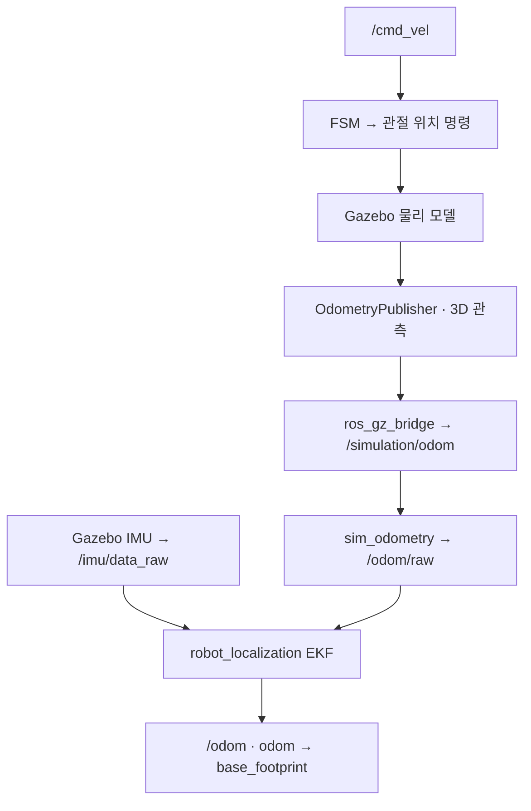

# Ch11 센서·오도메트리·TF 수정 보고서

- 작성일: 2026-10-16 (Asia/Seoul)
- 대상 저장소: https://github.com/silverbjin/Pysical_AI_ROS2
- 기준 커밋: `92fa2fea6b61ac04362690341559af21f694a7fc`
- 반영 브랜치: `fix/ch11-localization-observation`
- 범위: Ch11. 다른 장은 변경하지 않는다.
- 판정: **코드 수정 및 로컬 회귀 검사 완료 / ROS 빌드·실제 WSL2·Gazebo 실행 검증 미완료**
- 실제 실행 검증 상태: **BLOCKED**. 이 보고서는 “WSL2·Gazebo에서 문제가 없음”을 인증하지 않는다.

## 1. 요청과 처리 결과

| 요청 | 처리 결과 | 확인 범위 |
|---|---|---|
| IMU 토픽 불일치 해결 | EKF 입력을 브리지의 /imu/data_raw로 통일 | 설정 연결 회귀 검사 |
| TF 중복 발행 해결 | FSM의 오도메트리·TF 발행 제거, EKF 단독 발행 | 소스·설정 회귀 검사 |
| 명령 적분 오도메트리 한계 해결 | 활성 경로를 Gazebo 모델 관측 기반으로 교체 | 관측값 보존·비정상 데이터·시각 처리 검사 |
| 변경 보고서 작성 | 본 문서 및 실행 안내 작성 | 문서 확인 |
| 리포지토리 커밋 | 위 수정 브랜치로 반영 | 원격 커밋·파일 확인 대상 |
| WSL2·Gazebo에서 실제 실행 | 미수행 | 현재 환경에 접근 수단·ROS·Gazebo 없음 |

사용자 PC의 WSL2 터미널에 연결된 실행 도구가 제공되지 않았다. 현재 실행 환경은 일반 Linux 컨테이너다. 따라서 실제 WSL2 성공 로그나 Gazebo 화면을 만들어내지 않았으며, 스크립트의 사전 검사 차단 결과를 증거로 남겼다.

## 2. 수정 설계와 선택 이유

현재 책의 실행 대상이 Gazebo 시뮬레이션이므로, ROS 명령을 적분하던 경로를 Gazebo의 물리 모델 움직임을 관측하는 경로로 교체했다.



### 적용 범위에 대한 중요한 구분

이 변경으로 **명령을 받았다는 사실만으로 위치가 변하던 활성 오도메트리 경로**를 제거했다. 로봇이 미끄러지거나 외력으로 움직이면 Gazebo 모델의 위치 변화가 입력에 반영되는 구조다.

다만 Gazebo의 모델 위치는 시뮬레이터가 제공하는 참값에 가까운 관측이다. **실제 로봇의 관절·접촉 기반 leg odometry를 구현한 것은 아니다.** 실제 하드웨어 적용에는 접촉 상태, 관절 기구학, IMU 및 필요 시 시각·LiDAR 관측을 사용하는 추정기가 별도로 필요하다.

또한 참값 기반 입력을 EKF에 사용하는 시연은 센서 융합 연결 학습에는 유용하지만, 현실 센서만으로 얻을 수 있는 위치 추정 성능의 증거가 될 수 없다. /odom/raw와 EKF 결과 비교 역시 독립적인 정확도 검증이 아니다.

## 3. 파일별 변경 사항

| 파일 (my_quadruped_bot 기준) | 수정 내용 |
|---|---|
| config/ekf.yaml | imu0=/imu/data_raw, use_sim_time=true, pose와 동일 자료에서 계산한 속도의 중복 융합 제거 |
| config/ros_gz_bridge.yaml | Gazebo Odometry → /simulation/odom 추가. Gazebo TF는 ROS로 브리지하지 않음 |
| urdf/common/gazebo_control.xacro | 30 Hz·3D OdometryPublisher 추가, IMU gz_frame_id=base_link 명시 |
| my_quadruped_bot/trot_controllerFSM.py | 명령 적분 오도메트리, /odom 발행, TransformBroadcaster 제거 |
| my_quadruped_bot/odometry_observation.py | 프레임·유한값·쿼터니언·시각 검증, 관측 복사, 공분산 부여, 중복·역행 시각 처리 |
| my_quadruped_bot/sim_odometry.py | /simulation/odom 구독 → /odom/raw 발행. 명령 구독·적분·주기적 가짜 데이터 발행 없음 |
| my_quadruped_bot/leg_odometry.py | 오해를 유발하는 활성 실행 경로에서 제거 |
| my_quadruped_bot/command_odometry_demo.py | 기존 명령 적분을 /demo/cmd_vel → /demo/odom의 교육 예제로 보존 |
| launch/localization.launch.py | leg_odometry 대신 sim_odometry 사용, EKF 시간·출력 경로 통일 |
| launch/simulation.launch.py | robot_state_publisher에 use_sim_time=true 설정 |
| launch/ch11_bringup.launch.py | 시뮬레이션·위치 추정·FSM·IMU 관찰·LiDAR 경고 통합 실행 |
| setup.py | sim_odometry와 command_odometry_demo 실행 항목 등록 |
| package.xml | ROS 실행 의존성과 NumPy·YAML 테스트 의존성 보완 |

Ch11 아래 추가 산출물:

- `tests/test_localization_contract.py`: ROS 없이 실행 가능한 15개 회귀 검사
- `scripts/verify_wsl2_gazebo.sh`: WSL2 사전 검사·빌드·기존 테스트·Gazebo 구동·결과 수집
- `scripts/verify_runtime.py`: 실제 ROS 그래프·메시지·TF·짧은 이동 관찰
- `.gitignore`: Python·colcon 생성물과 새 WSL2 실행 증거의 우발적 커밋 방지
- `evidence/`: 수행한 검사 결과와 차단 증거
- `docs/CH11_RUN_AFTER_FIX_KO.md`: 수정 후 실행 방법

## 4. 데이터 계약

### IMU

- 브리지 출력 및 EKF 입력: /imu/data_raw, sensor_msgs/msg/Imu
- 물리 장착 프레임: base_link
- /imu/rpy_filtered는 학습용 Float32MultiArray 관찰 출력으로 유지한다.
- EKF가 이 RPY 배열을 입력받는다고 설명하지 않는다.
- imu0_relative=false로 모델 관측과 같은 세계 방향 기준을 유지한다.
- 실제 sensor_msgs/Imu의 frame_id·자세 유효성은 런타임 스크립트가 확인하도록 했다.

### 오도메트리

- Gazebo 관측: /simulation/odom
- 검증된 입력: /odom/raw
- 부모·자식 프레임: odom → base_footprint
- odom은 Gazebo 세계 좌표에 정렬된 관측 프레임이다. 시작 위치를 항상 (0,0,0)으로 재설정하지 않는다.
- 변환 어댑터는 센서 메시지의 stamp·pose·twist를 보존한다.
- pose 공분산 대각: [0.0025, 0.0025, 0.0025, 0.01, 0.01, 0.01]
- twist 공분산 대각: 모두 0.01. 현 EKF는 이 속도 성분을 융합하지 않는다.
- 공분산은 교육용 가정이며 실측·교정된 센서 오차가 아니다.
- 센서 입력이 끊기면 어댑터는 새 관측을 만들어내지 않는다. EKF 자체의 예측 출력은 계속될 수 있으므로 런타임에서 원시 관측의 신선도도 검사한다.
- 중복 stamp는 발행하지 않고, 시간 역행은 전체 bringup 재시작이 필요한 오류로 처리한다.

### TF

- EKF: odom → base_footprint
- robot_state_publisher: base_footprint → base_link 및 관절·센서 링크
- Gazebo OdometryPublisher의 Pose_V는 전용 Gazebo 토픽에만 남기며 ROS /tf로 변환하지 않는다.
- FSM은 ROS /tf와 /odom을 발행하지 않는다.
- 현재 URDF의 base_footprint와 base_link는 영변환 고정 링크다. 별도의 지면 투영 프레임을 만든 변경은 아니다.

## 5. 실제 수행한 검증

| 검증 | 결과 | 증거 |
|---|---|---|
| 수정 전 회귀 검사 | 13 FAIL, exit 1 | evidence/localization_red.log |
| 시각 스트림 추가 검사 RED | 기존 13 PASS + 신규 2 FAIL, exit 1 | evidence/stream_red.log |
| 최종 회귀 검사 | 15 PASS, exit 0 | evidence/localization_green.log |
| Python 문법 | 27개 파일 파싱 PASS (보고서 작성 시점) | evidence/verification_summary.json |
| XML/Xacro/SDF 문법 | 9개 파일 파싱 PASS | 동일 |
| YAML 문법 | 2개 파일 파싱 PASS | 동일 |
| Bash 문법 | bash -n PASS | 동일 |
| git diff --check | PASS | 커밋 전 확인 |
| 기존 pytest 기반 suite | 실행 시도 실패: pytest 미설치 | evidence/existing_suite.log |
| ROS colcon build | NOT_RUN: ROS 2·colcon 없음 | 환경 확인 및 본 문서 |
| 실제 WSL2·Gazebo 실행 | BLOCKED, exit 2 | evidence/current-host/result.json |

XML 파싱은 Xacro 확장·Gazebo 플러그인 로딩 검사가 아니다. 회귀 테스트의 관측 메시지 대용 객체는 ROS 없이 데이터 처리 로직을 검사하기 위한 것이며, ROS 브리지의 동작 증거가 아니다.

기존 suite가 통과했다고 선언하지 않는다. WSL2 실행 스크립트는 기존 colcon 테스트 결과까지 수집하고 하나라도 실패하면 종합 PASS를 내지 않는다. 기존 코드의 lint·문서화 문제 등이 발견되면 해당 실패도 보고해야 한다.

## 6. WSL2에서 남은 실행 검증

먼저 [수정 후 실행 안내](CH11_RUN_AFTER_FIX_KO.md)를 따른다. 핵심 실행 명령은 저장소 루트에서 다음과 같다.

```bash
bash Ch11/scripts/verify_wsl2_gazebo.sh
```

스크립트는 별도 DDS 도메인(기본 71)과 Gazebo Transport partition을 사용하며, 직접 시작한 프로세스 그룹만 종료한다. 준비된 환경에서 다음을 검사한다.

- WSL2·Jazzy·필수 명령·Python 의존성
- Ch11 빌드, 회귀 테스트, 기존 패키지 테스트
- 실제 /clock·IMU·LaserScan·모델 관측·EKF 출력 수신
- stamp 순서와 시뮬레이션 시간 정합성
- IMU·LiDAR frame_id, IMU 자세 유효성
- /odom과 /odom/raw의 단일 발행자
- odom→base_footprint의 단일 TF 발행자 GID와 연결
- 입력 관측과 /odom/raw의 동일 stamp·위치
- 기립 방향 확인 후 0.03 m/s로 3 시뮬레이션 초 이동
- 관측된 실제 이동량 5 mm 초과와 영속도 이후 낮은 평면 속도

이 수치는 짧은 스모크 테스트의 판정값이다. 정밀 추종·절대 위치 정확도·보행 성능의 일반적인 합격 기준이 아니다.

`Ch11/evidence/wsl2-시각/result.json`의 status와 세부 checks를 확인한다. FAIL/BLOCKED이면 같은 폴더의 build.log, bringup.log, probe.log, colcon-test-result.log를 조사한다. GPU LiDAR·WSLg·초기 기립 문제는 실제 실행에서 드러날 수 있다.

## 7. 남은 위험과 명시적 미완료 사항

1. **실제 WSL2·Gazebo 실행 미검증:** GUI·GPU 센서·플러그인 변환·TF·기립 안정성은 아직 확인하지 못했다.
2. **실물 로봇 위치 추정기 미구현:** 시뮬레이터 관측 의존성을 실물에서도 해결했다고 해석하면 안 된다.
3. **FSM 명령 타임아웃:** 기존 FSM에는 여전히 /cmd_vel 단절 시 자동 정지 정책이 없다. 검증기는 종료 시 영속도를 반복 발행하지만 일반 제어기의 watchdog을 대체하지 않는다.
4. **LiDAR 경고는 자동 제동 아님:** 기존 lidar_safety는 경고만 출력한다.
5. **2D 내비게이션 프레임 설계:** base_footprint 지면 투영과 동체 흔들림에 따른 스캔 왜곡은 별도 리뷰가 필요하다.
6. **SLAM·Nav2 미구현:** 이 변경은 그 선행 센서·위치 추정 연결을 정리한 범위다.
7. **기존 테스트 미확인:** pytest·ROS 테스트 도구가 없어 기존 suite 통과를 확인하지 못했다.

따라서 이 커밋은 검토·WSL2 실행 검증용 수정본이다. 실제 실행 결과를 확보하기 전 전체 요청을 완전히 완료했다거나 자율주행에 문제가 없다고 결론 내리지 않는다.

## 8. 공식 근거

- Gazebo Harmonic의 OdometryPublisher 3D·topic·frame 설정:
  https://gazebosim.org/api/sim/8/classgz_1_1sim_1_1systems_1_1OdometryPublisher.html
- Gazebo 8 구현의 물리 모델 worldPose 관측:
  https://github.com/gazebosim/gz-sim/blob/gz-sim8/src/systems/odometry_publisher/OdometryPublisher.cc
- robot_localization 센서 구성 및 상관된 관측 주의:
  https://github.com/cra-ros-pkg/robot_localization/blob/rolling-devel/doc/configuring_robot_localization.rst

문서 참조는 설계 근거이며 이 저장소의 실제 실행 성공 증거를 대신하지 않는다.
