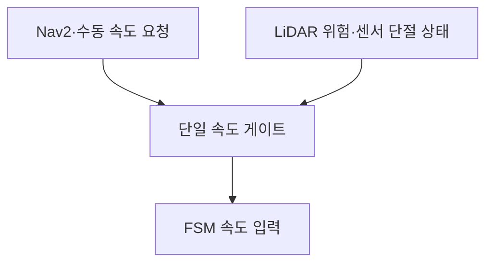

# 11.3.4 LiDAR 전방 장애물 감지 실습

- 기준: main `fcab2e68efa8f63a5025ecdd5bdee4d5296b75ca`
- 수정 브랜치: `feat/ch11-lidar-safety`
- 패키지: `Ch11/ros2_ws/src/my_quadruped_bot`
- 환경: Ubuntu 24.04, ROS 2 Jazzy, Gazebo Harmonic, WSL2
- 기본 입력: `/scan`, sensor_msgs/msg/LaserScan
- 기본 판단: 전방 ±30°(전체 60°), 거리 0.5 m 미만
- 출력: 경고 로그와 `/lidar_safety/status`의 JSON 문자열

> **이 단계는 장애물 감지·위험 경고 실습이다. 실제 비상 정지/AEB는 구현하지 않는다.**
> 원고 코드처럼 /cmd_vel을 발행하지 않으며, 이 경고만으로 움직이는 로봇이 멈추지 않는다.

## 1. 패키지 적용 내용

| 파일 | 역할 |
|---|---|
| my_quadruped_bot/lidar_safety.py | 기존 실행 이름을 유지하는 ROS 2 노드 |
| my_quadruped_bot/sensors/lidar_processing.py | 각도·ROI·유효 거리·신선도 판단 |
| launch/lidar_safety.launch.py | 토픽·임계값·시간을 지정하는 실행 구성 |
| Ch11/scripts/lidar_scan_demo.py | /lab/scan에 합성 입력을 발행하는 독립 실습 |
| Ch11/tests/test_lidar_processing.py | ROS 없이 실행 가능한 12개 회귀 검사 |

새 패키지를 만들 필요는 없다. 기존 setup.py의 lidar_safety 실행 항목, launch glob, find_packages와 std_msgs 의존성을 사용한다.

기존 경고 거리 1.5 m를 원고의 **0.5 m**로 변경했다. 기존 ch11_bringup.launch.py도 새 노드를 사용하므로 기본 임계값 변경을 함께 유의한다.

## 2. 데이터 처리 원리와 원고 보완점

각 거리 샘플의 방향은 다음과 같다.

```python
angle = angle_min + index * angle_increment
```

예제의 고정 슬라이스 대신 각도를 계산하여 전방 ±scope_deg에 해당하는 샘플을 선택한다. 각도를 [-π, π]로 정규화하므로 0~2π 스캔이나 역방향 배열도 처리한다.

- NaN·±Inf, 0 이하, range_min 미만, range_max 초과는 유효 반사점에서 제외한다.
- 최소 거리는 유효 반사점에서만 계산한다.
- 경고 조건은 `min_distance < safe_distance`다. 정확히 0.5 m이면 이 조건으로 경고하지 않는다.
- 유효 반사점이 하나라도 0.5 m 미만이면 다른 값의 결손 여부와 관계없이 OBSTACLE이다.
- 가까운 유효 반사점이 없더라도 ROI에 결손이 있거나 시야각이 부족하면 UNKNOWN이다.
- 모두 Inf인 스캔은 열린 공간일 수도 있지만 이 메시지만으로 결손과 확실히 구분하지 못하므로 UNKNOWN으로 둔다. Inf를 10 m로 바꾸어 안전 판정을 만들지 않는다.

**CLEAR는 해당 메시지의 전방 유효 측정값이 임계값 밖이라는 뜻이다.** 센서 사각지대, 몸체 폭, 뒤·측면 장애물, 제동거리, 보행 흔들림까지 보장하는 말이 아니다.

기본 기대 프레임은 lidar_link다. 현재 URDF에서 이 프레임의 +X가 로봇 정면과 정렬되어 있다. 다른 방향으로 장착한 LiDAR는 프레임 이름만 바꾸지 말고 실제 장착 변환과 감시 방향을 함께 수정해야 한다.

## 3. 상태 출력

`/lidar_safety/status`는 std_msgs/msg/String이며 data 안에 JSON을 담는다.

| state | 의미 |
|---|---|
| OBSTACLE | 전방 유효 반사점 중 경고 거리보다 가까운 값이 있음 |
| CLEAR | ROI의 측정 coverage와 모든 거리값이 유효하며 임계값 밖 |
| UNKNOWN | 전방 데이터 결손·빈 배열·부분 FOV·프레임/메타데이터 오류 등 |
| STALE | 최신 스캔이 없거나 획득 시각이 현재 시각과 맞지 않음 |

JSON에는 reason, min_distance, sector_count, valid_count, invalid_count, coverage_complete, safe_distance, scope_deg, scan_stamp가 포함된다. min_distance의 단위는 m이며 판단할 수 없으면 null이다.

수신 직후에는 센서 획득 시각(header.stamp) 지연을 검사하고, 별도의 steady-clock 타이머로 입력 단절도 감시한다. 기본 timeout은 0.5초다. Gazebo pause로 입력이 멈추어도 벽시계 기준으로 STALE이 된다. 이는 실습용 감시 정책이며 시뮬레이션 pause 자체를 하드웨어 고장으로 확정하는 뜻은 아니다.

## 4. 코드 받기·빌드

가상환경·Conda를 해제하고 새 WSL 터미널에서 실행한다.

```bash
cd ~/Pysical_AI_ROS2_publish
git status --short
git fetch origin
git switch --track origin/feat/ch11-lidar-safety
source /opt/ros/jazzy/setup.bash
cd Ch11/ros2_ws
rosdep install --from-paths src --ignore-src -r -y --rosdistro jazzy
colcon build --symlink-install --packages-up-to my_quadruped_bot
source install/setup.bash
ros2 pkg executables my_quadruped_bot
```

저장소 경로는 실제 위치에 맞춘다. 로컬 브랜치가 이미 있으면 `git switch feat/ch11-lidar-safety`를 사용한다. lidar_safety 실행 항목을 확인한다. 원고 경로의 공백이나 `# quadruped_system` 주석은 파일 경로의 일부가 아니다.

이후 각 터미널에서 ROS와 위 install/setup.bash를 source한다.

## 5. Gazebo에서 실습

### 터미널 1: 벽·상자가 있는 기존 월드

```bash
ros2 launch my_quadruped_bot SLAM_simulation.launch.py
```

이 구성은 기립 제어·Gazebo·RViz를 실행한다. 벽·상자가 있어 유효한 거리 반환을 관찰하기 쉽다. 원래 simulation.launch.py의 빈 월드에서는 모든 값이 Inf인 경우가 생길 수 있다.

### 터미널 2: 장애물 감지

```bash
ros2 launch my_quadruped_bot lidar_safety.launch.py
```

동일한 노드를 직접 실행하려면 위 명령 대신 다음을 사용한다.

```bash
ros2 run my_quadruped_bot lidar_safety --ros-args \
  -p use_sim_time:=true -p safe_distance:=0.5 -p scope_deg:=30.0
```

**ch11_bringup.launch.py는 lidar_safety를 이미 실행한다.** 그 구성을 사용 중이면 별도 노드를 중복 실행하지 않는다.

### 터미널 3: 데이터와 상태 확인

```bash
ros2 interface show sensor_msgs/msg/LaserScan
ros2 topic echo /scan --once --qos-reliability best_effort
ros2 topic echo /lidar_safety/status
```

RViz의 붉은 반사점과 전방 최소 거리를 비교한다. 장애물 반사면이 lidar_link의 +X 방향 약 0.3~0.4 m에 오도록 물체를 배치하면 경고 조건을 관찰할 수 있다. LiDAR 광선 높이와 물체의 collision 형상이 겹쳐야 한다.

**움직이는 로봇을 장애물에 접근시키는 실험은 기본 절차에 포함하지 않는다.** 이 노드는 제동하지 않으므로 정지한 로봇과 배치한 장애물로 먼저 확인한다. 가까운 물체를 배치할 때 로봇 몸체·다리와의 물리 충돌도 피한다.

기존 Figure 월드의 상자는 기본 0.5 m 임계값보다 멀다. 바로 경고가 뜨지 않아도 정상일 수 있다. 물체를 옮기지 않고 판단 분기만 관찰하려면 예를 들어 다음처럼 경고 거리를 넓혀 비교할 수 있다.

```bash
# 기존 lidar_safety를 종료한 뒤 실행. 이 값은 교육용 비교 설정이다.
ros2 launch my_quadruped_bot lidar_safety.launch.py safe_distance:=2.0
```

각 파라미터는 시작 시 읽는 read-only 값이다. 변경 비교는 노드를 재실행하여 수행한다.

## 6. Gazebo 없는 합성 스캔 실습

실제 센서 경로와 분리된 /lab/scan, /lab/lidar_status를 사용한다. 이 데이터는 실제 센서 측정이나 Gazebo 실행 성공의 증거가 아니다.

### 터미널 A: 격리 감지 노드

```bash
ros2 launch my_quadruped_bot lidar_safety.launch.py \
  use_sim_time:=false input_topic:=/lab/scan output_topic:=/lab/lidar_status
```

### 터미널 B: 상태 확인

```bash
ros2 topic echo /lab/lidar_status
```

### 터미널 C: 합성 입력 발행

저장소 루트에서 다음 중 하나를 실행한다. 현재 시각 stamp와 lidar_link 프레임을 붙여 10 Hz로 발행한다.

```bash
cd ~/Pysical_AI_ROS2_publish
python3 Ch11/scripts/lidar_scan_demo.py --case obstacle
```

Ctrl+C로 입력을 멈추면 약 0.5초 이후 STALE을 관찰할 수 있다. 다음 case를 바꾸어 재실행한다.

| --case | 입력 | 기대 상태 |
|---|---|---|
| obstacle | 정면 0.3 m, 나머지 2 m | OBSTACLE |
| clear | 모든 방향 2 m | CLEAR |
| rear | 후방만 0.2 m | CLEAR (전방 감시임을 확인) |
| invalid | 모두 Inf | UNKNOWN |
| out_of_range | 정면 20 m, range_max=10 m | UNKNOWN |
| partial | 정면 ±5°만 측정 | UNKNOWN |

이 합성 스캔은 테스트 편의를 위해 361개 샘플을 사용한다. 실제 Gazebo 센서는 설정상 360개다. 노드는 샘플 수나 1° 간격을 하드코딩하지 않고 메시지의 각도 정보를 사용한다.

## 7. 원고 11.3.2의 Gazebo 설명 수정

현재 패키지에는 LiDAR 센서·브리지·Ogre2 월드 플러그인이 이미 있으므로 제시된 구형 plugin을 중복 삽입하지 않는다.

Harmonic의 Sensors 시스템은 **월드 수준**에 다음처럼 배치한다.

```xml
<plugin filename="gz-sim-sensors-system" name="gz::sim::systems::Sensors">
  <render_engine>ogre2</render_engine>
</plugin>
```

LiDAR는 robot Xacro에서 gpu_lidar 센서를 정의하고 Gazebo 토픽을 `/model/my_quadruped/scan`으로 지정한다. 기존 ros_gz_bridge.yaml이 이를 ROS /scan으로 변환하며 ROS frame_id를 lidar_link로 지정한다. 이번 작업은 이미 정리된 센서·브리지 설정을 변경하지 않는다.

추가로 다음 표현을 보완한다.

- `libignition-gazebo-sensors-system.so`, `ignition::gazebo::systems::Sensors`를 새 Harmonic 설정에 그대로 복사하지 않는다.
- 센서 정의만으로 원통 모델이 회전하는 것은 아니다. 현재 lidar_link는 고정 조인트다.
- visualize=true가 모든 GUI에서 파란 광선 표시를 보장하지 않는다. 센서 시각화 플러그인·렌더링 환경을 확인하고 ROS /scan 수신을 별도로 검사한다.
- 360개 샘플과 양 끝 각도만 보고 정확히 1° 간격이라고 가정하지 않는다. 수신한 angle_increment를 사용한다.

## 8. 실제 비상 정지로 확장하려면

/scan을 보고 /cmd_vel에 0을 한 번 발행하는 것만으로 AEB가 완성되지는 않는다. Nav2·수동 조작기가 계속 속도 명령을 발행하면 제어기가 다른 명령을 다시 받을 수 있다.

후속 구현에서는 다음처럼 최종 속도 명령을 내보내는 경로를 하나로 관리해야 한다.



제동거리·보행 정지 지연·로봇 footprint·측후방 감시·명령 watchdog도 별도 검증 대상이다. 본 절의 제목은 실제 구현 범위를 반영해 “장애물 감지 및 위험 경고 노드 구현”으로 쓰고, 자동 긴급 제동을 심화 과제로 분리하는 것이 정확하다.

## 9. 검증·문제 확인

```bash
ros2 node info /lidar_safety
ros2 topic info /scan -v
ros2 topic info /lidar_safety/status -v
ros2 param get /lidar_safety safe_distance
ros2 param get /lidar_safety use_sim_time
```

UNKNOWN이면 reason과 invalid_count를 먼저 확인한다. STALE이면 /clock, scan stamp, 토픽 수신, Gazebo 재생 상태를 조사한다. 프레임을 임의로 덮어쓰는 대신 실제 센서 축 정렬을 확인한다.

회귀 검사:

```bash
cd ~/Pysical_AI_ROS2_publish
python3 -m unittest discover -s Ch11/tests -p test_lidar_processing.py -v
python3 -m unittest discover -s Ch11/tests -v
```

이번 환경에서의 결과:

- 신규 검사: 수정 전 12 FAIL → 수정 후 12 PASS
- 전체 검사: 50개 실행, 44 PASS, ROS/Gazebo 의존 6 SKIP
- 새 Python·launch·문서 Bash 문법 검사
- **새 노드의 ROS 빌드·실제 WSL2/Gazebo 실행은 미수행** (현재 실행 환경에 ROS/Gazebo 없음)

공식 LaserScan 메시지의 거리 범위 규약:
https://github.com/ros2/common_interfaces/blob/jazzy/sensor_msgs/msg/LaserScan.msg
