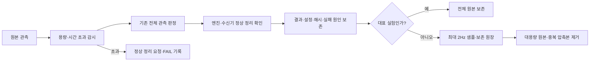

# Ch13 Evidence 보존 정책

2026-11-11 보완: 사용자의 추가 공간 정리 지시에 따라 기존 WSL 13.5 사례의 큰 원본을 SHA256과 ZIP CRC를 검증한 무손실 `retained_raw_20261111.zip` 또는 `retained_raw_20261111_extra.zip`에 보존했다. 같은 이름의 `.json`은 실제 삭제한 경로와 해시를 기록한다. 원래 경로의 파일을 직접 읽는 기존 분석기와 자동 보존 도구는 ZIP 안의 자료를 자동으로 읽지 않으므로 전체 원본을 사용할 때는 `restore_13_5_compacted_evidence.py`로 별도 빈 폴더에 복원한다. extra 압축본은 `--extra`를 지정하고, 두 압축본을 모두 사용하려면 각각 다른 빈 폴더에 복원한다. 결과·종료·오류 문서는 그대로 둔다. 이 수동 정리는 미확인 종료를 정상 종료로 바꾸지 않으며, 보존 도구가 이후의 신규 사례를 자동으로 압축한다는 뜻도 아니다.

적용일: 2026-10-28. 사용자 요청에 따라 과거의 전체 원본 영구 보존 원칙을 이 정책으로 대체한다. 시험의 성공 기준·안전 기준은 바꾸지 않는다.

2026-10-29 보완: 앞으로 생성하는 `frames.json`, `all_frames.json`, `native_controls.json`은 들여쓰기 없는 JSON으로 저장한다. 프레임·필드·값·순서·원래 시각은 모두 유지하며, NaN/Inf는 기존처럼 거부한다. 직렬화가 성공하기 전에 기존 파일을 열지 않아 잘못된 관측이 이전 결과를 덮어쓰지 않는다. 작은 결과·종료·출처 문서는 기존 가독성 형식을 유지한다. 과거 원본이나 그 해시는 다시 쓰지 않으며, 원본 CDR·판정기·기록 상한도 변경하지 않는다.

## 기록과 판정을 분리한다

- 판정기는 필요한 모든 관측을 검사한다. 샘플만으로 접촉 손실·속도 초과·종료 실패가 없었다고 판정하지 않는다.
- 일반 실험의 장기 보존본은 결과, 모든 검사별 메트릭, 설정, 소스/설치 해시, 실행 명령, 실패 원인, 종료 기록과 **최대 2Hz의 관측 샘플**이다. 샘플은 원래 촬영·수신 시각을 그대로 유지한다.
- 전체 재생이 필요한 현재 인수 검사에서는 완전 관측을 임시 작업 파일로 사용한다. 판정이 끝난 뒤 대표 실험만 전체 원본을 보존한다. 이 예외를 전체 프레임의 영구 보존으로 확대하지 않는다.
- 실험마다 원시 관측 2GiB, 작업 증거 8GiB, 실제 실행 3,600초를 상한으로 둔다. 기존 완료 실험의 작업 증거 최대 약7.4GB를 고려한 상한이다. CDR에서 파생한 JSON은 원시 관측에 이중 합산하지 않고 작업 증거에 합산한다. 초과하면 정상 정리 절차를 요청하고 해당 시험은 `FAIL/storage_budget`로 남긴다. 드롭·롤오버·시간 연장으로 통과시키지 않는다. 기존 단계별 제한이 더 짧으면 기존 제한을 적용한다.

## 무엇을 남기는가

| 자료 | 보존 |
|---|---|
| 결과·검사 메트릭·설정·명령·해시·오류·종료 기록 | 기한 없이 보존 |
| 일반 실험 샘플 | 종류별 2Hz, 파일별 2MiB 이내; 판정 원본의 대체물이 아님 |
| 대표 전체 원본 | 절·엔진·검사 종류·성공/실패별 최신 대표 1개, 교체 전까지 보존 |
| 현재 원인 분석에 필요한 원본 | 명시적 pin으로 보존, 이유와 대상 기록 |
| 완료된 비대표 실험의 대용량 관측·중복 압축본 | 요약과 샘플 검증 후 제거 |
| 아직 실행 중이거나 정리 확인이 안 된 실험 | 자동 삭제 금지 |

자동 정리는 실험 종료 후 및 다음 실험 시작 전에 수행한다. 7일이 지난 비대표 대용량 자료도 같은 검증 절차로 정리한다. 대표 원본과 pin에는 기간 만료를 적용하지 않는다. 요약 보존에는 개수 제한을 두지 않아 실패 횟수를 숨기지 않는다.

시작·종료 시점의 자동 정리이므로 컴퓨터가 꺼진 동안 별도 서비스가 실행되는 방식은 아니다. 수동 점검은 다음처럼 먼저 미리보기로 실행한다. `--apply`를 붙이면 실제 정리하고, `--pin 실험폴더명`으로 아직 남아 있는 원본을 보호한다.

pin은 해당 Evidence 루트의 `retention_pins.json`에 기록해 다음 자동 정리에도 유지한다. 원인 비교가 끝나면 해당 항목을 해제한다. 이미 원본이 제거된 요약을 다시 전체 원본으로 승격하지 않는다.

```bash
python Ch13/scripts/maintain_evidence_13_5.py --root /path/to/owned/evidence
python Ch13/scripts/maintain_evidence_13_5.py --root /path/to/owned/evidence --apply
```



새 13.5 native 실행기에서 시작·종료 자동 정리와 실행 중 약1초 간격의 용량 감시를 적용한다. 이는 디스크 할당량을 강제하는 운영체제 기능은 아니므로 한 번의 감시 간격과 이미 대기 중인 쓰기만큼 상한을 일시 초과할 수 있다. 종료 후 파생 파일을 포함해 다시 점검한다. 요약 압축본에는 전체 관측을 다시 넣지 않아 ZIP·분할 ZIP의 중복 누적을 피한다. 과거13.2~13.4 자료는 합계 약390MB로 작아 이번 대용량 정리 대상에서 제외한다.

## 기존 자료 적용 원칙

정리 전에 파일 크기 목록과 대표 선택을 고정한다. 원본 `result.json`과 `teardown.json`, 과거 SHA를 수정하지 않는다. 제거한 파일은 경로·크기·SHA256·이유를 새 보존 원장에 기록한다. 따라서 과거 성공 결과를 현재도 전체 재생 가능한 증거라고 오인하지 않는다. 비대표 ZIP에만 존재하는 소스 스냅샷은 작은 메타데이터 압축본으로 보존한다.

파일 삭제는 Ch13 Evidence 및 이 작업이 소유한 Linux Evidence 폴더에만 허용한다. 심볼릭 링크와 경로 이탈을 거부하고, Linux에서는 현재 사용자 프로세스가 증거 파일을 열고 있으면 거부한다. sources, 다른 장, 외부 소스, 사용자 문서, 현재 빌드/설치에는 적용하지 않는다.

논리 파일 크기 감소, Windows C: 여유 변화, WSL 내부 여유 변화는 따로 측정한다. WSL 가상 디스크는 파일을 지워도 Windows에서 즉시 작아지지 않을 수 있다. 관리자 권한의 가상 디스크 축소 작업은 이 정책에 포함하지 않는다.
