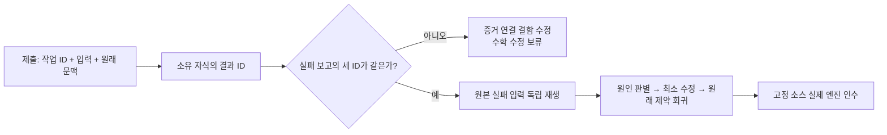
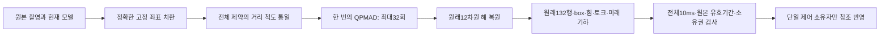

# 13.5 저속 crawl·navigation 검증 실습

현재 문서는 Task8 검증 단계의 실습 가이드다. **G2 전체와 Nav2 종단 인수는 아직 미완료**다.
하중 전환 부분 재설계는 [설계·검증 기록](SECTION_13_5_LOAD_TRANSFER_REDESIGN_KO.md)을 따른다.
명시적 Gazebo G2만 수치 자식에서 선택발XY 고정·지지발XYZ 보정을 계산한다. 발별 벡터2mm/s·
10mm, 기존Z 범위·힘·관절/형상 조건을 유지한다. 부모만 원본 시각과 현재IK/effort를 검증해
참조를 적용하며 착지 뒤 임시XYZ를 복원한다. 수치 예측을 실측 힘이나 물리 성공으로 읽지 않는다.
`numeric_worker_job_contract`와 `numeric_worker_normal_close`는 각각 계산 작업과 정상 종료의
별도 증거다. 취소된 실패도 전자의 실패로 남는다. 네 발 부품 진단 성공은 전체 G2 인수가 아니다.

2026-11-02 명시적 Gazebo G2는 `same_cycle` 경로를 사용한다. 현재 관측을 수치 자식에
한 번 제출하고 같은 제어 주기에서 검증·반영한다. 전체 거래10ms·커널10ms·전달40ms·
원본 관측200ms와 모든 토크/기하 한도는 유지한다. 센서 수신은 독립적으로 계속된다.
10ms 초과는 fault로 남고 재시도하지 않는다. 지난 주기의 해를 최신 관측에 맞는 해로
간주하지 않으며, 미래의 시간을 속도 예산으로 사용하지 않는다. 기본/G1/MuJoCo 경로는 유지한다.
새 경로의 단위/자식 시험 성공을 실제 C1/G2 전체 성공으로 설명하지 않는다.

몸체가 정착 기준을 잠깐 벗어나면 선택 발의 XYZ와 들기 진행은 고정한다. 이때도 접지한
지지 다리의 토크 유지 피드백은 같은2mm/s·10mm·정확한 토크/기하 한도 안에서 수행한다.
목적값은 현재 측정한 네 발 힘이며 의도적인 선택 발 하중 해제를 요청하지 않는다.
정착·새 정상 전체 미래 기하 증명·원래100ms 실제 해제 확인 없이는 SWING으로 진행하지 않는다.
최신 통과/실패는 [현재 상태](SECTION_13_5_STATUS_KO.md), 원인과 회귀는
[디버깅 보고서](SECTION_13_5_G2_DEBUGGING_KO.md)를 먼저 확인한다.

## 1. 설치와 역할 확인

[13.4 가이드](LAB_13_4_GUIDE_KO.md)의 ROS2 Jazzy/native MuJoCo·Gazebo 의존성과 Python 환경,
Ch13 `ros2_ws/src`만을 사용하는 빌드·overlay 설정을 준비한다. Ch01~12를 빌드하거나 수정하지 않는다.
이번 장의 이동기는 PPO가 아닌 접촉 기반 저속 crawl이다. 실제 Nav2 연결은 후속 게이트이며
이동 시험의 `G2_fixture` 명령 송신자를 Nav2 또는 추정 odometry로 설명하지 않는다.

저속 명령 상한은 전진/후진0.01m/s·회전0.03rad/s, 제어 목표50Hz다. 실제 평균 진행은 지지 이동·
하중 해제·발 이동·정착 때문에 더 느리다. 새 일반 CRAWL은 네 발 지지 SHIFT에서 몸체를 이동하고,
해제 이후 SWING/TOUCHDOWN/SETTLE에서는 몸체 참조를 유지한다. 실제 몸체가 멈췄는지는
센서로 별도 검사한다. 관절 명령이나 참조를 적분해 실제 도착을 판정하지 않는다.

## 2. 소스 회귀

저장소 루트에서 ROS2/Ch13 overlay가 설정된 Python을 사용한다.

```bash
python -m pytest Ch13/ros2_ws/src/integrated_robot_navigation/test -q --maxfail=1
```

이상적 피드백·형상 회귀는 실제 엔진 안정성의 증거가 아니다. 실제 ROS action 시험의 peer도
물리 엔진이 아니다. 라이브러리/패키지 설치본이 현재 소스와 같은지 감사한 뒤 실제 시험을 진행한다.
실행 중 소스·설치본을 바꾸면 같은 검증 실행으로 묶지 않는다.

전체 관측기의 라이브 원본은 `observations.capture`에 기록된다. 엔진과 관측 프로세스가 종료된 뒤
소유권·SHA·전체 레코드 수를 확인하고 모든 값을 `observations.jsonl`로 내보낸다. 원본 capture도
보존한다. `.tmp`만 남거나 export/hash/count가 실패하면 해당 시험은 실패다. 외부 pickle을 이
경로로 읽지 않는다. 관측 데이터의 변환 시점만 바뀌며 촬영/최초 수신 시각과 안전 기준은 같다.

## 3. 새 장면과 실제 G1

다음은 MuJoCo 경로다. 현재 Python 환경에는 native 플러그인과 동일 계약의 underlay 및 Ch13
설치본이 먼저 설정되어 있어야 한다. 출력 폴더는 매번 새로 만들며 이전 실패를 덮어쓰지 않는다.

```bash
trial_id=$(python -c 'import uuid; print(uuid.uuid4())')
native_evidence_root="$HOME/ch13-native-evidence"
mkdir -p "$native_evidence_root"
trial_root="$native_evidence_root/local-$trial_id"
python Ch13/scripts/prepare_navigation_model_13_5.py \
  --scene-engine mujoco --output-dir "$trial_root-prepared"
python Ch13/scripts/run_navigation_13_5.py \
  --engine mujoco --scenario sensors-carry \
  --scene-dir "$trial_root-prepared/scene" \
  --profile "$trial_root-prepared/carry_profile.json" \
  --output-dir "$trial_root-g1"
```

WSL에서 저장소가 `/mnt/c`에 있으면 실행 중 JSONL 출력은 위처럼 본인이 소유한 Linux 파일시스템에 둔다. Windows 파일시스템의 지연으로 기록 큐가 포화된 실패가 실제로 있었다. 엔진·런타임·모든 작업자의 종료와 부모 회수/잔여[]를 확인한 뒤 원본을 보존하며 저장소에 복사하고 파일별 SHA를 대조한다. 실행 중 복사·압축·CPU 회귀를 병행하지 않는다.

`prepare`는 offline 후보를 만들 뿐이다. G1은 실제 체중 분배·발 들기/재착지·센서 frame·수납
자세와 terminal result·정상 종료를 확인한다. 단순히 profile의 flag를 편집해 CRAWL을 허가하지 않는다.
`result.json`의 필수 checks가 전부 참이어야 하며 `teardown.json`의 measured_stop/runtime/engine,
부모 회수·강제 정리 여부·잔여 PID를 함께 읽는다. 잔여가 없다는 사실만으로 정상 종료를 선언하지 않는다.

## 4. 같은 G1 증거에 연결한 G2

G1이 실제 PASS이고 모든 소유 프로세스의 종료·회수가 확인된 경우에만 진행한다.
장면을 다시 생성하지 않고 같은 소스·설치·모델·물리 hash에 결합된 G1 결과를 넘긴다.

```bash
python Ch13/scripts/run_navigation_13_5.py \
  --engine mujoco --scenario crawl-cycle \
  --scene-dir "$trial_root-prepared/scene" \
  --profile "$trial_root-prepared/carry_profile.json" \
  --g1-result "$trial_root-g1/result.json" \
  --output-dir "$trial_root-g2"
```

실측 정지10초, 전진0.40m, 좌/우 각0.30rad, 각 단계와 최종 실측 STOPPED를 확인한다.
단계 사이는 건강한 CRAWL0속도 pause이며 명시 STAND는 마지막에 요청한다.
서비스 ACK·명령0·cancel ACK·action status만으로 물리 정지나 terminal 수신을 대신하지 않는다.
후진0.10m는 별도 새 출력 폴더의 `--scenario crawl-reverse`로 검사한다.
최종 인수에는 고정 소스에서 양 엔진 각각3회 연속 성공이 필요하다. 첫 실패를 제외해 성공만 모으지 않는다.

## 5. Gazebo 명시 검증 프로필

Gazebo G1/G2 전용으로 승인된 비교 모드는 아래 세 설정의 조합이다. 기본 launch/일반 profile의
자동 승격이 아니며 MuJoCo에 사용하지 않는다.

- 준비: `--scene-engine gazebo --g1-reference-ramp --g1-contact-allowance`
- 실행: `--engine gazebo --control-clock-mode relay100 --dart-contact-mode allowance50um`
- 해당 엔진 프로세스 환경: `LP_NUM_THREADS=2`

나머지 G1→정상 정리→동일 장면 G2 절차와 기존 인수 기준은 같다. 100Hz 전달은 원본 시각을
보존하며 전역/엔진 시계·센서 capture를 바꾸지 않는다.20ms 명령 적용·50µm DART 설정은
실제 로드된 프로세스/라이브러리/물리 getter 증거로 확인한다. 두 엔진을 동시에 실행하지 않는다.

### MuJoCo의 별도 승인 비교

MuJoCo G1/G2 검증 전용으로 `--control-clock-mode relay100`을 **두 실행에 명시**할 수 있다.
장면은 기존 native 물리이고 `--dart-contact-mode` 기본native를 유지한다. Gazebo의20ms reference나
DART50µm는 MuJoCo에 사용하지 않는다. G1은 원래 검사에 `control_clock_contract`를 추가하며,
G2에는 같은 중계 조합·고정 소스·설치본·장면의 새 G1 PASS가 필요하다. native 시계 G1 결과를
중계 G2에 재사용하거나 profile flag만 바꾸면 거부된다. 기본 launch는 계속native다.

정확히5개 고수준 노드만 중계를 사용한다. 원본 `/clock`, 관측기와 촬영 헤더는 그대로다.
Crawl은 이 opt-in 경로에서 기존 시계 콜백 분리/2worker 실행을 사용한다. CPU 감소·이동 성공은
실제 시험 전 보장하지 않는다. [승인 범위와 판별 계획](SECTION_13_5_MUJOCO_CLOCK_COMPARISON_KO.md) 참조.

### Gazebo G2 하중 전환 부품 시험의 계산 경계

명시적 Gazebo G2 후보의 수치 자식은 현재 q/접촉을 계산하고 부모만 명령한다. 불변 URDF 형상을 미리 준비해도 현재/후속28격자 검사는 매 입력에서 실행한다. 자식10ms·전달/회수40ms를 넘으면 실패하며, 정상 자식 종료가 계산 성공을 뜻하지 않는다. 부모의 실제 ROS/wall 간격이 후보의 입력 간격보다 짧으면, 원점 선형 실행 가능성이 증명된 경우에만 모든 발 변위를 같은 비율로 줄이고 현재 형상·effort를 재검사한다. 발별2mm/s·10mm와 원 시각을 유지하고 미사용 변위는 폐기한다.

원본 실패 `c3719b6e`와 고정 입력 재생·독립 기하 비교는 [재설계의 계산/적용 시간 분리](SECTION_13_5_LOAD_TRANSFER_REDESIGN_KO.md)에 있다. 재생 통과만으로 C1의 실제 들기, 전체 G2 또는 보행 인수를 선언하지 않는다.

## 6. 실패를 읽는 순서

1. `result.json`의 첫 오류와 실제 `controller_report.json`/`carry_failure_report.json`을 확인한다.
2. 원래 capture·수신 monotonic·DDS 메타데이터로 연결한다. trace 부재를 callback 부재로 단정하지 않는다.
3. 접촉 이름/예상 밖 접촉은 필터로 없애지 않는다. 모델에서 해당 쌍과 계획 경로를 확인한다.
4. 실제 FJT terminal 결과와 measured STOP·worker join·엔진 exit를 각각 확인한다.
5. 실패 UUID·명령·소스/설치 hash·원본 전량을 보존한 뒤 최소 재현과 회귀를 만든다.

SYSTEM 시각 역행 때 명령 순서는 DDS publication 식별자로 판정하지만 원본 시각과 기존 epoch
cutoff는 유지한다. 감지된 receiver의 RESET/다음 활성화는 재시작을 요구한다. 오래된 목표·
자동 fault 해제·재태깅·안전 age 완화로 통과시키지 않는다.

PPO 적재 보행·MoveIt·물리 파지·문턱 통과·실제 로봇 검증은 이 후보의 성공 범위에 포함하지 않는다.

## 2026-10-26 재개 시 주의: MuJoCo native 참조 분석

사용자는 MuJoCo 보간 controller를 채택하지 않고 native 유지·원인 분석만 선택했다.
현재G1 61422188은 실제 팔 속도 기준 초과로FAIL이며 그 결과로G2를 열지 않는다.
[원인 분석과 Mermaid](SECTION_13_5_MUJOCO_NATIVE_CAUSE_ANALYSIS_KO.md)를 먼저 읽는다.
특히 native_controls의 snapshot header는 새 staged ctrl의 물리적용 시각이 아니다.
오프라인 분석의 수치 통과를 엔진 인수 성공으로 사용하지 않는다. 새 런타임/물리 설정이나
전용 controller를 이 가이드에서 기본값처럼 실행하는 절차는 추가하지 않았다.

## 2026-11-01 접촉 전환 부품 검증의 상태

명시적 Gazebo G2의 수치 자식은 bounded_terminal_force 목적식을 사용한다. /2mm/s·10mm·6초·2N미만100ms·토크·28격자/원본안전기준은유지한다. 기존rate_1_per_s는수치비교경로이며기본실행/ MuJoCo정책을변경하지않았다. 실제G1 a71d1e8a PASS와C1 76b1aac2 하중마감FAIL을보존하며, 새목적식의실제인수성공은아직없다. 결과의numeric_worker_normal_close/job_contract와실제발들기/전체G2를각각확인한다. 상세원인과수치·실측구분은SECTION_13_5_LOAD_TRANSFER_REDESIGN_KO.md를참조한다.
## 2026-11-01 실행 경로·실패 증거 확인 보충

명시적 Gazebo `relay100` 검증 프로필은 원래50Hz steady 모델 타이머를 직접 단일 실행하고, 원래 TimeSource·센서는 별도 serial Events 수신기로 처리한다. native 기본값과 MuJoCo 경로·물리·참조·제어 기한은 유지한다. 모델 콜백이 이미 같은 MutuallyExclusive 그룹이면 작업자 수를 늘려도 병렬 계산이 생기지 않는다. 실제 검증에서는 `control_clock_ingress_owner.json`과 의존성 SHA·PID/TID·단일 시계 구독을 함께 확인한다. 합성 CPU 비교가 물리 인수를 대신하지 않는다.

Gazebo의 `contact_adapter_report.json`은 두 입력의 수신 횟수·중복·원래200ms 만료·각 최대 수신 공백·마지막 성공 짝·기존 각10개 pending의 첫 수신 시각을 담는다. 최대 공백이 초기 bootstrap에 속하는지 최초 고장 구간에 속하는지 구분한다. 이 보고는 읽기 전용이며 접촉 판정이나 명령을 허용하지 않는다.

수치 실패를 재생하기 전 `numeric_input_job_id`, `worker.last_input_id`, `worker.last_reply.id`가 같은지 확인한다. 실패 응답의 `ok`도 확인한다. 성공job의 입력과 실패job의 timing을 섞으면 잘못된 문제를 풀게 된다. 새 export helper는 연결이 없거나 다르면 정확한 실패 fixture를 만들지 않는다. QPMAD의 상태4는32회 반복 초과이며, 외부 C ABI 오류 code2나10ms 시간 초과와 구분한다. 기존 ac904 파생 fixture는 직전 성공 입력이어서 후속 실패의 재현 자료로 쓰지 않는다.



전체 스레드 procfs 계측은 `--thread-diagnostics`를 명시할 때만 실행한다. 앞선 실측에서 한 번에72ms wall/20ms CPU를 소비해 교란 가능성이 있었다. 기본 실행에도 원래 프로세스 통계·RAW 시각·모든 required_checks는 남는다. 엔진 중 별도 성능 시험·원본 분석·빌드를 병행하지 않는다. 최신 실제 인수와 미완료 범위는 `SECTION_13_5_STATUS_KO.md` 및 실행 원장을 따른다.

### 수치 완료와 모터 적용 가능 시각을 구분하기

`load_result_timing=mature_horizon`은 명시적 Gazebo G2 검증에서만 선택하며 다른 경로는 strict다. 수치 결과가 성공했어도 실제 ROS·wall 시간 예산보다 변위가 크면 적용할 수 없다. origin이 feasible하지 않으면 임의 축소도 금지한다. 새 경로는 같은 유효 결과 한 건만 보관하고 다음 평가에서 원래200ms·현재 상태·소유권·기하·속도를 다시 검사한다. 대기 중 목표를 새로 발행하거나 시각/기한을 갱신하지 않으며6초 하중 해제 기한은 그대로다. 만료·STOP·고장·세대/참조 변경 때 폐기한다. `load_result_cached`와 `waiting_for_reference_horizon`은 수치 완료를 물리 적용 성공으로 해석하지 않도록 돕는 진단이다.


### 수치 계산의 표현과 실제 과제 성공을 구분하기

실패 입력72·130은 허용 영역에 해가 있는데도 단위가 다른 제약의 선택 순서로32회 안에 수렴하지 않았다. 고정 좌표를 치환하고 모든 제약을 동일한 목적함수 거리로 정규화해 같은 수학 문제를 푼다. 반복 수나 물리 제한을 늘리는 방법이 아니다. 자세한 수식·RED/비교/회귀는 `SECTION_13_5_LOAD_TRANSFER_REDESIGN_KO.md`를 따른다.



수치 회귀 PASS는 실제 발 들기/복귀나 보행 성공이 아니다. 실제 C1 네 발 전환, 전체 G2, 양 엔진 고정본 연속 성공, Nav2 Tasks9–14와 최종 회귀는 각각의 인수 결과로 확인한다.


### 응답 도착과 제어 적용 시점을 혼동하지 않기

수치 자식이24.46ms에 계산을 끝내도,50Hz 부모가 다음 평가에서 JSON을 읽으면40ms 수집 기한을 넘을 수 있다. Gazebo G2의 명시적event_receiver는 응답을 독립적으로 완전히 파싱하고 최초 수신 시각을 보관한다. 모델은 이를 나중에 소비하되 제출→완전 수신40ms와 소비 wall200ms를 검사하고, gait에서 원래 입력의 ROS/wall age·세대·발·참조·현재 기하를 모두 다시 확인한다. 새 수신자는 모터 명령을 발행하지 않는다. 종료 때는 수신자를 먼저join한 뒤 STOP/ACK와 미처리 stream을 기존 소유자가 정리한다. 기본model_poll/MuJoCo/G1의 동작은 그대로다.

재현 시험은 `test_numeric_receipts.py`다. 실제 자식의40ms 수신/45ms 소비, 늦은 수신·오래된 소비 거부, 부분 프레임,1slot,EOF,중단과join을 구분한다. 이 시험의 통과만으로 실제C1/전체G2 성공을 선언하지 않는다. 해당 원본 실패와 현재 상태는 `SECTION_13_5_LOAD_TRANSFER_REDESIGN_KO.md` 및 `SECTION_13_5_STATUS_KO.md`에서 확인한다.
