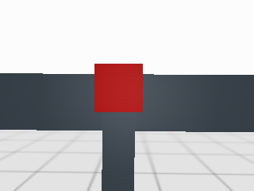

# 13.5 네비게이션과 보행의 연동: 공개 통합 플랫폼으로 작업 위치에 접근하기

## 13.5.1 역할과 플랫폼 전환

앞 절까지 만든 로봇과 실행 기록을 보존하고, 여기부터 공개 Go2+Piper 통합 플랫폼을 사용한다. Nav2는 지도에서 충돌을 피하는 경로와 속도를 계산한다. 공개 이동 정책은 이 속도와 실제 몸체·관절 관측을 받아 다리를 구동한다. 이 실습은 새 보행기를 학습하는 과정이 아니다.

먼저 [설계](SECTION_13_5_REUSE_DESIGN_KO.md), [고정 자산](../dependencies/section_13_5_reuse.lock.json), [원본 정착 조사](SECTION_13_5_REUSE_SETTLING_REVIEW_KO.md)를 읽는다. 외부 upstream 파일은 저장소에 넣지 않는다. 안내된 정확한 커밋을 별도 checkout하고 lock에 나열된 94개 파일을 확보한다. 모델·가중치의 하위 권리는 확인된 범위만 기록돼 있으므로 root BSD 표기만으로 재배포 허가를 단정하지 않는다.

## 13.5.2 실행 환경과 공개 정책

검증 환경은 Ubuntu24.04/WSL2, ROS2 Jazzy, Nav2 1.3.13, Python3.12.3, MuJoCo3.13.0과 CPU ONNX 추론이다. 기존 Ch13 환경을 덮어 올리지 않고 별도 추론 venv와 별도 build/install 디렉터리를 쓴다. Isaac Lab 전체 학습 환경은 본문 실행에 필요하지 않다. 시스템 패키지·권한·드라이버 변경은 이 안내를 실행했다고 자동 승인되는 일이 아니다.

새 PC에서는 ROS2 Jazzy·Nav2·colcon·pytest와 EGL 렌더링 라이브러리, OpenSSL 개발 헤더를 먼저 준비한다. 검증한 ROS 패키지 목록은 [사전 검사 목록](../evidence/section_13_5_reuse/r5_preflight_20261103_v2/nav2_packages.txt)에 있다. 운영체제 설치/관리자 명령은 이 실습 실행기에 포함하지 않는다.

외부 자산은 다음처럼 **새 디렉터리에서만** 고정 커밋의 정확한 파일을 받는다. 기존 upstream 디렉터리가 있으면 중단하므로 기존 원본을 고치지 않는다. 네트워크/해시 실패 시 부분 결과를 검사하고 다른 새 작업 위치에서 준비한다. Git LFS pointer 등 잘못된 내용도 크기/SHA 검사에서 중단된다. 모델·가중치를 책 저장소에 복사해 올리지 않는다.

```bash
python3 - <<'PY_ASSETS'
from pathlib import Path, PurePosixPath
from urllib.request import urlopen
from urllib.parse import quote
import hashlib, json
repo = Path.cwd().resolve()
lock = json.loads((repo/'Ch13/dependencies/section_13_5_reuse.lock.json').read_text())
target = repo.parent/'upstream-iit-locomanipulation-d010212'
if target.exists():
    raise SystemExit('기존 원본은 보존한다. 새 작업 위치를 사용하거나 설치 감사만 실행한다.')
target.mkdir()
base = 'https://raw.githubusercontent.com/iit-DLSLab/locomanipulation-teleop-isaaclab/'
for row in lock['files']:
    rel = PurePosixPath(row['path'])
    assert not rel.is_absolute() and '..' not in rel.parts
    with urlopen(base+lock['upstream']['commit']+'/'+quote(str(rel), safe='/'), timeout=60) as response:
        data = response.read(row['bytes']+1)
    assert len(data) == row['bytes'] and hashlib.sha256(data).hexdigest() == row['sha256'], row['path']
    destination = target.joinpath(*rel.parts)
    destination.parent.mkdir(parents=True, exist_ok=True)
    with destination.open('xb') as stream:
        stream.write(data)
print('94 pinned asset hashes verified')
PY_ASSETS
```

새 추론 venv는 다음 고정 목록을 사용한다. R5의 `pip_freeze.txt`는 ROS 패키지까지 보이는 실행 환경의 **조회 목록**이며 pip 설치 목록으로 사용하지 않는다. 아래 R0 목록은 추론 전용 목록이다. CPU Torch를 먼저 같은 버전으로 설치하고 나머지 고정 버전을 맞춘다. 이 새 PC 설치 절차를 별도 새 OS에서 다시 실행한 것은 아니며, 현재 PC의 새 isolated build/install 재현과 구분한다.

```bash
export CH13_REUSE_VENV="$HOME/ch13_reuse_iit_d010212_venv"
python3 -m venv "$CH13_REUSE_VENV"
"$CH13_REUSE_VENV/bin/python" -m pip install --index-url https://download.pytorch.org/whl/cpu 'torch==2.9.0+cpu'
"$CH13_REUSE_VENV/bin/python" -m pip install -r Ch13/evidence/section_13_5_reuse/r0-20261102/pip-freeze.txt
```

다음은 Ubuntu bash에서 저장소 루트로 이동한 뒤 실행한다. Python/MuJoCo 관련 정확한 버전은 lock의 pip 목록을 대조한다. ROS2/Nav2와 추론 venv가 이미 준비된 상태를 전제한다. 기본 venv 경로와 다른 PC에서는 `CH13_REUSE_VENV`에 실제 venv 경로를 지정한다.

```bash
export CH13_REUSE_VENV="$HOME/ch13_reuse_iit_d010212_venv"
export CH13_REUSE_BUILD="$HOME/ch13_reuse_r5_build"
bash Ch13/scripts/reuse_13_5/build_r2.sh
mkdir -p Ch13/evidence/section_13_5_reuse/my_preflight
bash Ch13/scripts/reuse_13_5/test_r2.sh "$PWD/Ch13/evidence/section_13_5_reuse/my_preflight/tests.log"
bash Ch13/scripts/reuse_13_5/env_r2.sh Ch13/scripts/reuse_13_5/audit_r2_install.py "$PWD/Ch13/evidence/section_13_5_reuse/my_preflight/install.json"
```

빌드 대상은 신규 navigation/wire와 기존13.4 geometry를 제공하는 `integrated_robot_vision` 세 패키지다. Ch05~12 빌드를 요구하지 않는다. 먼저 자유 공간 예제를 실행해 실제 기립·이동·zero 명령·정착·정상 종료를 확인한다. 실행마다 새 결과 디렉터리를 사용하고 이전 결과를 덮지 않는다.

```bash
bash Ch13/scripts/reuse_13_5/run_navigation.sh free "$PWD/Ch13/evidence/section_13_5_reuse/my_free_run"
```

`navigation_summary.json`은 action과 실제 상태, `navigation_verification.json`은 원본500Hz 정착 창의 독립 검증이다. `residual_processes.json`까지 PASS인지 확인한다. 프로세스를 종료시켰다는 사실만으로 실제 정지라고 판단하지 않는다.

## 13.5.3 명령·상태·TF 계약

Nav2 raw 출력을 upstream에 직접 연결하지 않는다. controller→smoother→navigation boundary→gateway→platform 경로를 읽고, `config/platform.yaml`의 단위·축·상한을 확인한다. vx/wz는 각각 최대0.20m/s·0.20rad/s, vy는0이다. 명령 ramp 상한은 몸체 가속도의 실측 보장이 아니다. 실행기는 먼저 실제 controller/smoother의 신선한 입력을 받으면서 zero를 유지하고, gateway 재무장→platform 재무장→명시적 release 후에만 움직인다. 생성 zero와 제어기 원본 stamp 사이의 watermark를 유지하여 인계 시 시각 역행을 막는다. DISARMED에서도 공개 정책은0속도로 몸체를 유지한다. 준비 중의 경로 실패는 움직임을 해제하지 않는다.

`/ch13/reuse/engine_state`는 실제3D 상태, `/ch13/reuse/odometry`는 지도 이동용 투영이다. TF에서 nav_base→base의 높이와 roll/pitch가 남는지 확인한다. map→odom은 알려진 장면과 engine ground truth를 사용하는 교육 profile이다. localization을 완성했다거나 AMCL/SLAM을 시험했다고 표현하지 않는다.

## 13.5.4 지도·footprint·Nav2

지도는 알려진 장면의 prior이고 scan은 실제 ray 관측이다. 자기 몸체·바닥의 ray 제외와 낮은 장애물의 지도 투영을 구분한다. 기존 장의 footprint 예시를 복사하지 않고, 실제 관절 자세에서 산출한 envelope를 사용한다. 원본 로봇 자체의 동역학과 정책은 유지하며 주변 정적 장면만 교육용 평지로 바꾼다.

`run_navigation.sh obstacle`, `blocked`, `cancel`로 각각 우회, 도달 불가, 취소를 시험한다. 장애물 우회는 실제 root 궤적도 검사한다. blocked는 최종 고정본에서 목표 셀 자체는 비어 있고 중간 벽이 통로를 막는 경우다. cancel은 ACK와 terminal CANCELED를 별도 기록한다. Spin/BackUp을 검증 없이 추가하지 않는다.

## 13.5.5 제한·watchdog·수납

팔은 원본 PD의 검증된 수납 목표를 유지한다. 팔 상태를 정책이 관측한다는 사실과 팔 명령 소유권을 구분한다. 오래된 입력, 관측 손실, clock 정지/역행, 소유자 교체는 fault를 고정하고 zero를 지시한다. 입력이 돌아와도 자동으로 움직이지 않는다. 같은 시뮬레이션 epoch의 입력 손실은 실제 stop 확인 후 명시적 reset·새 zero·arm 순서로 복구한다. clock 역행이나 engine 재시작은 소유 실행을 정상 회수한 뒤 새 launch에서 시작한다.

`raw_loss`는 이 실행이 만든 명령 경계 프로세스에만 손실을 주입한다. 명령 만료에서 zero 결정까지와 그 뒤 실제 정착 시간을 따로 읽는다. 플랫폼 전원을 끄거나 torque를0으로 만드는 시험이 아니다.

## 13.5.6 촬영에서 접근 후보까지

```bash
bash Ch13/scripts/reuse_13_5/run_navigation.sh vision "$PWD/Ch13/evidence/section_13_5_reuse/my_vision_run" 15
```



최종 v3 실험의 원본320×240 촬영이다. 붉은 고정 작업물의 보이는 표면과 depth를 사용한다.

320×240 RGB-D를 실제 상태 복사본에서 촬영한다. 카메라는 고해상도 장식 mesh 대신 원본 충돌 형상을 보여주는 교육용 화면이다. 실제 환경과 로봇 가림 근사를 렌더링하며, 장면 좌표를 비전 관측이라고 발행하지 않는다. 붉은 작업물의 보이는 표면을 색 영역과 depth로 검출한다. 일반 물체 인식은 별도 확장이다.

capture 상한15wallHz와 기본 처리 상한10wallHz를 구분한다. 위 명령은 문서에서 허용한15Hz 처리 선택을 명시하며 최종 인수의 선택값도15Hz다. 기본10Hz의 전체 접근 성공으로 전이하지 않는다. 느린 시뮬레이터에서는 실제 wall FPS가 낮아질 수 있으며300ms 만료를 늘려 성공으로 바꾸지 않는다. 완전한 RGB-D의 생존 확인과 물체 인식 주기를 구분하고, goal 승인·최종 인계에는 계속 신선한 검출을 요구한다. source header를 now로 고치지 않는다. 큰 원본 영상은 native ROS로 직접 수신하고 C++가 실제로 받은 동일 샘플의 전체 필드 SHA256·GID·최초 receipt와 대조한다. camera_receipts.jsonl에 이 대응을 남긴다. 저장 RGB·depth, calibration과 과거 TF로 관측점을 재계산할 수 있고, 저장 픽셀의 canonical SHA도 원본 C++ receipt와 다시 비교한다. 기존13.4 geometry를 재사용했어도 새 카메라 시험은 별도로 수행한다.

실제 팔 체인과 joint limit·collision으로 위치 IK를 풀고 footprint와 지도, 실제 Nav2 경로 비용을 더해 접근 후보를 선택한다. 목표까지0.4m라는 상수를 보편값으로 사용하지 않는다. 후보 계산 뒤 새 촬영을 받아 목표의 유효성을 다시 확인하고, 그 원본 촬영 시각을 goal header에 남긴다.

## 13.5.7 도착·정착·인계

성공 terminal만으로 팔을 허용하지 않는다. 실제 root 위치/방향 오차가0.10m/0.10rad 이내인지, 정착 창이1wall초와0.5sim초를 모두 만족하는지 확인한다. 실제 최종 몸체·관절로 팔 작업영역을 다시 확인하고 신선한 관측까지 갖춰야 READY_FOR_MANIPULATION을 발행한다. 이 실습에서는 팔 파지 명령을 보내지 않는다. 종료할 때 READY를 회수한다.

## 13.5.8 장애물·도달 불가·입력 손실

실패는 지우지 않고 첫 고장 시각·원인과 실제 stop을 기록한다. 도달 불가의 ABORTED, 사용자가 취소한 CANCELED, 안전 고장으로 취소된 실행을 구분한다. 정상 시나리오의 안전 취소를 도착 성공으로 바꾸지 않는다. 전체 엔진 실행과 빌드·대용량 분석을 동시에 돌리지 않는다. 같은 실패에 작은 수정을 두 번 적용해도 남으면 부품 시험과 구조 검토로 돌아간다.

## 13.5.9 결과와 확장

최종 인수 UUID와 고정본은 [R5 보고서](SECTION_13_5_REUSE_R5_REPORT_KO.md)를 따른다. 각 필수 시나리오1회가 본문 기준이며3회 반복은 강건성 확장이다. Gazebo 동등 구현, 실기 배포, 새 crawl/학습, AMCL/SLAM, 일반 인식, MoveIt·파지는 이번 결과의 검증 범위에 포함하지 않는다. 13.6은 선택한 Piper interface와 카메라/팔 TF를 이어받아 별도로 설계한다.

## 최종 고정본 전체 인수 재현

최종 source commit과 v3 freeze가 일치하는 checkout에서 실행한다. 이미 기록이 있는 결과 디렉터리를 재사용하지 않는다. source나 실행 도구가 달라지면 기존 freeze를 수정하지 말고 별도 개정으로 검증한다.

```bash
export CH13_REUSE_BUILD="$HOME/ch13_reuse_r5_build"
bash Ch13/scripts/reuse_13_5/env_r2.sh Ch13/scripts/reuse_13_5/run_acceptance.py \
  --freeze "$PWD/Ch13/dependencies/section_13_5_reuse_acceptance_v3.json" \
  --out "$PWD/Ch13/evidence/section_13_5_reuse/my_final_matrix"
```

실행기는 각 시나리오에 새 UUID를 만들고 실제 engine 종료와 잔여 검사를 끝낸 뒤 다음 시나리오를 시작한다. 각 RUN_REPORT_KO.md와 최종 matrix/verification JSON을 생성한다. 비교용 원본 결과를 보존하려면 새 작업 checkout에서 재현한다. 게시 보고서의 remote SHA와 source freeze를 함께 확인한다.
