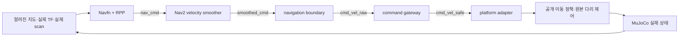

# 13.5 네비게이션과 보행의 연동: 작업하기 좋은 위치로 이동하기

이 가이드는 **소스 다운로드 → 고정 자산 준비 → 빌드 → 여섯 시나리오 → 결과 판독**을 직접 수행하는 실습이다. 각 절의 “구현 위치”에서 코드를 읽고, 바로 아래 명령으로 동작을 확인한다. 제공된 구현을 먼저 재현한 다음 부록의 수정 실습으로 진행한다.


> **배포 소스와 과거 인수의 구분 (2026-11-14):** 위 다운로드는 현재 원격 `main` 기준입니다. 기존 Ch13 v53/R5/M4 인수 JSON은 당시 동결 소스·자산의 성공이며, 새 clone의 HEAD에 동일한 합격을 자동 전파하지 않습니다. `git rev-parse HEAD`·94개 외부 자산 해시·설치/실행 로그가 대응되는지 검수해야 합니다. 실제 새 WSL2 설치·GUI·실기 현장 인수는 `MANUAL_REQUIRED`입니다. Ch10 #123은 HOLD이며 재검하지 않습니다.

**실행 환경:** Ubuntu 24.04 또는 WSL2의 Ubuntu 24.04, bash, ROS2 Jazzy. Windows 사용자는 Ubuntu 터미널을 연다. 아래 Linux 명령을 PowerShell에 붙여 넣지 않는다. 검증한 조합은 Python3.12.3·MuJoCo3.13.0·Nav2 1.3.13·CPU 추론이다. 비전 실습은 검증된 **15Hz 처리 선택**을 명시한다.

**실습 결과:** 지도 목표 도착, 장애물 우회, 도달 불가 판정, 이동 중 취소, 실제 RGB-D에서 계산한 작업 위치 접근, 입력 손실 시 정지. 팔 파지는 다음 절의 과제다. 13.1~13.4는 보존하고, 여기부터 공개 Go2+Piper 통합 플랫폼으로 전환한다.

## 먼저 준비하기: 다운로드에서 첫 빌드까지

### 준비 1. 운영체제와 ROS2 확인

이 절은 ROS2 Jazzy 저장소가 설정된 Ubuntu에서 시작한다. ROS2가 없다면 [공식 Jazzy 설치 절차](https://docs.ros.org/en/jazzy/Installation/Ubuntu-Install-Debs.html)를 먼저 완료한다. 다음 관리자 명령은 **새 실습 환경을 준비할 때** 실행한다. 기존 검증 PC의 시스템 패키지를 일괄 갱신하는 과정은 아니다.

```bash
. /etc/os-release
printf 'OS=%s %s\n' "$ID" "$VERSION_ID"
python3 --version

sudo apt update
sudo apt install git curl build-essential cmake \
  python3-venv python3-pip python3-colcon-common-extensions python3-pytest \
  libssl-dev libegl1 libgl1-mesa-dri \
  ros-jazzy-navigation2 ros-jazzy-nav2-bringup ros-jazzy-tf2-tools

source /opt/ros/jazzy/setup.bash
ros2 pkg prefix nav2_bringup
ros2 pkg prefix nav2_regulated_pure_pursuit_controller
dpkg-query -W ros-jazzy-nav2-bringup ros-jazzy-nav2-controller \
  ros-jazzy-nav2-velocity-smoother
```

기대 결과는 Ubuntu `24.04`, Python `3.12.x`, ROS 패키지 경로와 설치 버전이다. 이 책의 통과 기록은 Nav2 `1.3.13`이다. [검증 당시 패키지 목록](../evidence/section_13_5_reuse/r5_preflight_20261103_v2/nav2_packages.txt)과 비교한다. apt가 다른 버전을 제공하면 아래 기록을 그대로 재현했다고 표시하지 말고 별도 환경으로 검증한다. ROS2 저장소 미설정으로 `Unable to locate package`가 나오면 위 공식 설치 절차의 저장소 설정부터 확인한다.

### 준비 2. 책의 소스코드 받기

기존 작업 폴더와 분리한 새 위치를 사용한다. 다음 명령은 GitHub의 개정 브랜치를 받는다. 이미 같은 폴더가 있으면 덮어쓰지 않고, 그 폴더의 상태를 먼저 확인한다.

```bash
mkdir -p "$HOME/physicalai_13_5"
cd "$HOME/physicalai_13_5"
git clone --filter=blob:none --sparse --depth 1 --single-branch \
  --branch main \
  https://github.com/silverbjin/Pysical_AI_ROS2.git Pysical_AI_ROS2
cd Pysical_AI_ROS2
git sparse-checkout set Ch13/docs Ch13/dependencies Ch13/scripts/reuse_13_5 \
  Ch13/ros2_ws/src/ch13_navigation_reuse Ch13/ros2_ws/src/ch13_reuse_wire \
  Ch13/ros2_ws/src/integrated_robot_vision Ch13/evidence/section_13_5_reuse
git rev-parse HEAD
```

위 명령은13.5에 필요한 범위만 받는다. 다른 장의 소스까지 필요할 때는 `git sparse-checkout disable`로 전체를 받을 수 있다. 가이드가 개정되면 문서 commit은 바뀔 수 있다. 실행 소스는 `section_13_5_reuse_acceptance_v3.json`의 114개 파일 hash로 확인한다. 다음 검사는 엔진을 실행하지 않는다.

```bash
python3 - <<'PY_SOURCE'
from pathlib import Path
import hashlib, json
root = Path.cwd()
frozen = json.loads((root/'Ch13/dependencies/section_13_5_reuse_acceptance_v3.json').read_text())
for row in frozen['files']:
    data = (root/row['path']).read_bytes()
    assert len(data) == row['bytes'], row['path']
    assert hashlib.sha256(data).hexdigest() == row['sha256'], row['path']
print('SOURCE_FREEZE_PASS', len(frozen['files']))
PY_SOURCE
```

`SOURCE_FREEZE_PASS 114`가 나와야 한다. 소스를 직접 수정했다면 이 검사 실패는 정상이다. 수정 실습은 부록에서 새 고정본으로 구분한다.

### 준비 3. 공개 로봇 모델·정책·배포 소스 받기

[공식 upstream](https://github.com/iit-DLSLab/locomanipulation-teleop-isaaclab)의 고정 commit `d010212c3f5c9e6e5542ada61cfdacc19b00f775`에서 실행에 필요한 94개 파일을 받는다. 다음은 main 전체 다운로드나 재학습이 아니라, lock에 기록한 **정확한 배포 소스·모델·가중치**의 복제다. root 라이선스와 하위 자산 확인 범위는 [출처 명세](REUSE_MANIFEST.md)를 따른다. 이 외부 폴더를 책 저장소에 추가하지 않는다.

아래 블록을 **책 저장소 루트**에서 실행한다. 기존 폴더가 있으면 읽기 전용으로 검증만 한다. 부분 다운로드나 hash 불일치는 중단하며 기존 파일을 자동 덮어쓰지 않는다.

```bash
python3 - <<'PY_ASSETS'
from pathlib import Path, PurePosixPath
from urllib.request import urlopen
from urllib.parse import quote
import hashlib, json
repo = Path.cwd().resolve()
lock = json.loads((repo/'Ch13/dependencies/section_13_5_reuse.lock.json').read_text())
target = repo.parent/'upstream-iit-locomanipulation-d010212'
existing = target.exists()
if not existing:
    target.mkdir()
base = 'https://raw.githubusercontent.com/iit-DLSLab/locomanipulation-teleop-isaaclab/'
for row in lock['files']:
    rel = PurePosixPath(row['path'])
    assert not rel.is_absolute() and '..' not in rel.parts
    destination = target.joinpath(*rel.parts)
    if existing:
        assert destination.is_file(), f'기존 폴더에 파일 누락: {rel}'
        data = destination.read_bytes()
    else:
        with urlopen(base+lock['upstream']['commit']+'/'+quote(str(rel), safe='/'), timeout=60) as response:
            data = response.read(row['bytes']+1)
        assert len(data) == row['bytes'], str(rel)
        assert hashlib.sha256(data).hexdigest() == row['sha256'], str(rel)
        destination.parent.mkdir(parents=True, exist_ok=True)
        with destination.open('xb') as stream:
            stream.write(data)
    assert len(data) == row['bytes'], str(rel)
    assert hashlib.sha256(data).hexdigest() == row['sha256'], str(rel)
print('ASSET_HASH_PASS', len(lock['files']), target)
PY_ASSETS
```

기대 출력은 `ASSET_HASH_PASS 94 .../upstream-iit-locomanipulation-d010212`다. 중간 다운로드 실패로 폴더가 불완전해졌다면 부분 결과를 보존·확인하고 새 상위 실습 위치에서 다시 준비한다. Git LFS pointer나 다른 버전의 파일도 hash 검사에서 걸러진다.

### 준비 4. 추론 Python 환경 만들기

가상환경은 ROS2 시스템 Python과 분리한다. 여기서는 `source .../bin/activate`를 사용하지 않는다. ROS CLI는 시스템 Python을 쓰고, 시뮬레이터·정책 노드는 제공된 `env_r2.sh`가 지정한 Python으로 실행한다.

```bash
export CH13_REUSE_VENV="$HOME/physicalai_13_5/venv_reuse"
python3 -m venv "$CH13_REUSE_VENV"
"$CH13_REUSE_VENV/bin/python" -m pip install \
  --index-url https://download.pytorch.org/whl/cpu 'torch==2.9.0+cpu'
"$CH13_REUSE_VENV/bin/python" -m pip install \
  -r Ch13/evidence/section_13_5_reuse/r0-20261102/pip-freeze.txt

"$CH13_REUSE_VENV/bin/python" - <<'PY_VERSIONS'
import sys, mujoco, torch, onnxruntime
print('Python', sys.version.split()[0])
print('MuJoCo', mujoco.__version__)
print('Torch', torch.__version__)
print('ONNX Runtime', onnxruntime.__version__)
PY_VERSIONS
```

MuJoCo `3.13.0`, Torch `2.9.0+cpu`를 확인한다. 이 목록은 추론 전용이다. R5 사전 검사의 `pip_freeze.txt`에는 ROS와 로컬 패키지까지 포함되므로 그것을 pip 설치 목록으로 사용하지 않는다. Isaac Lab 학습 환경과 새 정책 학습은 필요하지 않다.

### 준비 5. 모든 터미널에서 사용할 환경 파일

**터미널 A**에서 다음 파일을 한 번 작성한다. `.bashrc`나 시스템 설정은 바꾸지 않는다.

```bash
cat > "$HOME/physicalai_13_5/lab_env.sh" <<'BASH_ENV'
export REUSE_WORK="$HOME/physicalai_13_5"
export REUSE_REPO="$REUSE_WORK/Pysical_AI_ROS2"
export CH13_REUSE_VENV="$REUSE_WORK/venv_reuse"
export CH13_REUSE_BUILD="$REUSE_WORK/build_reuse"
export EVIDENCE_ROOT="$REUSE_REPO/Ch13/evidence/section_13_5_reuse"
export REUSE_PKG="$REUSE_REPO/Ch13/ros2_ws/src/ch13_navigation_reuse"
export ROS_DOMAIN_ID=135
export ROS_LOCALHOST_ONLY=1
export PYTHONDONTWRITEBYTECODE=1
source /opt/ros/jazzy/setup.bash
if [[ -f "$CH13_REUSE_BUILD/install/setup.bash" ]]; then
  source "$CH13_REUSE_BUILD/install/setup.bash"
fi
cd "$REUSE_REPO"
BASH_ENV
source "$HOME/physicalai_13_5/lab_env.sh"
```

앞에서 다른 작업 위치를 선택했다면 이 파일의 `REUSE_WORK` 한 곳을 맞춘다. 이후 **새 터미널을 열 때마다** 다음을 실행한다. 터미널 A의 export가 B로 자동 전달되지는 않는다.

```bash
source "$HOME/physicalai_13_5/lab_env.sh"
printf 'repo=%s\nvenv=%s\nbuild=%s\n' \
  "$REUSE_REPO" "$CH13_REUSE_VENV" "$CH13_REUSE_BUILD"
```

### 준비 6. 세 패키지 빌드·설치 감사

**터미널 A, 엔진이 종료된 상태**에서 실행한다. 새 세션 폴더를 만들어 검사 로그를 구분한다.

```bash
export LAB_EVIDENCE="$EVIDENCE_ROOT/student_$(date +%Y%m%d_%H%M%S)_$(python3 -c 'import uuid; print(uuid.uuid4().hex[:8])')"
mkdir -p "$LAB_EVIDENCE"
printf '%s\n' "$LAB_EVIDENCE" > "$REUSE_WORK/current_lab.txt"

bash Ch13/scripts/reuse_13_5/build_r2.sh
source "$HOME/physicalai_13_5/lab_env.sh"
bash Ch13/scripts/reuse_13_5/env_r2.sh \
  Ch13/scripts/reuse_13_5/audit_r2_install.py "$LAB_EVIDENCE/install_audit.json"
bash Ch13/scripts/reuse_13_5/test_r2.sh "$LAB_EVIDENCE/tests.log"
```

빌드 출력은 `3 packages finished`, 설치 감사는 `INSTALL_AUDIT_PASS ... original94 hashes match`, 현재 소스 검사는 `Ran 89 tests ... OK`가 기준이다. 빌드 대상은 `ch13_reuse_wire`, `ch13_navigation_reuse`, 기존 13.4의 geometry를 제공하는 `integrated_robot_vision`이다. Ch05~12 빌드는 필요 없다. 설치 경로는 `$CH13_REUSE_BUILD/install`이다.

실습 세션을 이어서 쓰는 새 터미널 A에서는 아래처럼 복구한다. 새 실험 세션을 만들 때만 위 UUID 생성 블록을 다시 실행한다.

```bash
source "$HOME/physicalai_13_5/lab_env.sh"
export LAB_EVIDENCE="$(cat "$REUSE_WORK/current_lab.txt")"
```

## 13.5.1 도입: 경로를 계획하고, 실제로 이동하고, 정지하기

4족 로봇의 다리가 지형을 밟는다는 사실만으로 특정 문턱을 넘는다고 가정할 수는 없다. 이 실습은 공개 이동 정책을 재사용하여 **검증한 평지에서 경로를 따라 이동하고 정지하는 연결**을 먼저 완성한다. 앞 절의 로봇과는 다른 Go2+Piper 플랫폼을 사용한다.

**구현 위치:** [원본 실행 어댑터](../ros2_ws/src/ch13_navigation_reuse/ch13_navigation_reuse/platform_adapter.py), [시나리오 실행기](../scripts/reuse_13_5/run_navigation_probe.py). 실행기는 upstream `PlayMujoco.run`을 사용하고 실제 qpos/qvel을 관측한다. 새 보행기를 작성하거나 목표 위치로 root를 옮기지 않는다. 채택한 것은 [정착 조사](SECTION_13_5_REUSE_SETTLING_REVIEW_KO.md)의 배포 보완을 적용한 corrected A profile이다. 원본 가중치는 유지하고, 보완은 제공 어댑터가 적용한다. 다운로드한 upstream 파일을 직접 수정하지 않는다.

**터미널 A: 첫 자유 공간 이동.** 아래 명령 하나가 시뮬레이터·Nav2·명령 경계·정상 회수를 소유한다. 다른 터미널에서 같은 launch를 추가로 띄우지 않는다.

```bash
export FREE_OUT="$LAB_EVIDENCE/free"
printf '%s\n' "$FREE_OUT" > "$REUSE_WORK/current_run.txt"
bash Ch13/scripts/reuse_13_5/run_navigation.sh free "$FREE_OUT"
```

이 예제의 map 목표는 `(0.65, 0.0, 0.0)`이다. 처음 실행하면 모델/정책과 노드 준비를 기다린다. 실행 중 probe 출력은 결과 폴더의 `probe_stdout.log`로 들어가므로 터미널이 잠시 조용할 수 있다. MuJoCo GUI 대신 headless 모드로 실행되는 것이 정상이다.

**종료 후 결과 확인:**

```bash
python3 - "$FREE_OUT" <<'PY_FREE'
from pathlib import Path
import json, sys
p = Path(sys.argv[1])
s = json.loads((p/'navigation_summary.json').read_text())
v = json.loads((p/'navigation_verification.json').read_text())
r = json.loads((p/'residual_processes.json').read_text())
print('run/verify/cleanup:', s['result'], v['result'], r['result'])
print('terminal:', s['terminal_status'], 'target:', s['target'])
print('actual position/yaw error:', s['actual_goal_error_m'], s['actual_goal_yaw_error_rad'])
assert (s['result'], v['result'], r['result']) == ('PASS', 'PASS', 'PASS')
assert s['terminal_status'] == 4
PY_FREE
```

기대 결과는 `PASS PASS PASS`, terminal `4`다. 실제 위치/방향 오차는 각각 `0.10m/0.10rad` 이내여야 한다. “명령을 보냈다”와 “로봇이 도착했다”를 이 검사로 구분한다.

## 13.5.2 시스템 아키텍처: Nav2와 공개 이동 정책의 연결

Nav2의 경로 계획과 다리 제어는 역할이 다르다. 여기서는 Navfn planner와 RPP(Regulated Pure Pursuit) controller를 사용한다. 최종 명령 타입은 Jazzy 설정에 맞춘 `geometry_msgs/msg/TwistStamped`다.



| 경로/역할 | 실제 이름 | 구현 위치 |
|---|---|---|
| controller 출력 | `/ch13/reuse/nav_cmd` | `launch/navigation.launch.py`의 remapping |
| smoother 출력 | `/ch13/reuse/smoothed_cmd` | `config/nav2_params.yaml` |
| 경계 출력 | `/ch13/reuse/cmd_vel_raw` | `navigation_boundary.py` |
| 안전 게이트 출력 | `/ch13/reuse/cmd_vel_safe` | `command_gateway.py`, `safety.py` |
| 실제3D 상태 / 평면 이동 상태 | `/ch13/reuse/engine_state`, `/ch13/reuse/odometry` | `state_adapter.py`, `platform_adapter.py` |
| 지도 / 실제 ray scan | `/ch13/reuse/map`, `/ch13/reuse/scan` | `world_map.py`, `scene.py`, `sensors.py` |

**터미널 B: 선택적 읽기 전용 관찰.** 기본 재현은 A만으로 완료할 수 있다. 아래 조회는 A에서 시나리오를 실행하는 동안 사용한다. 짧은 실행이 먼저 끝나면 `Unknown topic`/`Node not found` 또는 `timeout` 종료가 정상일 수 있으므로 `launch.log`의 실행·종료 시각을 함께 확인한다. 조회 프로세스도 부하를 더하므로 비전 지연을 조사할 때는 먼저 A 단독 실행을 비교한다.

```bash
source "$HOME/physicalai_13_5/lab_env.sh"
RUN_OUT="$(cat "$REUSE_WORK/current_run.txt")"
tail -n 15 "$RUN_OUT/launch.log"
ros2 topic type /ch13/reuse/nav_cmd
ros2 topic type /ch13/reuse/cmd_vel_safe
ros2 topic info /ch13/reuse/cmd_vel_raw --verbose
timeout 5s ros2 topic echo /ch13/reuse/gateway/status --once
```

두 속도 타입은 `geometry_msgs/msg/TwistStamped`, raw publisher 수는 `1`이어야 한다. 관찰 중 `ros2 topic pub`나 별도 teleop를 추가하면 단일 명령자 계약을 위반한다. 위 명령들은 구독·조회만 한다.

**팔과 기립:** 팔은 원본 PD의 검증된 수납 목표를 유지한다. 기존 13.3 로봇의 상태 머신을 새 로봇에 그대로 적용하지 않는다. 준비 단계에서는 controller/smoother의 신선한 원본 입력을 받으면서 zero를 유지한다. `gateway arm → platform arm → navigation release` 순서가 끝나야 속도를 허용한다. DISARMED에서도 공개 정책은0속도로 몸체를 유지한다.

선택적으로 RViz가 설치된 환경에서는 B에서 `rviz2 --ros-args -p use_sim_time:=true`를 실행할 수 있다. Fixed Frame을 `reuse/map`으로 두고 Map=`/ch13/reuse/map`, LaserScan=`/ch13/reuse/scan`, Path=`/plan`, TF 표시를 추가한다. 기본 실습의 성공 여부는 아래 저장 결과로 판정한다.

**구현 읽기 — 터미널 A, 엔진 종료 후:**

```bash
sed -n '1,120p' "$REUSE_PKG/ch13_navigation_reuse/navigation_boundary.py"
sed -n '1,125p' "$REUSE_PKG/ch13_navigation_reuse/command_gateway.py"
```

`output_held`, `safe_watermark_ns`, `release`를 찾는다. 생성 zero의 시각이 원본 제어기 시각보다 앞서 갔다가 재무장 시 뒤로 돌아가는 것을 watermark로 막는다.

TF는 `reuse/map → reuse/odom → reuse/nav_base → reuse/base → arm/camera`다. `map→odom`은 engine ground truth 교육 profile이고, `nav_base→base`에 실제 높이·roll/pitch가 남는다. AMCL/SLAM을 실행한 것으로 해석하지 않는다.

```bash
# 터미널 B, 실행 중: 실제 body의 상대 높이·회전 확인
source "$HOME/physicalai_13_5/lab_env.sh"
timeout 5s ros2 run tf2_ros tf2_echo reuse/nav_base reuse/base
```

## 13.5.3 Nav2 설정: footprint·지도·센서를 맞추기

**구현 위치:** [Nav2 설정](../ros2_ws/src/ch13_navigation_reuse/config/nav2_params.yaml), [footprint 근거](../ros2_ws/src/ch13_navigation_reuse/config/footprint.json), [장면·ray](../ros2_ws/src/ch13_navigation_reuse/ch13_navigation_reuse/scene.py).

Footprint는 서 있는 몸통 치수만으로 정하지 않는다. 이 구현은 실제 R2 보행/회전/수납 자세70개에서 충돌 형상의 평면 envelope를 구하고4cm 여유를 더했다. 임의 팔 자세까지 포괄한다고 주장하지 않는다.

**터미널 A, 엔진 종료 후: 실제 설정 출력.**

```bash
bash Ch13/scripts/reuse_13_5/env_r2.sh - <<'PY_PARAMS'
from pathlib import Path
import json, yaml
from ament_index_python.packages import get_package_share_directory
share = Path(get_package_share_directory('ch13_navigation_reuse'))
cfg = yaml.safe_load((share/'config/nav2_params.yaml').read_text())
for name in ['global_costmap', 'local_costmap']:
    p = cfg[name][name]['ros__parameters']
    print(name, 'footprint=', p['footprint'])
    print('inflation=', p['inflation_layer'])
print('smoother=', cfg['velocity_smoother']['ros__parameters'])
PY_PARAMS
```

Footprint의 x 범위는 약 `-0.463~0.394m`, y 범위는 `-0.289~0.266m`다. 추가 `footprint_padding`은0.01m, inflation radius는0.65m다. 이 숫자는 이 모델·수납/보행 profile의 값이다. Nav2 내부 goal checker는 사전 설정한0.06m/0.06rad이고, 최종 실제 root 인수는0.10m/0.10rad다. 두 기준을 구분한다.

실제 obstacle layer의 핵심은 다음과 같다. **설명용 발췌**이며 원본 YAML에 중복으로 붙이지 않는다.

```yaml
obstacle_layer:
  plugin: nav2_costmap_2d::ObstacleLayer
  observation_sources: scan
  scan:
    topic: /ch13/reuse/scan
    data_type: LaserScan
    marking: true
    clearing: true
    min_obstacle_height: 0.0
    max_obstacle_height: 1.5
```

`min_obstacle_height=0.10`으로 낮은 물체를 무시한다고 해서 등반 능력이 생기지는 않는다. 본 예제는 알려진 낮은 물체도 지도에 보수적으로 투영하고, 실제 scan은 몸체에 붙은 높이에서 ray로 측정한다. 미지의 낮은 장애물 탐지나 문턱 등반은 별도 센서/이동 검증 과제다.

**터미널 A: 실제 우회 실험.** 자유 공간 실행이 끝난 후 수행한다.

```bash
export OBSTACLE_OUT="$LAB_EVIDENCE/obstacle"
printf '%s\n' "$OBSTACLE_OUT" > "$REUSE_WORK/current_run.txt"
bash Ch13/scripts/reuse_13_5/run_navigation.sh obstacle "$OBSTACLE_OUT"
python3 - "$OBSTACLE_OUT" <<'PY_OBSTACLE'
from pathlib import Path
import json, sys
p = Path(sys.argv[1]); s = json.loads((p/'navigation_summary.json').read_text())
print('result=', s['result'], 'terminal=', s['terminal_status'])
print('target=', s['target'], 'max |actual y|=', s['max_abs_y_m'])
assert s['result'] == 'PASS' and s['terminal_status'] == 4
assert s['max_abs_y_m'] > .45
PY_OBSTACLE
```

목표 `(2.25,0,0)`까지 실제 옆 경로로 돌아가야 한다. `max_abs_y_m > 0.45`는 명령이 아니라 관측한 root 궤적의 우회 증거다. 지도는 알고 만든 prior, scan은 실제 ray라는 역할 차이도 확인한다.

## 13.5.4 이동 안정성: 스무더와 안전 게이트

스무더는 속도·가속도 명령을 제한하고, Ch13 게이트는 소유권·원본 시각·상태를 검사한다. 이 예제의 RPP는 DWB가 아니다. 적용한 값은 다음과 같다.

```yaml
velocity_smoother:
  ros__parameters:
    smoothing_frequency: 20.0
    enable_stamped_cmd_vel: true
    feedback: OPEN_LOOP
    max_velocity: [0.20, 0.0, 0.20]
    min_velocity: [0.0, 0.0, -0.20]
    max_accel: [0.30, 0.0, 0.50]
    max_decel: [-0.30, 0.0, -0.50]
    velocity_timeout: 0.30
```

x는m/s, yaw는rad/s다. vy와 역주행은 이 profile에서 사용하지 않는다. Nav2의 설정 의미는 [Jazzy Velocity Smoother 문서](https://docs.nav2.org/jazzy/configuration_and_development/configuration_guide/core_servers/configuring_velocity_smoother/)를 참고한다. 속도 변화 제한은 실제 몸체 가속도의 실측 보장과 구분한다.

Ch13 게이트의 ramp는 다음 식을 사용한다. `dt`는 시뮬레이션 시간 차이고, wall 시간은 watchdog의 생존 확인에 쓴다.

```text
new = previous + clip(target - previous, -rate * dt, rate * dt)
rate(vx) = 0.30 / sim초
rate(wz) = 0.50 / sim초
```

**구현을 직접 출력하고 회귀 실행 — 엔진 종료 후:**

```bash
bash Ch13/scripts/reuse_13_5/env_r2.sh - <<'PY_SLEW'
import inspect
from ch13_navigation_reuse.safety import Guard
print(inspect.getsource(Guard.output))
PY_SLEW
bash Ch13/scripts/reuse_13_5/env_r2.sh -m unittest discover \
  -s "$REUSE_PKG/test" -p test_slew_clock.py -v
bash Ch13/scripts/reuse_13_5/env_r2.sh -m unittest discover \
  -s "$REUSE_PKG/test" -p test_safe_handoff.py -v
```

정상 감속과 고장 차단은 다르다. 입력이 만료되거나 비유한 값·소유자 충돌·clock 역행이 생기면 게이트는 FAULT를 고정하고 zero를 지시한다. 고장 명령을 계속 ramp로 추종하지 않는다. 실제 정지는 살아 있는 정책의 관측으로 확인한다.

## 13.5.5 접근 제어: 팔 작업영역을 만족하는 후보 선택

이 실습에서 “좋은 작업 위치”는 **팔 위치 IK·관절 제한·충돌·footprint를 통과한 후보 중 실제 Nav2 경로 비용이 작은 위치**다. Jacobian manipulability를 최적화하는 구현이나 팔 길이50~70%가 항상 최적이라는 보장은 포함하지 않는다.

관측 표면점이 `(xo,yo)`일 때 방향 후보 `phi`와 거리 후보 `d`로 다음을 계산한다.

```text
xg = xo - d*cos(phi)
yg = yo - d*sin(phi)
yaw_g = atan2(yo - yg, xo - xg)
```

실제 팔 체인 길이 `L`을 모델에서 계산하고 `L-0.15`, `L-0.25`, `L-0.35m`를 후보 거리로 사용한다. 현재 모델의 L은 약0.885m다. 모든 로봇에0.4m를 고정하지 않는다. 거리 후보와 방향 후보를 지도·IK로 거르고, 상위 후보에 실제 `ComputePathToPose`를 요청한다.

**구현 위치:** [후보·IK·지도 충돌](../ros2_ws/src/ch13_navigation_reuse/ch13_navigation_reuse/approach_geometry.py)의 `arm_reach`, `position_ik`, `footprint_clear`, `candidates`; [비전 접근 admission](../scripts/reuse_13_5/vision_mission.py)의 `select_goal`.

**터미널 A, 엔진 종료 후: 실제 모델의 FK/IK 확인.** 이 블록은 기구학 부품 시험이고 비전 관측이나 실제 팔 구동이 아니다.

```bash
bash Ch13/scripts/reuse_13_5/env_r2.sh - <<'PY_IK'
from pathlib import Path
import mujoco
from ch13_navigation_reuse.scene import make_model
from ch13_navigation_reuse.approach_geometry import arm_reach, tcp, position_ik
root = Path.cwd()
m = make_model(root.parent/'upstream-iit-locomanipulation-d010212/robot_model/scene_rough.xml', 'vision')
q = m.key_qpos[m.key('home').id].copy()
d = mujoco.MjData(m); d.qpos[:] = q; mujoco.mj_forward(m, d)
length = arm_reach(m, q)
answer = position_ik(m, q, tcp(m, d))
print('chain length m:', length)
print('distance candidates m:', [length-x for x in [.15, .25, .35]])
print('FK target IK:', answer)
assert answer is not None and answer['collision_free']
PY_IK
bash Ch13/scripts/reuse_13_5/env_r2.sh -m unittest discover \
  -s "$REUSE_PKG/test" -p test_approach_geometry.py -v
```

`FK target IK`에 유효한 관절 배열과 작은 잔차가 나와야 한다. 다음 절은 이 모델 정답점 대신 실제 RGB-D의 관측 표면점을 입력한다.

## 13.5.6 실제 구현: 촬영에서 NavigateToPose와 인계까지

**터미널 A: 실제 비전 접근.**

```bash
export VISION_OUT="$LAB_EVIDENCE/vision"
printf '%s\n' "$VISION_OUT" > "$REUSE_WORK/current_run.txt"
bash Ch13/scripts/reuse_13_5/run_navigation.sh vision "$VISION_OUT" 15
```

마지막 `15`는 처리 상한 선택이다. capture 상한은15wallHz, 처리 기본값은10wallHz이며 최종 인수는15Hz 선택에서 수행했다. RGB-D는320×240이고 MuJoCo의 실제 상태 복사본을 렌더링한다. 카메라는 원본 충돌 형상을 보여주는 교육용 화면이다. 붉은 고정 작업물의 보이는 표면을 검출하며 일반 객체 인식/YOLO를 실행한 결과가 아니다.


큰 영상은 native ROS 메시지로 받고, C++의 실제 송신자·최초 receipt·전체 필드 canonical SHA256과 결합한다. 검출점은 원본 촬영 시각의 과거 TF로 map에 옮긴다. 후보 계산 후에는 새 촬영을 받아 다시 유효성을 확인한다.

**터미널 B, 실행 중 조회:**

```bash
source "$HOME/physicalai_13_5/lab_env.sh"
ros2 action list -t
ros2 lifecycle get /planner_server
ros2 lifecycle get /controller_server
timeout 5s ros2 topic echo /ch13/reuse/observed_target --once
timeout 5s ros2 topic echo /ch13/reuse/navigation/status --once
ros2 param get /controller_server goal_checker.xy_goal_tolerance
ros2 param get /controller_server FollowPath.desired_linear_vel
```

`/navigate_to_pose`는 `nav2_msgs/action/NavigateToPose`, 두 lifecycle 노드는 `active [3]`가 기대값이다. 관측점의 frame은 `reuse/map`이다. 별도 `ros2 action send_goal`을 동시에 실행하지 않는다. 실행기가 소유한 목표와 취소 결과를 혼합하지 않기 위해서다.

### 액션 구현의 핵심 읽기

[완전한 액션 실행 코드](../scripts/reuse_13_5/run_navigation_probe.py)는 다음 순서로 진행한다. 아래는 **코드 읽기용 요약**이며 독립 실행 스크립트가 아니다.

```python
# run_navigation_probe.py의 흐름 요약
# goal.pose.header.stamp에는 선택한 관측의 원본 capture_ns를 넣는다.
sent = action.send_goal_async(goal)
# executor를 spin하면서 sent.done()을 기다린다.
handle = sent.result()
result_future = handle.get_result_async()
# controller/smoother 준비 zero -> gateway arm -> platform arm -> release
# executor를 계속 spin하면서 result_future.done()을 기다린다.
terminal = result_future.result().status
# terminal + 실제 root 오차 + 정착 + fresh 관측/IK 뒤에만 READY를 허용한다.
```

BasicNavigator도 같은 Nav2 액션을 다루는 상위 API다. [Simple Commander API](https://api.nav2.org/nav2-jazzy/html/md_nav2_simple_commander_README.html)의 기본 `waitUntilNav2Active()`는 AMCL localizer를 전제로 한다. 이 실습은 ground-truth profile이므로 원고의 AMCL 초기 위치 설정 예제를 그대로 실행하지 않고, 제공 실행기가 실제 lifecycle과 액션을 확인한다. 대기 중 빈 `while: pass` 루프도 사용하지 않는다.

**종료 후 내 실행의 관측·후보·인계 판독:**

```bash
python3 - "$VISION_OUT" <<'PY_VISION'
from pathlib import Path
import json, sys
p = Path(sys.argv[1]); s = json.loads((p/'navigation_summary.json').read_text())
v = json.loads((p/'navigation_verification.json').read_text())
a = s['vision_admission']; ready = s['ready_for_manipulation']
print('result:', s['result'], v['result'], 'terminal:', s['terminal_status'])
print('observed surface:', a['source_observation']['point'])
print('evaluated candidate count:', len(a['candidate_evaluations']))
print('selected pose:', a['selected']['pose'])
print('actual errors:', s['actual_goal_error_m'], s['actual_goal_yaw_error_rad'])
print('settling wall s:', s['terminal_to_settled_wall_s'])
print('READY:', ready['state'], 'photo age:', ready['decision_wall']-ready['capture_wall'])
print('final workspace:', s['final_arm_workspace'])
assert s['result'] == v['result'] == 'PASS' and s['terminal_status'] == 4
assert s['goal_header_stamp_ns'] == a['source_observation']['capture_ns']
assert ready['state'] == 'READY_FOR_MANIPULATION'
PY_VISION
```

원본 촬영 시각은 `camera_receipts.jsonl`, 과거 TF/역투영은 `vision_observations.jsonl`에 남는다. 저장한 `last_accepted_rgb.png`와 `last_accepted_depth.npy`에서 관측점과 원본 SHA를 재계산하는 독립 검사도 `navigation_verification.json`에 포함된다.

`READY_FOR_MANIPULATION`은 성공 terminal만으로 발행하지 않는다. 실제 root 오차0.10m/0.10rad 이내, 1wall초와0.5sim초를 모두 만족하는 정착, 신선한 관측, 실제 최종 pose의 IK를 확인한다. 종료할 때 READY를 회수하므로 live 토픽을 나중에 기다리는 대신 저장한 summary로 확인한다. 팔 파지 명령은 보내지 않는다.

## 13.5.7 보행 모드와 작업 모드: 지원 범위를 구분하기

이 고정 profile에는 검증한 `gait_type=crawl` 전환 서비스가 없다. 이동 속도가 낮아졌다는 이유로 crawl이라고 부르지 않는다. 고정 거리에서 임의의 gait 토픽을 발행하는 코드도 추가하지 않는다.

이 실습의 모드 경계는 `준비 zero → 이동 허용 → terminal → 실제 정착 → 작업 인계`다. 정책이 팔 상태를 관측하는 것과 팔 명령 소유권은 별개이며 이동 중 수납을 유지한다. 팔 동작·MoveIt·gripper 파지는13.6에서 실제 interface를 별도 연결한다.

**내 실행에서 모드 경계 확인:**

```bash
python3 - "$VISION_OUT" <<'PY_MODE'
from pathlib import Path
import json, sys
s = json.loads((Path(sys.argv[1])/'navigation_summary.json').read_text())
print('motion admission:', s['motion_admission'])
print('terminal:', s['terminal_status'])
print('handoff:', s['ready_for_manipulation']['state'])
a = s['motion_admission']
assert a['held'] and a['boundary_phase'] == 'ACTIVE'
assert a['gateway_arm_wall'] <= a['platform_arm_wall'] <= a['release_wall']
PY_MODE
```

이 순서를 이해한 뒤 gait 전환을 확장한다면 upstream이 실제 제공하는 정책/전환 규약과 전환 중 안정성부터 별도 검증해야 한다.

## 13.5.8 문제 해결과 실패 실습

### 도달 불가, 취소, 입력 손실을 각각 실행하기

**터미널 A에서 앞 실행 종료 후** 수행한다. 각 결과 폴더는 처음 쓰는 이름이어야 한다.

```bash
export BLOCKED_OUT="$LAB_EVIDENCE/blocked"
bash Ch13/scripts/reuse_13_5/run_navigation.sh blocked "$BLOCKED_OUT"
export CANCEL_OUT="$LAB_EVIDENCE/cancel"
bash Ch13/scripts/reuse_13_5/run_navigation.sh cancel "$CANCEL_OUT"
export LOSS_OUT="$LAB_EVIDENCE/raw_loss"
bash Ch13/scripts/reuse_13_5/run_navigation.sh raw_loss "$LOSS_OUT"
```

`blocked`는 비어 있는 목표 셀까지 가는 통로가 장벽으로 끊긴 경우다. `cancel`은 실제로 이동한 뒤 취소한다. `raw_loss`는 실행기가 만든 경계 PID와 부모를 확인해 일시 정지·복귀시키고, 입력 복귀 후에도 FAULT가 유지되는지 본다. 사용자가 임의 PID를 종료할 필요가 없다.

```bash
python3 - "$BLOCKED_OUT" "$CANCEL_OUT" "$LOSS_OUT" <<'PY_FAILURES'
from pathlib import Path
import json, sys
for folder, expected in zip(sys.argv[1:], [6, 5, 5]):
    p = Path(folder); s = json.loads((p/'navigation_summary.json').read_text())
    v = json.loads((p/'navigation_verification.json').read_text())
    print(s['case'], s['result'], 'terminal=', s['terminal_status'],
          'motion=', v['motion_witness_m'], 'settle=', s['terminal_to_settled_wall_s'])
    assert s['result'] == v['result'] == 'PASS' and s['terminal_status'] == expected
loss = json.loads((Path(sys.argv[3])/'navigation_summary.json').read_text())
print('raw receipt -> zero decision s:', loss['raw_expiry_decision_latency_s'])
assert loss['raw_expiry_decision_latency_s'] <= .35
assert loss['no_auto_resume_after_raw_return']
PY_FAILURES
```

terminal `4=성공`, `5=취소`, `6=도달 불가 종료`다. `blocked`가 PASS인 이유는 도착해서가 아니라 예상한 실패·정착·정상 회수를 확인했기 때문이다. cancel ACK와 terminal CANCELED는 다르고, 정지한 프로세스와 실제 몸체 정착도 다르다.

### 자주 막히는 지점

| 증상 | 확인 명령/위치 | 조치 |
|---|---|---|
| `ros2` 또는 패키지를 못 찾음 | `echo "$ROS_DISTRO"`, `ros2 pkg prefix ch13_navigation_reuse` | 새 터미널에서 `source .../lab_env.sh`; 빌드 종료 확인 |
| venv에서 ros2 launch가 `lark` 등으로 실패 | `which python3`, `which ros2` | venv를 전역 activate하지 않고 제공 wrapper 사용 |
| 설치 byte 불일치 | `install_audit.json` 또는 최초 traceback | 엔진 회수 후 같은 `CH13_REUSE_BUILD`로 재빌드·새 감사 |
| 결과 폴더 재사용 거절 | `ls "$LAB_EVIDENCE"` | 새 세션/새 결과 이름 사용; 기존 증거 보존 |
| 목표에서 회전/진동 | 실제 root 오차, TF/goal checker/속도 source 확인 | 원인을 먼저 구분; 고정 인수 오차를 실패 뒤 넓히지 않음 |
| `SOURCE_REORDER`, `INPUT_OR_CLOCK_TIMEOUT` | `gateway_last`, `platform_last`, `navigation_last` | 첫 fault와 원본 stamp/최초 receipt 확인; publisher 추가/수동 arm 우회 금지 |
| `VISION_EXPIRED` | `camera_health.jsonl`, `camera_receipts.jsonl`, `vision_summary.json`, summary의 `navigation_last.vision_fault_record` | 원본 촬영→수신→검증 지연과300ms 기준 확인; 다른 작업 종료 후 새 폴더에서 비교하되 실패 보존. source header를 now로 바꾸거나 만료 한계를 늘려 통과시키지 않음 |
| 미끄러짐/오도메트리 불일치 | `/engine_state`, TF, 실제 궤적 | 본문 ground truth와 실제 센서 localization을 구분; 실기 융합은 확장 |

실패한 개별 실행은 `set -e` 때문에 wrapper의 후속 보고서 생성 전 중단될 수 있다. 엔진이 회수됐는지 먼저 확인하고, 다음 명령으로 **새 잔여 검사 파일**과 보고서를 만든다. `RUN_OUT`은 실패한 결과 폴더로 지정한다.

```bash
# 예: 실패한 것이 vision인 경우
export RUN_OUT="$VISION_OUT"
bash Ch13/scripts/reuse_13_5/env_r2.sh \
  Ch13/scripts/reuse_13_5/inspect_r2_residuals.py \
  "$RUN_OUT/residual_recheck_$(python3 -c 'import uuid; print(uuid.uuid4().hex[:8])').json"
bash Ch13/scripts/reuse_13_5/env_r2.sh \
  Ch13/scripts/reuse_13_5/write_run_report.py "$RUN_OUT"
tail -n 35 "$RUN_OUT/probe_stdout.log"
```

같은 epoch의 입력 손실은 실제 정착 후 명시적 reset·fresh zero·재무장이 필요하다. clock 역행/engine 재시작은 소유 실행을 정상 회수하고 새 launch로 시작한다. 이 입문 실습은 각 시나리오를 새 launch로 시작하므로 수동 복구 서비스를 섞지 않는다. 실행 중 build·단위 검사·대량 분석을 병행하지 않는다.

## 13.5.9 요약과 전체 인수: 다음 절로 넘길 조건

이 실습에서 확인한 것은 공개 플랫폼의 실제 이동·경로 우회·정지와, 관측한 표면점에 대한 작업 위치 접근이다. 문턱 등반, gait switching, AMCL/SLAM, 일반 객체 인식, 물리 파지는 별도 확장이다.

| 확인할 결과 | 파일/조건 |
|---|---|
| 실행 완료 | `navigation_summary.json`: `result=PASS` |
| 실제 도착/취소 | terminal4/5/6을 시나리오 기대값과 비교 |
| 실제 정착·힘·관절·영상·인계 | `navigation_verification.json`: `result=PASS`, 개별 checks |
| 프로세스 회수 | `residual_processes.json`: PASS, `engine.json`의 join/정상 종료 |
| 비전 작업 인계 | `ready_for_manipulation`과 최종 IK/fresh 관측 |
| 원본 추적 | `engine_observations.jsonl`, `last_stop_500hz.jsonl`, `camera_receipts.jsonl` |

처음부터 여섯 시나리오를 한 번에 재현하려면 **새 실습 checkout에서**, 별도 새 결과 경로로 다음을 실행한다. `MATRIX_OUT`은 미리 mkdir하지 않는다. 실행기가 각 시나리오에 새 UUID를 만든다.

```bash
export MATRIX_OUT="$EVIDENCE_ROOT/student_matrix_$(python3 -c 'import uuid; print(uuid.uuid4())')"
cp Ch13/docs/SECTION_13_5_REUSE_R5_REPORT_KO.md "$LAB_EVIDENCE/published_reference_report.md"
bash Ch13/scripts/reuse_13_5/env_r2.sh \
  Ch13/scripts/reuse_13_5/run_acceptance.py \
  --freeze "$REUSE_REPO/Ch13/dependencies/section_13_5_reuse_acceptance_v3.json" \
  --out "$MATRIX_OUT"
python3 - "$MATRIX_OUT" <<'PY_MATRIX'
from pathlib import Path
import json, sys
p = Path(sys.argv[1])
m = json.loads((p/'matrix.json').read_text())
v = json.loads((p/'verification.json').read_text())
print(m['result'], v['result'])
for row in m['cases']:
    print(row['case'], row['uuid'], row['exit_code'], row['post_cleanup_exit_code'])
assert m['result'] == v['result'] == 'PASS' and len(m['cases']) == 6
PY_MATRIX
```

이 일괄 실행기는 `Ch13/docs/SECTION_13_5_REUSE_R5_REPORT_KO.md`도 내 실행 결과로 재생성한다. 앞의 `published_reference_report.md`는 기존 출판 결과 보관본이다. 중간 실패 시 이전 PASS 문서가 남을 수 있으므로 **이번 MATRIX_OUT의 JSON/UUID**를 기준으로 판정한다. 기본 인수는 각1회이고3회 반복은 강건성 확장이다.

출판 당시 결과는 [최종 인수 보고서](SECTION_13_5_REUSE_R5_REPORT_KO.md), [게시 확인](SECTION_13_5_REUSE_R5_PUBLICATION_KO.md), [설계와 한계](SECTION_13_5_REUSE_DESIGN_KO.md)를 참고한다. 13.6에서는 이 정착된 base와 선택한 Piper interface를 바탕으로 팔 제어를 연결한다. 이 절의 READY만으로 파지나 MoveIt 검증이 끝난 것은 아니다.

## 부록: 직접 목표를 바꿔 보는 구현 실습

기본 재현을 통과한 뒤 별도 로컬 브랜치에서 수행한다. 아래0.80m 목표는 **작성 실습**이며 출판된 v3 성공 결과에 포함되지 않는다. 기존 인수 JSON과 실패 기록은 수정하지 않는다.

```bash
git switch -c lab/ch13-13-5-free-080
python3 - <<'PY_EDIT'
from pathlib import Path
p = Path('Ch13/scripts/reuse_13_5/run_navigation_probe.py')
s = p.read_text()
old = 'target=[.65,0.,0.]'
assert s.count(old) == 1
p.write_text(s.replace(old, 'target=[.80,0.,0.]'))
PY_EDIT
export CUSTOM_OUT="$LAB_EVIDENCE/free_080"
bash Ch13/scripts/reuse_13_5/run_navigation.sh free "$CUSTOM_OUT"
```

이 파일은 직접 실행하는 probe이므로 목표 변경은 즉시 반영된다. 패키지 `.py`/YAML/launch를 수정했으면 엔진 종료 후 재빌드와 설치 감사를 먼저 수행한다. 변경한 소스로 기존 v3 전체 인수를 실행하면 hash가 달라 중단되는 것이 정상이다. 새 source snapshot은 다음처럼 **다른 이름**으로 고정한다.

```bash
bash Ch13/scripts/reuse_13_5/env_r2.sh \
  Ch13/scripts/reuse_13_5/freeze_acceptance.py \
  "$LAB_EVIDENCE/acceptance_free_080.json"
```

이 새 고정본으로 전수 검증을 하려면 앞의 `run_acceptance.py --freeze` 경로만 바꾸고 새 MATRIX_OUT을 사용한다. 허용오차를 실패 뒤 바꾸는 대신 목표·소스·실제 결과의 차이를 기록한다.
