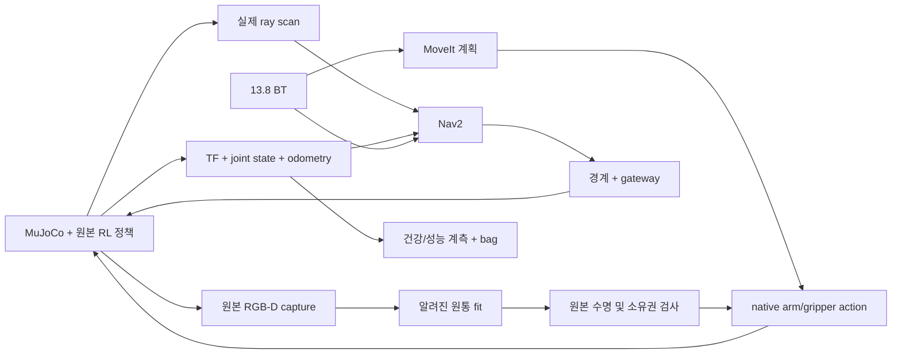

# 13.8 복합 시뮬레이션 실습 가이드

개발 중인 가이드. 연속 운반·내려놓기의 실제 인수와 Level 1/2/3·10회 평가는 SECTION_13_8_REPORT_KO.md의 실제 결과를 확인한다. 명령의 존재나 BT SUCCESS만으로 물리 성공을 판단하지 않는다.

2026-11-12 현재: 사용자 지시에 따라 Level2 반복 튜닝은 중단했다. 기존 Level3를 변경 없이1회 확인해 문 통과·새 관측은 통과했으나 PRE_GRASP의 MoveIt 충돌 계획 검증에서 거절됐다. 파지·귀환·놓기 정상 완주는 미달이며 인수 보류다. 최신 판단은 [기준 검토·전환 보고](SECTION_13_8_STATUS_CRITERIA_LEVEL3_SWITCH_20261112_KO.md)와 [Level3 단일 검증 결과](SECTION_13_8_LEVEL3_BASELINE_RESULT_20261112_KO.md)를 우선한다. 원고의3cm/평균120초와 내부15mm·높이20mm 등의 추가 witness를 구분하며, 이 가이드 실행만으로 목표 달성을 보증하지 않는다.

이후 같은 날짜의 사용자 정책 변경에 따라 새 교육용 평가는 `education_v1`을 사용한다. 목표는10회 중8회 이상 성공/성공 임무 평균600sim초 이하/최종 오차10cm 미만/측정 최대 기울기.15rad 미만/평균CPU85% 미만이다. 원고 기준 `book_v1`과 과거 FAIL은 보존한다. [정책 명세와 적용 범위](SECTION_13_8_EDUCATION_CRITERIA_SPEC_20261112_KO.md)를 참조한다. 충돌 검사·관측/입력 수명·실제 접촉·안전 종료와 내부 제어 설정은 이 평가 수치 변경으로 완화되지 않는다.

새 단일 임무는 `--criteria-profile education_v1`(기본값)을 기록한다. 새 batch의 `prepare`도 기본 education_v1이며 plan에 수치까지 고정한다. 원고 비교용 새 batch는 prepare 때 `--criteria-profile book_v1`을 명시한다. run/report 때 다른 기준으로 전환할 수 없고 기존v1 plan은 book_v1로 계속 해석한다. 교육용 평균 시간/위치는 성공 임무만 계산하고 실패도 전체 성공률 분모에 남긴다. CPU/기울기는 실패를 포함한 유효 측정을 사용하며 표본 수를 공개한다. 기준 선택은 충돌 경로 실행이나 미완료 임무의 성공을 뜻하지 않는다.

## 1. 소스 확보와 환경

현재 기준은 공개13.6이 아니라 로컬13.7의13ecb58d에서 확장한 feat/ch13-section-13-8이다. 13.8 branch는3447c9e8까지 원격 게시한 이력이 있다. 현재 최신 remote ref는 다시 확인하며 새 환경 다운로드/engine 재현 검증은 별도다. 기존 로컬 work/Pysical_AI_ROS2_13_8를 사용한다. sources/와 과거 worktree·증거를 수정하지 않는다.

WSL Ubuntu24.04, ROS2 Jazzy, /home/jinho/ch13_reuse_iit_d010212_venv와 sibling upstream-iit-locomanipulation-d010212 자산을 재사용한다. MuJoCo3.13.0, MoveIt2.12.4, moveit_msgs2.6.0, rosbag2/rosbag2_py0.26.11이며 원본 정책·native arm PD·gripper0.5N을 유지한다. 전역 venv 활성화나 시스템 dist-packages 선삽입을 하지 않는다.

아래 ROOT는 모든 터미널에서 실제 경로로 지정한다.

```bash
ROOT=/mnt/c/Users/Jinho/.codex/.chatgpt-projects/g-p-6ad1e56cf8f881919fe23e1ab94d2855/work/Pysical_AI_ROS2_13_8
cd "$ROOT"
export CH13_REUSE_BUILD=/home/jinho/ch13_reuse_13_8_build
```

처음 한 번 의존성 추출과 분리 build를 수행한다. script는13.6/13.7 build와 그 상하위 경로를 거부한다. 실행 중인 engine이 없어야 한다. BT deb는 새 build 아래에 버전·hash를 고정해 추출하고 기존 overlay를 덮어쓰지 않는다.

```bash
bash Ch13/scripts/reuse_13_8/build.sh
bash Ch13/scripts/reuse_13_8/env.sh Ch13/scripts/reuse_13_8/audit_install.py /tmp/ch13_13_8_install_audit.json
```

감사는 실제 venv child의 NumPy 우선순위·BT/ROS import와 설치 파일 바이트·외부94자산을 검사한다. 모델/실행 의존성이 없으면 engine 시작 전에 해결한다. 학생 기본 실습마다 과거243개 시험이나 전체 matrix를 실행할 필요는 없다.

## 2. 13.8.2 테스트 베드와 성공 정의

현재 연속 수명 경계 개발 fixture는 알려진 upright20g 원통과 기존 파지 받침대, 귀환 측 수령 받침대다. 이전 개발 단계의 설명이다. 현재 Level1 바닥 및 아래의 Level2/3 기하는 구현됐으며 실제 인수 실패·제한은 전용 평가 보고를 따른다. 실제 지원 fixture와 source freeze를 결과 보고서에 명시한다.

현재 지원 fixture는 아래와 같다. 귀환 base 목표는 모두(0,0,π)이며 development를 원고 Level1로 부르지 않는다.

| scenario | 대상 중심(m) | 수령 중심(m) | 지지면 높이(m) | 실제 상태 |
|---|---|---|---|---|
| development | (1.8,0,0.54) | (-0.8,0,0.54) | 0.50 | v15 연속 기능 1회 PASS, 시간/위치 목표 미달 |
| level1_floor | (2,0,0.04) | (-0.6,0,0.04) | 0 | v17 파지/귀환 PASS·놓기 FAIL, v18 작은 조각 폐기로 관측 FAIL, v19 팔wall deadline FAIL, v20 관측deadline FAIL, v22 후퇴 중 만료 FAIL, v22 연속 동작·정상 종료 완료/높이 기준 FAIL |

고정 camera는 base 좌표(0.4,0.4,0.29)m다. development는 yaw -31.607502도/pitch0, Level1은 yaw -40도/pitch down35도다. 실제 extrinsics는 sensor_summary.json과 해당 capture의T_map_camera로 확인한다. 과거 mount와 실패별 변경 이력은 PROGRESS에 보존했다. 현재 검출은 §9의 합의점 검사이며 과거 boundary 이웃 필터와 누적하지 않는다. source/capture/TF/hash를 보존하며 설정을 실행 중 바꾸지 않는다.

최종 성공은 동일 engine의 실제 파지, 운반 중 접촉/높이 유지, 귀환 terminal와 실측 정착, 수령 받침대 지지 후 개방, 물체 분리와2sim초 안정 유지, 정상 회수까지 모두 필요하다. 제어는 원본 RGB-D fit과 live 접촉을 사용하고, target freejoint는 engine 종료 뒤 판정에만 사용한다. 논리적 planning attach는 물리 weld가 아니다.

## 3. 13.8.3 순차 기동과 미션

이 재사용 profile은 원고의 integrated_robot_description/system_bringup.launch.py 대신 기존 ch13_navigation_reuse/navigation.launch.py를 소유 runner가 단계적으로 기동한다. 하나의 소유 runner가 Nav2와 MoveIt·engine의 종료까지 회수하므로 별도 engine을 중복 실행하지 않는다.

실행 전 잔여 검사 출력은 새 파일로 지정한다. 도구가 보여 주는 PID/lock만으로 다른 작업을 종료하거나 lock 파일을 삭제하지 않는다.

```bash
python3 Ch13/scripts/reuse_13_5/inspect_r2_residuals.py /tmp/ch13_13_8_before.json
```

터미널 A에서 새 UUID와 검증할 manifest를 명시한다. 아래 v24는 현재 개발 실행용 동결이며 Level1 실제 인수는 진행 중이다. 현재 소스와 다르면 freeze verify가 거부하며, 기존 manifest를 수정해 통과시키지 않는다.

```bash
CASE=$(python3 -c 'import uuid; print(uuid.uuid4())')
STAGE_REPORT=/tmp/ch13_13_8_stage_$CASE.json
bash Ch13/scripts/reuse_13_8/env.sh Ch13/scripts/reuse_13_8/stage_runtime.py \
  --manifest "$ROOT/Ch13/dependencies/section_13_8_system_v24.json" --output "$STAGE_REPORT"
RUN_ROOT=$(python3 -c 'import json,sys; print(json.load(open(sys.argv[1]))["runtime_root"])' "$STAGE_REPORT")
bash "$RUN_ROOT/Ch13/scripts/reuse_13_8/env.sh" -u "$RUN_ROOT/Ch13/scripts/reuse_13_8/run_mission.py" \
  --repo-root "$RUN_ROOT" --evidence "$ROOT/Ch13/evidence/section_13_8_system/$CASE" \
  --manifest "$RUN_ROOT/Ch13/dependencies/section_13_8_system_v24.json"
```

staging은 engine이 꺼진 상태에서 소스 동결별로 한 번 준비한다. Windows mount의 source 접근 지연을 피하기 위해 새13.8 build 아래 같은 hash의 소스 사본을 만들고, 외부 자산과 engine lock은 기존 sibling 파일로 연결한다. 이 단계는 로봇 실행이나 새 권한을 만들지 않는다. 같은 동결로 반복 실행할 때는 RUN_ROOT를 재사용하고 CASE만 새 UUID로 바꾼다. source가 바뀌면 기존 동결을 수정하지 말고 새 동결/사본을 준비한다. runner가 runtime_stage.json으로 실행 사본의 근거를 보존한다. 현재 v24 명령은 개발 검증 대상이며 물리 인수 상태는 보고서를 확인한다.

터미널 B는 시스템 ROS CLI 환경이다. engine/센서가 준비된 뒤 /start_mission을 보내야 하며 현재 시작 대기 예산은 준비 후30wall초다. 개발 자동 시작은 runner에 --auto-start를 지정하며 같은 토픽 수신을 통과한다.

```bash
source /opt/ros/jazzy/setup.bash
export ROS_LOCALHOST_ONLY=1 ROS_DOMAIN_ID=135
ros2 topic pub --once /start_mission std_msgs/msg/Empty '{}'
```

기본적으로 선별 bag를 기록한다. 최초 불확실한 물리 개발 사례는 --no-bag로 계측 영향과 운반 경계를 분리할 수 있으며, bag 실습 완료로 집계하지 않는다. live_status.json은 진행 참고이며 새 권한이나 최종 판정이 아니다.

운반은 원본300ms 이내 camera capture health와 매 physics step의 지정 양 finger 접촉·force-hold를 검사한다. 만료된3D point는 그대로 만료 상태이며 팔 계획/개방의 권한이 아니다. 귀환 후 실제 정착과 fresh3D 재획득이 있어야 PLACE에 들어간다. source 나이100wallms 이내인 새 capture를 기다린 뒤 귀환을 재진입하며, 기존300ms watchdog을 늘리지 않는다.

## 4. 건강 상태와 데이터 흐름



실제 토픽은 /ch13/reuse/scan, /ch13/reuse/rgb, /ch13/reuse/joint_states, /ch13/reuse/odometry, /ch13/reuse/vision/observation, /ch13/reuse/observed_target다. Nav2 action /navigate_to_pose 및 MoveIt 서비스는 전역 이름이다. 원고의 /camera/rgb, /vision/target_pose 등 이름이 모두 존재한다고 가정하지 않는다.

```bash
ros2 run tf2_tools view_frames
ros2 topic hz /ch13/reuse/scan
ros2 topic hz /ch13/reuse/rgb
ros2 topic hz /ch13/reuse/joint_states
```

TF는 reuse/map→reuse/odom→reuse/nav_base→reuse/base 및 각 관절·scan·camera_optical·tcp를 확인한다. health.json은 receipt 주파수와 sim delay·원본 capture wall 나이를 구분한다. camera15Hz 교육 profile은 원고30Hz 목표를 충족했다고 표현하지 않는다. 느린 simulation에서 wall 수신 주파수와 sim 제어50Hz도 구분한다. CPU100% 한 코어만으로 MoveIt thread 폭주라고 단정하지 않는다.

## 5. 13.8.4~6 프로파일링과 고장 판독

trial.json의 sim_s/wall_s는 /start_mission 수신부터 실제 place 완료까지다. mean CPU는 소유 프로세스 tree의 CPU초를 해당 프로세스의 sched_getaffinity 코어수와 wall초로 나눈 값이다. 다른 ROS domain의 daemon은 소유 tree에 포함하지 않는다. health.json의 capture 나이는 최초 촬영 monotonic 시각을 보존한다. 전압 모델이 없어 battery_voltage는 unavailable이다.

원고 목표는10회 성공률≥90%, 평균120sim초 이하, 성공 위치 오차<3cm, 최대 roll/pitch<0.1rad, 평균 CPU<70%다. sim 시간 목표와 별도로 wall 시간을 항상 공개한다. 한 번의 성공으로 강건성이나99% 성공을 주장하지 않는다. 과거13.7의 파지만 포함한 정상 사례도161.90sim초였으므로120초 달성을 전제하지 않는다.

문제별 기본 대응:

- 넘어짐/충돌: 실패 위치와 접촉·자세·phase를 보존한다. torso teleport, 원본 정책 kill, 몸통 shift나 새 WBC로 통과시키지 않는다.
- 통신 지연: 원본 stamp·receipt·source GID와 CPU 구간을 확인한다. QoS를 일괄 Best Effort로 바꾸거나 nice -10을 기본 적용하지 않는다.
- 물체 이탈: finger 접촉·force-hold·상대 slip을 확인한다. effort cap, 마찰, 질량, 가상 부착으로 성공을 만들지 않는다.
- BT 중단: cancel ACK, 실제 CANCELED, 물리 정착, worker join, 자식 종료를 따로 확인한다. 파지 중 임의 개방/수납은 회수가 아니다.

## 6. 13.8.7 기록과 재생

기본 bag에는 /clock, /tf, /tf_static, joint_states, odometry, cmd_vel_safe, vision/observation, manipulation/status, /start_mission을 선별 기록한다. 현재 compressed image publisher가 없으므로 원고의 compressed 토픽을 기록했다고 표시하지 않는다. 원본 RGB-D 증거는 기존 renderer capture 자료에 별도 보존한다. bag는 SIGINT로 닫힌 뒤 metadata와 메시지 수를 확인해야 한다.

현재 추가로 vision/health, navigation/status, validation/bt_log도 기록한다. 실제 v4 실패 사례의12토픽131424메시지 무결성과 별도domain136 수신 재생을 확인했다. 이는 전체 raw RGB-D 이미지 bag나 비전/Nav2 알고리즘 전체 재생 검증은 아니다.

```bash
bash Ch13/scripts/reuse_13_8/env.sh Ch13/scripts/reuse_13_8/inspect_recording.py \
  --bag /absolute/path/to/case/bag --output /absolute/path/to/case/bag_verification_new.json
bash Ch13/scripts/reuse_13_8/env.sh Ch13/scripts/reuse_13_8/replay_recording.py \
  --bag /absolute/path/to/case/bag --output /absolute/path/to/case/replay_verification_new.json
```

두 도구는 기존 출력 덮어쓰기를 거부한다. inspect는 ROS node를 시작하지 않고 CDR를 읽는다. replay는 스스로 domain136을 사용하고 TF static·관측·camera health·BT log만 선택해 player clock으로 재생한다. live lease, 시작 명령과 actuator topic은 내보내지 않는다. 기록/재생 PASS는 원래 실패한 미션을 PASS로 바꾸지 않는다.

재생은 engine을 끄고 별도 domain136에서 수행한다. 기록된 /clock과 새 player clock을 동시에 발행하지 않도록 재생 토픽을 선택한다. live lease 토픽과 actuator command를 재생하지 않는다.

```bash
export ROS_DOMAIN_ID=136
ros2 bag info /absolute/path/to/bag
ros2 bag play /absolute/path/to/bag --clock --topics \
  /tf /tf_static /ch13/reuse/joint_states /ch13/reuse/odometry /ch13/reuse/vision/observation
```

재생은 분석 입력이다. 과거 capture·session·GID를 새 live 권한으로 바꾸지 않는다. PlotJuggler는 선택 도구이며 미설치 상태를 실습 성공으로 표시하지 않는다.

## 7. 개발자 부품 회귀

Windows mount에서 spawn 자식의 source import 비용이15초 카메라 시작 예산을 소진한 기록이 있다. 아래 도구는 동일 source/fixture hash를 확인한 WSL native 사본에서 부품을 실행한다. 새 build 아래 snapshot.json과 tests.log를 보존한다. 공유 lock과 원본 모델은 같은 파일을 참조한다.

```bash
python3 Ch13/scripts/reuse_13_8/stage_component_sources.py
```

학생 기본 mission마다 이 전체 회귀를 반복하지 않는다. engine 중 build/pytest/대용량 사후 분석을 병행하지 않는다.

## 8. 원본 보존·압축·복원

engine이 정상 회수되고 공유 lock이 free일 때 명시한13.8 UUID 사례만 압축한다. 모델/정책 가중치·생성 URDF/SRDF·embedded description을 제외하고 raw 원본은 그대로 둔다. 같은 raw.tar.gz/raw_manifest.json이 있으면 덮어쓰지 않는다. 과거 FAIL을 압축/복원했다고 PASS로 바꾸지 않는다.

```bash
bash "$ROOT/Ch13/scripts/reuse_13_8/env.sh" "$ROOT/Ch13/scripts/reuse_13_8/archive_evidence.py" \
  --repo-root "$ROOT" "$ROOT/Ch13/evidence/section_13_8_system/$CASE"
RESTORE=/tmp/ch13_13_8_restore_$CASE
mkdir -p "$RESTORE"
cp --update=none "$ROOT/Ch13/evidence/section_13_8_system/$CASE/raw.tar.gz" "$RESTORE/"
cp --update=none "$ROOT/Ch13/evidence/section_13_8_system/$CASE/raw_manifest.json" "$RESTORE/"
bash "$ROOT/Ch13/scripts/reuse_13_8/env.sh" "$ROOT/Ch13/scripts/reuse_13_6/restore_evidence.py" "$RESTORE"
```

복원은 archive와 개별 파일hash를 확인하며 기존 파일의 내용이 다르면 거부한다. 모델·실행 의존성 설치나 원격 다운로드 검증을 대신하지 않는다. 과거 원본 verdict를 보존하고 재판정이 필요하면 해당 사례의 source/config를 사용해 새 출력 파일로 남긴다. 복원한 과거 capture·session은 live 명령의 근거가 아니다.

## 9. 반복 실패와 현재 검출 계약

v14의13.8 opt-in 원통 fit은 기존 이웃 경계 필터를 끄고 고정 축·반경 모델의 합의점 선별을 적용한다. side점95% 이상이 모델에서2mm 이내여야 하며, 선별 뒤에도RMS1.5mm·높이75~105%·최소20점·side 폭을 요구한다. residual_m은 이 mode의 합의점 RMS이므로 raw_residual_m/raw_points/outlier_points/surface_inlier_fraction도 함께 확인한다. 기존13.6/13.7은 원래 전체점 검사를 유지한다. capture300ms·촬영 이전TF100ms·GID/hash·물리/접촉/실행 제한은 바뀌지 않는다.

팔 준비의 최초 타입 로딩은13.8 ready에서 수행한다. 긴 초기화를 heartbeat 주기 안에서 실행하지 않기 위한 것으로, 타입 준비가 새 동작 권한을 주지는 않는다. startup_preparation 이벤트와 arm_probe.json의 초기화 구간, renderer_captures.json의 render_started_wall/render_finished_wall/render_elapsed_cpu_s, health.json의 프로세스별 CPU를 판독한다. 공식 자료·실제 실패별 구분·수정/남은 검증은 SECTION_13_8_LATENCY_DIAGNOSIS_KO.md를 참조한다. 새 동결의 실제 인수 상태는 결과 보고서를 확인한다.

v15에서는 live_status.json 파일 기록을ROS timer 밖의단일owned writer로분리한다. 읽기잠금으로표시갱신이실패하면이전표시가남을수있다. telemetry_delivery.json의write_errors/last_error/overwritten_waiting/joined를확인하고최종trial/BT/engine 판정과구분한다.

## 10. 원고 Level1 연결 상태

명시적`--scenario level1_floor`는바닥2m 원통·받침대없음·귀환측바닥수령점을사용한다. 기본값`--scenario development`는이전개발fixture다. 기능PASS실측은v15 development 1회이며Level1 전체는v22 계측실제검증을준비중이다. 원고Level2/3·10회평가완료로해석하지않는다.

Level1은카메라를아래35도·yaw-40도로고정하고팔은아래30도/사전6cm 접근을사용한다. 실제floor지지와새관측수령영역확인전에는개방하지않고팔이몸통/다리/바닥에힘을주며관통하면latch fault다. 명령의다른인자는같으며새CASE로runner에`--scenario level1_floor`를추가한다. source/설정이달라진사례를v15정상실측이나고정10회에섞지않는다. 상세M0·구현계획은SECTION_13_8_WORLD_PLAN_KO.md를참조한다.

v17의센서stream은물리표면이아닌붉은attachment_site 보조표시를제외한다. segmentation ID를실제검출에사용하지않는다. v18의floor LOWER는action terminal후실측팔저속/base정착/지지접촉을0.5sim초연속확인하며최대20wall초를기다린다. 이후에도기존지지확인·개방·실제접촉해제·새관측·scene분리readback·후퇴·유지가필요하다. 관측수명/물리/힘제한을늘려통과시키지않는다. 원인과공식ref는SECTION_13_8_FLOOR_VISION_DIAGNOSIS_KO.md에있다.

 v20의floor 시간보정은기존coarse배율안에서같은연속제한을통과하는세밀한배율을찾는다. 경로/모든waypoint와0.05rad/s·0.1rad/s²·120sim/240wallaction한계는유지한다. 기본development는기존정책이다. 실제policy는pick_mission.json의execution_time_adapter.scale_policy와scale로확인하며,공식자료/실패원인은SECTION_13_8_TIMING_DIAGNOSIS_KO.md에있다.

v22은제어를유지한진단계측동결이다. capture_stage_timing.json의최근256개scan/상태발행/pre-offer/put비용과renderer_captures.json의request_offer_wall·request_to_render_wall_s를확인한다. capture_wall은원래촬영시각이며offer시각으로대체하지않는다. 현재관련21시험·짧은센서재현만통과했고실제전체부하deadline원인은조사중이다.
현재v24는Level1 도착 허용 반경1.5cm를공식Nav2 RewrittenYaml로전달한동결이다. 관련13개회귀와짐없는전진navigation1회(11.82mm)만추가검증했으며,이동허가전cold-start실패가한차례있었다. v22의전체연속동작/물리높이FAIL이력을v24전체인수로옮겨쓰지않는다. startup FAULT는arm/강제reset으로우회하지말고원본을보존한다.

## 12. Level 2·3 및 고정 총 10회 평가

[작업명세](SECTION_13_8_LEVEL23_EVALUATION_SPEC_KO.md)와 [실제평가보고](SECTION_13_8_LEVEL23_EVALUATION_REPORT_KO.md)를 먼저 읽는다. 현재 L2/L3는 v28 각5회 모두 엄격한 성공 기준에 미달했다. `level2_obstacles`는 0.5m 테이블/박스/5도 경사, `level3_house`는 폭1.1m 문/식탁 아래 바닥 원통이다. 개발용 실패 사례를 학생의 성공 예제로 제시하지 않는다.

기존 1~3절의 분리 build·의존성 감사 후 **실제 소스와 일치하는 새 이름의 freeze**를 만든다. 과거 v28/v29 파일을 덮어쓰지 않는다. 현재 checkout과 과거 freeze가 불일치하면 원래 버전의 보존 소스 또는 정확한 commit을 사용한다. build/시험/큰 archive 작업이 모두 끝나고 실제 잔여/공유 lock free를 확인한 뒤 engine을 실행한다.

```bash
# 준비/감사는 engine 실행 전에 한다. 새 경로를 선택한다.
bash Ch13/scripts/reuse_13_8/env.sh Ch13/scripts/reuse_13_8/freeze_runtime.py write Ch13/dependencies/ch13_my_freeze.json
bash Ch13/scripts/reuse_13_8/env.sh Ch13/scripts/reuse_13_8/stage_runtime.py --manifest Ch13/dependencies/ch13_my_freeze.json --output /tmp/ch13_my_stage.json
```

stage JSON의 `runtime_root`와 `manifest_relative_path`를 확인한다. manifest는 저장소 안의 새 경로여야 하며 외부 /tmp manifest는 staging에서 거부한다. 수동으로 snapshot 소스를 수정하지 않는다. 아래 변수를 실제 JSON에서 읽고 native snapshot으로 이동한다.

```bash
RUNTIME=$(python3 -c 'import json; print(json.load(open("/tmp/ch13_my_stage.json"))["runtime_root"])')
REL_MANIFEST=$(python3 -c 'import json; print(json.load(open("/tmp/ch13_my_stage.json"))["manifest_relative_path"])')
MANIFEST="$RUNTIME/$REL_MANIFEST"
# CASE_ROOT와 BATCH는 충분한 디스크 공간이 있는 새 evidence 경로를 선택한다.
cd "$RUNTIME"
python3 Ch13/scripts/reuse_13_5/inspect_r2_residuals.py /tmp/ch13_before_level23.json
bash Ch13/scripts/reuse_13_8/env.sh -u Ch13/scripts/reuse_13_8/run_mission.py \
  --repo-root "$RUNTIME" --manifest "$MANIFEST" \
  --evidence "$CASE_ROOT/$(cat /proc/sys/kernel/random/uuid)" \
  --auto-start --scenario level2_obstacles
# Level3는 scenario만 level3_house로 선택한다. 한 번에 engine 하나만 실행한다.
```

고정 총10회는 새 빈 batch 폴더로 plan을 먼저 만들고 UUID/source/scenario hash를 기록한 후 실행한다. 교대 각5회이며 10회씩 각각의 평가가 아니다. seed는 기존 초기 설정이고 스케줄링은 비결정적이다.

```bash
bash Ch13/scripts/reuse_13_8/env.sh Ch13/scripts/reuse_13_8/evaluate_batch.py prepare \
  --repo-root "$RUNTIME" --manifest "$MANIFEST" --batch "$BATCH" --case-root "$CASE_ROOT"
# plan.json 보존 후 동일한 인자로 실행. 중간 소스/조건 변경·실패 교체 금지.
bash Ch13/scripts/reuse_13_8/env.sh -u Ch13/scripts/reuse_13_8/evaluate_batch.py run \
  --repo-root "$RUNTIME" --manifest "$MANIFEST" --batch "$BATCH" --case-root "$CASE_ROOT"
```

`run`은 기존 attempt를 거부하고 사례 사이 잔여 검사를 수행한다. 결과 FAIL의 exit1은 완료된 평가의 실패일 수 있으므로 JSON/CSV와 종료 자료를 함께 읽는다. `trial.complete`는 worker 종료 자료 완성이며 성공이 아니다. 원래 `trial.success`, Pick/transport/world 판정과 각 목표를 확인한다. 누락 수치를0으로 채우거나 유효1건 평균을10건 성공 평균으로 표현하지 않는다. before/after 잔여 FAIL이면 다음 engine을 실행하지 않는다. 정상 종료·cancel ACK·terminal·실제 정지·자식회수는 별개다.

개발자 부품 시험은 engine이 없는 상태에서만 선택 실행한다. 학생 기본 실습마다 전체389개나과거engine matrix가필수는아니다. 실패 수명/TF/소유권 조건을완화하거나과거FAIL을덮어쓰지않는다.
