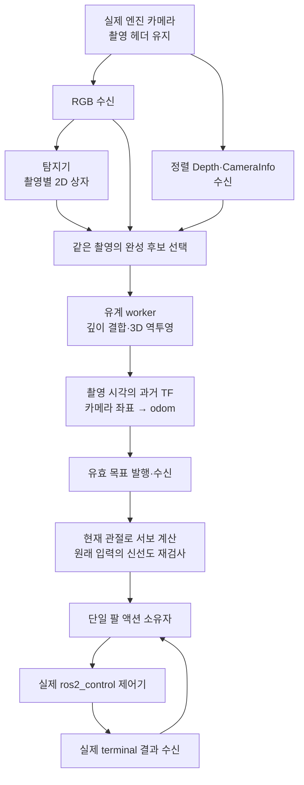
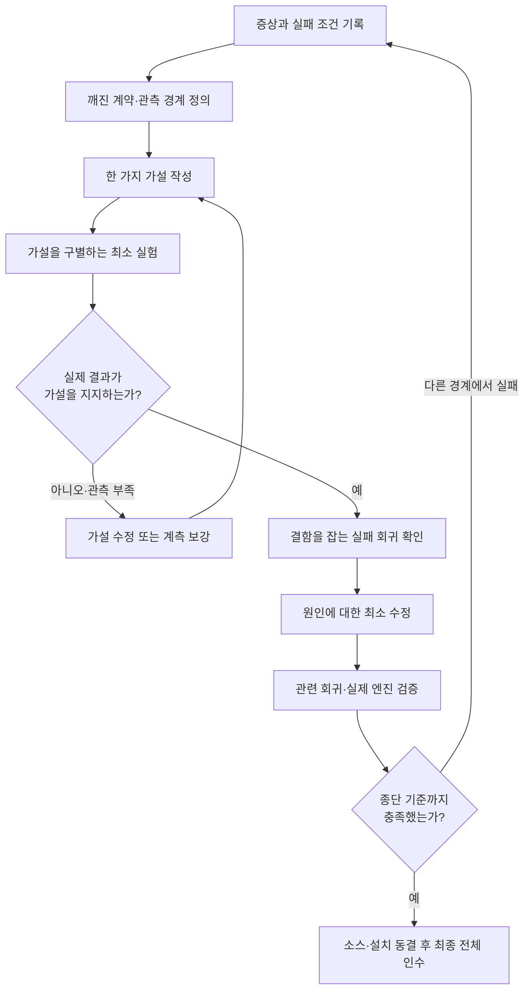
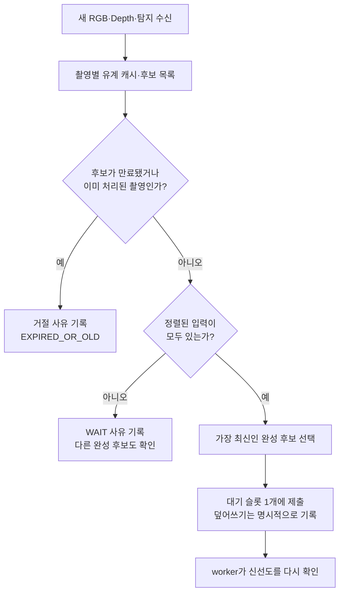
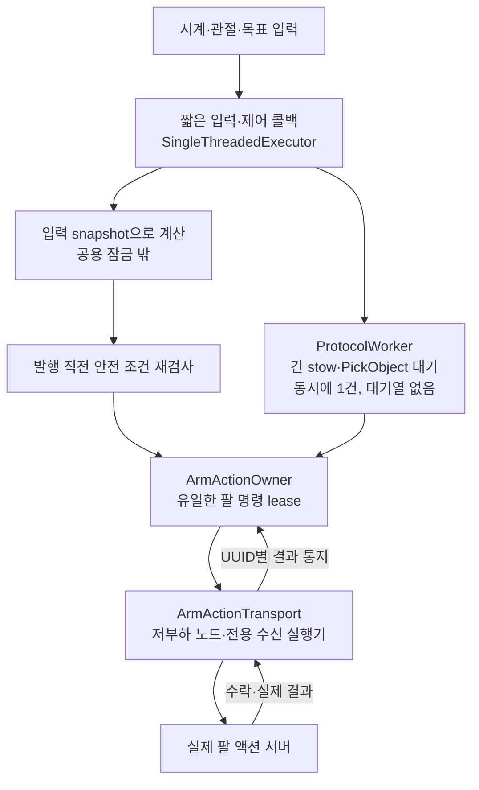
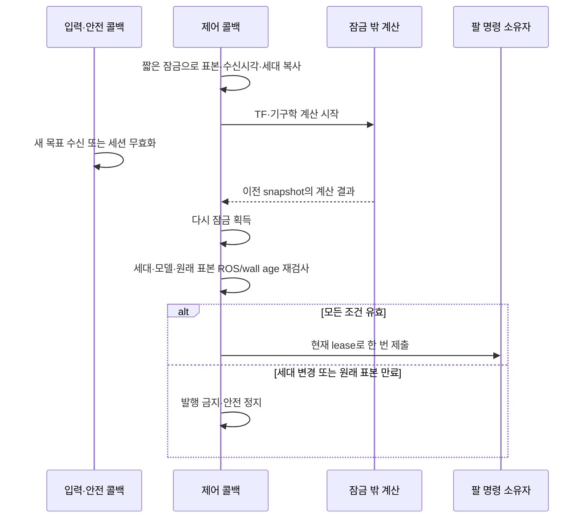
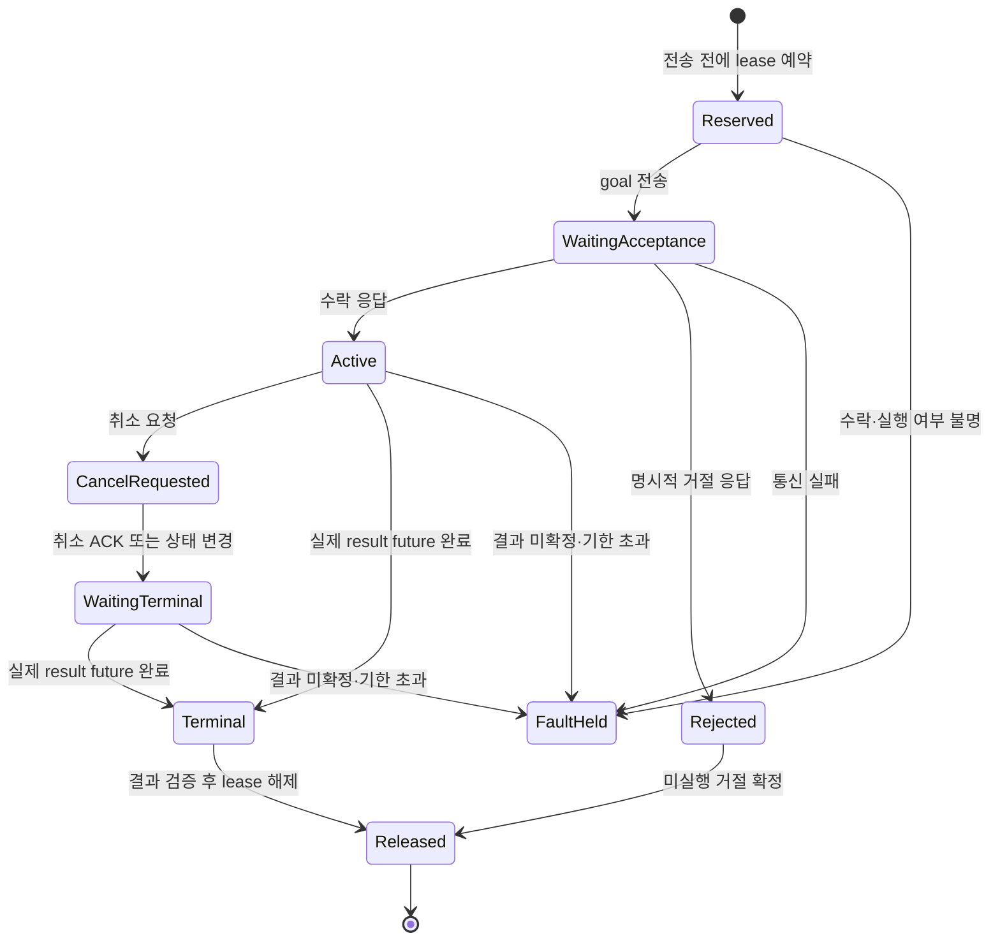
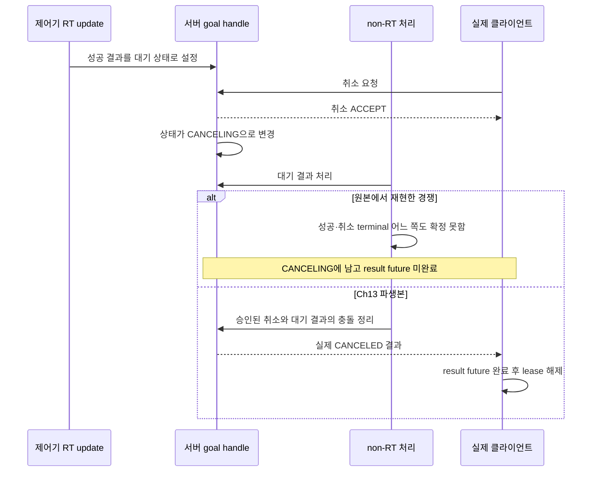
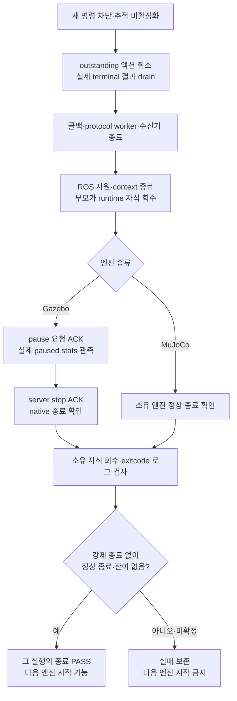

# 13.4절 디버깅 사례로 배우는 로봇 통합 시스템 문제 해결

> 교육 대상: ROS 2의 토픽·서비스·액션과 Python 기초를 학습한 학생 및 초급 로봇 개발자.
>
> 학습 목표: 복잡한 실패를 경계별로 분해하고, 가설을 실험으로 판별하며, 안전 기준을 유지한 채 종단 성공을 입증하는 방법을 익힌다.
>
> 근거: 2026-10-22 완료한 Ch13.4의 실제 소스·실패 로그·MuJoCo/Gazebo 인수 기록. 이 문서 작성 중에는 엔진 시험을 새로 실행하지 않았다. 실측 수치는 기존 고정 실행의 결과이며, 설명용 의사코드와 개념도는 실제 구현 전체를 대신하지 않는다.

## 1. 먼저 결론: 하나의 느린 함수가 아니라 여러 경계의 계약 문제였다

13.4절의 목표는 단순히 화면에 탐지 상자를 그리는 것이 아니다. **실제 카메라 입력으로 유효한 3차원 목표를 계속 만들고, 팔이 제한된 범위에서 추적하며, 입력 손실과 종료에 안전하게 대응하는 것**이다.

처음 관찰한 큰 증상은 세 가지였다.

1. 물체 탐지는 발생하지만 유효한 RGB-D/TF 결합 목표가 연속 갱신되지 않았다.
2. 팔 액션을 취소해도 클라이언트가 최종 결과를 확정하지 못하는 경우가 있었다.
3. Gazebo 또는 런타임이 정상 종료되지 않았다.

각 증상에는 서로 다른 원인이 겹쳐 있었다. 입력 불완성, 계산·스케줄링 지연, 공유 잠금, 액션 수신 경합, 서버의 완료/취소 경쟁, 종료 순서, 부모의 자식 회수 문제를 분리해야 했다.

핵심 교훈은 다음과 같다.

> “다음 단계가 보이지 않는다”와 “이전 단계가 실행되지 않았다”는 같은 말이 아니다. 어느 경계까지 실제로 진행됐는지 관측한 뒤 원인을 좁혀야 한다.

### 이 문서의 읽기 순서

- 2~4절: 성공 조건과 데이터 흐름을 정의한다.
- 5~7절: 입력 누락·시간 예산·동시성 문제를 해결한다.
- 8~9절: 액션 수명과 정상 종료를 검증한다.
- 10~13절: 실패 기록을 해석하고, 최종 인수와 교육 실습으로 연결한다.

## 2. 안전 계약을 고정해야 수정의 의미를 판단할 수 있다

버그를 고치기 전에 “바꿔도 되는 것”과 “유지해야 하는 것”을 구분했다.

| 유지한 계약 | 의미 |
|---|---|
| RGB-D 320×240 | 해상도를 낮춰 처리 시간을 줄이지 않는다 |
| 카메라 목표 15Hz | 목표 주기이지 모든 프레임의 처리 보장은 아니다 |
| 추론 기본 10Hz, 선택 15Hz | 시작 빈도 상한이며 실제 처리량은 별도 측정한다 |
| 촬영 ROS age 및 수신 후 wall age 300ms | 오래된 관측으로 새 명령을 만들지 않는다 |
| 촬영 시각의 과거 TF, timeout 100ms | 최신 TF로 촬영 당시 자세를 대신하지 않는다 |
| 팔 명령 최대 5Hz | 연속 명령의 발행 간격은 최소 200ms다 |
| 명령·관절·TF의 단일 소유권 | 실행기나 스레드 추가가 명령권 중복으로 이어지지 않는다 |
| 엔진 순차 실행 | 소유 프로세스 정리 확인 전 다음 엔진을 시작하지 않는다 |

촬영 헤더를 현재 시각으로 바꾸거나, 300ms를 늘리거나, 실패 후 자동 재활성화하면 숫자는 좋아질 수 있다. 그러나 그것은 같은 문제를 해결한 것이 아니라 시험 조건을 바꾼 것이다.

반대로 입력 QoS, 유계 캐시, 계산 방식, 콜백 배치, 액션 수신 자원, 종료 순서는 승인 범위 안에서 재설계했다. 이때도 변경 이유와 회귀 결과를 남겼다.

## 3. 전체 흐름: 탐지 성공과 제어 성공은 다르다



이 그림에서 탐지 상자가 나왔다는 사실은 `DET`까지의 일부 성공만 뜻한다. fusion 쪽 RGB가 없거나, Depth가 정렬되지 않았거나, TF가 없거나, 입력이 만료되면 유효 목표는 나오지 않는다. 목표가 나와도 액션 수락·실행·결과 수신은 각각 별도다.

### 시간과 좌표의 두 가지 질문

비전은 “**촬영 당시** 이 픽셀의 물체가 어디 있었는가?”를 계산한다.

```text
p_camera = deproject(pixel, depth, intrinsics)
p_odom   = T_odom_camera(t_capture) × p_camera
```

팔 제어는 “**현재** 관절 상태에서 이 목표를 어떻게 바라볼 것인가?”를 계산한다. 따라서 제어 단계에서 현재 관절이나 현재 카메라 자세를 사용하는 것 자체가 잘못은 아니다. 잘못은 **촬영 당시의 좌표 변환을 최신 TF로 대체하거나, 오래된 관측의 헤더를 지금으로 바꾸는 것**이다.

좌표를 부드럽게 하는 필터도 누락된 입력·잘못된 TF·만료된 관측을 유효하게 만들지는 못한다.

## 4. 문제 해결의 기본 루프: 가설을 코드보다 먼저 쓴다



예를 들어 “렌더러가 느리다”는 설명만으로는 부족하다. 다음처럼 써야 판별할 수 있다.

```text
관찰: 탐지는 있지만 완성 후보가 worker에 제출되지 않은 촬영이 있다.
가설: fusion 쪽 RGB 캐시가 같은 촬영의 RGB를 받지 못했다.
실험: 촬영별 RGB/depth/detection 수신과 후보 선택·제출 사유를 연결한다.
판정: WAIT_RGB가 관측되고, 해당 촬영이 실제 RGB 캐시에 없는지 확인한다.
```

가설과 다른 결과가 나오면 설명을 바꾼다. 수정한 코드가 있어도 실제 엔진에서 실패하면 완료가 아니다. 반복되는 최소 수정으로 전체 문제가 풀리지 않을 때는 같은 구조를 계속 덧대지 않고 책임과 실행 경계를 다시 검토했다.

### 최소 재현과 실제 엔진 시험의 역할

- 최소 재현은 “이 원인이 이 증상을 만들 수 있는가?”를 빠르게 판별한다.
- 회귀 시험은 같은 결함이 다시 들어오는 것을 막는다.
- 실제 엔진 시험은 렌더링·DDS·TF·관절·제어기·종료가 연결된 결과를 확인한다.

어느 하나도 나머지를 완전히 대신하지 못한다. 진단 도구나 디버거 아래에서 성공한 실행도 타이밍이 달라지므로 일반 실행의 인수 성공으로 승격하지 않았다.

## 5. 첫 번째 문제: 왜 탐지는 있는데 유효 목표가 없었는가?

### 5.1 worker 뒤가 아니라 worker 앞을 관측한다

처음에는 TF나 worker 지연을 의심하기 쉽다. 그러나 실제로 확인한 일부 구간은 그 이전이었다. 탐지와 Depth는 있는데 fusion의 RGB 캐시에 같은 촬영이 없었다.

탐지기와 fusion은 서로 다른 구독자다. **탐지기가 RGB를 받았다고 fusion도 받았다고 가정할 수 없다.** 이 관측만으로 물리 네트워크의 패킷 유실 원인까지 확정한 것도 아니다.

그래서 계측 범위를 완성 후보가 제출되기 전까지 넓혔다.

| 관측 경계 | 확인할 내용 |
|---|---|
| 입력 수신 | 어떤 촬영의 RGB·Depth·탐지가 각 소비자에 도착했는가 |
| 후보 선택 | 완성 후보인가, `WAIT_RGB`·`WAIT_DEPTH`·`WAIT_INFO` 등인가 |
| 제출·대체 | `SUBMITTED`, `SUPERSEDED`, `SLOT_OVERWRITTEN` 중 무엇인가 |
| worker | 언제 처리했고, 만료·깊이 오류·TF 오류 중 무엇이 발생했는가 |
| 출력 | 목표가 발행됐는가, 제어 노드도 같은 촬영의 목표를 받았는가 |

촬영 stamp만 무조건 전역 식별자로 쓰지 않고 frame, clock epoch, producer/boot 등의 진단 문맥을 함께 확인했다. 시뮬레이션 시계가 되돌아가면 같은 숫자의 촬영 시각이 다시 나올 수 있기 때문이다.

진단도 유계다. 상한이나 유실로 기록이 없으면 `미관측/부분 관측`이지 곧바로 `콜백 미실행`은 아니다. 서로 다른 촬영의 p95 지연을 더해 한 촬영의 종단 지연이라고 부르지도 않았다.

### 5.2 최신 입력이 아니라 최신 ‘완성’ 후보를 선택한다



예를 들어 촬영 A의 입력은 모두 모였고, 더 최신인 B는 탐지만 도착했다면 B 때문에 A를 지우지 않는다. A가 여전히 유효할 때 A를 처리할 수 있어야 한다. 반대로 A가 만료됐는데 “아직 B가 없으니” 계속 사용해서도 안 된다.

모든 프레임을 무한 큐에 쌓는 방식도 피했다. 오래된 작업을 순서대로 처리하면 처리량이 있어 보여도 제어 시점에는 이미 만료된 결과만 나오기 쉽다.

### 5.3 QoS를 맞추되 만능 해법으로 보지 않는다

탐지기·fusion의 관련 입출력을 유계 reliable로 맞추고 Gazebo 브리지의 실제 publisher 호환성도 검증했다. 이 과정에서 브리지에 넣은 `DEFAULT` QoS 문자열이 실제 파서에서 거부되는 새 결함도 발견했다. 지원되는 설정으로 보완하고 실제 publisher 생성 회귀를 추가했다.

중요한 점은 reliable 변경 뒤에도 전체 추적이 실패했다는 것이다. 즉, **입력 불완성과 시간 예산 부족은 별개의 문제**였다. reliable은 모든 프레임의 도착·300ms 내 처리·무한 처리량을 보장하지 않는다. best-effort 전용 외부 카메라와는 별도 호환 검토도 필요하다.

## 6. 두 번째 문제: 300ms 안에 도착하는가, 그 안에 계산도 끝나는가?

### 6.1 시간 예산을 두 시계로 검사한다

```text
capture_age = 제어 노드의 ROS 시각 - 원래 촬영 ROS 시각
receipt_age = 현재 monotonic 시각 - 원래 표본의 수신 monotonic 시각
```

촬영 ROS age는 관측이 얼마나 오래됐는지 본다. 수신 후 wall age는 시뮬레이션 시계가 멈추거나 느려져도 실제 대기 시간을 감시한다. 각 차이는 같은 시계 영역끼리 계산하며 ROS 시각과 monotonic 시각을 직접 빼지 않는다. 시계 역행·미래 시각·유효성 허용 범위도 별도 검사한다.

**TF timeout 100ms는 전체 파이프라인에 추가로 허용한 시간이 아니다.** TF를 기다리는 동안에도 원래 300ms 예산은 소모된다.

또한 15Hz는 약 66.7ms 간격으로 촬영을 목표로 한다는 뜻이지, 촬영→추론→TF→명령이 66.7ms 안에 끝난다는 뜻은 아니다. 15Hz로 더 자주 추론하면 큐와 CPU 경합이 커질 수도 있다.

### 6.2 측정 후 채택한 최적화와 버린 가설

| 판별 실험 | 실제 관찰 | 판단 |
|---|---|---|
| 실제 eye-in-hand 카메라의 그림자 맵 4096→512 | 분리 실험 렌더 p95 약26.78→9.22ms | 채택하되 실제 기하·YOLO·추적을 재검증 |
| 탐지 프로세스 OpenCV 8→1thread | fixture 계산300회 CPU 약1.977→0.388s | 해당 프로세스에 한정해 채택 |
| 500Hz 시계 입력, 5초 실행기 비용 비교 | Single CPU1.723s, Multi 1thread5.384s, Multi 4thread5.295s | 짧은 입력 콜백의 pool handoff 비용을 줄이는 근거 |
| 기구학 정적 정보 준비·투영 Jacobian 개선 | servo 계산 p95 약8.705→0.326ms | 독립 수치 비교 후 채택 |
| 렌더 프로세스 `LP_NUM_THREADS=2` | 해당 종단 비교에서 지연 악화 | 채택하지 않음 |
| BLAS/OMP 제한 | servo 개선 근거 부족 | 채택하지 않음 |

이 값들은 특정 장비·버전·fixture의 서로 다른 실험 결과다. 표의 p95나 CPU 시간을 합산해 전체 가속률을 만들면 안 된다. 특히 소프트웨어 렌더러 하나가 모든 실패의 원인이라고 결론내리지 않았다.

그림자 맵은 렌더링 품질 설정이다. 출력 320×240이나 물리 모델·카메라 보정값을 바꾼 것은 아니지만, 그림자 경계 품질은 달라진다. 따라서 “영향 없는 최적화”로 숨기지 않고 실제 컵 인식까지 다시 확인했다.

### 6.3 기구학을 빠르게 만들되 정답까지 함께 바꾸지 않는다

기존 계산은 매번 정적 URDF origin·axis·limit를 해석하고, 수치 미분을 위해 FK를 여러 번 수행했다. 이를 다음처럼 바꿨다.

1. 모델 생성 시 정적 변환·축·limit를 한 번 준비한다.
2. 현재 관절의 FK를 한 번 계산한다.
3. 관절 축과 위치에서 점의 미분을 구하고 영상 투영 미분과 결합한다.

회전 관절의 기본 관계는 `점 속도 = 관절 축 × (점 위치 - 관절 위치)`다. 모든 벡터를 같은 좌표계로 표현해야 한다. 이 관계를 투영 Jacobian과 결합해 반복 FK 비용을 줄였다.

검증은 개선된 코드로 자기 정답을 만드는 방식이 아니라, **비영 관절 자세의 MuJoCo 카메라 및 독립 유한차분 결과**와 비교했다. 모델이 바뀌면 준비된 정적 정보도 새로 만들어야 한다.

계산만 줄인 실제 시험에서도 다시 만료가 발생했다. 그래서 계산 최적화만으로 끝내지 않고 콜백과 긴 작업의 책임 분리를 이어갔다.

## 7. 세 번째 문제: 스레드를 늘리면 반드시 더 잘 동작하는가?

### 7.1 실행 자원과 명령 소유권을 분리한다



모든 일을 한 실행기에 넣지 않았다. 반대로 모든 콜백을 무조건 Reentrant로 풀거나 worker 수만 늘리지도 않았다.

- 짧은 시계·관절·제어 입력은 불필요한 Python thread pool 전달을 줄였다.
- 긴 stow/PickObject 프로토콜은 동시에 한 건인 worker에 위임하고 비동기로 기다렸다.
- 액션 수락·결과 수신은 고부하 부모 실행기와 분리했다.
- worker와 transport는 실행·통신 자원을 소유할 뿐, 두 번째 팔 명령권을 갖지 않는다.

단일 실행기에 동기 대기를 그대로 남기면 다른 입력을 막는다. 따라서 **단일 실행기 전환과 긴 작업 분리는 한 쌍의 설계**다. 전용 액션 수신 노드는 불필요한 `/clock` 구독과 launch 노드명 재매핑도 상속하지 않는다.

이는 해당 환경에서 측정한 비용에 대한 해결책이다. “SingleThreadedExecutor가 언제나 빠르다”, “Python 멀티스레드는 항상 무의미하다”, “50Hz가 hard realtime으로 보장된다”는 일반 법칙이 아니다.

### 7.2 공유 잠금 밖에서 계산하고, 보내기 직전에 다시 검사한다

서보의 TF·수학 계산 동안 공용 잠금을 잡으면 목표·관절·안전 무효화 콜백이 기다리게 된다. 잠금을 짧게 유지하려고 snapshot을 만들었지만, 이것만으로 충분하지 않았다. 계산이 끝날 때 snapshot은 이미 오래됐을 수 있다.



이를 “검사 시점과 사용 시점 사이의 경쟁”, 즉 TOCTOU 문제로 볼 수 있다. 처음 검사할 때 유효했다고 발행 시점에도 유효한 것은 아니다.

실제 `final-v3` 실패는 좋은 교육 사례다.

| 항목 | ROS 시각 또는 age |
|---|---:|
| 계산에 사용한 원래 촬영 | 27.242s |
| 계산 종료 | 27.544s |
| 원래 촬영의 age | 약302ms: 만료 |
| 그때 도착해 있던 더 최신 목표 | 27.378s, age 약166ms |

최신 목표가 유효해도 **이미 끝낸 계산은 이전 촬영을 사용했다.** 최신 표본의 시각을 이전 계산에 붙이면 안전 검사를 우회한다. 이 실패는 안전 장치가 정상 작동한 것이다. 해결은 기한을 늘리는 것이 아니라 계산과 실행 경합의 비용을 줄이는 방향이어야 했다.

의사코드로 요약하면 다음과 같다.

```python
# 설명용 의사코드: 실제 구현의 모든 예외·미래 시각 허용 범위를 생략했다.
with lock:
    work = snapshot(target, target_received_wall, joints, generation, model)

command = compute(work)  # 공용 잠금 밖

with lock:
    if generation != work.generation or model is not work.model:
        discard(command)
    elif original_capture_or_receipt_expired(work):
        disable_tracking()  # 새 입력으로 옛 계산의 TTL을 갱신하지 않음
    elif all_current_safety_gates_valid():
        arm_owner.send(command)
```

자체 리뷰에서는 snapshot에 원래 목표의 **wall 수신 시각**이 빠진 결함도 발견했다. 새 입력으로 옛 계산의 TTL이 갱신될 수 있는 실패 회귀를 먼저 만들고, 원래 ROS age와 wall age를 발행 직전에 함께 검사하도록 보완했다.

## 8. 네 번째 문제: 취소 ACK가 왔는데 왜 끝나지 않았는가?

### 8.1 액션에는 서로 다른 완료 경계가 있다



위 그림은 교육용 수명 모델이다. 모든 내부 변수를 그대로 옮긴 상태도가 아니다. 중요한 것은 `FaultHeld`를 정상 해제로 이어주지 않았다는 점이다. 불명확한 전송 실패가 “모터에 명령이 전달되지 않았다”는 증거는 아니기 때문이다.

다음은 서로 다르다.

1. 서버의 goal 수락 응답을 받았다.
2. `/status`에서 상태 변화를 봤다.
3. 취소 요청에 대한 ACK를 받았다.
4. 서버가 result 요청을 처리했다.
5. 서버가 terminal 결과를 응답했다.
6. 클라이언트의 실제 result future가 완료됐다.

lease 해제에 필요한 것은 실제 결과 확인이다. 상태 메시지나 취소 ACK만으로 대신하지 않는다. 명시적 goal 거절은 별도로 미실행이 확정된 경우다.

### 8.2 클라이언트와 서버를 따로 진단한다

같은 “결과가 안 온다”에도 두 종류가 있었다.

**클라이언트 실행기 경합:** 부모의 worker 4개를 점유하는 실제 ROS 최소 재현에서 수락·결과 처리가 지연됐다. 일부 실제 실행에서는 서버 실행 뒤 수락 콜백까지 약2.36초가 걸렸다. 저부하 전용 수신 실행기로 통신을 격리하고, future와 수신기 수명이 결과를 받을 때까지 유지되도록 했다.

**서버 완료/취소 경쟁:** 다른 실행에서는 result 요청이 실제 서버에 도착했는데 응답 발행이 없었다. 이때는 클라이언트 worker만 고쳐서는 해결되지 않는다.



설치된 `realtime_tools 3.13.0`의 해당 순서를 실제 C++ 서버/클라이언트로 재현했다. 원본은 cancel ACK가 있어도 결과가 없었고, 수정한 파생본은 실제 CANCELED 결과를 전달했다.

외부 설치본을 덮어쓰지 않고 JTC 4.42.1의 cpp/hpp와 realtime_tools 3.13.0의 header, 총3개 파일만 출처·커밋·라이선스를 기록해 Ch13 전용 namespace/plugin으로 분리했다. 비전 경로만 새 plugin을 선택하며, 실제 엔진 PID가 해당 라이브러리를 매핑했는지 해시까지 확인했다.

이 수정은 검증한 버전의 경쟁을 해결한 것이다. 다른 버전은 자동 호환을 가정하지 않고 빌드 시 명시적으로 막는다. 과거 경계 로그가 부족한 모든 실패의 내부 원인을 이 경쟁 하나로 확정한 것도 아니다.

## 9. 다섯 번째 문제: 프로세스가 없어졌으면 정상 종료인가?

### 9.1 종료는 시작의 반대가 아니라 의존성의 역순이다



엔진을 먼저 끄면 runtime은 실제 제어기 결과를 더 이상 받을 수 없다. 반대로 ROS context를 먼저 파괴하면 아직 실행 중인 callback/worker가 이미 파괴된 ROS 자원에 접근할 수 있다.

Gazebo의 pause 요청 응답과 실제 pause 상태도 구분했다. server stop 응답을 받았어도 native 프로세스 종료는 다시 확인해야 한다. 강제 SIGTERM/SIGKILL로 잔여를 없앴다면 정상 종료 성공이 아니다.

### 9.2 좀비와 회수 완료를 구분한다

`final-v4`에서는 안전 정지·실제 취소가 통과했는데 launch가 runtime 종료코드255를 보고했다. 기존 검사는 좀비를 “실행 중 아님”으로 분류해 다음 종료 단계로 너무 일찍 넘어갈 수 있었다.

일반적으로 자식은 실행을 끝낸 뒤에도 부모가 종료 상태를 회수하기 전까지 좀비 상태로 남을 수 있다. 따라서 다음 두 조건은 다르다.

- 살아서 실행 중인 자식이 없다.
- 원래 부모가 자식의 종료 상태를 정상적으로 회수했다.

별도 최소 재현은 실제 Python 3.12의 해당 실행 환경에서 `정상 exit0 → 좀비 → Popen 신호 경로의 poll → pidfd watcher 회수` 경쟁이255 보고를 만들 수 있음을 보여줬다. 이를 runtime 자체의 예외라고 단정하지 않았다.

대기 조건을 PID뿐 아니라 시작 tick과 함께 검사하고, 같은 자식이 부모에게 회수될 때까지 기다리도록 강화했다. 직접 부모인 Popen 자식만 직접 poll하고, 다른 launch의 자식은 그 부모의 회수를 기다린다. PID 재사용도 구분해야 한다.

첫 보완은 자기 Popen 자식까지 남이 회수하기를 기다리는 회귀를 만들었다. 이 실패도 남기고 수정했다. **“255를 무시한다”가 아니라 “255를 만들던 수명 경쟁을 제거한다”가 목표**였다.

## 10. 시험의 실패와 제품의 실패를 구분한다

### 10.1 기준 표본 없이 개선율을 계산할 수 없다

고정1초 대기만으로는 추적 활성화 전 픽셀 기준 표본이 모였다는 보장이 없었다. 그래서 다음 조건을 실제로 확인한 뒤 단 한 번 활성화했다.

- 서로 다른 촬영3개 이상.
- 유한한 픽셀 오차와 기존 중앙값 >1px 조건.
- 기준 측정 중 팔 명령0건.
- 기준 측정이 활성화 요청보다 먼저 끝남.

분모가 없는 개선율을 계산하거나, 이미 움직인 뒤의 값을 초기값으로 쓰면 올바른 평가가 아니다.

### 10.2 같은 `/clock`을 써도 각 프로세스의 소비 시점은 다르다

최종13.4 22회가 모두 통과한 뒤, 13.3 회귀의 합성 목표가 서버 시계보다56ms 미래여서 거절됐다. 서버의 허용 한계는50ms였으므로 거절 자체는 올바른 동작이었다.

시험 생성기가 기록한 원래 header를 유지한 채 100ms 동안 입력 전달을 준비하고 한 번만 전송하도록 보완했다. 서버 허용치를 늘리거나 거절 뒤 재시도하지 않았다. 이것은 **합성 시험 입력의 순서 보완**이며 비전 촬영 헤더를 현재 시각으로 바꾸는 우회가 아니다. 임의의 시스템에서100ms면 시계 동기화가 보장된다는 일반 해법도 아니다.

제어된60ms 시차의 실제 ROS 액션 회귀에서 실패를 먼저 확인하고, 수정 후 양 엔진13.3를 다시 검증했다. 제품·설치본은 그대로였고 변경은 probe와 그 회귀 시험뿐이므로 영향받지 않은22native를 반복하지 않았다. 별도 manifest로 정확히 두 파일의 차이만 허용했다.

### 10.3 단계별 실패를 지우지 않는다

| 보존된 단계 | 실패가 알려준 것 | 대응 |
|---|---|---|
| 최초 EGL20회:12PASS/8FAIL | 계측·EGL 수정만으로 종단 성공이 아님 | 입력·액션·종료 경계 분리 |
| `final/` | 제어 전 기준 표본 부족 | 시간 대기 대신 실제 baseline 조건 |
| `final-v2/` | 15Hz에서 수락 수신 정체 | 실제 ROS 수신 경합 재현·transport 격리 |
| `final-v3/` | 계산에 쓴 원래 입력이 약302ms로 만료 | 안전 검사 유지, 계산·실행 구조 개선 |
| `final-v4/` | 정상 작업 뒤 종료 회수 경쟁 | 부모의 실제 회수까지 기다림 |
| `final-v5/legacy_mujoco` | 합성 목표가 서버보다56ms 미래 | 시험 입력 순서만 보완·양 엔진 회귀 |

컴파일 오류·존재하지 않는 테스트 파일·잘못된 테스트 import는 행동 결함의 재현으로 세지 않았다. 도구가 실패한 것과 가설이 실험으로 입증된 것은 다르다.

## 11. 무엇으로 최종 성공을 입증했는가?

### 11.1 최종 실행 전 소스와 설치본을 동결한다

“Git HEAD가 같다”만으로는 충분하지 않다. 작업트리의 미커밋 변경이나 오래된 ROS overlay 때문에 실제 실행 바이트가 다를 수 있다.

그래서 실행 UUID, 실제 명령, 소스 파일 SHA256, 설치 파일 SHA256, 실제 라이브러리 매핑, 원본 관측과 종료 로그를 함께 남겼다. 동결 전후 바이트를 대조하고 첫 실패에서 batch를 중단했다. 실제 엔진은 소유 정리 확인 후 순차 실행했다.

최종 native 동결은167소스/380설치 파일이며, 시험 입력 보완은168소스의 별도 supplement다. 설치380파일과 native22회에 사용한 실행 코드는 그대로였다. 이것을 “모든 파일이 전혀 바뀌지 않았다”로 단순화하지 않는다.

### 11.2 최종 결과

| 항목 | MuJoCo snapshot/EGL | Gazebo |
|---|---|---|
| 13.4 실제 native 시험 | 13/13 PASS | 9/9 PASS |
| 정적30고유 촬영 RMS | 약3.13mm | 약2.29mm |
| 카메라 이동+150ms,30고유 촬영 RMS | 약2.52mm | 약1.87mm |
| 5.20초 추적 | 10Hz·15Hz 각각3연속 PASS | 3연속 PASS |
| 추적 픽셀 오차 감소 | 약91.7% | 100% |
| 고정 YOLO 컵 인식 | 102/102탐지 촬영, 유효3D113 | 182/182탐지 촬영, 유효3D181 |
| images·tf·joints 손실 | 각각PASS | 각각PASS |
| 기존13.3 회귀·정상 종료 | PASS | PASS |

기하 한계는 정적 RMS≤0.03m, 이동+지연 RMS≤0.05m였다. 추적은 픽셀 오차20% 이상 감소 외에도 최대5Hz 명령, .04rad 각도 및 .1rad/s 실측 속도 한계를 모두 확인했다. Gazebo의100% 감소는 해당 fixture에서 중앙값이0px가 된 결과이지 모든 환경의 완벽한 추적을 뜻하지 않는다.

표의 탐지 촬영 수는 탐지 메시지 기록, 유효3D 수는 유효 track 출력 기록으로 집계 단위가 다르다. 113/102 같은 비율을 인식 정확도나 성공률로 해석하지 않는다.

추가 확인은 다음과 같다.

- 소스 시험374PASS, 패키지 검사199건에서 오류·실패·skip0.
- 원래20회 matrix에 Gazebo 신뢰성 반복2회를 추가해22회, 이전13.3 양 엔진 회귀2회.
- 추적·취소·정상 종료의 간헐 조건은 고정 제품 소스에서3회 연속 성공. 실패를 빼고 연속 성공을 세지 않음.
- 실제 명령267건의 terminal 결과267건, 취소 요청17건의 terminal17건 확인.
- 취소 요청 중16건은CANCELED5,1건은이미 완료된SUCCEEDED4. 요청 자체를 모두 취소 성공으로 바꾸지 않음.
- 최종 pending UUID 없음, 강제 정리 없이 정상 종료, live 엔진/runtime 없음.
- 원본 artifact 크기·SHA256, 소스 archive, 설치본 일치 및 외부 underlay 무변경 확인.

이 결과의 구현 커밋은 `f2fa0eba4c042b00bb70f15b4066869ed370d84f`, 최종 게시 기준은 `8e07b05cdf45eeb96dffbfe4fdbe1cf045373146`이다. 이 교육 문서 자체는 그 이후 작성했다.

### 11.3 성공의 경계를 명시한다

이번 시선 추적은 기립 상태에서 팔의 `arm_joint_1`·`arm_joint_5` 두 관절을 제한적으로 움직이는 시험이다. 나머지 팔 관절은 활성화 기준 자세를 유지한다. 이동 시험도 **팔 카메라의 명시적 진동 fixture**이지 PPO 적재 보행이 아니다. 기하 정답은 선언된 물체 전면과 촬영 광선의 교차점으로, 모든 TF 오차를 독립적으로 측정한 것은 아니다. TF 소유권도 그래프·모델·코드 계약의 확인이지 패킷별 GID 인증은 아니다.

검증한 MuJoCo 경로는 명시적 snapshot/EGL 옵션이다. 유지한 upstream 기본 카메라 경로까지 새 완료 판정으로 승격하지 않았다. 정상 종료는 관리 실행기의 순차 절차 기준이며 모든 수동 Ctrl+C 경로의 보장은 아니다.

PPO 보행, MoveIt, 물리 파지, Nav2/13.5, 실로봇, 실제 motion blur와 센서 노이즈 일반화는 미검증이다. 이 사례의 목표는 그 기능들을 완성했다고 주장하는 것이 아니다.

## 12. 수업에서 직접 따라 할 수 있는 읽기 전용 실습

### 실습 A: 같은 증상에 서로 다른 원인을 붙여 본다

다음 세 관측을 보고 실패 경계를 분류한다.

1. 탐지는 있고 `WAIT_RGB`이며 같은 촬영의 fusion RGB가 없다.
2. 서버에서 result 요청을 받았지만 결과 응답이 없고 상태가 CANCELING이다.
3. 실제 결과 수신과 안전 정지는 통과했지만 launch 종료코드가255다.

**해설:** 각각 worker 이전의 후보 완성 경계, 서버의 terminal 결과 생성 경계, 프로세스 종료/부모 회수 경계다. 모두 “ROS가 느리다”로 묶으면 판별 실험을 설계할 수 없다.

### 실습 B: 이전 표본과 새 표본을 구분한다

7.2절의27.242s/27.544s/27.378s 예에서, 최신 목표의166ms를 이유로 이전 계산을 발행해도 되는지 설명한다. 원래 표본의 ROS age와 wall 수신 시각을 snapshot에 함께 저장해야 하는 이유를 적어 본다.

**해설:** 계산의 출처와 유효성은 함께 이동해야 한다. 최신 입력 수신은 이전 계산의 TTL 갱신 근거가 아니다.

### 실습 C: 최종 판정 JSON에서 근거를 읽는다

저장소 루트에서 Python으로 다음을 실행한다. 엔진을 시작하거나 파일을 변경하지 않는다.

```python
import json
from pathlib import Path

base = Path('Ch13/evidence/section_13_4/completion-f8c0bed5')
summary = json.loads((base/'final-v5/FINAL_ACCEPTANCE_SUMMARY.json').read_text())

print('판정:', summary['status'])
print('native / legacy:', summary['native_trials'], summary['legacy_trials'])
for row in summary['rows']:
    audit = row.get('action_result_audit')
    if audit:
        print(row['label'], audit)
print('보존한 이전 legacy 실패:', summary['retained_legacy_failures'])
```

추가로 `final-v4/mujoco-images/result.json`과 `final-v5/mujoco-images/result.json`의 종료 판정을 비교한다. 첫 파일의 안전 정지·취소가 통과했어도 왜 전체 실행을PASS로 세면 안 되는지 설명한다.

> 실패를 만들기 위해 실제 안전 한계를 늘리거나 프로세스를 임의 종료하지 않는다. 엔진 재현 실습은 별도 [실습 가이드](LAB_13_4_GUIDE_KO.md)의 소유·정리 절차와 새 UUID/출력 디렉터리를 사용한다.

### 토의 질문

1. reliable QoS를 썼는데도 유효 목표가 안 나올 수 있는 이유는 무엇인가?
2. 관측되지 않은 trace와 실행되지 않은 callback을 왜 구분해야 하는가?
3. 스레드 수 대신 어떤 책임을 분리해야 했는가?
4. 취소 요청이 있어도 실제 결과가SUCCEEDED일 수 있는 이유는 무엇인가?
5. 프로세스 exit0, 부모 회수, 잔여 없음 중 하나만 확인하면 무엇을 놓치는가?
6. 단위 시험이 모두 통과한 뒤에도 실제 엔진 시험이 필요한 이유는 무엇인가?

## 13. 다른 로봇 프로젝트에 적용할 체크리스트

- [ ] 증상 대신 깨진 계약과 경계를 정의했는가?
- [ ] 실패한 환경의 소스·설치본·명령·버전을 보존했는가?
- [ ] 한 가설을 다른 가설과 구별하는 최소 실험을 만들었는가?
- [ ] 제출 전 누락 후보도 왜 빠졌는지 설명할 수 있는가?
- [ ] 동일 촬영과 동일 시계 영역끼리 지연을 연결했는가?
- [ ] 계산에 사용한 원래 입력을 발행 직전 다시 검사하는가?
- [ ] 실행 자원과 명령 소유권을 분리했는가?
- [ ] 액션 수락·status·취소 ACK·실제 결과를 구분했는가?
- [ ] callback/worker 종료 전에 ROS 자원을 파괴하지 않는가?
- [ ] native 종료와 부모의 자식 회수를 모두 확인했는가?
- [ ] 실패를 삭제하거나 성공한 실행만 골라 인수하지 않았는가?
- [ ] 실제 검증한 경로와 미검증 기능을 명시했는가?

## 근거 자료와 코드 탐색 지도

문서 안의 Mermaid는 핵심 관계를 나타낸 교육용 개념도다. GitHub 등 Mermaid 지원 Markdown 뷰어에서 볼 수 있다. 별도 편집기에서는 `mermaid` 코드 블록 내용만 복사해 사용한다.

문서 검수에서는 Mermaid11.4.1로 도식8개의 파싱·렌더링을 확인하고, 로컬 참조15개의 경로와 핵심 집계 수치를 원본 JSON에 대조했다. 이 문서 검수는 엔진 재시험이 아니다.

| 읽을 자료 | 용도 |
|---|---|
| [종단 변경·리뷰 보고서](SECTION_13_4_COMPLETION_RESULTS_KO.md) | 최종 수정·실측·한계 |
| [시간순 실행 기록](SECTION_13_4_COMPLETION_LEDGER_KO.md) | 가설·실험·실패·방향 전환의 원본 흐름 |
| [교육 실습용 실행 가이드](LAB_13_4_GUIDE_KO.md) | 설치·수동 관찰·관리 실행기 사용 |
| [evidence 안내](../evidence/section_13_4/completion-f8c0bed5/README.md) | 실패 batch·고정 소스·실제 명령의 위치 |
| [최종 수집 판정](../evidence/section_13_4/completion-f8c0bed5/final-v5/FINAL_ACCEPTANCE_SUMMARY.json) |22native·양 엔진 회귀·실제 액션 결과 감사 |
| [최종 설치·프로세스 감사](../evidence/section_13_4/completion-f8c0bed5/FINAL_POST_TRIAL_AUDIT.json) | 바이트 일치·소유 잔여·외부 원본 상태 |
| [fusion 후보 선택](../ros2_ws/src/integrated_robot_vision/integrated_robot_vision/vision_processor.py) | 입력 완성·제출·거절 |
| [서보 snapshot·발행 전 검사](../ros2_ws/src/integrated_robot_runtime/integrated_robot_runtime/tracking_support.py) | TOCTOU·세대·원래 입력의 TTL |
| [팔 액션 소유자](../ros2_ws/src/integrated_robot_runtime/integrated_robot_runtime/arm_action_owner.py) | UUID·future·lease 수명 |
| [전용 액션 수신기](../ros2_ws/src/integrated_robot_runtime/integrated_robot_runtime/arm_transport.py) / [유계 프로토콜 worker](../ros2_ws/src/integrated_robot_runtime/integrated_robot_runtime/protocol_worker.py) | 실행 책임 분리 |
| [controller 파생 출처](../ros2_ws/src/integrated_robot_controller/REUSE_MANIFEST.md) | 외부3파일·라이선스·버전 제약 |
| [관리 인수 실행기](../scripts/run_vision_13_4.py) / [회귀 시험](../tests/test_runtime_shutdown_order.py) | 실제 엔진·종료 순서 검증 |

외부 사례 [quadruped_ros2_control의 고정 커밋](https://github.com/legubiao/quadruped_ros2_control/tree/5434c5810d1a7fe223bcfd04550e9d3bfdd4b458)은 제어 update와 worker, executor 수명 분리를 비교하는 데 참고했다. SDK2/DDS 연결 방식 전체를 도입하거나 해당 사례가 Ch13의 RGB-D·TF·팔 액션·종료 성공을 대신 입증한다고 보지는 않았다.

> 마지막 정리: 이 작업의 핵심은 더 많은 패치를 쌓은 것이 아니라, **데이터의 출처·시간·소유권·수명을 경계마다 확인할 수 있게 만들고, 실패한 가설까지 보존하면서 실제 종단 계약으로 검증한 것**이다.
