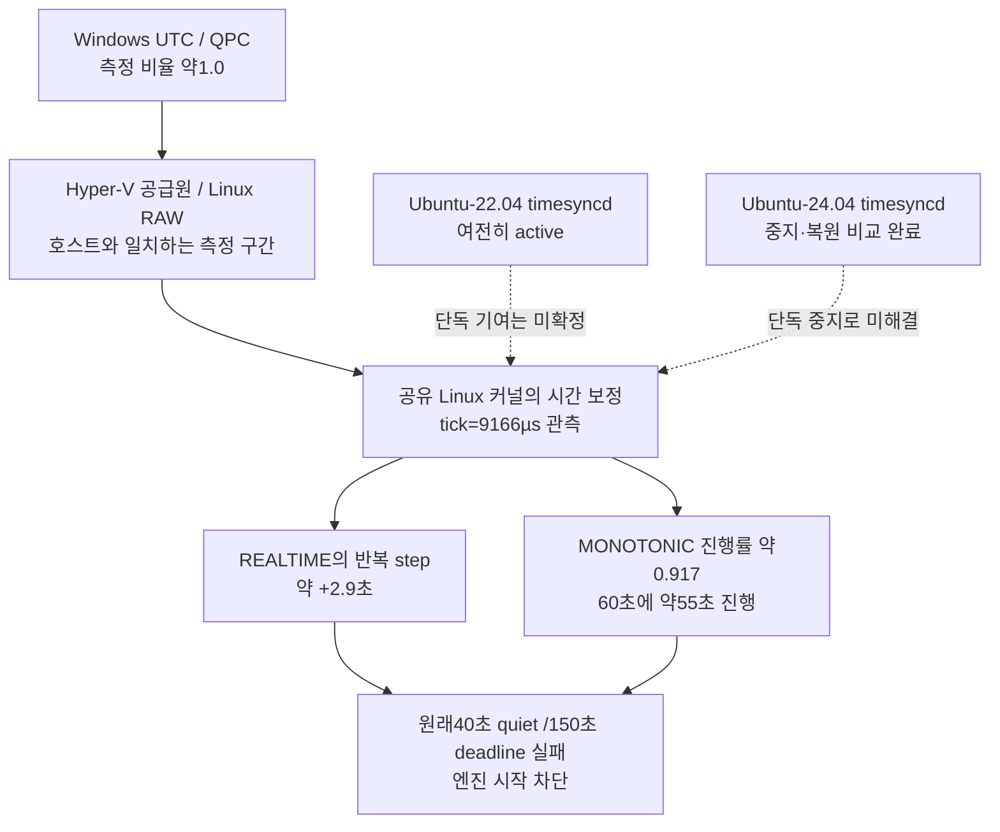

## 읽기 전용 보정 표기 인식 (실제 시각·기존 인수 기준 유지)

Linux의 `tick`은 USER_HZ 단위의 정수 마이크로초, `freq`는65536분의1ppm이다. [man-pages의 단위 정의](https://man7.org/linux/man-pages/man2/adjtimex.2.html)와 [Linux6.18 ntp_update_frequency](https://github.com/torvalds/linux/blob/v6.18/kernel/time/ntp.c#L234)는 두 항을 합산한다. 이는 일반 API/커널 동작의 참고이며 설치 WSL 바이너리의 소스 동일성 주장으로 쓰지 않는다. 실제 RAW·MONOTONIC·SYSTEM·Windows QPC 측정이 별도로 필요하다.

추가 private 준비 도구에만 `--compensated-tick-read-only` 선택을 도입했다. 기존 기본값 `tick=10000` 검사는 보존하고, 선택 시 관측된 `9999µs + 약100ppm` 상쇄 표기를 합산 오차2ppm 이내에서만 인식한다. `9999/freq0`, `9166/freq500ppm`, 상쇄 범위 초과는 거부한다. 설정 쓰기·시각 보정·허위 stamp 생성은 없다. 원본 MONOTONIC/RAW0.999–1.001,40초 quiet,원래300초 준비 마감,1ms 불연속 거부 및 뒤따르는150초 원본 기록·Windows QPC 교차 검사·runtime의 원래40초/150초 preflight·19시동 회귀를 모두 유지한다. G1/G2 required_checks는 변경하지 않는다. 단일 보정 필드의 표기를 물리적 진행률과 혼동하던 추가 준비 검사만 수정한다.

TDD RED0.25초→35시험0.31초 PASS(기존 서비스 복원/개별 init 수명 포함). `clock-encoding-replay-0aec7f16`은 원본 e103284행/SHA d37e2e29를 그대로 재생했다. 기존 해석은300초 FAIL, 새 선택은 원본169.103초에서40초 quiet를 확보했다. 이는 반사실 진단이며 과거 e103FAIL을 바꾸지 않는다. 새 실제 준비/QPC/엔진 결과는 별도 UUID로 검증한다. 승인된 tick writer의9166↔10000 제한은 유지한다.

## 2026-10-28: e103426d의 추가 준비 검사 거부 (엔진0)

이벤트 수신 후보의 실제 비교는 추가 read-only convergence300초에서 중단됐다. 원본 로그의 초기 tick9701은 실제 수렴 대기였고, 이후 tick9999/freq약+100ppm에서 MONOTONIC/RAW가 약1로 안정돼도 정수 tick10000 조건이 계속 거부했다. 서비스 복원·두 foreground 종료·잔여 없음 true다. 후보의 물리 효과는 아직 미검증이다. 승인된 tick writer의9166↔10000 제한을 확대하거나 실제 시계를 쓰지 않는다. 두 읽기 전용 보정값의 합산 의미와 원본 진행률·불연속 검사를 연결할 필요가 있다. 기본 runtime의40초 quiet/150초 deadline과 모든 G1/G2 required_checks는 유지한다.

# 13.5 시각 차단 요인과 제한된 판별 실험

## 2026-10-28 후속: 공유 커널과 배포판 수명은 다르다

`bb8b781a`는 추가 수렴112표본·QPC60초·원본150초·기존40초quiet·19시동/종료를 통과했지만, 시험 중 SYSTEM-MONOTONIC offset이899,656,095ns 변해 엔진0회로 중단했다. 양 서비스 복원true다. 점프 직전/직후의 호출 구간은3,000/2,200ns로, 약0.9초 변화를 단순 콜백 대기로 설명할 수 없다.

읽기 전용 `clock-lifetime-8df8c287-ac4a-4afc-9a54-e67c3ea932ac`에 원본 조회 명령·journal·분석을 보존했다. 같은 kernel boot ID에서 Ubuntu22의 systemd startup 완료가15.659803초와400.868572초에 각각 나타났다. 승인해 정지한 시간 서비스는19.048159초에 멈췄지만398.973609초에 다시 시작했고399.472854초에 최초 NTP 동기화를 기록했다. 원본 offset 점프는399.440578210~399.460785511초 사이로, NTP 로그와 약12ms 차이다. 이는 syscall 발신자 직접 추적과 구분하지만, 배포판 재시작과 동기화 재활성화는 journal에서 확인됐다. 관리 chrony 단독 원인으로 단정하지 않는다.

[Microsoft WSL systemd 설명](https://learn.microsoft.com/en-us/windows/wsl/systemd/)은 서비스 실행만으로 배포판 수명이 유지되지 않음을 명시한다. 기존 임시 서비스 소유권은 공유 kernel boot ID만 확인해 개별 init의 교체를 놓쳤다.

수정은 승인된 두 서비스 범위 안에서 한다. 각 배포판에 소유한 일반 사용자 foreground 세션을 먼저 열어 검증 종료까지 유지하고, nonce·UID·PID·PID1 시작 tick·원본 boot/time namespace를 기록한다. 읽기 전용 inspect로 원래 서비스를 확인한 후 기존 stop/restore를 수행한다. 동일 커널에서 init이 바뀌거나 세션이 소실되면 실패하고 새 인스턴스를 자동으로 다시 열지 않는다. 엔진 회수→서비스 복원 확인→소유 세션 정상 종료 순서다. 드라이버·chrony·영구 설정·인수 기준 변경이나 다른 작업 중단은 없다.

검증 순서는 같은 boot/새 init 거부 RED → 세션 normal/EOF·기존 rollback 회귀 → 실제 두 배포판 일반 세션 확인 → 기존 시계·실제 한 쌍이다. 통과한 검사 일부만 골라 완료로 세지 않는다.

같은 boot/새 init 회귀는 기존 코드가 잘못 복원 성공을 반환하는 RED0.29초였다. 새 일반 세션과 root 서비스 명령 경계·기존 복원/수렴31시험0.51초 PASS다. 실제 두 배포판의 일반 사용자 세션을70초 유지한 `distro-sessions-1d845cd6-dbc3-4796-ab28-dfcd895ddad6`도 신원/서비스 상태 유지·정상close ACK/회수 PASS다. 서비스 변경은 이 확인에서0회다. 실제 stop/start는 기존 승인 범위에서만 수행하고 명령 실행 직전 실제 init/boot/machine을 다시 확인한다. 재시작 인스턴스에 명령하지 않으며 foreground 소실·서비스 재활성화는 실패로 남긴다. 엔진 정리가 원래 한도를 넘으면 FAIL을 유지하고, 소유 엔진이 정리될 때까지 서비스와 세션을 먼저 해제하지 않는다.

2026-10-27. 사용자가 일시 중지·복원 비교를 승인했다. 영구 설정을 변경하지 않는다.

## 실제 증거

`preflight-mujoco-pairs-cd782528-3efb-405e-8c83-6e753f4f9d4e`는 원본 SYSTEM/MONOTONIC을 40초 관측해 READY가 됐다. 이어진 시동·종료 회귀는 19개 모두 통과(30.51초)했지만, 같은 부팅의 uptime 131.280초에 SYSTEM−MONOTONIC 차이가 +1,594,437,682ns 변했다. 해당 시리즈는 엔진을 한 번도 시작하지 않고 중단했다. 앞선 부팅에서 ±2.3초 변동도 기록됐다. 40초 사전 관측은 이후 안정성을 보증하지 않는다.

현재 kernel은 6.18.40.1-microsoft-standard-WSL2, clocksource는 hyperv_clocksource_tsc_page다. 일반 사용자로 조회한 systemd-timesyncd는 활성 상태이며 외부 ntp.ubuntu.com에 동기화한다. 서비스의 존재와 시각 변동만으로 단독 원인을 확정하지 않는다.

[Ubuntu WSL 공식 문서](https://ubuntu.com/wsl/docs/stable/explanation/time-sync/)는 Hyper-V의 암묵적 동기화와 게스트 NTP가 충돌할 수 있음을 설명하고, Ubuntu 24.04의 timesyncd를 별도로 다룬다(문서 갱신 2026-10-20). [systemd 설명](https://www.freedesktop.org/software/systemd/man/253/systemd-timesyncd.service.html)은 큰 오차를 연속 보정 대신 step으로 바꿀 수 있음을 명시한다. 이 설명과 현상은 부합하지만 인과 관계는 비교로 확인해야 한다.

## 승인받을 구체적 변경

1. 최초 active/enabled 상태·부팅 ID·원본 시각과 서비스 로그를 저장한다.
2. Ubuntu-24.04 내부의 `systemd-timesyncd.service`만 해당 검증 세션 동안 `systemctl stop systemd-timesyncd.service`로 일시 중지한다. Linux root 권한이 필요하다. disable/mask·설정 파일 변경·시각 수동 변경·Windows 관리자·드라이버 변경은 하지 않는다.
3. 소유한 단일 부모 프로세스 아래에서 원본 SYSTEM/MONOTONIC을 같은 방법으로 관측한다. 역행이나 불연속이 계속되면 이 가설을 기각하고 실제 엔진을 시작하지 않는다. 안정될 경우 기존 사전 관측과 동일 회귀를 실행한다. 기존 원본 header·ROS/wall age·역행 latch를 유지한다.
4. 실제 엔진은 기존 순차·첫 실패 중단·reap/잔여/원본 SHA/아카이브 규칙을 유지한다. 시각 문제 해결은 G1/G2 물리 성공의 증거가 아니다.
5. 정상·실패 경로 모두에서 서비스의 원래 active 상태를 복원하고 상태를 기록한다. 비정상 중단 시 복원 필요 여부를 체크포인트에 남긴다. 원래 enabled 상태는 변경하지 않는다.

승인이 없으면 위 시스템 조작을 실행하지 않고, Ch13 내부의 독립적인 결함 수정·회귀와 차단 요인 문서화를 진행한다. 안전 검사를 끄거나 과거 실패를 제외하는 방식으로 진행하지 않는다.

## 첫 판별 결과와 다음 가설

`timesync-comparison-fa3e279b-5db5-4176-a0e1-ee42f9a0305b`는 일반 사용자75초 관측에서 uptime40.863초에 -7,327,677,899ns 변동을 기록했다. 실제 엔진은 시작하지 않았다. root 래퍼의 finally에서 서비스 active/enabled 복원을 확인했다. 서비스 중지만으로 모든 시각 변동이 사라진다는 가설은 기각한다.

단, 변동은 초기 약30초 지점 한 번이며 이후 약45초는 조용했다. 다음 판별은 Windows 원본 UTC/Stopwatch를 함께 기록하고, 이미 정의한 **40초 연속 quiet/150초 deadline** 게이트로 초기 보정 후의 안정 여부를 평가한다. 첫 진단의 추가 조건인 ‘75초 전체에 변동0회’는 부팅 시 초기 보정과 반복 불안정을 구분하지 못했다. 변경된 판별은 기존 Gate를 사용하고 원본 모든 변동을 보존한다. 이후 사전 관측·시동 회귀 중 다시 변하면 엔진을 시작하지 않으며, 실제 엔진의 원본 역행 보호와 물리 기준은 변경하지 않는다. Windows 시간 서비스는 조회 당시 Stopped였으나 이것만으로 호스트나 Hyper-V를 원인으로 확정하지 않는다.

## 2026-10-28: 공유 커널과 시간 진행률을 교차 측정한 결과

새 수정본의 빌드와 8패키지 설치 감사는 통과했다. 그러나 `preflight-mujoco-pairs-a386ee08-36fa-4d7a-9370-f0b8b6015679`는 같은 부팅 `87c3f02d-25d7-4fbb-a9ab-39eacf7e7fdd`에서 150초 안에 +2.926/+2.956/+2.958/+2.936/+2.937초의 SYSTEM−MONOTONIC 변화를 관측해 실패했다. **엔진 시작0회**다. 승인된 Ubuntu-24.04 서비스 비교 `timesync-comparison-e4d9e6b6-a635-446d-87b9-fbe156110c67`의 finally 복원은 active/enabled 일치·restored=true로 확인했다. 이 실패를 보행 실패나 새 G1/G2 결과로 세지 않는다.

추측 대신 세 개의 독립적인 원본 측정을 추가했다. 모두 일반 사용자이며, 시각·서비스 설정을 변경하지 않았다.

| 측정 | 고유 증거 | 결과 |
|---|---|---|
| Linux RAW/REALTIME/MONOTONIC와 `adjtimex(modes=0)` 150초 | `clock-discipline-18ba439f-97f6-47aa-bb12-3019199fe70d` | 6414개 표본, tick=9166µs 일정, freq=32.221710ppm. MONOTONIC/RAW 중앙값0.916994. REALTIME는 +2.902~2.918초 step4회 |
| Windows UTC/QPC 150초 | `host-clock-43de3fba-abf5-4964-8d0e-7e4ba9bd7f67` | UTC/QPC=0.99999885 |
| Windows QPC가 Linux 조회 전후를 감싼 60초 | `clock-cross-boundary-12e96348-4d8d-4475-a9df-1c02f029b8e8` | 실제 호스트 경과59.777~60.093초. RAW59.93584초(비율0.99738~1.00266), MONOTONIC54.97213초(0.91478~0.91962) |

위 오차 구간을 포함해도 이번 부팅의 게스트 MONOTONIC은 호스트보다 약8.3% 느리다. RAW 자체가8.3% 빠르다는 설명과는 맞지 않는다. 시스템의 큰 진행률 보정값 `tick=9166`이 원인에 직접 관련됐다는 강한 근거다. 32.22ppm 주파수 값만으로8.3% 차이는 설명되지 않는다. 누가 tick을 이 값으로 설정했는지는 아직 증명하지 못했다. Hyper-V·NTP·특정 프로세스 중 하나를 단독 원인으로 확정하지 않는다.

별도 `shared-clock-environment-2fe63f82-20bf-4a23-b26f-e7f9840716f2`에서 **Ubuntu-22.04도 실행 중이고 그 안의 timesyncd PID108이 active/enabled**인 것을 발견했다. 24.04의 PID2177과 독립적인 서비스다. 두 배포판의 boot ID와 time namespace가 같으며, Docker 컨테이너는0개다. 22.04 서비스의 이번 부팅 로그에는 시작 이후 중지 기록이 없다. 따라서 ‘24.04 서비스 하나 중지’는 WSL VM 전체 NTP 중지가 아니었다. 이것이 지난 비교의 범위 한계다. Linux의 REALTIME은 time namespace로 가상화되지 않으므로, 별도 배포판이라는 이유로 독립 시계라고 가정하면 안 된다.

분석 산출물은 `clock-discipline-analysis-2fd204f1-1580-4d60-b5d7-7e5633ab0581/result.json`이다. 실제 측정 방법·명령·완료 표식·SHA·시간 조회 호출을 감싼 불확실성 구간을 보존했다. 진단 C 프로그램은 `adjtimex`의 modes=0만 호출하고 root가 아니다.

### 다음 판별을 위해 추가로 필요한 승인 범위

사용자는 2026-10-28 후속 답변에서 **두 서비스·tick 임시 보정 및 복원 비교를 승인**했다. 아래 범위로 실행하며, 기존24.04서비스하나승인과구분한다. 실제 진행과 결과는 고유 session/lease evidence로 기록한다.

1. 두 배포판의 서비스 active/enabled, 동일 boot/time namespace, 커널 tick/freq/status를 저장하고 승인한 상태와 다르면 조작하지 않는다. 소유 엔진·명령 프로세스가 없는 상태에서 시작한다.
2. Ubuntu-22.04와24.04의 timesyncd만 검증 세션 동안 일시 중지한다. 배포판 자체 종료, 다른 서비스·Windows 설정·드라이버·clocksource·영구 설정 변경은 하지 않는다.
3. 공유 커널의 `adjtimex(ADJ_TICK)`으로 tick만 명목10000µs로 임시 보정한다. USER_HZ=100을 실제 조회했다. freq·status·현재 날짜/시각을 직접 설정하지 않는다. 기존 tick=9166을 복원용으로 저장한다. 커널 시간 진행률은 **다른 실행 중 WSL 작업에도 영향을 준다**. 따라서 Ch13 내부 변경으로 취급하지 않는다.
4. 먼저 원본 시계의 진행률·불연속을 호스트 QPC와 재측정한다. 기존40초 quiet/150초 deadline와 원래 시동 회귀를 통과한 경우에만 같은 임시 설정을 유지한 채 기존 고정본 순차G1/G2 검증을 진행한다. 첫 실패에서 중단하며, 시계나 인수 기준을 완화하지 않는다. 실제 ROS header·시뮬레이터 물리2ms·native100Hz controller는 그대로다.
5. 정상·실패 경로의 finally에서 저장한 tick과 두 서비스의 원래 active/enabled를 복원하고, 각각 실측 확인한다. 외부 조작·부팅 변경으로 복원 소유권이 불명확하면 자동 덮어쓰기하지 않고 복원 미확정으로 보고한다. 전원 차단처럼 finally가 실행되지 못한 경우를 위해 디스크에 복원 대기 표식을 먼저 남긴다.

근거: [Microsoft의 WSL2 구조 설명](https://learn.microsoft.com/en-us/windows/wsl/compare-versions)은 배포판이 관리 VM 내부의 격리된 컨테이너임을 설명한다. [Linux time namespaces 문서](https://man7.org/linux/man-pages/man7/time_namespaces.7.html)는 REALTIME 비격리를 명시한다. [adjtimex API](https://man7.org/linux/man-pages/man2/adjtimex.2.html)는 modes=0 조회와 CAP_SYS_TIME이 필요한 ADJ_TICK 변경을 구분한다. [Linux v6.18 ntp.c](https://raw.githubusercontent.com/torvalds/linux/v6.18/kernel/time/ntp.c)의 tick은 USER_HZ 주기이며 기본값은 USER_TICK_USEC다. 공식 소스를 개념 근거로만 읽었고 외부 코드를 복사하거나 수정하지 않았다.

### 승인한 첫 비교: 수동 보정은 유지되지 않았지만 자연 수렴을 발견했다

가짜 권한 동작의 복원 회귀11PASS 후 실제 `clock-normalization-7f639ebf-9e7b-430b-8126-8b28355e76f3`을 실행했다. 두서비스 중지·ADJ_TICK만10000적용을 확인했다. 그러나 원본 표본에서3.706442초에9166으로바뀌었다. 반복덮어쓰기는하지않았다. 60초QPC교차측정의MONOTONIC비율구간0.90577~0.92960은실패했다. 엔진0회,validation미진입이다.

150초 기록을 끝까지 분석하니 **114.8044167초에 tick이10000으로자연복귀**했고, 말미의freq는6023(약0.092ppm)이었다. 따라서9166을고정설정오염으로단정한설명을갱신한다. 서비스/수동tick복원은해당수행지점에서확인됐고restore=true/잔여[]다. 두서비스를다시활성화한뒤최종tick스냅샷은10000이었다. 외부동기화기가재개된뒤값까지고정하기위해추가덮어쓰지않았다.

WSL3.0.1.0의관리영역을일반사용자로읽어 `chronyc tracking`에서PHC0가선택된별도동기화기를확인했다. [WSL init 공식 소스](https://github.com/microsoft/WSL/blob/master/src/linux/init/main.cpp)의 `StartTimeSyncAgent`는PHC기반chronyd를시작한다. 열람blob SHA4970608d7739a5b5a60ea1c5e11ec83e97099567이며, 이소스를설치바이너리와동일하다고주장하지않는다. 실제관리영역응답과공식소스의역할을구분한다.

[chrony 공식 maxslewrate 설명](https://chrony-project.org/doc/4.6/chrony.conf.html#maxslewrate)의 기본값은83333.333ppm(1/12)이다. 이번8.3%차이·수초오차·두NTP중지후약115초자연수렴은큰위상오차를속도보정으로해소하는과정과부합한다. chronyd의정확한쓰기호출을추적한것은아니므로개별syscall의발신주체확정과는구분한다. 중요한설계결함은배포판서비스둘과관리영역동기화기라는**복수의시간보정소유자**를놓쳤다는점이다.

### 다음 판별: 두 서비스만 중지하고 기존 시간 소유자의 수렴을 관측

사용자의추가승인안에서커널수동변경을제외한더좁은범위로진행한다. chronyd·PHC·드라이버·관리영역설정은변경하지않고두Ubuntu서비스만임시중지한다. 커널tick을다시덮어쓰지않는다. 별도읽기전용수렴관측은RAW기준최대180초안에명목tick·MONOTONIC/RAW비율±0.1%·REALTIME불연속없음을40초연속확인한다. 이는새진단단계이며기존40초quiet/150초deadline사전검사를대체하거나늘리지않는다.

이후지속하는Windows QPC조회프로세스로프로세스기동지연을측정구간에서분리하고,원본RAW/MONOTONIC/REALTIME진행률과추가150초전체원본기록을검사한다. 기존preflight와19시동회귀까지통과한경우에만고정본G1/G2세쌍을진행한다. 첫실패중단·정상종료·원본보존은그대로다. 부모는바꾸지않은tick을‘복원’하기위해외부소유자의값을덮어쓰지않고,실제로중지한두서비스만원래상태로복원한다. 이모드와원래수동비교모드는분리된UUID/명령으로남긴다. 추가8FAIL/기존11PASS회귀뒤총19PASS0.21초이며실제엔진성공을뜻하지않는다.

### 후속 세션의 추가 수렴 관측 한도와 원래 인수 기준의 구분

0277506f-5bc3-4958-ba1a-947a8db7e6b7은 kernel/chrony 쓰기 없이 두 서비스만 중지했으나, 추가읽기전용관측180초 안에 수렴하지 못했다. 원본에서는152.1984667초에 tick9167→10833으로 보정 방향이 바뀌었다. 이 세션은엔진0회·관련ROS회귀진입0회이며두서비스복원true다. 앞선ef602의시계/실제실행성공과이번시계대기실패를함께보존한다.

chrony의공식 corrtimeratio 설명은소스이력에따라보정시간이달라짐을명시한다. 관측된보정방향전환을한번더수동tick으로덮어쓰지않는다. 다음판별은추가읽기전용관측의최대대기만300RAW초로명시하고,40초연속의정상진행률/명목tick/불연속없음조건은유지한다. 이값은원래인수의deadline이아니라서비스전환후의진단대기예산이다. **원래ClockStabilityGate의40초quiet/150초deadline,200/300msage,실제엔진의모든기한과required_checks는변경하지않았다.** 기본180초진단클래스와명시300초선택의분리를RED0.19초→복원/수렴24PASS0.58초로검증했다.

이비교에서는8초마다관리영역chronyc tracking을읽기전용으로함께기록해,남은보정량과실제진행률의관계를설명한다. chronyd설정/프로세스·PHC·드라이버는바꾸지않는다.300초에도수렴하지않으면엔진을시작하지않고복원하며,같은조건의무조건반복대신추가외부판별에필요한결정을제시한다.

### 2026-10-30 대칭 보상 표기의 읽기 전용 누락

280ff810-a986-441b-91d3-e41470052afa는 추가 수렴 관측300초에서 중단됐고 엔진0회·복원true/foreground종료/잔여[]다. 마지막50표본의MONOTONIC/RAW비율은0.99999572~1.00000282였으나, tick10001µs와약-100ppm 보상을 기존 선택형 검사가 인식하지 않았다. 기존 검사는9999µs/+100ppm만 허용했다. 이 표기 차이를 실제 속도 불량으로 단정하지 않는다.

[Linux v6.18 ntp.c](https://raw.githubusercontent.com/torvalds/linux/v6.18/kernel/time/ntp.c)의 ntp_update_frequency는 USER_HZ 주기인 tick 항에 주파수 항을 더한다. [adjtimex 공식 매뉴얼](https://www.man7.org/linux/man-pages/man2/clock_adjtime.2.html)의 freq 단위는16비트 소수부가 있는ppm이다. USER_HZ100에서 인접한±1µs tick과 반대 부호의∓100ppm은 대칭 보상이다. 이는 개념 근거이며 설치된WSL커널과위소스가정확히같다는주장은아니다. 외부코드복사0이다.

원본표본을 변경하지 않은 반사실 재생 task8-clock-upper-encoding-replay-01.json+method에서 기존판정은301.026초FAULT, 대칭판정은165.660초에같은40초안정조건READY였다. 원본실패를성공으로고치지않고새실행인수로세지않는다. 선택형read-only검사에10001/-100의관측된경우만추가한다. 기본strict10000·보상오차2ppm·원본비율±0.1%·40초quiet·추가300초관측기한·별도원래150초검사·QPC교차·엔진10초기한은유지한다. 잘못된부호/무보상/범위초과/10002미관측형식은거부한다. 커널tick/freq/status·chrony·드라이버쓰기0이며기존두서비스중지/복원범위만사용한다.
# 2026-11-01 결정 요청: 추가 2ppm 표현 검사와 실제 진행률 검사

사용자는 후속 답변에서 **실제 진행률 기반 검증 교정을 승인**했다. 기본 모드와 기존 실패는 보존하고 `--measured-clock-witness`를 명시적으로 선택하는 경로를 구현한다. root `3e617975-1891-4db8-a505-4ad368c5d470`는200표본/40초 안정화와 Windows QPC60초 교차검사를 통과한 뒤, 기존 원본150초 witness에서 실패했다. 엔진0회, 서비스 복원/foreground 종료/잔여 없음 확인. 이 과거 실행은 승인 뒤에도 FAIL로 보존한다.

원본6,915표본 중119표본(2.582초)에서 tick9999µs/freq95.032135ppm, 합성 보정값−4.967865ppm이 기록됐다. 기존 추가 조건인 ‘인접 tick의 보상오차2ppm’에는 맞지 않는다. 시각 점프는0이고, 같은 원본의 실제 MONOTONIC/RAW를1초 이상 창으로 다시 측정하면6,868개 구간의 불확실성 포함 비율은0.999875444~1.000125353이다. 원래±0.1% 범위의 실패 구간은0이다. 이 오프라인 비교로 원래 FAIL을 PASS로 바꾸거나 새 인수 성공을 생성하지 않는다. 방법·입력SHA·계산결과는 `task8-clock-witness-comparison-52e09829-5ee0-46a0-b966-603ee2390729.json`과 같은 이름의 `.method.py`에 있다.

[chrony tracking 공식 문서](https://chrony-project.org/doc/4.6/chronyc.html#tracking)는 system clock을 급격히 이동시키는 대신 속도로 오차를 보정하는 동작과 Frequency/Residual freq/Skew를 구분한다. [adjtimex 공식 매뉴얼](https://man7.org/linux/man-pages/man2/adjtimex.2.html)은 tick과16비트 소수부의 freq 표현을 설명한다. 약5ppm인 이번 보정값 자체를 유해한 시각 점프 또는8.3% 진행률 문제와 같다고 볼 근거는 없다. 다만 정확한 커널 쓰기 syscall 발신자는 추적하지 않았다. 원본 chronyc tracking도 별도로 보존한다.

## 구체적 제안

기본 경로와 기존2ppm 판정/실패 증거를 보존하고, 명시적으로 선택하는 읽기 전용 witness 모드를 추가한다. 이 모드에서는150초 전체의 실제 MONOTONIC/RAW 진행률을 원래±0.1% 범위로 연속 검사한다. 각 표본의 RAW 조회 전후 구간을 사용해1초 이상 창의 하한·상한을 계산하고, 불확실성까지 범위 안에 있어야 한다. 원래 REALTIME/MONOTONIC 차이의1ms 점프 거절, QPC±1% 교차, 40초 안정화/원래150초 기한, 추가수렴300초 한계와 센서/명령/물리 기준을 유지한다. tick/freq·기존2ppm 위반도 모두 기록한다. 커널/chrony/서비스 설정을 새로 변경하지 않는다.

이는 기존 단락의 **‘보상오차2ppm·원본비율±0.1% … 유지’** 중150초 witness의 추가2ppm 필수조건을 실제 진행률 검사로 교체하는 승인이다. 단순히2ppm을5/10ppm으로 바꾸지 않는다. 추가수렴의 기존2ppm/40초 검사는 그대로이며, 원본150초 witness만 선택 모드에서 실제 진행률로 검사한다. 기본 모드에는 기존 필수조건이 그대로 남는다.

정상속도/±8.3%/점프/역행/불확실성/누락 표본/기록 완료/기본모드 보존 회귀를 먼저 추가했다. 신규 `clock_witness.py`는 고정512표본 이력으로 원본 값을 읽고, raw조회 구간을 포함한1초 이상 창을 연속 검사한다. 원래150초 C 수집기는 변경하지 않고 metadata·완료 표식·끝 구간 coverage도 확인한다. 이 모듈의 소스/설치 바이트 일치를 특권 동작 전에 확인하고 실행 UUID 안에 동일 코드를 고정한다. 새 원본150초·G1/C1 비용 판별은 회귀와 설치감사 뒤 수행하며, Task8·Nav2·최종 회귀·push는 아직 완료가 아니다.

## 2026-11-01: QPC READY 경계의 초기화 비용 분리

root `ad97fa29`는 엔진을 시작하지 않았다. 두 서비스 복원·foreground 종료·잔여 없음이 확인됐다. 첫 QPC 응답 bracket이869.8855ms였고 RAW 진행률 구간 `[0.985654478,1.000157171]`이 원래 ±1% 범위를 벗어나 admission FAIL이었다. 이 구간은1.0을 포함하므로 실제 진행률 오차를 확정한 것은 아니다. 원본 실패·7개 측정값·150초 기록을 보존한다.

기존 host는 `READY` 후에 처음 `ConvertTo-Json` 응답 경로를 실행했다. 읽기 전용 ABBA 비교(`qpc-ready-cca7aa1c-e1a2-4742-9f45-9e9a5b9210af.json`, method와 protocol 함께 보존)에서 첫 왕복은 초기화 전89.30/106.90ms, 같은 응답 경로 초기화 뒤 READY에서는30.38/7.45ms였다. 이후0.36–0.85ms이고 네 소유 프로세스 모두 exit0이다. 하드웨어 시계/로봇 성공의 증거는 아니며 준비 경계의 결함을 판별한 것이다.

최소 수정은 같은 응답 함수를 한 번 초기화한 다음 READY를 보내는 것이다. 측정 시작 전의 준비 단계이며, 이후7개의 고정 측정·10초 간격·60초 구간·원래 ±1%의 전체 구간 검사를 모두 유지한다. RTT에 따라 표본을 선택하거나 실패 실행을 성공으로 바꾸지 않는다. 기존150초 원본 진행률 ±0.1%·40초 안정화·1ms 점프·모든 로봇 인수 기준, 서비스/커널 쓰기 범위는 변경하지 않는다. 새 helper/test와 SHA는 각 root에 복사해 원본 실패와 새 프로토콜을 구분한다. 실제 RPC·정상 종료2시험은0.266초 PASS이며 기존 lease/engine-plan 안전 회귀 후 재검증한다.

