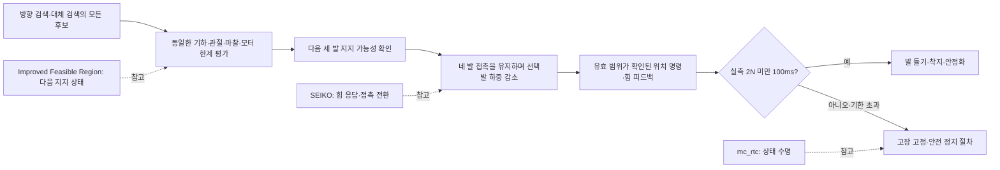

# 13.5 하중 전환 문제: GitHub·논문 조사와 적용 판단

조사일: 2026-10-29. 대상은 [구조 검토](SECTION_13_5_ROOT_CAUSE_REVIEW_KO.md)의 하중 해제 실패, 모터 제한, 계획 경로 불일치, 고장 후 정지다. 공식 저장소·저자 논문·저자 페이지를 확인했다. 외부 코드 설치·복사·엔진 실행은 하지 않았다. 논문 실증과 이 환경의 재현 성공을 구분한다.

## 결론과 우선순위

**가장 직접적인 조합은 SEIKO의 위치 제어 기반 힘 제어와 Improved Feasible Region의 실행 가능한 지지 자세 계획이다.** 전자는 계획한 힘을 실제 위치 명령으로 실현하는 문제, 후자는 애초에 모터·관절·마찰 한계 안에서 지탱할 수 있는지의 문제를 다룬다. 한쪽만 참고하면 현재의 계획/실행 불일치가 남을 수 있다.

| 우선순위·사례 | 실제 확인한 성과/구현 | 현재 결함과의 연결 | 적용 판단 |
|---|---|---|---|
| 1. SEIKO, RA-L 2024 + 공개 C++ | 위치 제어 TALOS의 접촉력 제어·발 접촉 전환 실증 | 위치 명령으로 힘을 줄일 때의 전신 결합, 모터 한계, 접촉 해제 | 힘 제어 구조의 우선 참고 |
| 2. Feasible Region, TRO 2020 / Improved Feasible Region, TRO 2023 + jet-leg | HyQ·Aliengo 실험, 마찰·구동·관절 한계를 포함한 영역 | 지지 삼각형만으로 승인하는 계획과 fallback | 공통 계획 승인 조건의 우선 참고 |
| 3. Passive WBC, RA-L 2019 | HyQ의 crawl/trot 및 구동 한계에 따른 하중 재분배 | 포화된 다리에 하중을 계속 요구하는 문제 | 제약을 계획/제어에 포함하는 근거 |
| 4. legged_control 공개 C++ | 모터·마찰·접촉 제약과 추종 목적의 분리 | 비용을 좋게 만드는 것과 물리 제약 충족의 차이 | 작은 제약 구성 방식 참고 |
| 5. mc_rtc FSM 공개 C++ | stop·teardown·상태 완료와 접촉 작업의 분리 | 고장 후 착지 대상/명령 소유권의 수명 | 상태 수명 설계 참고 |
| 보조. Efficient CoM Planning, Actuators 2025 | MuJoCo·실제 Solo12의 준정적 보행 | 계획기 계산 비용·관절/힘 조건 결합 | 논문 참고, 공개 코드 접근 불가 |

모든 사례가 현재의 4족+팔, Gazebo DART/MuJoCo, 50Hz 제어, 30Nm 상한, 기존 시간·안전 기준을 그대로 검증한 것은 아니다. 이번 조사에서 그 조건을 모두 만족하는 대체 구현은 확인하지 못했다.

## 1. SEIKO: 현재 위치 제어 인터페이스에 가장 가까운 사례

**논문:** Rouxel, Ivaldi, Mouret, *Multi-Contact Whole-Body Force Control for Position-Controlled Robots*, RA-L 2024. [논문 v4](https://arxiv.org/html/2312.16465v4), [저자 프로젝트](https://hucebot.github.io/seiko_controller_website/).

유연성 모델로 위치 명령과 접촉력의 전신 관계를 다룬다. 실행 가능한 자세·힘을 생성하는 retargeting과, 실제 힘을 추종하도록 위치 명령을 보정하는 controller를 나눈다. 실물 TALOS의 발 들기/재접촉 비교에서 하중 전환을 부드럽게 만든 결과가 있다. 논문의 IV-E, V-C, 부록 E가 현재 문제와 직접 관련된다.

공개 코드에서도 다음을 확인했다.

- [SEIKOController.cpp:905–922](https://github.com/hucebot/seiko_controller_code/blob/972e3a69af9334eec324e61566433fabf05bf061/inria_model/src/SEIKOController.cpp#L905-L922): 보정 문제 안에 관절 토크 제한을 구성한다.
- [SEIKORetargeting.cpp:1249–1279](https://github.com/hucebot/seiko_controller_code/blob/972e3a69af9334eec324e61566433fabf05bf061/inria_model/src/SEIKORetargeting.cpp#L1249-L1279): 접촉력 변화율을 제한한다.
- [SEIKOWrapper.cpp:220–269](https://github.com/hucebot/seiko_controller_code/blob/972e3a69af9334eec324e61566433fabf05bf061/inria_model/src/SEIKOWrapper.cpp#L220-L269): 접촉 제거 요청과 최종 제거를 나누고, 힘을 줄이는 동안 접촉을 유지한다. 여기서 확인하는 힘은 최적화 내부 상태이므로 Ch13의 실제 센서 해제 판정을 대신할 수 없다.

**적용:** 작은 수직 스프링 보정만 반복하기보다, 힘 응답과 모터 제한을 함께 다룬다. 하중 해제와 공중 발 이동을 분리하고, 기존 실측 `2N 미만 100ms` 조건을 계속 요구한다.

**한계:** 논문은 500Hz 처리와 2kHz 명령 보간을 사용한다. VI절은 빠른 보행 전환의 한계와 20cm 계단에서의 실패도 명시한다. TALOS 전용 설정·게인·주기를 이식하거나 보행 완성품으로 채택하지 않는다. 현재 인터페이스 유지가 가능하다는 설계 근거이며 즉시 성공 보장이 아니다. 관절 토크 관측을 사용하는 논문의 피드백에 Ch13의 내부 `force_command`를 실측 토크인 것처럼 넣어서도 안 된다.

## 2. Feasible Region / Improved Feasible Region: 계획기의 공통 승인 조건

**논문:** Orsolino 등, *Feasible Region: an Actuation-Aware Extension of the Support Region*, TRO 2020. [저자 해설·논문 링크](https://scaron.info/publications/tro-2020.html), [논문](https://arxiv.org/abs/1903.07999).

무게중심이 지지 영역 안에 있어도 필요한 관절 토크가 상한을 넘으면 몸무게를 지탱하지 못할 수 있음을 다룬다. HyQ의 추가 하중 실험이 포함된다. [jet-leg 제약 코드](https://github.com/orsoromeo/jet-leg/blob/532d2b218690e73b3f15d4f3c160c977a92c43ba/jet_leg/constraints/constraints.py#L210-L270)는 마찰과 구동 한계를 함께 선택하는 경로를 제공한다.

**확장 논문:** Abdallah 등, *An Efficient Paradigm for Feasibility Guarantees in Legged Locomotion*, TRO 2023. [논문 v2](https://arxiv.org/html/2011.07967v2), [공식 연계 저장소](https://github.com/abdelrahman-h-abdalla/jet-leg/tree/73cc3d3fdfa6f4fecb6548e089e16c41c49cde8a).

힘/마찰/토크 영역과 관절 도달 가능 영역을 결합하며 HyQ·Aliengo에서 실험했다. VI절의 crawl 계획은 다음 세 지지다리를 기준으로 몸체 목표를 정한다. 발 이동 중 몸통을 유지하는 원칙은 현재 Ch13에도 이미 적용돼 있다. 새로 참고할 핵심은 단계 분리 자체보다 **다음 세 발 지지 상태의 구동·관절 실행 가능성까지 같은 계획 조건에 넣는 것**이다.

확인한 구현은 [force_polytope_constraint.py:34](https://github.com/abdelrahman-h-abdalla/jet-leg/blob/73cc3d3fdfa6f4fecb6548e089e16c41c49cde8a/jet_leg/constraints/force_polytope_constraint.py#L34)의 구동 제약과 [full_feasible_workspace.py:98–114](https://github.com/abdelrahman-h-abdalla/jet-leg/blob/73cc3d3fdfa6f4fecb6548e089e16c41c49cde8a/jet_leg/kinematics/full_feasible_workspace.py#L98-L114)의 관절 도달 검사다.

**적용:** 방향 검색과 constrained fallback을 별도 승인 체계로 두지 않는다. 후보 생성 방법과 관계없이 같은 물리 조건을 통과해야 한다. 단순한 최대 하중 비율 최소화보다, 현재 자세에서 남은 세 다리가 실제 모터 한계 안에서 지탱할 수 있는지가 중요하다.

**한계:** 준정적 실행 가능성은 위치 제어기가 그 힘 분포에 도달한다는 보장이 아니다. 유연성·센서 오차·과도 응답은 별도로 다뤄야 한다. 논문의 근사와 영역 생성은 전체 충돌 경로 검사도 대신하지 않는다. 두 저장소의 root 라이선스는 LGPL-3.0이므로 구조 참고와 소스 복사를 구분한다. 이번에는 소스를 복사하지 않았다.

## 3. Passive WBC: 토크 제한이 하중 재분배의 일부여야 한다는 실증

Fahmi 등, *Passive Whole-Body Control for Quadruped Robots: Experimental Validation over Challenging Terrain*, RA-L 2019. [저자 연구실 설명](https://dls.iit.it/whole-body-control-for-quadruped-robots), [논문](https://arxiv.org/abs/1811.00884).

HyQ에서 crawl/trot를 실험하며 전신 동역학·관절·구동·접촉 제약을 함께 다룬다. 구동 한계를 적용할 때의 하중 재분배를 검증했다. 힘 명령을 계산한 뒤 마지막 단계에서 잘라내기만 하는 방식과 비교할 때, 제한을 고려한 제어 목표가 필요하다는 근거다.

현재 Ch13의 위치 제어를 이 논문의 저수준 토크 제어로 교체하는 것은 채택하지 않는다. 제약을 계획/제어의 내부 조건으로 취급하는 원리를 참고한다. 아래 legged_control은 별도 프로젝트이며 이 논문의 공식 구현이라고 주장하지 않는다.

## 4. legged_control: 하드 제약과 추종 목적을 분리하는 코드 사례

[저장소·고정 커밋](https://github.com/qiayuanl/legged_control/tree/a7f381c0367e98e31c01336e678eef47e304d40d). BSD-3-Clause.

[WeightedWbc.cpp:50–56](https://github.com/qiayuanl/legged_control/blob/a7f381c0367e98e31c01336e678eef47e304d40d/legged_wbc/src/WeightedWbc.cpp#L50-L56)는 동역학·토크·마찰·지지발 조건을 제약으로 묶고, 발/몸체/접촉력 추종을 비용으로 묶는다. [WbcBase.cpp:110–170](https://github.com/qiayuanl/legged_control/blob/a7f381c0367e98e31c01336e678eef47e304d40d/legged_wbc/src/WbcBase.cpp#L110-L170)에 실제 토크·마찰 제약 구성이 있다.

**적용:** 현재 fallback의 ‘기하적으로 가능한 첫 결과’ 승인 대신, 필수 물리 조건과 선호 목적을 구분하는 작은 평가기를 만든다. 모터 한계 위반을 더 큰 비용과 교환할 수 있는 선택지로 취급하지 않는다.

**한계:** ROS1/catkin·OCS2·NMPC/WBC 환경이며 현재 Jazzy 위치 인터페이스와 다르다. 전체 스택 도입은 비용이 크다. 또한 읽은 WeightedWbc 부분은 QP 초기화/해 획득의 반환값을 직접 확인하지 않는다(`:43–46`). 제약 구성은 참고하되 이 실패 처리까지 그대로 모방하지 않는다. Ch13은 solver 실패·비유한 해·제약 잔차를 확인해야 한다.

## 5. mc_rtc: 상태 중단과 자원 해제의 수명 분리

[저장소·고정 커밋](https://github.com/jrl-umi3218/mc_rtc/tree/792ae292875c40ab1b3198cfaac30f9cb4d9ebe6). BSD-2-Clause.

[Executor.cpp:134–158](https://github.com/jrl-umi3218/mc_rtc/blob/792ae292875c40ab1b3198cfaac30f9cb4d9ebe6/src/mc_control/fsm/Executor.cpp#L134-L158)는 상태의 stop, teardown, 완료 처리를 분리한다. [AddRemoveContact.cpp:196–235](https://github.com/jrl-umi3218/mc_rtc/blob/792ae292875c40ab1b3198cfaac30f9cb4d9ebe6/src/mc_control/fsm/states/AddRemoveContact.cpp#L196-L235)는 접촉 추가에서 힘 조건의 연속 관측을 처리한다.

**적용:** 최초 고장·후속 오류·복구 대상·실측 정지·자원 해제를 별도 상태로 관리하는 참고다. ‘FAULT 진입’이 곧 ‘안전 정지 완료’나 ‘명령 소유권 해제’를 뜻하게 만들지 않는다.

**주의:** 같은 파일의 접촉 제거 경로(`:155–186`)는 먼저 solver의 접촉을 제거하고 이동 거리를 완료 조건으로 사용한다. 이 경로를 Ch13의 실측 하중 해제 알고리즘으로 복사하면 안 된다. mc_rtc의 일반 stop 역시 우리 실측 STOPPED·ROS 액션 terminal·엔진 정상 종료를 자동 보장하지 않는다.

## 6. MuJoCo의 가까운 보조 사례와 접근 제한

Nikolić 등, *Efficient CoM Motion Planning for Quadruped Robots’ Quasi-Static Walking*, Actuators 2025. [논문](https://www.mdpi.com/2076-0825/14/5/202), DOI `10.3390/act14050202`.

CoM 실행 가능 영역과 제약 IK를 결합하고, MuJoCo 및 실제 Solo12에서 실험한다. 전체 제어·시뮬레이션/드라이버를 한 ROS2 노드에 두어 통신 비용을 줄인 구조를 설명한다. 실물은 시뮬레이션과 같은 성능을 내지 못했고, 저강성·발열·느린 IK 등 한계도 보고한다.

현재 하중 전환을 해결하려고 모든 노드를 합치는 것은 권하지 않는다. 계산·통신 비용의 경계를 측정하는 참고이며, 현재 직접 실패가 하중 해제라는 사실을 유지한다. 토크 제어 Solo12와 Ch13의 위치 제어는 다르다.

논문이 가리키는 `ajsmilutin/ftn_solo`는 조사 시점에 GitHub API와 웹에서 모두 **404**였다. 삭제·비공개 등 이유는 알 수 없다. 논문은 MIT 공개라고 쓰지만 현재 코드를 확인하지 못했으므로, 당장 재사용 가능한 구현으로 순위를 높이지 않았다.

## 7. 조사에서 도출한 적용 구조 — 구현 완료가 아닌 권고

권고 순서는 다음과 같다.

1. **계획:** 다음 세 발 접촉 상태의 힘/토크/관절 조건을 공통 평가한다. fallback도 예외가 없다. 팔·몸통을 포함한 현재 모델을 사용한다.
2. **실행:** SEIKO에서 참고한 전신 결합·모터 한계·접촉 전환 원리를 현재 위치 인터페이스에 맞게 축소한다. 근사 모델의 실제 힘 응답 방향·지연·포화를 작은 부품 시험으로 확인한다.
3. **실패 처리:** 최초 고장은 유지하면서 후속 원인과 착지 대상의 수명을 보존한다. 실측 정지 확인까지 기존 명령 소유자를 관리한다.
4. **검증:** 모델 자체를 공유하는 테스트만으로 끝내지 않는다. 한 번의 실제 하중 해제→착지→정지 부품 시험이 통과한 뒤 전체 G1/G2로 넘어간다. 주기·기한·높이·속도·모터·최종 인수 기준은 낮추지 않는다.

기존 legubiao 사례는 ROS2/엔진 연결과 제어 소유권에, free_gait는 동작 추상화에 유용하다. 그러나 이번 하중 전환의 직접 해법으로는 위 두 연구가 더 가깝다. [free_gait README](https://github.com/leggedrobotics/free_gait/blob/master/README.md)는 지원 중단을 명시하므로 새 기반 의존성으로 채택하지 않는다.

## 8. 출처 고정과 보존

이번에 확인한 커밋·라이선스·파일·줄 범위, 논문 링크와 접근 실패는 [source-index.json](../evidence/section_13_5/85670137-e73c-4c72-bcb2-0c73e755088b/contact-research-344afd17-d0a6-4936-b746-35177f5017af/source-index.json)에 기록한다. 원문 전체·이미지·동영상·저장소 clone은 저장하지 않는다. 외부 소스를 실제 복사하는 후속 구현에는 별도 REUSE 출처·라이선스 기록이 필요하다.

이번 조사 결과는 참고 구조의 선정이다. Task8의 물리 성공·양 엔진 고정 연속 성공·Nav2 완성·최종 회귀·게시 완료를 의미하지 않는다.
