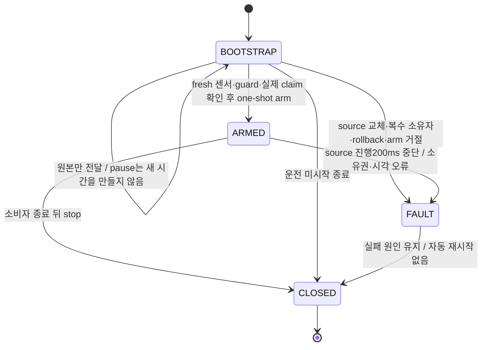
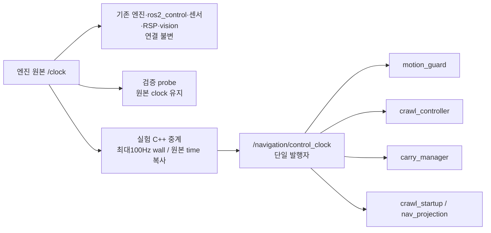

# 13.5 제어 시계 전달 부하 실험 — 승인·구현 중

2026-10-24 사용자 승인: 아래 opt-in100Hz 실험을 진행한다. 기본 실행과 CRAWL
승인은 변경하지 않는다. 구현·실제 비교 결과는 별도로 기록하며, 승인 자체를
실험 성공으로 간주하지 않는다.

## 구현 및 현재 검증 기록

새 구현은 `ros2_ws/src/integrated_robot_navigation_sensors`의
`ControlClockGate`, `ControlClockRelay`, `control_clock_relay` 실행 파일이다.
고수준 노드의50Hz steady 제어 타이머를 변경한 것이 아니다. C++ 단일 실행기가
마지막 원본 메시지·GID·최초 수신 시각을 소유한다. 중복 원본은 진행 lease를 갱신하지
않는다. 명시적 운전 arm 뒤200ms 진행 중단은 고착 실패다. 시계 역행·발행자 변경은
bootstrap에도 항상 고착 실패한다.
초기0 bootstrap은 양의 진행과 구분한다. 전송 후 다음 timer를 재설정해 최소10ms
간격과 timer 경계가 충돌해 매번 한 tick을 건너뛰는 현상을 피한다.

`crawl_system.launch.py` 기본은 `control_clock_mode:=native`다. 실험은
`validation_mode:=true control_clock_mode:=relay100`을 명시해야 한다.
`validation_mode:=false` 조합은 launch가 거절한다. 실제 시험 runner는
`--control-clock-mode relay100`으로 선택하며 원래23개 필수 검사에
`control_clock_contract`를 **추가**한다. profile 승인·G2 해제는 하지 않는다.

| 단계 | 결과/범위 |
|---|---|
| 순수 상태기계 | 미구현 RED1→8통과. 원본값·최소 간격·중복 lease·고착 실패·close |
| 실제 ROS wire | 미구현 RED1→4통과/2.108초. 송신 원본의 부분집합 수신·속도·pause/재개 거절·stop·복수 출력 |
| launch 경계 | RED3/기존 기본1통과→4통과. 정확히5개 remap, native 기본 유지, CRAWL 우회 거절 |
| runner | trace/graph/mode RED12→12통과; 실제 PID/exe/lib 판별 RED7→관련19통과 |
| 관련 회귀 |44통과/33.32초. 미래 촬영 대기·소유권·프로세스·기존 판정 포함 |
| 동결 두 패키지/설치본 | N366통과/4분51초, S42건(CTest wrapper포함)통과/12.3초, 선택8패키지 감사 통과 |
| 새 실제 Gazebo 비교 | `925d70ff` 시동 고착 FAIL, 수정 후 `67658cbb` contact wall age FAIL. 원본 보존 |

각 RED/GREEN 원본은 evidence/section_13_5/85670137-e73c-4c72-bcb2-0c73e755088b의
`task8-control-clock-*`에 보존한다. 최초 ROS 시험 fixture에서 ROS 초기화 전에
executor를 생성한 오류로4건 실패했고, fixture 소유 자원을 초기화 뒤 생성하도록
수정했다. 새 헤더 생성 뒤 이전 미구현 object가 재사용된 빌드도 보존하며, 실제 ROS
4건이 실행된 로그와 혼동하지 않는다. 이 실패들을 삭제하거나 물리 실패 원인으로
추정하지 않았다.

종료 순서는 기존 STOPPED·액션 terminal→소비자 종료 확인→중계 report/stop→
동일 UID/PID/start/exe/매핑 라이브러리 재확인→중계 SIGINT/exit0→엔진 종료다.
stop ACK·관측된 소멸·부모가 기록한 exit 코드는 서로 대체하지 않는다.
`control_clock.jsonl`은 원본 capture/receipt·발행 cadence의 **생산자 측** 증거다.
독립 wire 동등성은 실제 ROS 수신 시험으로 검증하며 생산자 trace를 독립 수신으로
위장하지 않는다. 실제 graph·실행 파일·lib SHA·CPU·종료 증거를 함께 남긴다.

진행 순서: 순수 상태기계 실패→통과, 실제 ROS 전달/소유권/정지 시험,
5개 노드 전용 launch 검증, 설치 감사, 새 UUID 실제 G1 비교 및 정상 종료 검사.
Ruling(첫 실제 실행 후 정정): 양의 첫 시각만으로 운전 상태를 추정하지 않는다.
기존 StartupManager가 fresh 센서·STAND guard·실제 controller claim을 확인한 뒤
다리 활성화 전에 명시적 one-shot `~/arm`을 수행한다. 그때도 양의 원본의 최초
receipt가200ms 이내여야 하며 기존 receipt를 arm 시각으로 갱신하지 않는다.
arm ACK 뒤에도 활성화 직전 기존 readiness를 다시 확인한다. 요청 거부/시동45초
기한/고착 fault는 재시도·자동 복구하지 않는다. 운전 중 진행 중단200ms·원본
sensor ROS/wall200ms·scan300ms는 유지한다. bootstrap은 새 시간을 생성하지 않고
원본만 전달하며 stale pending 후보와 반복 시각은 재발행하지 않는다.

### 첫 실제 실행에서 얻은 구조 판별

`925d70ff`는 G1 전체 **FAIL**이다. 원본4ms를1회 전달한 뒤, JSB 활성화 전
시동 구간에서 `source_stalled`가 고착됐다. graph는 정확히5개 remap이었다.
relay actualPID1156/exe·lib SHA를 확인했고, native engine1140 exit0/launch0,
force없음/reaped/residual[]였지만 relay exit1과 STOPPED 미확정 때문에 정상 종료
필수 검사는 실패로 유지했다. 동작 중 carry 개선/CPU 비교를 판단할 수 없는 실행이다.
입력 콜백이 영원히 없었다고 추정하지 않는다. `inputs`는 fault 이전에 수용한 수다.

세 선택지를 검토했다. 임의 지연 timer와 더 긴 timeout은 시동 준비를 보장하지 않아
채택하지 않았다. 진행 감시를 완전히 없애는 대신, 위의 **명시적 운전 arm 경계**를
선택했다(구현자 판단). 중계 소유권/rollback 감시는 bootstrap에도 항상 적용한다.
새 lifecycle gate를 중계 내부에서 추정하거나 센서/제어 기준을 완화하지 않는다.

보존본 `task8-control-clock-925d70ff.zip`13,187,215bytes,
SHA256 `949c2f1f2249a58826b8efb0f763608763a7818ba6c29fb0b7cf9fb9009ffa46`.
정확한 실행 source77개와 원본 실패·준비 장면·시험·도구를 member별 재독 검증했다.

arm 수정의 최소 시험은 bootstrap RED1→상태기계10통과, 실제 시동 서비스 RED2→
8통과다. arm 기록 없는 유효 cadence가 합격하는 판정 누락도 RED1로 확인했다.
수정 후 관련46통과/60.58초에는 운전 중 clock pause 뒤 원본을 재개해도 다리 fault와
명령 차단이 유지되는 시험을 포함한다. 이전 전체N366은 **arm 수정 전** 결과이며
현재 전체 통과로 재사용하지 않는다.

추가 직접 ROS 시험의3통과/2실패는 빌드된 새 `.so`가 아닌 설치된 이전 `.so`를
`LD_LIBRARY_PATH` 우선순위로 로드한 시험 도구 오류였다. 없는 `~/arm` 서비스와
없는 `armed` 필드로 판별했다. 시험 도구는 선택 build 경로를 해당 프로세스에만
우선시키고 `ldd`를 기록한다. 실제 엔진은 설치·source manifest·실제 매핑 해시를
계속 감사한다. 외부 환경 설정이나 드라이버를 변경한 것이 아니다.

### 두 번째 실제 실패와 시계 콜백 소유권

`67658cbb-c2fd-4d4c-9ac8-b538007e7cad`는 arm·다리 활성화 뒤, carry 준비 전에
`contacts:wall_age`로 전체FAIL했다. ROS3.9s/wall134023448167ns에서 선택한
contact3.884s의 최초 수신은133822610397ns여서 wall age200.837770ms였다.
독립 probe는 새 contact3.904s를133972165332ns에 받았다. 중계는3.914s/
3.926s를 각각133975997138ns/133996958117ns에 발행했지만 선택자는 ROS3.9s를
사용했다. 이는 수신된 미래 후보와 로컬 시각 지연의 경계이며, 콜백 부재나 물리적
미접촉으로 단정하지 않는다. `contact-clock-fault-window.json` 참조.

922고유 전달/최소 간격10.220364ms/receipt→publish 최대50.165044ms,
실제4종 MotionState의 양의 시각 모두 중계 원본과 일치(누락0)였다. 전체 평균
70.297Hz는 bootstrap gap을 포함한다. 정적10초에 도달하지 않아 stand CPU 비교를
할 수 없다. clock source_stalled는 최초 contact 실패보다 약4.87초 뒤, 정리 중
engine pause 이후 발생했다. 최초 원인과 합치지 않는다. STOPPED 실패가 이후 정리를
건너뛰던 runner 경로는 RED7→관련43통과로 수정했다. 물리 실패는 계속FAIL로 남기되
소비자 정리 후 중계를 닫는다. 소비자 종료 미확인 시에는 시계를 유지한다.

보존본 `task8-control-clock-67658cbb.zip`3,692,411bytes,
SHA256 `95f225bba007b98ad821e5637b2fe56c8f559021aa3bdb354b09a7e281394897`.
보존본 이후의 first-fault 시간 창은 별도 사후 분석이며 원본 결과를 바꾸지 않는다.

설치 Jazzy `rclpy/time_source.py`에서 시계 구독도 기본 callback group을 사용함을
확인했다. 실제 DDS+2worker+의도적으로 대기하는 제어 callback 시험으로 시계 지연을
재현했다(RED1, opt-in 경로/기본 실행기 검사 RED2). 새 Ch13 `clock_execution.py`는
공개 `Node.create_subscription`/topic resolve API로 TimeSource의 **기존 구독 하나만**
별도 MutuallyExclusive 그룹에 넣는다. 새 clock writer·중복 구독·내부 TimeSource 패치가
아니다. opt-in Crawl만2worker를 사용하고 관절·센서·lifecycle·명령 callback은 기존
그룹/lock에 남는다. native는 기존 단일 실행기다. 실제 ROS 분리 시험2통과/9.09초.
실제 엔진 효과는 후속 검증 대상이며 완료로 간주하지 않는다.

first-fault 진단은 시계 읽기 전후 wall 구간, pending 후보 최초 receipt, 최근16 contact
수신/캐시 채택 시각을 불변 snapshot으로 남긴다(RED1→실제ROS3통과14.34초).
원래 stamp/200ms/50Hz/물리 명령은 불변이다. 새 전체N/설치 감사 후 실제 UUID를 다시
실행한다. 이전366건을 새 수정본 전체 통과로 재사용하지 않는다.

## 관측과 한계

기준 로컬 체크포인트는 `abcc057`이다. 실제 GZ `be4858fc`에서 원본 시계의 양의
촬영 간격513개가2ms였다. 500Hz 수준의 원생 시간 해상도가 확인됐지만 일부 전달
누락과 종료/정지 구간 중복도 포함하므로 전체808메시지의 평균을 정확한 발행률로
단정하지 않는다. publisher GID는1개, rollback은0이었다. 원생 계측 프로세스 CPU는
시작·종료 포함 one-core5.76%였고 해당 실제 시험은 관절 wall age로 FAIL했다.
이 실패를 계측기가 원인이라고 확정하거나 원본에서 제외하지 않는다.

독립 domain219의 단순 rclpy 소비자는 무계측3초에서500Hz 약19.25%,50Hz 약6.50%
CPU를 썼다. 실제 노드 전체 비용이나 최종 원인의 증거가 아니라, 공통 시계 수신이
무시할 수 없는 비용일 수 있다는 판별 자료다. 계측기를 켠53%/17% 값은 운영 비용으로
사용하지 않는다. 임의의 ROS/driver/underlay 원본 최적화는 하지 않는다.

## 선택지

1. 기존 시계 연결 유지: 시간 전달 구조가 늘지 않는다. 대신 같은 고주파 수신 비용을
   유지한 채 다른 계산/물리 경로를 최적화해야 한다.
2. **권장 실험:** Ch13 고수준 navigation 노드5개에만 최대100Hz wall 주기의 C++
   중계를 opt-in으로 사용한다. 원본 `/clock`, 실제 엔진/ros2_control, RSP, 센서,
   vision/TF 경로와 검증 probe의 시계는 바꾸지 않는다. 50Hz 제어/steady watchdog은
   그대로이며, 전달량을 줄이는 대신 로컬 ROS 시각이 최대 약10ms+전송 지연만큼
   뒤처질 수 있다. 이를 검사에서 면제하지 않는다.

100Hz는 새로운 시간축이나 보간 시계가 아니다. 전달하는 Clock 메시지는 **실제 원본
메시지의 time 값 그대로**다. host now로 retag하거나 중간 시각을 생성하지 않는다.
전역 `/clock`에 재발행하지 않고 `/navigation/control_clock`이라는 단일 소유 토픽을 쓴다.

## 변경하지 않는 계약

- 촬영 header·최초 monotonic receipt·ROS/wall age200ms와 scan300ms를 유지한다.
  미래 촬영은 기존 후보 선택 규칙으로 기다리며, 최신 TF나 now로 치환하지 않는다.
- 카메라320×240/목표15Hz, 추론10/선택15Hz, 기존300ms/TF100ms/팔5Hz는 불변이다.
- 다리 명령 소유자·힘/속도/가속도/지지/수납/착지·10wall초 교정 조건은 불변이다.
- 중계는 입력 GID/단일 source를 확인하고 rollback·다른 source·비정상 stamp를
  고착 실패로 처리한다. clock 정지 중에는 새로운 시각을 만들지 않는다.
  기존 steady watchdog과 고착 fault를 유지하므로 소스 재개로 제어가 자동 재활성화되지 않는다.
- 기본 launch와 기존13.3/13.4는 그대로다. 실험은 validation_mode에서만 사용하고
  정상 CRAWL/profile 승인에는 실행 모드의 증거 binding을 별도로 구현·검증해야 한다.
- 종료 시 신규 명령 차단·실제 STOPPED·action terminal을 먼저 확인하고 중계는
  소비자 정리 뒤 종료한다. 새 프로세스의 정상 exit·회수·잔여도 기록한다.

## 인수 방법

TDD로 원본 time 동등성,100Hz 상한,미래 촬영 대기,rollback/복수 source/정지 손실,
단일 소유권과 종료 수명을 검사한다. 소스/설치 감사 후 기존 native G1을 새 UUID로
순차 실행한다. CPU와 원본/중계 stamp 지연을 측정하되 기존 required checks를 줄이지
않는다. 실패를 자동 재시도하거나 과거 성공에 섞지 않는다. GZ의 물리 파지/보행과
비동기 IMU 검증 문제는 이 실험의 성공만으로 해결됐다고 하지 않는다.

## 2026-10-24 재개: 센서 메일박스 경계 판별

직전 실행 `44a97d81-b90f-41b2-b8cc-5693156f8120`은 시계 계약은 통과했지만 전체 G1은 실패했다. 첫 contacts wall age는208.579433ms였다. 독립 probe는 소유 노드의 실패 약6.76ms 전에도 새 contacts를 받았고, 소유 노드의 clock read는36,561ns였다. 따라서 이 실행을 전역 시계 중단이나 엔진 센서 생산 중단으로 설명하지 않는다. 시계 콜백만 분리한 뒤에도 센서와 제어가 같은 콜백 그룹/모델 잠금을 공유하는 구조를 점검했다.

실제 DDS 최소 재현(`task8-sensor-mailbox-red.log`)은 제어 그룹이 모델 잠금을 보유한 동안 clock 갱신은 통과하지만 contacts 메일박스 수신은 실패했다(1FAIL/2PASS). 이 결과는 콜백 분리만 하고 모델 잠금을 공유해도 해결되지 않음을 시험하도록 구성했다. 실제 물리 인수 성공을 의미하지 않는다.

Ruling: 승인된 relay100 검증 모드 안에서만 센서 수신을 별도 mutually-exclusive 그룹으로 분리한다. 센서 메일박스는 별도 짧은 잠금으로 보호하고, 제어는 선택한 immutable Sample 묶음으로 계산한다. 모델·라이프사이클·관절 명령의 소유권은 기본 제어 그룹에 남긴다. 잘못된 센서는 메일박스에 최초 오류를 고정하고 제어 소유자가 다음 판단 및 발행 직전 이를 확인한다. 오류를 센서 worker가 직접 상태 머신에 적용하지 않는다. 잘못 판단한 경우 실제 엔진에서는 여전히 제어 지연/물리 조건 실패가 남을 수 있으므로 새 UUID 실측으로 판정한다. 기본 native 실행기·안전 한계·타임스탬프는 바꾸지 않는다.

직전 실행 원본/78개 소스 고정 ZIP: `task8-control-clock-44a97d81.zip`,13,836,440bytes,SHA256 `22b55f5c0d66fac1078fea8abd8694f0b0af40fd34f3bfb0fc55dc7d9dbdd5b7`. 실제 consumer/relay/native 프로세스는 정상 반환했지만 물리 STOPPED 미확정이므로 시스템 정상 종료 검사는 실패로 보존했다.

### 메일박스 수정 후 새 실측

실제 DDS/오류 소유권 RED 각각1실패→관련31통과/68.93초. N 설치18.9초와 선택8패키지 감사 뒤 새 Gazebo `5f2a8463-2ae6-4bdd-acef-50e28e853a48`(result UUID `3a2522c8-6905-4254-a873-6452a5554e6d`)을 실행했다. 전체는 **FAIL**이며 기존23+중계1 필수 검사를 유지했다.

- 정적10ROS초와 carry 실제 terminal/settle, 센서 신선도·지지·접촉/힘·실제 발 lift·IMU·native ctrl·clock 계약은 통과했다. 첫 controller fault/stop snapshot은 실패 보고 시점에 모두 null이었다. 이전 wall-age 실패가 이 실행에서 관측되지 않았다는 뜻이며 간헐 결함의3회 연속 성공 판정은 아니다.
- 교정은 관측상24.68ROS초 SHIFT→31.548ROS초 SWING으로 진행했다. 10.12wall초/8.2ROS초의 교정 제한에서 아직 SWING이어서 착지/settle을 완료하지 못했다. 교정 단계 RTF0.8102, Crawl CPU94.0%(단일 코어 기준)/17threads다. 정적 단계 RTF0.7905/Crawl91.44%다. 시계 중계만으로 CPU 문제가 해결됐다고 하지 않는다.
- 4020개 고유 원본 시각을 전달했고 최소 간격10.134392ms, receipt→publish 최대23.636744ms였다. 실제4개 MotionState의 양의 stamp lineage 누락0이다. bootstrap 간격이 섞인 전체 평균84.89Hz는 운전 중 주기 보장의 대체 지표가 아니다.
- measured STOPPED 및 deactivate는 실패했다. 소비자 정리·relay stop/실제 exit0·native PID1140 exit0·launch0·부모 회수·receiver join·강제 정리 없음·잔여[]는 확인했다. 프로세스 정상 반환으로 시스템/물리 종료 실패를 덮지 않았다.
- 정확한78개 runtime 소스와 실행/준비 장면/RED·GREEN·설치 증거를 `task8-control-clock-5f2a8463.zip`(20,149,669bytes,SHA256 `3979b0af242b5d4b54ac8c884928a5805e471dddb063ae6e5d90d7dfe2447b62`)에 보존했고 원본도 유지했다.

후속 CPU 전용 손계산 fixture 비교(`task8-sensor-cpu-characterization.json`)에서 inherited 대비 BLAS1은1.094→1.072ms/tick, 양쪽3threads였다. 실제 Crawl의91~94% CPU를 BLAS 과다 스레드로 설명할 근거가 없으므로 실행 환경을 변경하지 않았다. 이 마이크로벤치마크는 엔진/물리 성공 증거가 아니다. 다음 분석은 교정 단계의 실제 하중 해제·추가 swing·착지·안정화 시간 예산이며,10wall초나 센서/물리 한계 완화로 통과시키지 않는다.

### 최종 회귀와 네이티브 자체 검토

이 수정본에서 navigation385시험/324.10초와 sensors45건(CTest wrapper포함)/10.7초가 통과했고, 재빌드 없이 선택8패키지 설치 바이트 감사를 다시 통과했다. Gazebo와 동일78개 runtime 소스로 새 기본/native MuJoCo `c1ae8cd3-a240-4145-88bc-0cfd719a4033`(result `de49988a-170c-48b7-9209-9d681fe7da92`)을 실행해 G1의23개 필수 검사를 모두 통과했다. runtime·engine·launch 정상exit0/receiver join/parent reaped/force없음/residual[]를 확인했다. 이는 relay100의 MuJoCo 인수나 G2/Nav2 성공이 아니다.

실제 MuJoCo와 전체 회귀 보존본은 `task8-control-clock-mailbox-mujoco-regression.zip`11,214,240bytes,SHA256 `089541abbb20c33c3f44fa9ca0ef316b01493e867279ddbcb544c848dc17a338`다. 모든 archive member를 다시 읽어 해시를 확인했다. 원본은 유지했다.

작성자 단일 작업자 자체 검토(서브에이전트 없음): 잠금 순서는 model→mailbox이고 정상/오류 수신 경로는 model 잠금을 획득하거나 Machine을 수정하지 않는다. 샘플 변환은 원본 callback-entry receipt를 보존하며 복제·과거 후보로 lease를 갱신하지 않는다. cleanup의 cutoff/epoch와 pending cache도 같은 mailbox 잠금으로 보호한다. Clock은 기존 TimeSource 구독 하나이며 추가 writer/private field/외부 소스 수정은 없다. 실제 종료 순서와 최초 실패/typed action terminal 결과의 의미를 구분했다. 독립 리뷰를 받은 것으로 표시하지 않는다.

별도 프로파일링 fixture(`task8-sensor-dispatch-profile.json`)는 native/relay 모두 실행기 wait-set 준비 비용이 큰 호출 집합임을 보여 줬지만, 프로파일러 부하에서 relay는 `control gap` FAULT까지 발생했다. 서로 같은 프로세스의 시험 producer/consumer 및 계측 비용이 포함되므로 실제 CPU 사용률 비교나 새 엔진 결함의 증거로 대체하지 않는다. 최초 진단 명령은 셸 로그 경로 전달 오류로 시작하지 못했고, 명시적 스크립트에서 수행한 진단만 결과 파일로 기록했다. 이것을 성공한 물리 실행으로 세지 않았다.

보존된 Gazebo 후분석(`calibration-budget-postmortem.json`)에서 최초5mm 실제 FK lift는 시작9.404706273wall초였다. 원래 센서 캡처들은 비동기이며 해당 숫자를 정확한 owner 궤적/원인 확정으로 과장하지 않는다. 일반 보행용SWING의 추가 이동과 착지/안정화가 남아 있는 구조에 대한 다음 설계 검토가 필요하다. G1 전용 lift-return/단계 예산 재설계를 사용자에게 제안했으며, 기준 완화나 기존CRAWL 궤적 변경은 제안하지 않았다. 답변 전에는 물리 궤적을 변경하지 않는다.
