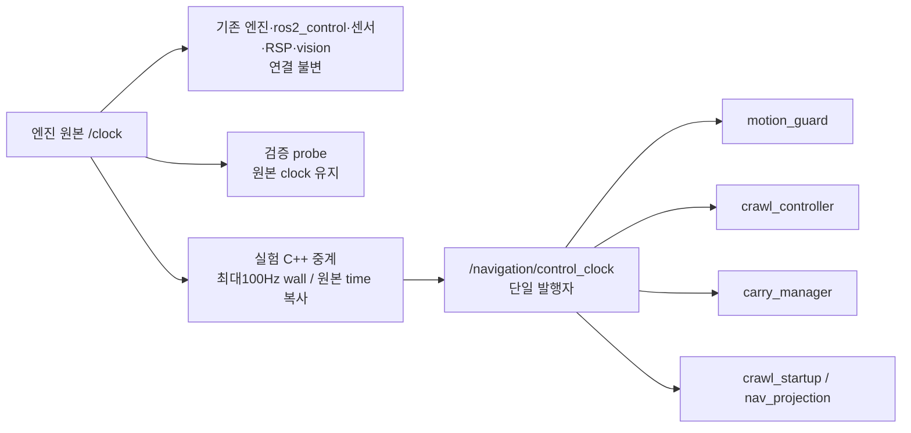

# 13.5 제어 시계 전달 부하 실험안 — 미구현·검토용

## 관측과 한계

기준 로컬 체크포인트는 `abcc057`이다. 실제 GZ `be4858fc`에서 원본 시계의 양의
촬영 간격513개가2ms였다. 500Hz 수준의 원생 시간 해상도가 확인됐지만 일부 전달
누락과 종료/정지 구간 중복도 포함하므로 전체808메시지의 평균을 정확한 발행률로
단정하지 않는다. publisher GID는1개, rollback은0이었다. 원생 계측 프로세스 CPU는
시작·종료 포함 one-core5.76%였고 해당 실제 시험은 관절 wall age로 FAIL했다.
이 실패를 계측기가 원인이라고 확정하거나 원본에서 제외하지 않는다.

독립 domain219의 단순 rclpy 소비자는 무계측3초에서500Hz 약19.25%,50Hz 약6.50%
CPU를 썼다. 실제 노드 전체 비용이나 최종 원인의 증거가 아니라, 공통 시계 수신이
무시할 수 없는 비용일 수 있다는 판별 자료다. 계측기를 켠53%/17% 값은 운영 비용으로
사용하지 않는다. 임의의 ROS/driver/underlay 원본 최적화는 하지 않는다.

## 선택지

1. 기존 시계 연결 유지: 시간 전달 구조가 늘지 않는다. 대신 같은 고주파 수신 비용을
   유지한 채 다른 계산/물리 경로를 최적화해야 한다.
2. **권장 실험:** Ch13 고수준 navigation 노드5개에만 최대100Hz wall 주기의 C++
   중계를 opt-in으로 사용한다. 원본 `/clock`, 실제 엔진/ros2_control, RSP, 센서,
   vision/TF 경로와 검증 probe의 시계는 바꾸지 않는다. 50Hz 제어/steady watchdog은
   그대로이며, 전달량을 줄이는 대신 로컬 ROS 시각이 최대 약10ms+전송 지연만큼
   뒤처질 수 있다. 이를 검사에서 면제하지 않는다.

100Hz는 새로운 시간축이나 보간 시계가 아니다. 전달하는 Clock 메시지는 **실제 원본
메시지의 time 값 그대로**다. host now로 retag하거나 중간 시각을 생성하지 않는다.
전역 `/clock`에 재발행하지 않고 `/navigation/control_clock`이라는 단일 소유 토픽을 쓴다.

## 변경하지 않는 계약

- 촬영 header·최초 monotonic receipt·ROS/wall age200ms와 scan300ms를 유지한다.
  미래 촬영은 기존 후보 선택 규칙으로 기다리며, 최신 TF나 now로 치환하지 않는다.
- 카메라320×240/목표15Hz, 추론10/선택15Hz, 기존300ms/TF100ms/팔5Hz는 불변이다.
- 다리 명령 소유자·힘/속도/가속도/지지/수납/착지·10wall초 교정 조건은 불변이다.
- 중계는 입력 GID/단일 source를 확인하고 rollback·다른 source·비정상 stamp를
  고착 실패로 처리한다. clock 정지 중에는 새로운 시각을 만들지 않는다.
  기존 steady watchdog과 고착 fault를 유지하므로 소스 재개로 제어가 자동 재활성화되지 않는다.
- 기본 launch와 기존13.3/13.4는 그대로다. 실험은 validation_mode에서만 사용하고
  정상 CRAWL/profile 승인에는 실행 모드의 증거 binding을 별도로 구현·검증해야 한다.
- 종료 시 신규 명령 차단·실제 STOPPED·action terminal을 먼저 확인하고 중계는
  소비자 정리 뒤 종료한다. 새 프로세스의 정상 exit·회수·잔여도 기록한다.

## 인수 방법

TDD로 원본 time 동등성,100Hz 상한,미래 촬영 대기,rollback/복수 source/정지 손실,
단일 소유권과 종료 수명을 검사한다. 소스/설치 감사 후 기존 native G1을 새 UUID로
순차 실행한다. CPU와 원본/중계 stamp 지연을 측정하되 기존 required checks를 줄이지
않는다. 실패를 자동 재시도하거나 과거 성공에 섞지 않는다. GZ의 물리 파지/보행과
비동기 IMU 검증 문제는 이 실험의 성공만으로 해결됐다고 하지 않는다.
