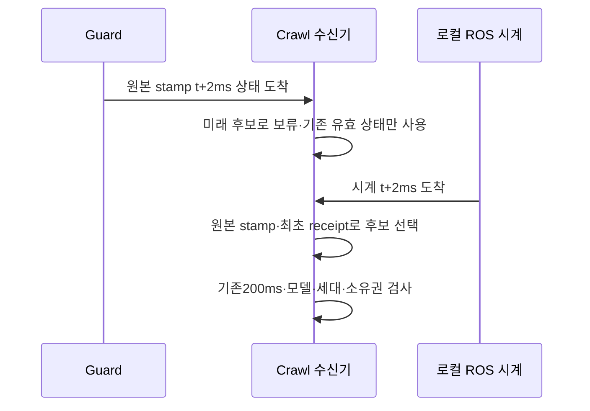
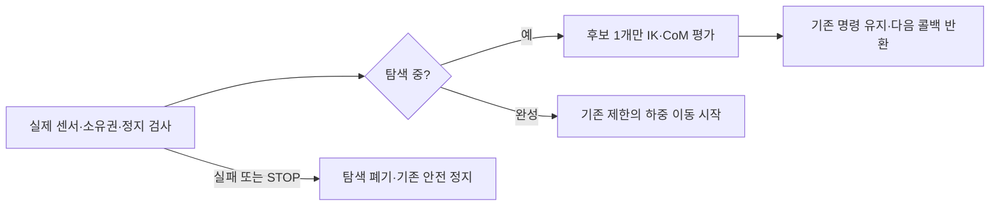
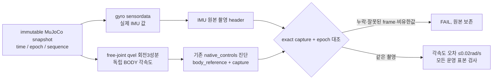

# 13.5 저속 crawl 기반 네비게이션 통합 설계

## guard 상태와 로컬 시계의 도착 순서 (2026-10-24)

82ffc55f의 first_stop은 `guard:ros_age`였으나 실제 선택 stamp11.578초가 판정 노드
ROS11.576초보다2ms **미래**였다. 양 노드의 `/clock`과 guard subscription은 다른
순서로 처리될 수 있다. 이는149959a0의205.80ms wall 지연과 별개의 원인이다.

guard callback은 원래 header와 최초 receipt를 최대10개 후보에 보관한다.
유효성 검사에서는 `stamp<=로컬 ROS 시각`인 가장 최신 후보만 선택한다. 나머지 미래
후보는 보류하고, 마지막 선택값도 기존ROS/wall 각각200ms 범위에서만 사용할 수 있다.
중복·역순 도착으로 receipt를 갱신하지 않으며, 만료·clock 정지·소유자 변경은 계속
안전 정지를 유발한다. inactive 준비 신호도 유효한STAND/HOLD guard를 먼저 요구한다.

재현 시험은 동일 callback/clock 순서를 강제로 분리해 미래 상태의 조기 선택과 중복
receipt 갱신을 검출한다. 관련ROS10건은 통과했지만 실제 반복 인수 전이므로 전체
간헐 실패를 해결했다고 선언하지 않는다. 오래된 packet 시험은 임의120ms가 아니라
마지막 유효 capture의 원래200ms 만료를 기다리도록 교정했다.

## 안전 주기를 막지 않는 하중 이동 탐색 (2026-10-24, 실제 인수 전)

실제149959a0의 최초SHIFT 콜백은173.88ms를 차지했다. 다음 주기에 선택된 접촉은
ROS age70ms지만 수신 후 wall age205.80ms로 기존200ms watchdog을 위반했다.
단순히 센서가 발행되지 않았다고 단정하거나 한계를 늘리지 않는다.

동일 관측의 CoM은 root-to-joint 공통 변환을 한 번만 계산한다. 다음 관측에는 새로
계산하므로 상태를 시간 사이에 재사용하지 않는다. 회귀38건을 통과했지만 오프라인
전체 탐색의 중앙값은28.00→28.95ms로, 이것만으로 속도 개선을 입증하지 못했다.

따라서 기존 coarse9점·binary8회 탐색을 제어 주기마다 후보 하나씩 평가하는
협력식 단계로 분리한다. 탐색 입력과 명령 기준은 고정하고 매 주기 실제 센서·지지·
owner·정지 검사를 먼저 한다. 계획 완성 전에는 기존 명령을 유지하며 이동 곡선의
시간도 진행시키지 않는다. STOP/FAULT는 탐색을 폐기한다. worker나 두 번째 명령
소유자를 추가하지 않는다. Python을 hard real-time으로 보장하는 설계는 아니다.

새 계산량 회귀는 원래 한 주기 CoM14회에서 실패했고, 변경 후 기존 물리·보행을
포함36건을 통과했다. 명목 탐색 시간 약0.26–0.34ROS초가 추가되므로 기존10wall초
실제 calibration 인수 안에서 검증해야 한다. 한계나 완료 기준을 늘린 것이 아니다.

## 활성화 시 위치 명령·실측 앵커 분리 (2026-10-24, 인수 진행 중)

위치 힘 구동에서 하중이 있는 관절의 실측각은 기존 명령각과 다를 수 있다.
740e454c 실제 실행에서 calf 실측1.035905rad/기존 명령1.0rad의 위치력은 약-17.95Nm였다.
활성화가 실측각을 새 목표로 삼으면 이 지지력의 상당 부분이 사라진다.
따라서 cold-start는 유일하고 유효한 URDF position initial_value12개를 사용하고,
이후에는 동일 모델·동일 소유자의 마지막 명령을 유지해 command FK 목표를 인계한다.
누락/중복/비유한/범위 밖 초기값·외부 다리 publisher가 있으면 거절한다.

실제 발 앵커·floor·미끄러짐·지지 여유는 실측 상태로 유지한다. 명령 FK를 odometry나
실측 발 위치로 발행하지 않는다. root pose/velocity 쓰기나 무조건적인 재시도가 아니다.
최소 수학·실제 lifecycle/DDS 회귀는 통과했으나, 후속5091c217은 네 발 하중을
유지한 뒤 guard ROS age로 중단됐다. 전체G1/G2 성공은 아직 아니며 정상 종료도 미완료다.

반복 비용을 줄이기 위해 일반 사용자 소유 Linux 전용 build/install 영역과 명시적
runtime 소스 범위 Git 감사를 사용한다. 설치607파일 최초 복제 해시·새 빌드 후8패키지
감사를 기록하고, 최종 전체 회귀는 동결 뒤 수행한다. 과거 실패·기준·원본은 유지한다.

## Task 8 실측에 따른 제어 설계 교정 — 인수 미완료

기존의 고정8초 물리 주기 가정은 아직 달성한 성능이 아니다. `cycle_s=8`은
발 이동량과 몸체 진행량을 계산하는 명목 phase-time으로 유지하되, 실제 부하 해제·안정
게이트는 진행 시계를 멈출 수 있다. 실제 주기·진행률·Nav2 deadline 충족 여부는 G2/G4에서
별도로 실측해야 하며 고정8초로 부르지 않는다. 강제로 시간을 맞추려고 발을 들지 않는다.

내부 무게중심 이동도 quintic 최대 가속도0.10m/s²를 적용한다. 이동 완료 후 몸체 속도
0.003m/s·각속도0.01rad/s 이내가100ms 유지돼야 SHIFT의 부하 해제를 시작한다.
선택한 발만2mm/s, 최대10mm로 부드럽게 해제하고 실제 정상력2N 미만·다른 세 발 지지·
실측 안정100ms 후 SWING으로 전이한다. 총 swing 높이20mm 한계는 그대로다. 해제 중에도
발 소유권을 유지하므로 STOP은 같은 발을1초 이내에 착지시키고 기존 STOPPED 검사를 한다.

이 교정은 모델·한계 hash를 바꾼다. 이전 native profile을 재사용하지 않는다. 원본 모델과
13.4 장면은 불변이며 navigation 전용 position PD 후보만 별도 생성한다. 후보의 수학·
Python 물리 시험 성공은 실제 양 엔진 G1/G2 통과가 아니다. 실패 원본과 판별 실험은
`Ch13/evidence/section_13_5/85670137-e73c-4c72-bcb2-0c73e755088b/EXECUTION_LEDGER.md`에 있다.

상태: **사용자 승인 — 구현 진행 중**. 사용자는 저속 crawl 상세 설계와 구현 계획을 승인했다.
이 문서는 승인된 설계이며, 아직 보행·접근 성능을 검증했다는 보고서가 아니다.

- 기준 HEAD: `8e07b05cdf45eeb96dffbfe4fdbe1cf045373146`.
- 작업 브랜치: `feat/ch13-section-13-5`. 생성 전 동명 로컬·원격 브랜치 부재를 확인했다.
- 작업 위치: 사용자 지정 기존 checkout을 재사용한다. 별도 worktree는 생성하지 않았다.
- 기존 미추적 `SECTION_13_4_DEBUGGING_LESSONS_KO.md`는 보존하고 이 설계 커밋에 섞지 않는다.
- 네이티브 단일 작업자가 수행한다. `sources/`, Ch01~Ch12, 외부 checkout/underlay는 수정하지 않는다.
- 설계 승인 후 구현 계획을 작성·검토하고 테스트 우선으로 구현한다. 이 단계에서는 제품 코드·설치·엔진을 변경하지 않는다.

## 1. 목적과 완료의 의미

13.4의 실제 RGB-D/촬영 시각 TF 처리를 재사용해 물체의 작업 위치를 정하고,
Nav2가 경로와 속도를 생성하면 통합 4족+팔 모델이 실제 발 접촉으로 저속 이동한다.
목표 위치에서 네비게이션 액션의 실제 결과와 몸체의 정지를 확인한다.

성공은 launch 실행이나 `/cmd_vel` 발행만을 뜻하지 않는다. 실제 양 엔진에서
전진·회전·장애물 우회·접근·정지·실패 대응·정상 종료를 확인해야 한다.
몸체 pose/velocity 강제 설정, 명령 적분으로 만든 가짜 odometry, 바퀴나 보이지 않는
구동 플랫폼, 외력으로 몸체를 끄는 대체 backend는 인수 성공에 사용하지 않는다.

### 이번 절에 포함하지 않는 것

PPO 학습·배포, trot, 동적 gait switching, 문턱·계단 등반, 경사지·험지, 적재물 운반,
MoveIt/물리 파지, 실로봇을 새로 완성하지 않는다. `crawl` 외 gait 요청은 거절한다.
기존 짧은 Ch12 정책을 안정적인 적재 보행 정책으로 취급하지 않는다.

검증 장면은 **평탄한 바닥·고정 지도·정지 물체**로 한정한다. 최초 구현의 localization은
시뮬레이터가 측정한 실제 상태를 쓰는 명시적 `native_ground_truth` profile이다.
AMCL/SLAM·IMU/LiDAR 융합의 성능으로 부르지 않는다. 전신 제어와 실제 위치 추정의
불확실성까지 동시에 해결하는 확장은 별도 과제다.

## 2. 확인된 기존 사실과 설계의 차이

| 현재 구현 사실 | 13.5에서 추가할 것 |
|---|---|
| `locomotion_node`는 STAND/HOLD/STOP만 지원하고 WALK를 거절 | 별도 저속 crawl 제어기 |
| `SAFE_ARM=(0,...,0)`은 기립용 영점 자세 | 접힘·간섭·CoM·실측 유지가 확인된 carry 자세 |
| 몸통의 URDF collision은0.60×0.30m | 보폭·수납 팔·여유를 포함한 footprint |
| 기존 `base_footprint`는 몸통과 같은6D 자세 | Nav2 전용 평면 `nav_base` |
| `/odom`은 실제 엔진 상태의 전달이며 명령 적분이 아님 | 같은 실측을 기반으로 한 평면 odometry·제어 검증 |
| 13.4 팔 명령은 단일 owner와 실제 terminal을 추적 | 동일 수명 계약을 재사용한 carry 전용 owner |

원고의0.50×0.30m footprint는 현재 몸통 길이0.60m도 모두 포함하지 못한다.
또한 13.4의 영점 자세를 이름만 바꿔 수납으로 선언하지 않는다.

## 3. 전체 구성과 명령 소유권

주 경로:

`ApproachObject → Nav2 NavigateToPose → velocity_smoother → motion_guard → crawl_controller → leg_position_controller`

`carry_manager`는 팔·그리퍼 수납을 담당하고, 실제 상태·접촉·센서 adapter는
제어기와 안전 게이트에 입력을 제공한다. perception은 기존 카메라·탐지·fusion을 재사용한다.

| 자원 | 13.5 launch에서 유일한 소유자 |
|---|---|
| Nav2 경로 추종 속도 | Nav2 controller server |
| 평활 속도 | velocity_smoother |
| crawl 입력 속도·motion lease | motion_guard |
| 다리12관절 명령 | crawl_controller |
| 팔 FollowJointTrajectory·그리퍼 명령 | carry_manager |
| 실제 `/odom`, `odom → base_footprint` | 기존 NativePoseAdapter |
| `/navigation/odom`, `odom → nav_base` | nav_projection |
| `map → odom` | benchmark localization profile의 단일 publisher |
| 로봇 내부 TF | robot_state_publisher |

13.5 launch는 기존 architecture launch 전체를 동시에 띄우지 않는다.
기존 locomotion/manipulation/tracking requester와 새 이동·팔 owner를 중복 실행하지 않는다.
같은 controller/명령 토픽의 외부 producer가 발견되면 활성화를 거절한다.
실행기나 통신 노드 추가를 두 번째 명령권으로 취급하지 않는다.

## 4. 패키지 경계와 기존 기능 보존

- 신규 `integrated_robot_navigation` Python 패키지: gait/IK/지원 영역 순수 코어,
  crawl_controller, motion_guard, carry_manager, nav_projection, approach coordinator,
  Nav2 설정·지도·행동 트리·launch·회귀 시험.
- 신규 `integrated_robot_navigation_sensors` C++ 패키지: 필요한 MuJoCo 읽기 전용
  접촉·IMU·거리 센서 adapter. 외부 plugin base를 link하며 외부 구현을 덮어쓰지 않는다.
- 기존 `integrated_robot_interfaces`: `FootContacts.msg`와 `ApproachObject.action` 추가.
- 기존 description: navigation 선택 인수·센서와 navigation 전용 world/model 추가.
  기존13.2~13.4 기본값과 원본 fixture는 그대로 둔다.
- 기존 runtime/vision의 공통 기구학·액션 수명·native pose 코드를 의존성으로 재사용한다.
  이전 장 소스가 더 필요하면 Ch13에 최소 복사하고 REUSE에 출처·커밋·라이선스를 기록한다.

Ch13 소스만으로 colcon 빌드한다. 이전 장 설치본을 source해서 누락 의존성을 숨기지 않는다.
센서·제어기·카메라의 실제 설치 경로와 소스 manifest를 감사한다.

### 구현 중 확인한 모델 교정

Task 3의 독립 오프라인 거리 검사에서 기존 URDF/MJCF 모두 몸통과 네 허벅지에
약0.020m 침투가 확인됐다. 기존 기본 모델의 의미는 보존하고, navigation 전용
모델만 `hip_mount_y=0.13`으로 생성한다(기존 기본값0.10). 허벅지 중심선은
몸통 기준 y=±0.18m가 되며, 초기 자세의 몸통 표면과 약0.01m 여유를 만든다.
몸통·다리 충돌 형상을 줄이거나 이 비인접 쌍의 충돌을 무시하지 않는다.

이 변경은 navigation 전용 MJCF와 URDF에 동일하게 적용하고 각각 해시로 결합한다.
이전13.4 물리 검증을 새 모델의 성공으로 승계하지 않는다. 새 간섭·접촉·CoM·보행은
G1/G2에서 실제 재검증한다. 원본 관측과 판단은
[13.5 실행 원장](../evidence/section_13_5/85670137-e73c-4c72-bcb2-0c73e755088b/EXECUTION_LEDGER.md)에 남긴다.

## 5. 저속 crawl의 제어 계약

### 5.1 실제 발 접촉으로 이동

50Hz 제어 주기에서 직전 stance 발의 위치를 기준으로 지지 발의 세계 위치를 유지하고,
몸체의 작은 전진·yaw 증분에 대응하는 다리 IK 위치 목표를 만든다.
한 번에 한 발만 swing한다. 정해진 `FL → RR → FR → RL` 순서를 사용한다.
외부 명령은 기존 제어기에 보내는12관절 위치 목표다. 엔진의 PD/effort 한계를 유지하며
PPO가 토크를 생성하거나 새 effort 인터페이스를 구현했다고 표현하지 않는다.

각 발의 단계는 `SHIFT → SWING → TOUCHDOWN → SETTLE`다. SHIFT는 들 발을 제외한
지지 삼각형 안으로 추정 CoM 투영을 이동시키며, 안전 여유를 확보하기 전에는 발을 들지 않는다.
이동 속도만으로 시간을 진행하지 않고 실측 관절·몸체 자세·접촉을 확인한다.
발 궤적은 끝점의 위치·속도가 연속인 곡선을 사용하고 joint limit·도달 가능성을 검사한다.

초기 설계 상한은 전진0.01m/s, 횡이동0, yaw0.03rad/s다. full gait cycle은8초를
기준으로 하고 발의 수평 이동은0.08m 이하, swing 높이는0.02m 이하로 제한한다.
스무더 가속도 상한은 전진0.02m/s², yaw0.06rad/s²다. 이 값은 검증된 성능이 아닌
보수적인 초기 설정이며 튜닝은 실제 측정과 이유를 기록한 뒤 최종 동결 전에 수행한다.

한 발 swing 전에는 나머지3발의 접촉과 추정 CoM의 지지 다각형 내부 여유≥0.01m를
요구한다. 접촉 판정은 발별 정상력≥2N을 초기 기준으로 한다. force 단위·좌표계와
발 이름 매핑은 양 엔진의 정적 체중 분배·실제 발 들기 시험으로 먼저 검증한다.
단순히 발 높이만 보고 접촉했다고 판정하지 않는다.
CoM은 실제 관절·자세와 링크 질량으로 추정하고, 인수에서는 native CoM/접촉 위치를
별도 관측해 swing 중 실제 지지 영역 내부에 있는지도 대조한다. 제어기의 계획 지지점을
실측 접촉 증거로 대신하지 않는다.

### 5.2 안정성·신선도

- 이동 중 roll/pitch 절대값≤0.15rad와 몸체 높이0.30~0.70m를 요구한다.
- stance 중 발의 세계 위치 이동이0.02m를 넘으면 미끄러짐으로 정지·fault를 기록한다.
- 관절·IMU·접촉·몸체 상태는 촬영 ROS age와 수신 후 monotonic age 각각0.20초 이내다.
- 속도 입력은 wall0.20초 만료, scan은0.30초 만료로 감시한다.
- 시계 역행·정지, 비유한 입력, 모델/이름 불일치, IK 실패, 몸체 범위 이탈은 fault다.
- 상태 복구만으로 자동 재활성화하지 않는다. 명시적 재무장과 모든 안전 조건 재검사가 필요하다.

상한을 맞추려고 관측 시각을 갱신하거나, 지원 여유·안정성 한계를 실패 후 낮추지 않는다.
실제 보행을 얻지 못하면 Nav2 성공을 대신 주장하지 않고 crawl 게이트 미달로 남긴다.

### 5.3 정지의 세 가지 의미

일반 목표 도착·사용자 취소는 새 몸체 이동을 차단하고 현재 swing을 최대1초 안에
착지시킨 뒤 안정 stance로 전이한다. 그때도 필요한 관절·자세·접촉이 신선해야 한다.

충돌·위험 정지는 스무더의 완만한 감속 뒤에 대기시키지 않고 motion_guard가 즉시
속도 명령을0으로 차단한다. 하위 제어기는 넘어짐을 막기 위한 유계 착지·지지 동작만 수행한다.
관절/자세 피드백까지 잃었으면 새 궤적을 추정 실행하지 않으며 기존 위치 hold 상태와
정지 미확정을 기록한다. 명령0 발행을 물리적 정지 증명으로 간주하지 않는다.

`STOPPED`는 발 착지와 함께 실측 선속도≤0.003m/s·yaw 속도≤0.01rad/s가
1초 유지된 경우다. 기한 내 이를 확인하지 못하면 정상 완료가 아니라 실패다.

## 6. 팔 수납과 이동 시작 절차

새 팔 owner가 기존 ArmActionOwner/ArmActionTransport 계약으로 FJT를 실행한다.
수납 초기 탐색 후보는 `[0, 1.2, -2.0, 0, 0.8, 0]`rad이며 **검증된 자세가 아니다**.
실제 모델에서 자기·몸체·다리 간섭, 지면 여유, 수납 envelope와 전체 CoM을 검사한다.
후보가 부적합하면 동결 전 모델 한계 내 다른 자세를 선택하고 근거를 기록한다.
충돌 모양을 임의 축소하거나 비인접 충돌을 일괄 비활성화해서 통과시키지 않는다.

배포할 carry 설정은 최종 모델 해시와 검증 결과를 함께 가진다. 검증 기록/해시 불일치나
검증되지 않은 자세는 이동을 허용하지 않는다. 팔의 실제 terminal 결과, 목표 오차≤0.03rad,
실측 속도≤0.02rad/s가1초 유지돼야 carry-ready다. 이동 중에도 이 조건을 감시한다.

시동 순서는 모델·센서·중복 owner 검사 → 다리의 안전 stance 확인 → 팔 수납과
carry-ready 실측 → crawl 준비 → Nav2 활성화 확인 → 명시적 이동 허용이다.
기존13.4 영점 검사 자체를 넓히지 않고 새 launch/새 carry guard로 분리한다.

## 7. 센서·TF·지도와 localization 범위

MuJoCo는 기존 native free-joint 상태를, Gazebo는 기존 native odometry를 사용한다.
IMU와 발별 접촉·거리 정보는 실제 엔진 관측에서 생성한다. MuJoCo 추가 센서가 worker를
사용하면 전용 snapshot/mjData와 reset epoch를 소유하며 렌더링 worker나 live mjData를 공유하지 않는다.
Gazebo는 native 센서를 bridge하고 실제 frame·단위·발 collision 매핑을 검사한다.

거리 입력은 몸체 고정 planar scan, 목표10Hz·360샘플이다. 자체 로봇을 제외하는
센서 마스크는 world 장애물을 제외하지 않아야 한다. 센서/worker 비용은 실제 CPU·주기로
측정하며 13.4 카메라의320×240·15Hz·추론10/15Hz·300ms·TF100ms 계약은 유지한다.

기존 `odom → base_footprint`는6D 실측 그대로 유지한다. 새 `nav_base`만 실측 x/y/yaw와
z=0으로 지면에 투영한다. `/navigation/odom`의 twist는 그 child frame 기준으로 변환한다.
`nav_base`와 실제 로봇은 odom을 공통 조상으로 연결하며 동일 child에 부모를 두 개 붙이지 않는다.

benchmark의 map/world 원점은 고정 world 정의로 일치시킨다. `map → odom`은 그 profile만
발행한다. 별도 AMCL을 동시에 켜거나 공분산0을 실제 위치 추정 정확도처럼 해석하지 않는다.
지도·장애물 world·물체 위치의 원본/해시와 native 실제 변위를 결과에 저장한다.

## 8. Nav2·속도·충돌 처리

### Task 5 구현 관측·소유권 세부 계약

`Sample.epoch`는 물리 엔진 세션이며, `MotionState.generation`은 명시적 RESET으로
바뀌는 명령 소유권 세대다. 서로 같은 값이라고 가정하지 않는다. body Sample은
`odom` 부모와 `base_footprint` child의 실제 xyz/quaternion 및 **child 기준** 선·각속도를
보존한다. `project_body`는 별도 `nav_base` Sample을 만들며 원본6D TF를 대체하지 않는다.
투영 선속도는 세계 평면에 투영 후 nav_base로 회전하고, yaw 속도는 단순 세계 angular.z가
아니라 투영된 heading의 시간 미분이다. 이는 native-ground-truth benchmark이며
새 SLAM/공분산 추정 구현을 의미하지 않는다. 제거한 z/roll/pitch 자유도는 큰 분산으로 표시한다.

안전 게이트의 canonical 입력은 관절별 position/velocity, IMU acceleration/angular_velocity,
발 names/points/forces/touching/unexpected_contacts, 원본6D body, scan ranges/hits와
carry ready/generation/model_sha256다. scan의 +∞는 no-hit 마스크와 유한 최대 거리로
정규화하되 NaN·음수·너무 작은 거리는 유효 관측으로 바꾸지 않는다.

센서와 clock의 DDS 도착 순서가 바뀌면 미래 촬영을 최대10개씩 대기시키고 clock이
따라온 촬영만 선택한다. 최초 wall 수신 시각을 보존한다. 헤더 없는 Twist는 이 절의
**동일 host** profile에서 DDS SYSTEM source timestamp로 RESET 이전 패킷을 거절하며,
ROS 시각과 monotonic 시각을 서로 빼지 않는다. 분산 host 시간 동기화까지 검증한 기능은 아니다.

motion_guard는 짧은 ROS 수신 실행기와 별도의 monotonic watchdog을 사용한다.
원래 raw 입력의 중단은 smoothed 재발행으로 가려지지 않는다. CRAWL 동안 입력·명령
발행자 수뿐 아니라 실제 DDS endpoint GID도 고정한다. 교체·추가·손실은 fault이며
입력이 복구됐다는 이유만으로 재활성화하지 않는다. 종료 때 새 명령을 막고 STOP/최종0을
발행하고 watchdog을 join한 후 ROS 자원을 파괴한다. 이0이나 STOP 상태는 물리 STOPPED의 증명이 아니다.

ROS CRAWL 서비스는 실제 bound profile 검사를 통과해야 한다. 순수 게이트 및 DDS 단위
시험의 admission stub은 통신·안전 로직만 검사하는 시험 경계이며 실제 G1 인수 기록이 아니다.
별도 unstubbed 서비스 시험에서 offline profile의 CRAWL 거절을 확인한다.

### Nav2 연결 계약 — 구현·인수는 후속 Task 9 이후

ROS 2 Jazzy의 실제 Nav2 map/planner/controller/BT/lifecycle/smoother를 사용한다.
controller는 전후진·yaw만 허용하며 y 속도0, 검증하지 않은 Spin/BackUp recovery는
비활성화한다. 상위 액션 취소 또는 실패 뒤 다른 이동을 자동 재시도하지 않는다.

`/navigation/cmd_vel_raw → /navigation/cmd_vel_smoothed → motion_guard → /navigation/cmd_vel`
로 분리하고 최종 명령 producer를 하나로 유지한다. Jazzy의 Twist/TwistStamped 설정은
구성 전체에서 명시적으로 일치시킨다. 스무더는 실측 odometry를 이용하고 watchdog은
monotonic 기준으로 별도 실행해 시뮬레이션 pause에도 만료를 감지한다.

footprint는 검증한 carry 자세·다리의 전체 허용 궤적 collision 투영을 포함하는 보수적
볼록 다각형에0.05m 여유를 더해 생성한다. 기준 프레임은 `nav_base`다.
inflation_radius는 footprint 외접 반경+0.05m보다 작게 두지 않는다.

`min_obstacle_height=0.10`을 등반 능력으로 사용하지 않는다. 지면 제거가 필요한
경우에도 ground-relative 의미와 실제 센서 높이를 검사한다. 알려진 낮은 장애물도
기본 지도에서 충돌 대상으로 유지한다. 알려지지 않은 낮은 물체·낭떠러지·험지는 이번
단일2D scan 기반 인수 범위 밖이며 실로봇 배포를 허용하지 않는다.

## 9. 작업 위치 계산과 13.4 목표의 수명

`ApproachObject.action`은 원래 `PoseStamped` 관측과 object 식별자를 받는다.
accept 시13.4의 촬영/수신300ms 및 frame/TF 유효성을 검사한다. 입력 pose를 최신 TF로
바꿔 해석하거나 source header를 now로 덮어쓰지 않는다.

정지 물체의 승인된 관측은 명시적 navigation task anchor로 저장한다. 이 anchor는
장시간 유지되는 이동 목적지이지 계속 신선한 카메라 관측이라고 주장하는 값이 아니다.
Nav2 요청의 header와 원래 관측 source header를 별도 보존한다. 순항 중 물체가 시야에서
벗어나도 지도 경로는 추종하지만, 만료된 `/vision/target`을 새 인식·파지 목표로 발행하지 않는다.
물체 이동·정밀 visual servo·도착 후 새 파지 좌표 보장은 이번 인수 범위가 아니다.

물체를 바라보는 yaw와 arm mount 오프셋을 적용해 nominal standoff0.55m에서 후보를 만든다.
거리는0.45/0.50/0.55/0.60/0.65m, yaw는 최초 방향의0/±15도 후보를 평가한다.
지도 collision·전체 footprint·팔 위치 IK 및 joint margin을 통과한 후보 중 경로 가능성과
여유를 기준으로 결정한다. 예제의0.4m를 현재0.6m 몸체와 작업대에 무조건 적용하지 않는다.
이것은 실행 가능한 작업 위치 선택이며 전역 최적 manipulability를 보장하는 해법은 아니다.

후보가 없으면 실패를 반환하고 억지로 보내지 않는다. 경로 수행에는 실제 NavigateToPose를
사용하고 진행 feedback·사용자 취소·wall deadline을 처리한다. busy loop나 무조건
`lifecycleShutdown()`으로 공유 스택을 종료하는 예제는 채택하지 않는다.

상위 성공 조건은 실제 Nav2 terminal SUCCEEDED + 실측 목표 위치 오차≤0.10m/
yaw 오차≤0.10rad + STOPPED + carry 유지다. 팔 목표의 IK 가능성은 검증하지만 물리 파지
성공으로 부르지 않는다. 최초 접근은 최대240초, 취소 결과/소유권 해제 확인은5초 기한을 둔다.

## 10. 실패·취소·종료 수명

`NOT_READY → CARRY_READY → READY → NAVIGATING → SETTLING → SUCCEEDED`를 정상 경로로,
어느 단계의 fault도 `STOPPING → FAILED`로 귀결한다. 사용자 취소는 실제 하위 액션
terminal과 STOPPED를 확인한 경우만 CANCELED로 확정한다. 미확정은 fault-held 상태다.

새 명령 차단 → Nav2·팔 outstanding 실제 결과 drain → 안정 지지/정지 판정 → sensor/
callback/worker 정리 → ROS 자원·runtime 자식 회수 → 엔진 종료 순서로 관리한다.
Gazebo는 pause ACK와 실제 paused stats, server stop ACK와 native 종료를 구분한다.
강제 종료·자식 회수 미확정·잔여 PID는 해당 실행FAIL이며 다음 엔진을 시작하지 않는다.
시스템 관리자 권한·드라이버 변경·ptrace 정책 변경은 하지 않는다.

## 11. 단계별 인수 게이트

아래 숫자는 **구현 전에 제안하는 기준**이다. 현재 통과한 결과가 아니다.

| 게이트 | 필수 증거 |
|---|---|
| G0 기존 기반 | 깨끗한 source/install 감사, 기존13.3·13.4 기준 보존, 이전 파일 무변경 |
| G1 모델·센서·carry | 관절/TF 단일 owner, 발별 접촉·IMU/scan frame/단위 검증, 실제 접힘과 유지 |
| G2 실제 crawl | 각 엔진에서 정지10초, 전진0.40m, 좌/우 yaw 각0.30rad,3회 연속 성공 |
| G3 안전·프로토콜 | 속도/센서 만료, 중복 owner, carry 이탈, IK 실패, scan 손실·시계 pause, 실제 취소 |
| G4 실제 Nav2 접근 | 각 엔진에서 정면/대각 접근·지도 장애물 우회·도달 불가·취소·침입 장애물 정지 |
| G5 최종 동결 | 소스·설치 고정 후 전체13.5 및 영향받은13.3/13.4 회귀, 문서·evidence·게시 |

G2의 실제 전진은 native pose에서 측정하며 위치 오차≤0.05m, yaw 오차≤0.10rad와
5.2절의 안정·미끄러짐 기준을 함께 만족해야 한다. yaw 시험의 위치 표류도≤0.05m다.
G2가 통과하기 전에 Nav2 성공 시험으로 건너뛰지 않는다.

G4의 성공 과제는 최소0.60m 실제 몸체 이동을 포함한다. 우회 장애물은 scan이 실제로
관측할 높이로 구성하고 ground truth collision/경로 clearance를 별도 검사한다.
도달 불가는 장애물을 무시하거나 teleport해서 성공시키지 않는다. 도착·실제 취소·정상 종료는
동결 제품 소스에서 각 엔진3회 연속 확인하며 실패한 실행을 제외하지 않는다.

최종 source/package 시험은 전체 Ch13을 실행한다. 기존13.4의 원래20회 matrix와
Gazebo 추가 추적2회 및 양 엔진13.3 회귀를 새 설치본에서 보존해 확인한다.
필수 required_checks를 낮추거나 mock·합성 odometry로 실제 엔진 결과를 대체하지 않는다.

각 실행에 고유 UUID·소스/설치/world/지도 해시·실제 명령·원본 센서·명령·관절·접촉·
몸체 pose·액션 결과·종료 기록을 저장한다. 단독 디버깅은 관련 시험을 우선하고,
제품 코드 동결 후 최종 전체 회귀를 수행한다. 실패 batch는 보존하고 새 수정은 새 실행으로 검증한다.

## 12. 문서·게시와 설계 변경 규칙

`Ch13/docs`에 한글 단계별 실습 가이드, 원고 교정/변경·리뷰 보고서, REUSE를 갱신하고
`Ch13/evidence/section_13_5/<UUID>`에 원본을 저장한다. 새 절의 결과를13.4 원본에 덮어쓰지 않는다.

검증 완료 후 `feat/ch13-section-13-5`로 non-force push하고 실제 원격 SHA와 로컬 HEAD를
대조한다. 그 사이 동명 원격이 생겨 독립 이력이면 자동 병합·강제 push하지 않고 새 접미사
브랜치를 사용한다. main 병합·PR 생성은 하지 않는다. 기존13.4 교육 문서는 별도 사용자 자산으로 보존한다.

승인된 설계 안의 수치 튜닝·내부 구현 선택은 근거와 테스트를 기록하며 진행한다.
반면 보행을 synthetic backend로 대체, 실제 인수 축소, PPO 재학습/외부 모델 도입,
실로봇·등반·위치 추정 스택 확장, 시스템 권한 변경은 새 결정 없이 진행하지 않는다.

## 근거

### Task 6 구현 — 실제 관측에 의해 허용되는 crawl

`CrawlMachine`의 세계 좌표 발 목표·몸체 reference는 **제어 목표**이지 odometry가 아니다.
FL→RR→FR→RL의 한 발씩 SHIFT/SWING/TOUCHDOWN/SETTLE을 진행하고,
들기 전과 swing 중 모두 실제 관측으로 계산한 지지 여유 0.01m를 요구한다.
SHIFT의 예측에서는 몸통 이동만 무게중심에 더하지 않는다. 지지 발의 세계 위치를 고정한
네 다리 IK와 URDF 전체 질량으로 후보 몸체 자세의 CoM을 다시 계산한다.
예측 여유 0.025m를 만족하는 제한 구간 내 후보를 유계 탐색하되,
**예측 성공만으로 발을 들지 않고 실제 여유 0.01m를 다시 검사**한다.

0속도는 다음 발을 시작하지 않고 현재 발을 착지시켜 실측 정지를 기다린다.
일반 속도 일시정지는 새 허가 명령으로 재개할 수 있지만, 명시적 STOP과 FAULT는
새 속도 패킷만으로 해제하지 않는다. STOPPED는 실제 네 발 접촉과 속도 한계가
1초 유지돼야 한다. 관측 손실·시계 정지/역행·슬립·IK/footprint 관절 범위 실패는
새 위치 목표를 내보내지 않으며 STOPPED를 추정하지 않는다.

`crawl_controller`는 lifecycle 관리되는 유일한 다리 publisher다. configure/activate 전과
deactivate 뒤에는 위치 명령이 없고, STAND bootstrap은 carry 전에 가능하다.
미검증 profile은 외부 ready 플래그가 있어도 CRAWL에 진입할 수 없다.
비활성화는 고장 기록 삭제가 아니므로 직전 fault_reason을 유지한다.
입력 정규화·미래 촬영 대기는 `observations.py`로 공유하되 최초 수신 나이를 보존한다.

이 단계의 ideal-feedback 시험은 **수학·상태 전이 시험용**으로, 제어 목표를 정확히
따르는 가상 응답을 명시적으로 사용한다. 별도 무응답 시험은 예측만으로 발을 들 수
없음을 검사한다. 둘 다 실제 엔진의 지지력·보행 성공·G1/G2 증거가 아니다.

아래는 프로젝트의 기존 근거 자료다.

### Task 7 구현 — 배타적 시동·수납 결과의 세 경계

`crawl_system.launch.py`는 단 하나의 엔진 장면과 motion_guard/crawl_controller/
carry_manager/nav_projection/crawl_startup만 연결한다. 기존 locomotion_node,
manipulation_node, visual tracking requester는 이 경로에서 기동하지 않는다.
기존 비navigation launch의 기본값은 유지한다. Gazebo 접촉 어댑터는 해시 검증한
동일 장면의 실제 충돌 이름 매핑을 `scene_dir`로 받는다.

시동기는 STAND 모드 요청 → crawl configure/activate → **실측 기립 정착** →
carry 예약 → **실제 FJT terminal 수신** → **실측 팔/그리퍼 오차·속도 1초 유지**를
순차 확인한다. 45초 wall deadline을 넘기거나 서비스가 거절되면 fault이며 자동 재시도나
CRAWL 진입을 하지 않는다. startup READY는 시동 절차 완료 기록이지 현재 이동 허가가 아니다.
실시간 guard/crawl/carry 상태가 이동 허용의 권위다.

configure와 activate 사이에는 비활성 crawl 소유자의 `BOOTSTRAP_FEEDBACK_READY`를
기다린다. 이 신호는 관절·IMU·접촉·몸체 관측의 두 나이, 모델/범위와 현재 지지 여유를
검사한 결과이며 모터 명령이나 이동 ready가 아니다. 단순히 guard가 STAND를 발행했다고
엔진의 joint_state_broadcaster가 이미 준비됐다고 간주하지 않는다. 활성화 시에도 관측을
다시 검사하며, 실패한 activate를 자동 재시도하지 않는다.

Task8의 실제 MuJoCo 실행에서 `prepare` 서비스가 먼저 보이고 실제 팔·다리·그리퍼
제어기는 아직 기동 중인 순서 경쟁을 관측했다. 따라서 활성화 전과 수납 예약 전에
`/controller_manager/list_controllers`를 비차단 조회한다. 현재 장면 URDF의12개 다리·
6개 팔·2개 그리퍼 position interface가 각각 지정 제어기에 정확히 한 번 할당되고,
joint_state_broadcaster를 포함한 네 제어기가 모두 active여야 한다. 누락/비활성은
기존45초 wall 예산 안에서 관측만 기다리며, active 상태의 잘못된 claim·중복/외부
소유권은 즉시 sticky fault다. 조회 future는 한 개만 유지하고 거절된 모터 요청을
자동 재시도하지 않는다. 서비스의 원래 거절 message도 startup fault에 보존한다.
이 게이트는 실제 FJT terminal·실측 수납 정착·실시간 이동 허가를 대신하지 않는다.

Gazebo 최초 실행에서 configure 서비스 ACK와 기존 구성 전 status의 도착 순서가
다른 경쟁도 재현했다. WAIT_FEEDBACK에서만 `INACTIVE/BOOTSTRAP_WAIT_FEEDBACK`,
빈 model hash, ready=false/stopped=false인 명시적 초기 상태를 준비 부재로 기다린다.
실제 다른 nonempty hash나 준비를 주장한 잘못된 식별자는 계속 fault이며 자동 복구하지
않는다. 200ms 관측 검사·45초 시동 deadline과 실제 claim 검사는 그대로다.

착지도 시간만으로 완료하지 않는다. 내려오는 SWING에서 실제 정상력≥2N을 확인하면
현재 명령을 유지하고 TOUCHDOWN으로 전이하여 이미 닿은 발을 더 밀어 넣지 않는다.
발의 command anchor는 이 목표를 연속 보존하며, 탄성 변형된 실측 위치를 순간적으로
새 목표로 복사하지 않는다. 접촉이 다시 사라지면 현재 목표에서2mm/s로만 탐색한다.
기존 floor−2mm 한계·1초 touchdown timeout과 실제 다른 세 발 지지·CoM·센서 기준은
유지한다. 실제 센서/odometry를 목표로 대체하는 것이 아니라 **명령의 연속성**을
보장하는 조치다. 물리 결과와 팔/그리퍼 속도 한계는 양 엔진 G1/G2에서 별도 확인한다.

### Task8 후속 판별 — 발 궤적의 시간 예산

실제046c4a16 실행은 TOUCHDOWN 전에 수납 이탈로 실패했다. 따라서 접촉 이후의
연속성 개선만으로 문제가 해결됐다는 가설은 성립하지 않는다. 몸체 속도 입력을
제한해도 고정0.8초 SWING의 발 목표 속도까지 제한되는 것은 아니었다. 추가한
`max_swing_speed_mps=0.02`는 기존 안전 기준 완화가 아니라 새 내부 명령 상한이다.

발 궤적은 `P(u)=P0+(P1−P0)S5(u)+Az·B4(u)`다. quintic 보간의 최대 미분은15/8,
quartic 높이 곡선 `B4=16u²(1−u)²`의 최대 절대 미분은16/(3√3)이므로,
`T >= ((15/8)|P1−P0| + (16/(3√3))A)/0.02`로 실행 시간을 정한다. 최소0.8초는
유지하되 실제 궤적의 시간을 늘리며 위치를 잘라내거나 실측 odometry를 조작하지 않는다.
해당 phase의 몸체 진행은 여전히 명목0.8초 예산으로 매핑해 대기 시간 때문에 추가
보폭이 적분되지 않게 한다. 이 선택은 구현자의 판정이며, 실제 주기·이동률과 과제
시간을 늘릴 수 있는 비용이 있다. 정지10초·교정10초·힘/CoM·수납·센서 기준은
그대로이며 실제 엔진에서 성공하지 못하면 인수 실패로 남긴다.

### Task8 G1 원본 관측의 독립 판정

READY·명령 발행·종료 코드만으로 센서/물리 인수를 대체하지 않는다. 아래 수치 경계는
구현자가 추가한 판정 규칙이며 기존 필수 check와 안전 기준을 제거하거나 완화하지 않는다.

| 판정 | 원본 관측과 계산 |
| --- | --- |
| 접촉 frame/힘 | 실제 발 이름 순서·world-z 정상력·접촉점/FK XY 차이≤0.01m·지면 Z 차이≤0.005m, 정적 총 지지력과 URDF 체중 차이≤5%, 힘의 중심과 native CoM 투영 차이≤0.01m |
| IMU frame | base_link 기준 정적 중력 벡터 오차≤0.2m/s², 전체 운용 구간 gyro와 실제 몸체 각속도 차이≤0.02rad/s |
| world scan | lidar_link의 실제 자세로 바운드 장면의 네 벽에 독립 ray/box 계산, 실제360개 hit와 거리 오차≤0.03m. 로봇 자체 hit나 world 벽을 빠뜨린 마스크를 인정하지 않음 |
| 실제 발 들기 | FL의 실제 FK 높이 상승≥0.005m·해당 실제 힘<2N·다른 세 발≥2N인 고유 접촉 촬영≥3개. 명령 높이만으로 통과하지 않음 |
| 충돌 | 실제 unexpected contact가0이어야 하며, 운용 중 실측 관절 값의 URDF 비인접 충돌 형상 간격도≥0.0001m이어야 함 |

충돌 재구성은 고정 root의 별도 URDF 기하 모델에서 관절 값만 대입하는 오프라인 계산이다.
Python MuJoCo3.3.7의 `mj_forward`/형상 거리 계산을 사용하지만 엔진을 step하지 않고,
live 엔진의 root/속도/외력을 쓰지 않는다. 실제 ROS C++ MuJoCo3.12.0 또는 Gazebo 실행과
물리 결과를 대신하지 않으며 실제 접촉 스트림·설치 라이브러리 출처 검사를 함께 요구한다.

정적 구간은 실제 ROS와 monotonic 시간 **각각10초 이상**이어야 한다. 관측 coverage≥9.6초는
양 끝의200ms 샘플 경계를 위한 별도 조건이지 시험 시간을9.6초로 줄이는 허가가 아니다.
몸체·scan 각각30개 이상 고유 촬영을 요구한다. 수납은 원본 관절 위치/속도에서도 팔
0.03rad/0.02rad/s, 그리퍼0.002m/0.005m/s를 운용 전 구간에 다시 적용한다.
명시적 bootstrap/shutdown은 측정 구간에서 분리하지만 모든 원본은 `all_frames.json`과
`observations.jsonl`에 남긴다. 운용 중 fault/outlier는 제외하지 않고 알 수 없는 stage도
거절한다. 구간·지표·판정은 새 UUID 실행에 저장하며 이전 FAIL을 고쳐 쓰지 않는다.

carry_manager만 팔 FJT와 그리퍼 무부하 0.015m 자세를 소유한다. 서비스 응답의 success는
**요청 예약**이며 준비 완료가 아니다. 실제 result를 받기 전에는 취소 ACK나 status가 있어도
팔 lease를 해제하지 않는다. 팔 오차 0.03rad/속도 0.02rad/s 이내를 1초 유지해야 READY이고,
그 후 자세·관측·세대·소유권이 바뀌면 sticky fault로 차단한다. 물체를 잡았다는 뜻이 아니다.
직선 관절인 그리퍼에는 팔의 rad 허용 오차를 재사용하지 않고 목표0.015m에 대해
위치 오차0.002m/속도0.005m/s를 적용한다. footprint는 원래 그리퍼 전체 허용 이동
구간을 포함하므로 이 정착 검사는 기존 형상 경계를 줄이거나 충돌을 숨기는 조작이 아니다.
지연/취소 결과 수신은 기존 13.4의 독립 action receiver에서 처리한다.
미확정 terminal이 있으면 destroy를 거절하고 receiver를 유지한다. 정상 종료 증명에는
호출자가 실제 결과 drain과 receiver join을 확인해야 한다.

`validation_mode=true`는 STAND+carry 검증만 허용한다. motion_guard의 CRAWL 서비스와
crawl_controller의 외부 ready 처리 양쪽에서 이를 차단한다. 실제 통신 peer 시험은
물리 엔진·JointTrajectoryController 시험을 대신하지 않으며 G1/G2 통과로 세지 않는다.

- [13.4 완료·검증 범위](SECTION_13_4_COMPLETION_RESULTS_KO.md).
- [기존 기립 전용 이동 노드](../ros2_ws/src/integrated_robot_runtime/integrated_robot_runtime/locomotion.py).
- [실제 native odometry·6D base_footprint](../ros2_ws/src/integrated_robot_vision/integrated_robot_vision/native_pose.py).
- [몸통·다리 치수](../ros2_ws/src/integrated_robot_description/urdf/quadruped_base.xacro).
- [Ch12.8의 짧은 PPO 검증 한계](../../Ch12/docs/SECTION_12_8_REPORT_KO.md).
- [Nav2 Jazzy velocity smoother](https://docs.nav2.org/jazzy/configuration_and_development/configuration_guide/core_servers/configuring_velocity_smoother/).
- [Nav2 Jazzy obstacle layer 구현](https://api.nav2.org/nav2-jazzy/html/obstacle__layer_8cpp_source.html).

### Gazebo 구동 경로 판별 추가 사항 (2026-10-23)

`81da9758-805b-4052-8f44-057e4995ff66` 실행은 정적 수납 뒤 SHIFT의
676ms 지점에서 FL/RR 측정 하중이 0N이 됐다. 아직 unload 전이며,
제어기가 실제 선택한 입력의 ROS age는 2~12ms였다. 따라서 오래된 입력이나
발 들기 명령으로 단정하지 않는다. 원본 `controller_report.json`과 그 해석을 보존한다.

설치된 `gz_ros2_control` 1.2.20의 position 경로는 위치 오차를 `JointVelocityCmd`로
변환한다. 이것은 MuJoCo 위치 PD와 다른 물리 구동 방식이다. 원인 판별을 위해
Ch13 Gazebo 관측기에 **읽기 전용** schema2 진단을 추가한다. 실제 ECM의 scalar joint
position/velocity/velocity command, 축·종류·제한, joint frame 전달 wrench를
같은 capture에 기록한다. 프레임·회전/직선 단위를 구분하고, 전달 wrench의 축 투영을
실제 actuator force로 이름 바꾸지 않는다. 제공되지 않는 값은 null/미준비로 보존한다.
관측기는 명령·속도·root 상태를 쓰거나 힘을 추정하지 않는다. 명령 소유권과 모든
2N·3점 지지·10mm margin·시각/수납/종료 기준은 유지한다.

이 관측은 아직 물리 원인 해결 또는 G1 인수 성공이 아니다. 실제 구동 값과 실패를
연결한 뒤 필요한 최소 물리 수정과 새 엔진 검증을 수행한다. 종료 코드0만으로
FAULT 이후 측정 STOPPED 미확정을 정상 종료로 바꾸지 않는다.

구동 명령 관측은 **Update priority-1**이다. 모든 controller PreUpdate 뒤이고,
고정 gz-sim8.15.0 Physics Update(priority0)의 명령 소비·초기화 전이다. PostUpdate에서
명령을 읽어 초기화된0을 적용 명령으로 오해하지 않는다. `capture_ns`는 해당 명령의
적용 step, `state_capture_ns=capture_ns-step_ns`는 직전 완료된 ECM 상태 시각이다.
진단에 `sample_phase=pre_physics`를 명시하고, 접촉/CoM은 기존 PostUpdate를 유지한다.
동일 stop mutex로 두 경로를 막는다. 실제 플러그인 로더 회귀로 Update 참여·priority를
검사하며, 이 시험 자체는 엔진의 물리 지지력이나 힘 제한을 증명하지 않는다.

### 네이티브 감쇠 위치 구동 비교 결정 (미인수 후보)

명령 소비 전 계측을 사용한 `54776df9-c003-44b1-af38-a554c8135e41`은 다시 SHIFT에서
실패했다. 실제20관절/1,040고유 진단을 얻었고 최초 실패 접촉은
FR1.8545/FL71.3324/RR76.0112/RL0N이었다. 여러 hip/thigh의 전달 토크가20/30Nm
축 한계에 닿았다. 속도 명령은 작아도 폐쇄 사슬의 네 다리가 강한 속도 서보로
경쟁할 수 있다는 가설이다. **무제한 토크라고 단정하지 않으며**, 전달 wrench와
직접 적용 구동력의 구분을 유지한다. 후자는 이 경로에서 제공되지 않았다.

Ch13 내부의 다음 비교 후보를 채택한다. 이것은 작성자의 구현 판단이며 실제 성공으로
간주하지 않는다. ROS2 위치 인터페이스와 기존20관절·관절 한계·단일 Controller Manager는
유지하고, Gazebo 하드웨어 내부만 `PositionPDSystem`으로 바꾼다.
`tau=clip(kp*(q_target-q)-kd*q_dot, -effort_limit, +effort_limit)`를 실제 native
관절 상태에서 계산해 scalar `JointForceCmd`에 적용한다. 회전은Nm/직선은N이다.
MuJoCo 후보에 이미 사용한 동일 게인 설정을 재사용하며 수치·질량·힘 한계를 올리지 않는다.
이 비교로 인과 가설을 판별하며, 실제 G1 실패면 채택 완료를 선언하지 않는다.

- 위치 목표 발행자는 여전히 crawl/carry뿐이다. 내부 힘 명령을 별도 ROS 토픽으로 발행하거나
  PPO/whole-body 제어가 구현됐다고 하지 않는다.
- 초기 관절 reset은 native 하드웨어 초기화 때 URDF 초기값으로 한 번만 한다. 이후
  루트/관절 pose·속도 reset, 외력, 모션 강제 설정은 금지한다.
- 형상/힘/게인/인터페이스를 모두 검증한 뒤 초기화한다. 일부만 초기화하지 않는다.
  잘못된 명령·native 상태는 sticky 오류로 차단하며 자동 복구하지 않는다.
- 제어기 비활성 시에는 초기/마지막 승인 위치를 감쇠 유지한다. 전력 차단을 흉내 내지 않는다.
  실제 STOPPED·typed terminal·관측 stop·엔진 종료는 각각 검증한다.
- 생성되는 **13.5 Gazebo 장면만** 이 플러그인을 선택한다. 13.4와 이전 장의 기본 하드웨어는
  바꾸지 않는다. 외부 패키지는 공개 base ABI에 link할 뿐 복사·수정하지 않는다.

대안인 시간/힘 기준 완화는 인수 계약을 훼손하므로 제외했다. 속도 게인만 낮추는 방식은
여전히 두 엔진의 구동 의미가 달라 원인 판별이 약하다. 같은 힘 제한의 감쇠 위치 구동을
비교하는 대신 새 native 물리·profile hash·성능 검증 비용을 감수한다.

### 명시적 PD 후보의 실패와 원생 감쇠 후보 (2026-10-24)

앞 절의 외부 `kp*error-kd*velocity` 후보는 **미채택 실패 이력**이다.
`38499c57-595c-4c11-8651-8f84c9f787ae`에서 시동 대기 입력477개가 관절 속도 한계로
거절됐다. 입력은 신선했지만 팔/그리퍼 속도가 진동했다. 같은 숫자의 PD 게인이라도
MuJoCo의 암시적 적분과 DART에 외부 힘으로 적용한 명시적 피드백은 같지 않다.

설치된 DART6.13.2의 순차 1자유도 판별 실험
`dart-damping-study-fe875293-b545-44ae-bcd0-7442a7785cb3.json`은 dt2ms, 관성0.0001,
kp60/kd10, 외부 힘 한계12Nm를 고정했다. 명시적 후보는 속도 약3rad/s 진동과
오차0.1rad가 남았다. 원생 감쇠 후보는 마지막200ms 오차1.93e-6rad/속도1.17e-5rad/s로
정착했다. **실제 DART 구성요소 판별이며 전체 Gazebo 로봇 인수 증거는 아니다.**

새 후보는 Gazebo 장면의 원래 수동 감쇠 `d_base`를 보존해 `d_native=d_base+kd`로
명시한다. `ch13_damping_mode=native`, base/native 계수를 URDF 하드웨어 파라미터에
함께 기록하고 변환된 실제 JointAxis의 damping과 일치해야 초기화한다.
외부 위치력은 `clip(kp*(q_target-q), ±effort_limit)`만 적용한다. 미분 힘을 다시 빼지 않는다.
원생 감쇠는 DART의 암시적 적분이 처리한다. 누락/불일치 시 명시적 모드로 fallback하지 않는다.

이것은 **물리 감쇠 모델 변경**이며 새 물리·profile 해시와 실제 G1/G2 검증이 필요하다.
원래 effort 한계는 외부 scalar 위치력의 한계다. 원생 수동 감쇠와 접촉 전달 wrench는
별도 항이며, 그것들을 한계 내 actuator force로 위장하지 않는다. MuJoCo의 포화 PD와
완전히 같은 액추에이터라고 주장하지 않는다. 기존 질량·관성·관절/명령/관측 한계,
3점 지지와 정착/종료 조건은 바꾸지 않는다. 이전 절의 기본 모델도 수정하지 않는다.

수정 전 명시적 후보의 runtime4파일은 이전 실행 source manifest와 SHA256 일치를 확인해
`failed-explicit-runtime-source.zip`으로 추가 보존했다. 원본 FAIL/result/log는 변경하지 않았다.

### IMU 검사의 동일 촬영 원칙 (2026-10-24)

검사기에도 센서 결합과 같은 시간 계약이 필요하다. 7c3d8a5e에서 IMU31.412초의 값과
최신 `/odom`31.446초를 비교해0.040626rad/s 오차가 났다. 실제 좌표축 오류로 단정할
수 없는34ms 시차다. 두 스트림50Hz 목표가 같은 촬영을 보장하지 않으며 원본 body
간격은 운영 구간20–78ms였다. 20ms 이내 보간만 허용한 사후 가설은752개 중314개를
놓쳤다. 누락 표본을 삭제하거나 보간 폭을 늘려 성공시키는 방식을 채택하지 않는다.

free-joint 선속도는 WORLD지만 각속도는 BODY라는 native 계약을 구분한다.
기준값은 gyro를 다시 읽거나 명령에서 계산하지 않는다. base_link가 free root인지,
주소와 유한값이 맞는지 검증한다. 원본 snapshot을 `mj_forward`로 재계산하거나
header를 변경하지 않는다. 엔진 스텝 내 sensordata/qvel 평가 단계 차이도 기존
0.02rad/s 한계 안인지 실제 실행으로 확인해야 하며 단위시험만으로 인수하지 않는다.

검사 수신은 별도 단일 소유 executor에서 진행하고 부모는 프로세스·파일 조회를 한다.
스레드 예외는 고착 실패, 종료 시 join 완료 전 ROS 자원과 로그를 해제하지 않는다.
프레임 신선도 기준·제어권·기존 명령 주기는 바꾸지 않는다. Gazebo의 동일 촬영
관측 계약은 별도 경로로 검증하며 MuJoCo 결과를 대신 사용하지 않는다.
