# 13.5 저속 crawl 기반 네비게이션 통합 설계

## G2 소유자 내부의 순수 산술 경계 후보

실제 G2 `a9e062c5`의 적용 확인은 원본 시각에 적격인 첫 모델 판단에서 승인됐다. 현재 자료는 ACK 조건 완화의 근거가 아니다. 계산 단독과 live 비용 차이도 GIL·CPU 경쟁 중 하나로 확정하지 않는다. 기존 NumPy의 여러 작은 행렬 호출을 불변 기하에 대한 C++ 순수 함수 한 번으로 묶어 소유자 내부 작업량을 줄이는 후보를 판별한다. Python 스칼라 재작성은 단독/수신 부하 비교에서 이점이 작아 채택하지 않았다.

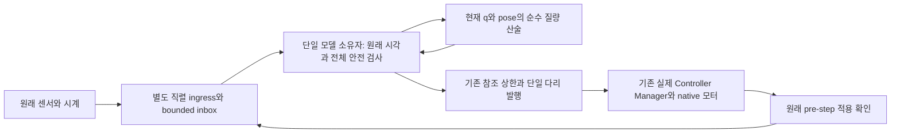

새 `NativeMassEvaluator`는 기존 `_mass_plan`이 만든 정확한 URDF/질량/불변 변환만 소유한다.64관절/65모멘트 상한, 현재 관절·pose·강체/유한값/관절 한계 검사를 유지하며 측정 pose를 캐시하지 않는다. C ABI1 함수에는 ROS·시계·명령·worker·물리 상태 쓰기가 없다. [Python3.12 CDLL 계약](https://docs.python.org/3.12/library/ctypes.html#ctypes.CDLL)에 따라 한 번의 외부 순수 계산 동안 GIL을 해제하며 Python callback을 C++에서 호출하지 않는다. ABI·설치 라이브러리 SHA·컴파일된 기하 SHA를 report에 남기고, 오류 후 fallback/재활성화는 없다. cleanup/종료 시 모델 호출이 끝난 뒤 기하 객체를 해제한다.

선택은 명시적 MuJoCo G2 relay100 구성에 한정한다. G1·Gazebo·native 기본 모델은 원래 Python 산술이다. 현재 측정·가상 예측의 세 CoM 호출에 같은 계산기를 사용해 지지 계획과 실측이 다른 수식을 쓰지 않게 한다.50Hz 제어·100Hz CM·2ms 물리·native 명령 적용·게인·힘·다리 궤적·40/20ms 개별 참조 상한·기존 phase 마감·100ms 안정화·200ms 센서/ACK 기준은 변경하지 않는다. 팔·카메라/촬영/TF 계약도 그대로다.

구현 전 수치 시험 RED14.74초(모듈 부재), 구현 뒤 독립 full-link FK100자세·불량 입력·현재값 비캐시·단일 joint read·정확한 모델 바인딩·해제10시험11.20초 PASS다. 구성 선택도 연결 전에 G2 미연결 RED11.38초를 확인했다. 실제 수신4.2209초/1,353메시지를 재생한 `native-mass-contention-replay-34896d4c`에서 NumPy/native/native/NumPy 순서의 순수 측정+IK 평균 CPU는1.375/1.008/0.873/1.616ms였다. 수치 출력 동일·각172callback·모터0·receiver 정상 join을 확인했다. 계산 CPU 평균 약37% 감소이며, 같은 기록의 ROS timer 간격은 약24.6ms로 같았다. 이 결과로 실제 G2 성공이나 전체 지연 감소를 주장하지 않는다. 후속 설치 감사·관련 회귀와 새 고정 소스 엔진에서 판단한다.

## G2 실제 실패에서 갱신한 실행·참조 계약 (2026-10-25)

[G2 판별 기록](SECTION_13_5_G2_DEBUGGING_KO.md)에 원본 실패·회귀·수식을 연결한다.
접촉이 계획 끝점 완료를 의미하지 않으므로 정상 발 궤적은 기존 속도 내에서 끝까지 수행한다.
G2 허가 서비스의 파일 I/O는 원본 시계 수신과 별도 callback group/기존 DrainingExecutor를 쓴다.
관측 원본은 journal에 전량 기록하고 live cache만128개로 제한한다. 엔진/receiver 종료 뒤
전체 기록을 건수 일치로 복구한 다음 전 표본을 인수 검사한다. 원본 시각·기준은 유지한다.

일반 보행은 지지 offset과 travel을 합쳐 기존 선형0.1m/s²/각0.06rad/s² 이내의
quintic 시간 법칙을 적용한다. 입력 ramp와 회전 기여를 포함해 최소 시간을 해석적으로
정하며 단계별 총 변위·보폭은 그대로다. 현재 명령을 매 tick 적용한다. 접촉 없는 탐색1초,
탐색0.002m/s와 명시 STOP 착지/안정화 기준 및 G1 전용 궤적/10wall초는 유지한다.
실제 G2는 아직 FAIL이며 관련43건·방향/ramp8건 PASS는 물리 성공의 대체물이 아니다.

## 종료 자원의 수명: 이미 검증한 공통 구현 재사용 (2026-10-25)

읽기전용스레드진단`2d92e769`는물리G1/실제carry terminal/관절·TF소유권을모두통과했다.
하지만crawl 종료로그에`exception was never retrieved: cannot use Destroyable because
destruction was requested`가있어전체FAIL이다. 모든프로세스exit0/회수/잔여없음으로이
예외를정상종료로위장하지않았다. worker실행중guard를파괴하는설치Jazzy종료순서가원인이다.
새실제DDS회귀는콜백을실제로정지시킨채실제pool join/guard destroy경계를관찰하여
guard가먼저파괴되는실패를결정적으로재현했다. 관찰hook은실제연산을대체하지않는다.

relay100용Crawl실행기만기존Ch13 `common.DrainingExecutor`로바꾼다. 이공통구현은
spin이돌아온뒤먼저실제worker pool을join하고그뒤ROS guard를파괴한다.
원본커밋`f2fa0eba4c042b00bb70f15b4066869ed370d84f`, 공통파일/외부rclpy수정없음.
2worker·callback group·기존TimeSource·관절/센서/명령소유권은유지하고native기본은
SingleThreadedExecutor그대로다. RED1→실제종료/수신/기존13.3프로토콜14PASS12.78초다.
다음은코드동결후미리정한Gazebo3연속검증이며첫FAIL에서멈춘다. 성공한실행만고르지않는다.

## 구조 재검토: 임시 완화책의 수명과 원래 동작 한계 (2026-10-25)

계산/수신개선을진행했지만`025d4b84`도원래10wall초에FAIL했다. 세착지/복귀후
STAND후보의남은시간은1.195초였다. 수신freshness는이번에통과했으나직전scan실패의
원인이해결됐다고보지는않는다. 더작은시간보정을계속더하는대신현재조치의필요성을
재검토한다. 기존.1m/s²설정은유지된채G1에만내부배율.5가남아있다.

- 이전수치접촉0에서가속도절반은접촉소실/팔속도초과를없애지못했다. 관련원본실패는보존됐다.
- 50µm실측네건은들기/복귀로진행했고최초실패는원래deadline이었다. 접촉문제의완전해결을
  확정하지는않지만, 수치접촉경계조치와시간을늘리는임시완화책을구분할근거다.
- 따라서G1의내부.5배율을제거하고원래설정.1m/s²의동일quintic곡선을사용한다.
  설정상한을올리는것이아니며일반CRAWL·게인·30Nm·형상/접촉/속도/하중·10초·실제1초
  안정화는변경하지않는다. duration은기존2.486→약1.758ROS초로돌아간다.
  기존안전검사와새실제실험으로판별하고실패하면배율을다시순회하지않는다.

참고구현은`legubiao/quadruped_ros2_control`의고정커밋
`5434c5810d1a7fe223bcfd04550e9d3bfdd4b458`에서직접읽었다.
[Controller update/FSM](https://github.com/legubiao/quadruped_ros2_control/blob/5434c5810d1a7fe223bcfd04550e9d3bfdd4b458/controllers/unitree_guide_controller/src/UnitreeGuideController.cpp)은
native update에서모델·추정·명시상태를순서대로갱신한다. 채택할원칙은동작단계와계산·통신
대기를분리하고한제어소유자로검증하는것이다. 특정로봇의수치/게인이나제어기를복사하지않는다.
[실행안내](https://github.com/legubiao/quadruped_ros2_control/blob/5434c5810d1a7fe223bcfd04550e9d3bfdd4b458/controllers/unitree_guide_controller/README.md)는
Jazzy/Harmonic사례를제공하지만KDL성능차이로불안정할수있다고도명시한다.
pos/vel/effort/KP/KD인터페이스가Ch13position-only와다르고팔추가하중은검증하지않았다.
[FixedStand의percent전이](https://github.com/legubiao/quadruped_ros2_control/blob/5434c5810d1a7fe223bcfd04550e9d3bfdd4b458/controllers/unitree_guide_controller/src/FSM/StateFixedStand.cpp)는
우리의실제하중/속도/연속1wall초확인을대체할수없다. 여기서직접해당외부모델을실행한
것은아니며자료의성공사례와Ch13의실제인수를구분한다. 라이선스Apache-2.0, 소스복사없음.

## 실제 실행 비용의 경계: 기본 QoS 경고 이벤트 (2026-10-25)

`bd8ad3ae`는원래참조복귀/실제착지두표본까지도달했으나10wall초에FAIL했다.
CPU비용을분리한결과저장된STAND수치kernel은약2ms였고OpenBLAS가아닌Netlib이매핑됐다.
따라서BLAS스레드설정은바꾸지않았다. 공식launch prefix/filter로소유motion_guard만
부모cProfile아래시작한`787361fb`도원래deadline FAIL이었다. 이는main-thread wall계측이며
별도watchdog CPU나전체CPU시간으로해석하지않는다. 이실행은추가필수조건
`unprofiled_acceptance=false`로G1승격을금지했다. 실제엔진/launch0·회수·강제없음·잔여[]다.

main계측에는`waitable.__add__`407,976회등대기집합항목의반복검사가관측됐다.
실제QoS오류가그만큼발생했다는뜻은아니다.
[설치Jazzy와같은공식API](https://github.com/ros2/rclpy/blob/jazzy/rclpy/rclpy/event_handler.py)는
기본QoS/타입불일치경고를위해별도이벤트를등록한다. 경고로그는현재안전확인프로토콜이
아니며, 입력age와단일publisher/GID·모델·소유권검사가별도로존재한다.

실제DDS8토픽50Hz 비교에서메시지1,600개가양쪽모두누락없이수신됐고대기항목은34→2,
프로세스CPU454.14→330.75ms(약27%감소)였다. 이는국소비용측정이며엔진RTF개선이나
G1성공을증명하지않는다. Ch13신규`dispatch_node.py`는공개`use_default_callbacks=False`
만사용해이경고전용항목을등록하지않는다. 메시지QoS/주기/콜백/직접제공한이벤트컨테이너는
유지한다. 실제지정matched이벤트가계속실행되는지, 메시지전수신·입력손실·200ms만료·
carry terminal·시동/종료를회귀하고새실제엔진으로검증한다. underlying ROS/드라이버/다른장은
수정하지않고메시지나촬영을버려성공시키지않는다.

## 동시 수신과 한 제어 주기의 판단 경계 (2026-10-24)

센서 수신 분리는 제어 잠금 대기 문제를 해결하지만, 판단 시각을 읽은 뒤 새 수신을
선택하는 경합을 새롭게 고려해야 한다. Gazebo `d1136df9`에서 첫 센서묶음의carry는
23.988ROS초/receipt440163880161ns로 판단wall440194094423ns보다30.214262ms
앞선 유효한 상태였다. 그러나 교정조건은 같은 tick에서 `bundle()`을 다시 호출했다.
중간에 도착한 같은/이전ROS시각의 새carry는 판단wall보다 뒤인 receipt를 가지므로
`sample_valid`가 음수 wall age로 거부한다. 독립probe의새24.002ROS초 receipt는
440194674672ns였다. probe시각을 owner callback시각으로 대체하지는 않는다.
기존API의 결정적 회귀에서 유효한이전샘플→늦은후보→`calibration_carry:wall_age`
실패를 재현했다. 첫stop기록은 처음bundle이므로 실제거부된후보의 정확한receipt는
기존실행에서 복원할수없다. 후보시각을 정밀 계측했다고 주장하지 않는다.

수정원칙은 임계값 확대가 아니라 **한 판단의 시간 경계와 입력 고정**이다.
`SensorInbox.bundle(ros_ns,wall_ns=...)`와 guard선택은 두시각보다 뒤인 후보를
보존하되 이번판단에 쓰지 않는다. 교정carry검사·상태머신·first_stop은 같은bundle을
사용한다. 다음tick에는 원본receipt로 늦은후보를 평가하며,200ms가 지난이전샘플은
그대로실패한다. 원본stamp/receipt변경·최신TF·자동재시도·fault복구는 없다.

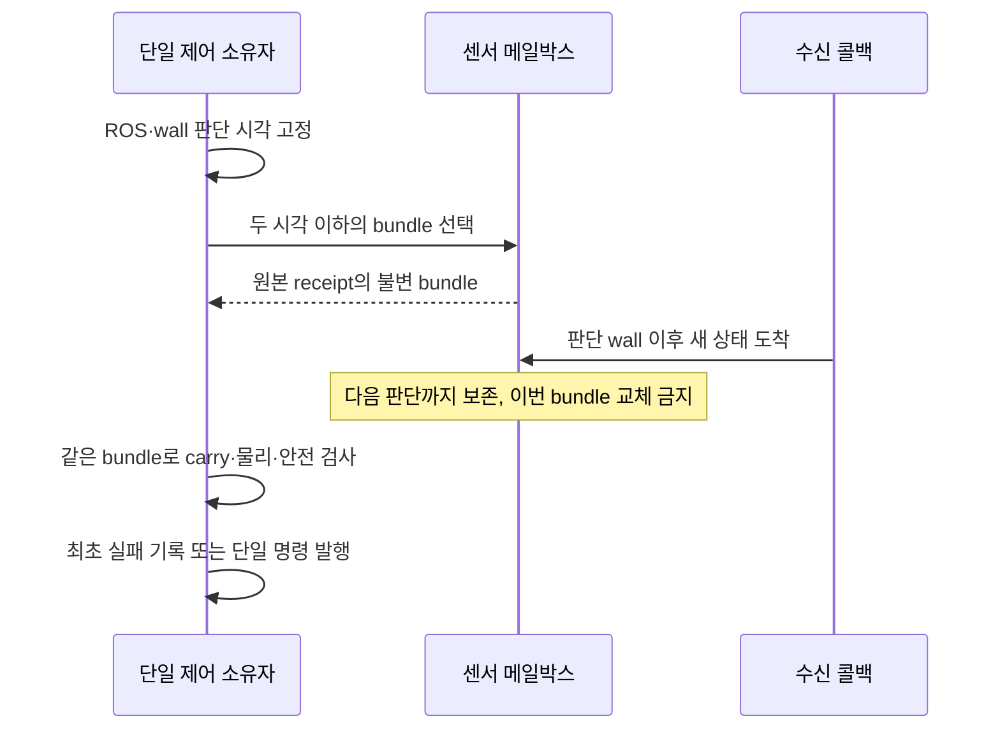

원시접촉 진단은 기존50Hz 진단packet에 동일2ms post-step raw pair/깊이/wrench/
발중심을 batch할뿐이다. 접촉 목록이 비어도 발높이로 힘을 생성하지 않는다.
이 변경은 일반CRAWL 궤적/게인·기존센서/물리인수 기준을 바꾸지 않는다.

## 승인된 G1 제자리 교정 전용 경로 (2026-10-24)

### 수치 접촉 경계 판별 (2026-10-25, 구현·첫 실측 완료, G1 미통과)

첫50µm 실행 `5b1854b7`은 실제같은PID의DART파일·SHA와 공개getter
0→0.00005m를1,540개native표본에서확인했다. 기존23+relay1검사를유지하고
설정계약1개를추가했다. 실제lift는통과했으나요청후10wall초에착지복귀중FAIL했다.
설정적용성공은G1성공이아니며, 이한번으로접촉문제의완전해결을확정하지않는다.
native/launch/relay exit0·reaped·강제없음·잔여[]이나물리STOPPED와전체정상인수는
FAIL이다. 원본84소스와실행ZIP을보존한후다음수정을진행한다.

명령FK와같은촬영의원시하중대조에서초기rest+3mm참조가1.08ROS초멈췄고,
실제FL하중은최소18.529N이었다. 가상모터참조와물리발중심을같은값으로간주한
내부3mm/초기floor-.2mm상한이불필요한직렬대기를만들었다. 단순상한제거의관련회귀는
54통과/10실패였다. 강체이상추종은하중30N에서0으로바뀌어지지이동전에발이떨어졌다.
이음성결과를보존하고실제엔진으로내보내지않았다. 현재G1전처리는측정관절FK를
명령body기준으로계산한높이와현재명령높이의차이(추종압축여유)절반이내로만진행한다.
강체이상추종의여유0이면진행하지않고, 실제압축여유가있을때만해제한다.
이는실제발높이를대체하지않는다. 원래rest+10mm상한/.002m/s·실제FL10N예비하중·
네발2N검사와원래rest/10초/실제lift/1wall초안정화는유지한다.
아래3mm조건은이전가설의역사기록이며현재설계에서는이실측으로대체한다.

`15aaca4a`의20ms실험은 실제입력/적용차이와 native 힘계산오차0을확인했지만
SHIFT 중팔4속도0.033323rad/s로FAIL했다. 따라서계단참조만이원인이라는가설은
충분하지않다. 숫자를더늦추거나같은실행을반복하지않고원시이벤트를추가관측했다.

`3d830070`에서31개native2ms이벤트상태를확보했다. 최초carry실패가선택한25.910초
관절표본은이벤트상태의모든관절속도와정확히일치했다. 이표본의팔속도는0.02미만이고,
그리퍼0.00550265m/s가원래0.005를넘었다. 직전25.908초에는팔2/4의짧은속도충격도
관측된다. 어느carry실패나같은관절원인이라고단정하지않는다.

네발실제중심과실제관절FK로몸체rigid transform을오프라인재구성한최대맞춤잔차는
1.34e-15m였다. 2ms위치2차차분의최대가속도는2.526m/s²다. 이는native IMU수치나
단일원인확정이아니며, 기존센서/odom/명령을대체하지않는다. 원래SHIFT 참조상한
0.05m/s²와실제짧은기계적충격을구분하는보조측정이다.

모든접촉단절의직전구바닥z는평면z0보다0.7–3.1nm높았다. 다음2ms에원생pair0과
0.19–0.36mm의침투가관측되고다음step에접촉힘이복원됐다. 접촉을높이로재생성하거나
원래검사를완화하지않는다. 이패턴은지지접촉의수치적경계/오차보정이후보임을보인다.
현재접촉검출기자체의버그나컴플라이언스부족을확정했다는뜻은아니다.

[DART6.13.2 공식구현](https://raw.githubusercontent.com/dartsim/dart/v6.13.2/dart/constraint/ContactConstraint.cpp)은
기본 `ErrorAllowance`를0으로둔다. 설치vendor의공개getter를별도읽기전용도구로
조회한결과도0이었다. 실제엔진의값은다음opt-in설정전공개getter로다시검증해야한다.
pkg-config경로/eigen별칭조회두번은실패했고,외부설정수정없이기존공식CMake target으로
빌드·조회했다. 단순검출기비교는
[Gazebo8 공식설정](https://raw.githubusercontent.com/gazebosim/gz-sim/gz-sim8/tutorials/physics.md)의
ODE/FCL선택으로도가능하나,이번권장안은측정된경계문제에직접대응하는한변수판별이다.

- 제안: **소유한단일world G1 검증엔진프로세스에서만**공개DART API로접촉허용오차를
  0→50µm(0.00005m)로설정해비교한다. 기존20ms실험·궤적·게인/감쇠·30Nm·형상/
  질량·마찰·반발·2ms물리step·10wall초·전required_checks는유지한다.
- 이값은Ch13모델의수치접촉설정으로명시하고physics hash에포함한다. 실제설치DART의
  header/library와설정전/후getter값을증거로남긴다. 예상기본값이아니거나중복설정소유자/
  다중world이면실패한다. 실제측정하중·lift·안정화는그대로검사한다.
- 이는접촉정규화기의가짜하중생성이나센서필터가아니다. 기존0값실패를보존하고,
  비교실패시허용오차를무작정늘리지않는다. 새설정성공후에도고정소스3연속·최종전수
  인수전에는기본보행승인으로승격하지않는다.

사용자가2026-10-25에이50µm비교의구현·검증을승인했다. 현재기준소스·원본실패를
로컬checkpoint에보존한뒤테스트우선으로진행한다. 승인자체를실제성공으로세지않는다.
시스템권한상승·driver/외부원본수정·시스템설정변경은필요하지않다.

### 후속 구조 판별 후보: G1 검증 모드에서만 명령 적용 경계 비교

새복귀 수정 후 MuJoCo `293d0ff3`은23개 필수검사 모두PASS였다. 반면 Gazebo
`e2cb2cc1`은 새수직helper 진입 전 SHIFT 중 팔4번 관절의 실측속도0.033196rad/s가
기존0.02를 넘어실패했다. 정적지지 원생5,000개2ms촬영에는 접촉pair단절0건,
calibrate580개에는3건이 있었다. 독립joint_states의22.898초는충격을선택했지만
20ms간격native command표본의팔최대속도는0.011916이었다. 표본주기의차이를
고려해야 하며 어느한쪽 기록으로다른쪽실측을부정할수없다.

기존Ch13 `PositionPDSystem.write()`는매물리step 현재q를읽지만 목표는
`joint.command`를그대로hold한다. 50Hz새명령이올때 native P항의참조가 바뀌는
구조다. 실제미포화P-law 역산표본에서주변최대참조변화는0.0022077rad/20ms였다.
이는 정확한callback수신시각이나2ms명령추적이아니므로, 접촉단절의원인으로
확정하지않는다. 낮은SHIFT가속도만계속줄이는대신이경계를판별하는것이후보이다.

- 제안: **G1 validation-only Gazebo 생성장면에만 opt-in**, 기존Ch13 native
  position backend에서다리12관절의새목표를이전적용목표부터20ms동안연속적으로
  적용하는비교시험. 추가commandowner/ROS토픽없이기존backend가적용하며,
  값의예측·root/속도setter·외력·적분항은추가하지않는다. 새목표가중간에도착하면
  당시적용참조부터갱신해계단을재생하지않는다. 기본모드와일반CRAWL은그대로다.
- kp/kv/native damping/30Nm/관절범위·질량/관성/접촉형상·물리step/카메라·모든
  required_checks·10wall초는유지한다. 진단에서 실제적용참조와입력참조를구분한다.
  지연/기한/rollback/비정상입력/정지·비활성화인계는최소회귀부터검증한다.
- 판별: 연속참조의최대step 감소가실제기록되는지, 같은물리장면의접촉단절/팔초과가
  남는지새UUID1회로확인한다. 실패하면같은구조에서숫자를무작정바꾸지않는다.
  시험성공만으로일반CRAWL승인이나3연속/최종전수인수를대체하지않는다.

사용자가 이 native 명령적용 경계를 포함하는 opt-in 비교 구현·검증을 승인했다.
최소실제플러그인 RED3/4PASS→GREEN7PASS, 장면/launch경계 관련23PASS다.
기존플러그인의관절state/command handle은하나씩유지한다. 변경은20ms causal
참조적용뿐이며 새목표는그시각의적용참조부터시작한다. 비활성화는미완료목표로
뛰지않고마지막적용참조를유지한다. 기존rollback/비정상입력은stickyfault/힘0이다.
진단전용 Ch13 `PositionReference`는 실제write시각과입력·적용값을기록해observer가
읽는다. physics가소비하는위치/속도명령이아니며 새액추에이터소유자가아니다.
전체설치/실제Gazebo판별이끝나기전실험성공이나일반보행승인으로표시하지않는다.
외부underlay·드라이버·시스템권한은변경하지않는다.

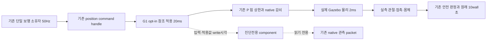

### 승인 확정: 접촉 확인과 원래 preload 참조 복귀의 구분

`bea603b2`의 helper는 4N·고유3촬영에서 STAND 후보가 됐지만 참조 z는
0.0243287m로 원래 held rest 0.0167551m보다 7.574mm 높았다. 이때 FR calf의
실측 오차는 약0.039545rad(기존 허용0.03), 속도는0.000783rad/s였다.
원생 P 구동력은 -29.7273Nm/상한30Nm로, 조용히 기다려도 관절 오차가 남는
정적 하중 상태였다. 바닥 접촉만으로 ‘원래 참조까지 복귀’를 대신할 수 없다.

원래 .002m/s의 접촉 후 참조 경사를 끝까지 유지하면 남은7.574mm 복귀에만
최소3.787ROS초가 더 필요하다. 현재 경로의10wall초·최종1초 안정화와 맞지 않는다.
이는 모든 가능한 자세/제어기의 불가능성 증명이 아니라 현재 경로의 실측 예산이다.
보조 IK 탐색은 기존 관절 범위 내의 중심 이동 후보를 찾았지만, 수평 접촉장력·
네번째 발·PD 변형을 생략하므로 실제 tracking 성공이나 전역 최적해로 쓰지 않는다.

사용자가 원본 preload까지 유계 복귀 재설계·검증을 승인했다(2026-10-24).
아래 첫 방식을 적용한다. 승인 전 원본 실패와 느린 seek 구현은 기록으로 보존한다.

- 권장 검토: G1의 계획된 복귀 참조를 기존 SWING 상한 .02m/s 이내의 연속·유계
  곡선으로 원래 rest까지 완료한다. 이 계획된 구간은 접촉 후에도 계속될 수 있다.
  해제/별도 접촉 탐색 .002m/s·게인·30Nm 상한·4N/3촬영·실제 tracking/1초 안정화·
  10wall초·전체 required_checks는 유지한다. 원래 참조 복귀와 물리 확인이 모두
  끝나기 전에는 STAND 완료가 아니다. 일반 CRAWL의 조기 접촉 정지 정책은 바꾸지 않는다.
- 접촉 후 참조속도도 계속 .002m/s로 고정한다면, 해당 계약을 유지한 제약·대안을
  보고한다. 기준 완화나 gain 증가·실패 재시도로 완료를 위장하지 않는다.

실행 계획은 기존 Task8 안에서 다음 세 경계를 분리하는 것이다.

1. 실측6mm/고유3촬영 lift 후 기존 속도·가속도 상한 안에서 원래 rest로 복귀한다.
   복귀 중2N/4N을 관측해도 원래 endpoint에 도달하기 전에 완료하지 않는다.
   endpoint에는 속도0으로 접근하도록 남은 거리의 제동 속도를 사용한다.
2. endpoint에서 원래 rest를 유지하고4N/나머지발2N/고유3촬영을 확인해야 STAND 후보가
   된다. 원래 참조보다 내려가는 추가 탐색이나 측정 발중심으로 참조 덮어쓰기는 없다.
3. 후보 이후에도 calibration 소유권과 원래10wall초 deadline을 유지한다. 기존 owner의
   관절오차0.03/속도0.02·몸체정지·네발접촉·연속1wall초 확인 후에만 해제한다.
   실패하면 sticky fault이며 자동 재요청·재시작은 없다.

일반 CRAWL의 조기접촉 즉시정지/느린 접촉탐색과 native 제어기/feedforward는 바꾸지
않는다. 승인된 교정 전용 경로를 실패회귀→최소수정→관련회귀→설치감사→새 실제
Gazebo 단일 실행으로 판별한다. 간헐조건3연속/최종 전체시험은 성공 경로 확정 후다.

착지구간 후속판별: `db492b97`에서는실제lift와TOUCHDOWN까지진행했지만,
높이만floor+2mm이하이면공중에서도.002m/s로줄이는내부조건에예산을소모했다.
높이근접은접촉력이아니다. 이조건만제거하여측정하중2N전에는기존.02m/s이하
공중복귀/기존slew를사용하고,측정2N이되면즉시fastdescent를멈춘다. 이후에는
기존.002m/s이하접촉seek/4N/고유3촬영/원본rest상한/최종1wall초를유지한다.
타이머·기하학적높이만으로착지성공을만들지않는다. 높이만으로2mm/s에묶이는
기존동작을새최소회귀에서RED1/5.70초로재현했고후속관련검증을진행한다.

### 예산 재검토 — 전처리 후 실제 들기·착지 도달, 시간 예산 미통과

낮은G1 가속도만바꾼`1823b29e`에서는본unload진입전접촉/팔자세상실이
먼저발생하지않았으나원래10wall초에다시실패했다. 이것이간헐접촉문제의
최종해결이나3회연속성공이라는뜻은아니다. 일반CRAWL은변경하지않았다.
아래3mm/바닥하한/10N조건의전처리를최소회귀RED10→관련48PASS46.91초로
구현했다. 아직새실제실행성공증거는없다. 명시적G1요청도항상FL을선택하게해
이전보행순서의index와고정force index1이엇갈리지않도록회귀를추가했다.

후속`68c22106`는전처리/해제전에SHIFT에서실패했다. FL원생pair수0/힘0의
2ms촬영22.924초가그대로정규화되었고,3발만으로현재CoM을지지할margin이없어
안전판정은옳았다. 이촬영은3발하중이있어축약진단의상세요건(<3발)에해당하지
않았으므로전체pair상세는없다. pair수0인선택FL과원본힘0은요약에그대로남았다.
그뒤22.930초joint촬영에서팔qd가.033/.034rad/s로기존.02를넘었다.
callback벽시각과원생촬영시각을섞어어느노드가물리원인을만들었다고단정하지않는다.

다음단일변수판별은G1에서만기존동일SHIFT형상/목표를더긴시간에실행하여,
내부peak가속도를기존상한의절반(.05m/s²)으로줄이는것이다. 따라서duration은
기존의sqrt(2)배다. 일반CRAWL/게인·전체limits는그대로다. 원생접촉단절과팔동요가
동일하지않은정도로줄어드는지새UUID로확인하며,10wall초전체인수실패를성공으로
바꾸지않는다. 이가설이틀리면더낮은숫자를무작정반복하지않고다시원인분석한다.
시간예산전처리는이판별과동시에구현하지않아영향을구분한다.

`8b101e20`의하중해제목표변화8.5mm는기존.002m/s로약4.25ROS초가필요했다.
기존SHIFT1.758ROS초와계획·안정화·들기·복귀·최종1wall초를직렬로더하면,
이번약.63RTF에서는10wall초가매우빡빡하다. 이때unload를자주정지했다는가설은
실제목표변화와맞지않으므로기각했다. 상세진단payload의영향은별도동일궤적비교로
분리하고, 이것만시간초과의유일원인으로설명하지않는다.

진단비교후에도예산실패가남아승인된G1범위안에서다음후보를테스트우선구현한다.
네발이측정접촉중인SHIFT동안, 선택FL의기존압축preload만기존.002m/s이하로
조금풀어직렬대기를겹친다. 물리적들기/SWING을먼저시작하는것이아니다.

- 계획계산중에는목표를바꾸지않아IK/CoM후보의일관성을유지한다.
- FL측정하중10N이상·다른세발각2N이상일때만전처리목표를올린다.
  초기측정floor보다.2mm낮은값과원본heldrest+3mm중작은값을넘지않는다.
- FL이실제2N아래로먼저떨어지면전처리중조기접촉손실로실패한다.
  오래된하중·힘을합성하거나재접촉을기다려자동복구하지않는다.
- 원래의tripod margin/몸체정지확인/100ms안정화후에만본unload를시작한다.
  원래rest기준의전체10mm해제상한과복귀rest를전처리뒤의새원점으로재설정하지않는다.
- 일반CRAWL의SHIFT/해제/SWING·게인·최대속도·하중·최종settle·10wall초는유지한다.
  다른발의world목표나새관절발행자를추가하지않는다.

전처리가실제로안전하거나10초를만족했다고아직주장하지않는다.
변경전실패회귀·관련회귀뒤새고유UUID엔진실측으로검증한다.

사용자는 `7f321eb` 이후 G1 전용 lift-return 궤적/단계별 시간 예산 재설계와 검증을
승인했다. 일반 CRAWL 궤적·게인·10wall초·실제lift·속도·하중·안정화 기준은 그대로다.
Task8의 기존 작업 공간/실행 방식(네이티브 단일 작업자)을 재사용하고 재승인을 반복하지
않는다. 아래 세부 수치는 구현자의 선택이며 실제 인수로 정당성을 확인해야 한다.

### 근거와 선택

원본 `5f2a8463`은 최초 실제5mm lift가9.4047wall초이고 교정10초 종료 때도 일반
SWING을 수행했다. 실제 하중 해제 자체와 추가20mm 보행 bump는 서로 다른 단계다.
시간 제한/힘 임계값 완화는 배제한다. 일반 CRAWL 곡선을 바꾸는 대신 G1에만 실측
종료 조건을 둔 수직 lift-return을 선택했다. 계산/통신 성능 개선만으로 물리 단계
완료를 가정하지 않으며 승인 자체도 성공 증거가 아니다.

### 상태·소유권·시간

- SHIFT의 계획·CoM margin·실제 body settle·100ms 하중 해제 확인은 유지한다.
  교정에 한해 하중이2N 바로 아래로 내려간 동안에도0.002m/s 이내의 해제 경사를
  계속해 임계 부근 정지/재접촉을 피한다. 최대 해제 높이10mm는 유지한다.
- `calibration.py`의 순수 수직 경로는 actuator/ROS/엔진 API를 소유하지 않는다.
  CrawlMachine만 명령을 생성한다. x/y, 몸체, 나머지 발의 목표는 새 경로가 수정하지 않는다.
- SWING: 실제 FK 높이가 교정 전 measured floor보다6mm 이상이고 선택 발 힘<2N인
  고유 contacts 촬영3개를 요구한다. 기존 독립 판정5mm/고유3개보다1mm 여유를 둔
  목표이며 명령 높이나 contact point의 ground/center 의미 전환만으로 lift를 선언하지 않는다.
- 수직 reference 속도 상한은 기존0.02m/s다. 속도 전이는100ms 기준의 유계 ramp로
  급변을 억제한다. 목표 높이 상한은 기존 measured floor+20mm다.
- TOUCHDOWN: 공중에서는 기존0.02m/s 이하 복귀를 유지한다. 높이 근접만으로
  접촉으로 취급하지 않으며, 실측2N 하중에서 빠른 하강을 즉시 중단한다.
  이후0.002m/s 이하 접촉 seek를 하며 기존 held preload 아래로 명령하지 않는다.
  선택 발4N(기존2N보다 보수적 여유), 나머지 발2N 이상/고유3촬영을 확인해 STAND
  후보가 된다. 안정 하중 전에 임의 timer만으로 완료하지 않는다.
- STAND 후보는 PASS가 아니다. 기존 소유 노드의 모든 발 접촉·관절 오차/실측 속도·
  몸체 속도와1초 wall settle을 그대로 통과해야 최종 ready/stopped가 된다.
- 서비스 요청의 원래 ROS/wall 시각과10초 deadline, 단계 전이, 촬영 식별자·관측
  높이/힘을 보고한다. 최초 요청 시각을 재설정하거나 clock을 새로 만들지 않는다.
  기존 외부 runner의10wall초 판정을 유지하고 예산을 늘리거나 실패를 재시도하지 않는다.

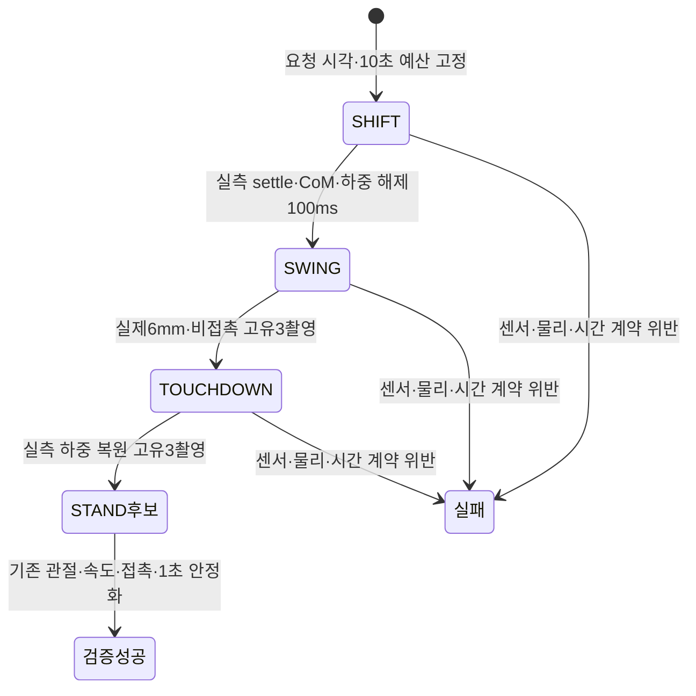

### 검증 계획과 한계

먼저 순수 경로에서 중복/미달 lift/하중 미복원/속도·높이 한계/clock rollback·시간
예산을 실패 회귀로 재현한다. 이어 실제 CrawlMachine+ideal fixture로 교정만 분기됨을
확인하고 기존 일반 보행·정지·소유권·ROS·Python MuJoCo component를 회귀한다.
설치 감사 뒤 실제 Gazebo 관련 G1을 새 UUID로 실행한다. 실패하면 원본을 보존하고
같은 소스의 무조건 반복 대신 첫 실패 경계로 돌아간다. 실제 엔진은 순차 실행한다.
일반 CRAWL/G2/Nav2 성공·물리 파지·PPO를 이 변경만으로 주장하지 않는다.

첫 전용 경로 실측 `5b47123d`는 교정 진입 전 guard wall age202.236736ms로 실패했다.
독립 probe는 소유자의 실패20.095422ms 전에 새 원본2.712초 guard를 수신했으나,
소유자 선택값은2.548초였다. 시계/6개 센서와 달리 guard 상태 구독은 제어 그룹/모델
잠금에 남아 있었다. 이를 교정 궤적의 시간 실패로 해석하지 않는다. 원본79소스와
FAIL은 `task8-control-clock-5b47123d.zip`(3,017,534bytes,
SHA256`6258edddaa5382c3ce5ea6ba3d0edad3c54516c0cc827277037b64837f11d510`)에 고정했다.
STOPPED/액션 drain/consumer·relay·native/launch0/회수·잔여[]는 이 실행에서 확인했다.

Ruling: 검증 모드의 모든 **상태 피드백**(6센서+guard)은 같은 짧은 메일박스 경계에서
원본 메시지·최초 callback-entry receipt만 보관한다. guard 해석·선택·모델/세대/소유권
검사와 명령·라이프사이클은 기존 제어 그룹/소유자에 남긴다. 입력 cache와 상태 머신을
분리한 이전 설계의 누락을 고치며 watchdog·QoS·토픽 주기·한계를 바꾸지 않는다.
잘못 판단한 경우 생산자/제어 지연이 여전히 남을 수 있으므로 실제 새 실행으로 확인한다.

## guard 상태와 로컬 시계의 도착 순서 (2026-10-24)

82ffc55f의 first_stop은 `guard:ros_age`였으나 실제 선택 stamp11.578초가 판정 노드
ROS11.576초보다2ms **미래**였다. 양 노드의 `/clock`과 guard subscription은 다른
순서로 처리될 수 있다. 이는149959a0의205.80ms wall 지연과 별개의 원인이다.

guard callback은 원래 header와 최초 receipt를 최대10개 후보에 보관한다.
유효성 검사에서는 `stamp<=로컬 ROS 시각`인 가장 최신 후보만 선택한다. 나머지 미래
후보는 보류하고, 마지막 선택값도 기존ROS/wall 각각200ms 범위에서만 사용할 수 있다.
중복·역순 도착으로 receipt를 갱신하지 않으며, 만료·clock 정지·소유자 변경은 계속
안전 정지를 유발한다. inactive 준비 신호도 유효한STAND/HOLD guard를 먼저 요구한다.

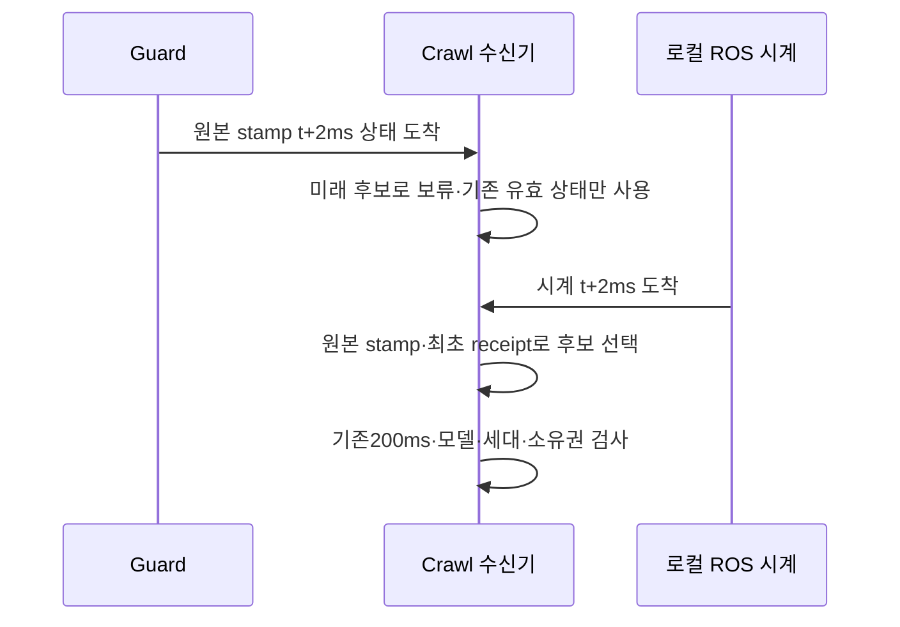

재현 시험은 동일 callback/clock 순서를 강제로 분리해 미래 상태의 조기 선택과 중복
receipt 갱신을 검출한다. 관련ROS10건은 통과했지만 실제 반복 인수 전이므로 전체
간헐 실패를 해결했다고 선언하지 않는다. 오래된 packet 시험은 임의120ms가 아니라
마지막 유효 capture의 원래200ms 만료를 기다리도록 교정했다.

## 안전 주기를 막지 않는 하중 이동 탐색 (2026-10-24, 실제 인수 전)

실제149959a0의 최초SHIFT 콜백은173.88ms를 차지했다. 다음 주기에 선택된 접촉은
ROS age70ms지만 수신 후 wall age205.80ms로 기존200ms watchdog을 위반했다.
단순히 센서가 발행되지 않았다고 단정하거나 한계를 늘리지 않는다.

동일 관측의 CoM은 root-to-joint 공통 변환을 한 번만 계산한다. 다음 관측에는 새로
계산하므로 상태를 시간 사이에 재사용하지 않는다. 회귀38건을 통과했지만 오프라인
전체 탐색의 중앙값은28.00→28.95ms로, 이것만으로 속도 개선을 입증하지 못했다.

따라서 기존 coarse9점·binary8회 탐색을 제어 주기마다 후보 하나씩 평가하는
협력식 단계로 분리한다. 탐색 입력과 명령 기준은 고정하고 매 주기 실제 센서·지지·
owner·정지 검사를 먼저 한다. 계획 완성 전에는 기존 명령을 유지하며 이동 곡선의
시간도 진행시키지 않는다. STOP/FAULT는 탐색을 폐기한다. worker나 두 번째 명령
소유자를 추가하지 않는다. Python을 hard real-time으로 보장하는 설계는 아니다.

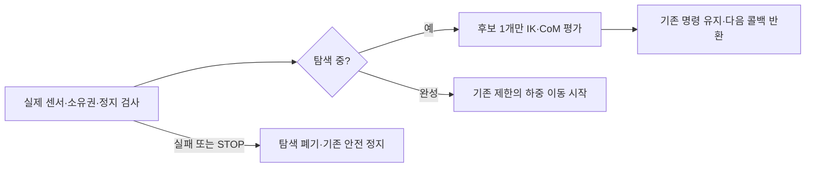

새 계산량 회귀는 원래 한 주기 CoM14회에서 실패했고, 변경 후 기존 물리·보행을
포함36건을 통과했다. 명목 탐색 시간 약0.26–0.34ROS초가 추가되므로 기존10wall초
실제 calibration 인수 안에서 검증해야 한다. 한계나 완료 기준을 늘린 것이 아니다.

## 활성화 시 위치 명령·실측 앵커 분리 (2026-10-24, 인수 진행 중)

위치 힘 구동에서 하중이 있는 관절의 실측각은 기존 명령각과 다를 수 있다.
740e454c 실제 실행에서 calf 실측1.035905rad/기존 명령1.0rad의 위치력은 약-17.95Nm였다.
활성화가 실측각을 새 목표로 삼으면 이 지지력의 상당 부분이 사라진다.
따라서 cold-start는 유일하고 유효한 URDF position initial_value12개를 사용하고,
이후에는 동일 모델·동일 소유자의 마지막 명령을 유지해 command FK 목표를 인계한다.
누락/중복/비유한/범위 밖 초기값·외부 다리 publisher가 있으면 거절한다.

실제 발 앵커·floor·미끄러짐·지지 여유는 실측 상태로 유지한다. 명령 FK를 odometry나
실측 발 위치로 발행하지 않는다. root pose/velocity 쓰기나 무조건적인 재시도가 아니다.
최소 수학·실제 lifecycle/DDS 회귀는 통과했으나, 후속5091c217은 네 발 하중을
유지한 뒤 guard ROS age로 중단됐다. 전체G1/G2 성공은 아직 아니며 정상 종료도 미완료다.

반복 비용을 줄이기 위해 일반 사용자 소유 Linux 전용 build/install 영역과 명시적
runtime 소스 범위 Git 감사를 사용한다. 설치607파일 최초 복제 해시·새 빌드 후8패키지
감사를 기록하고, 최종 전체 회귀는 동결 뒤 수행한다. 과거 실패·기준·원본은 유지한다.

## Task 8 실측에 따른 제어 설계 교정 — 인수 미완료

기존의 고정8초 물리 주기 가정은 아직 달성한 성능이 아니다. `cycle_s=8`은
발 이동량과 몸체 진행량을 계산하는 명목 phase-time으로 유지하되, 실제 부하 해제·안정
게이트는 진행 시계를 멈출 수 있다. 실제 주기·진행률·Nav2 deadline 충족 여부는 G2/G4에서
별도로 실측해야 하며 고정8초로 부르지 않는다. 강제로 시간을 맞추려고 발을 들지 않는다.

내부 무게중심 이동도 quintic 최대 가속도0.10m/s²를 적용한다. 이동 완료 후 몸체 속도
0.003m/s·각속도0.01rad/s 이내가100ms 유지돼야 SHIFT의 부하 해제를 시작한다.
선택한 발만2mm/s, 최대10mm로 부드럽게 해제하고 실제 정상력2N 미만·다른 세 발 지지·
실측 안정100ms 후 SWING으로 전이한다. 총 swing 높이20mm 한계는 그대로다. 해제 중에도
발 소유권을 유지하므로 STOP은 같은 발을1초 이내에 착지시키고 기존 STOPPED 검사를 한다.

이 교정은 모델·한계 hash를 바꾼다. 이전 native profile을 재사용하지 않는다. 원본 모델과
13.4 장면은 불변이며 navigation 전용 position PD 후보만 별도 생성한다. 후보의 수학·
Python 물리 시험 성공은 실제 양 엔진 G1/G2 통과가 아니다. 실패 원본과 판별 실험은
`Ch13/evidence/section_13_5/85670137-e73c-4c72-bcb2-0c73e755088b/EXECUTION_LEDGER.md`에 있다.

상태: **사용자 승인 — 구현 진행 중**. 사용자는 저속 crawl 상세 설계와 구현 계획을 승인했다.
이 문서는 승인된 설계이며, 아직 보행·접근 성능을 검증했다는 보고서가 아니다.

- 기준 HEAD: `8e07b05cdf45eeb96dffbfe4fdbe1cf045373146`.
- 작업 브랜치: `feat/ch13-section-13-5`. 생성 전 동명 로컬·원격 브랜치 부재를 확인했다.
- 작업 위치: 사용자 지정 기존 checkout을 재사용한다. 별도 worktree는 생성하지 않았다.
- 기존 미추적 `SECTION_13_4_DEBUGGING_LESSONS_KO.md`는 보존하고 이 설계 커밋에 섞지 않는다.
- 네이티브 단일 작업자가 수행한다. `sources/`, Ch01~Ch12, 외부 checkout/underlay는 수정하지 않는다.
- 설계 승인 후 구현 계획을 작성·검토하고 테스트 우선으로 구현한다. 이 단계에서는 제품 코드·설치·엔진을 변경하지 않는다.

## 1. 목적과 완료의 의미

13.4의 실제 RGB-D/촬영 시각 TF 처리를 재사용해 물체의 작업 위치를 정하고,
Nav2가 경로와 속도를 생성하면 통합 4족+팔 모델이 실제 발 접촉으로 저속 이동한다.
목표 위치에서 네비게이션 액션의 실제 결과와 몸체의 정지를 확인한다.

성공은 launch 실행이나 `/cmd_vel` 발행만을 뜻하지 않는다. 실제 양 엔진에서
전진·회전·장애물 우회·접근·정지·실패 대응·정상 종료를 확인해야 한다.
몸체 pose/velocity 강제 설정, 명령 적분으로 만든 가짜 odometry, 바퀴나 보이지 않는
구동 플랫폼, 외력으로 몸체를 끄는 대체 backend는 인수 성공에 사용하지 않는다.

### 이번 절에 포함하지 않는 것

PPO 학습·배포, trot, 동적 gait switching, 문턱·계단 등반, 경사지·험지, 적재물 운반,
MoveIt/물리 파지, 실로봇을 새로 완성하지 않는다. `crawl` 외 gait 요청은 거절한다.
기존 짧은 Ch12 정책을 안정적인 적재 보행 정책으로 취급하지 않는다.

검증 장면은 **평탄한 바닥·고정 지도·정지 물체**로 한정한다. 최초 구현의 localization은
시뮬레이터가 측정한 실제 상태를 쓰는 명시적 `native_ground_truth` profile이다.
AMCL/SLAM·IMU/LiDAR 융합의 성능으로 부르지 않는다. 전신 제어와 실제 위치 추정의
불확실성까지 동시에 해결하는 확장은 별도 과제다.

## 2. 확인된 기존 사실과 설계의 차이

| 현재 구현 사실 | 13.5에서 추가할 것 |
|---|---|
| `locomotion_node`는 STAND/HOLD/STOP만 지원하고 WALK를 거절 | 별도 저속 crawl 제어기 |
| `SAFE_ARM=(0,...,0)`은 기립용 영점 자세 | 접힘·간섭·CoM·실측 유지가 확인된 carry 자세 |
| 몸통의 URDF collision은0.60×0.30m | 보폭·수납 팔·여유를 포함한 footprint |
| 기존 `base_footprint`는 몸통과 같은6D 자세 | Nav2 전용 평면 `nav_base` |
| `/odom`은 실제 엔진 상태의 전달이며 명령 적분이 아님 | 같은 실측을 기반으로 한 평면 odometry·제어 검증 |
| 13.4 팔 명령은 단일 owner와 실제 terminal을 추적 | 동일 수명 계약을 재사용한 carry 전용 owner |

원고의0.50×0.30m footprint는 현재 몸통 길이0.60m도 모두 포함하지 못한다.
또한 13.4의 영점 자세를 이름만 바꿔 수납으로 선언하지 않는다.

## 3. 전체 구성과 명령 소유권

주 경로:

`ApproachObject → Nav2 NavigateToPose → velocity_smoother → motion_guard → crawl_controller → leg_position_controller`

`carry_manager`는 팔·그리퍼 수납을 담당하고, 실제 상태·접촉·센서 adapter는
제어기와 안전 게이트에 입력을 제공한다. perception은 기존 카메라·탐지·fusion을 재사용한다.

| 자원 | 13.5 launch에서 유일한 소유자 |
|---|---|
| Nav2 경로 추종 속도 | Nav2 controller server |
| 평활 속도 | velocity_smoother |
| crawl 입력 속도·motion lease | motion_guard |
| 다리12관절 명령 | crawl_controller |
| 팔 FollowJointTrajectory·그리퍼 명령 | carry_manager |
| 실제 `/odom`, `odom → base_footprint` | 기존 NativePoseAdapter |
| `/navigation/odom`, `odom → nav_base` | nav_projection |
| `map → odom` | benchmark localization profile의 단일 publisher |
| 로봇 내부 TF | robot_state_publisher |

13.5 launch는 기존 architecture launch 전체를 동시에 띄우지 않는다.
기존 locomotion/manipulation/tracking requester와 새 이동·팔 owner를 중복 실행하지 않는다.
같은 controller/명령 토픽의 외부 producer가 발견되면 활성화를 거절한다.
실행기나 통신 노드 추가를 두 번째 명령권으로 취급하지 않는다.

## 4. 패키지 경계와 기존 기능 보존

- 신규 `integrated_robot_navigation` Python 패키지: gait/IK/지원 영역 순수 코어,
  crawl_controller, motion_guard, carry_manager, nav_projection, approach coordinator,
  Nav2 설정·지도·행동 트리·launch·회귀 시험.
- 신규 `integrated_robot_navigation_sensors` C++ 패키지: 필요한 MuJoCo 읽기 전용
  접촉·IMU·거리 센서 adapter. 외부 plugin base를 link하며 외부 구현을 덮어쓰지 않는다.
- 기존 `integrated_robot_interfaces`: `FootContacts.msg`와 `ApproachObject.action` 추가.
- 기존 description: navigation 선택 인수·센서와 navigation 전용 world/model 추가.
  기존13.2~13.4 기본값과 원본 fixture는 그대로 둔다.
- 기존 runtime/vision의 공통 기구학·액션 수명·native pose 코드를 의존성으로 재사용한다.
  이전 장 소스가 더 필요하면 Ch13에 최소 복사하고 REUSE에 출처·커밋·라이선스를 기록한다.

Ch13 소스만으로 colcon 빌드한다. 이전 장 설치본을 source해서 누락 의존성을 숨기지 않는다.
센서·제어기·카메라의 실제 설치 경로와 소스 manifest를 감사한다.

### 구현 중 확인한 모델 교정

Task 3의 독립 오프라인 거리 검사에서 기존 URDF/MJCF 모두 몸통과 네 허벅지에
약0.020m 침투가 확인됐다. 기존 기본 모델의 의미는 보존하고, navigation 전용
모델만 `hip_mount_y=0.13`으로 생성한다(기존 기본값0.10). 허벅지 중심선은
몸통 기준 y=±0.18m가 되며, 초기 자세의 몸통 표면과 약0.01m 여유를 만든다.
몸통·다리 충돌 형상을 줄이거나 이 비인접 쌍의 충돌을 무시하지 않는다.

이 변경은 navigation 전용 MJCF와 URDF에 동일하게 적용하고 각각 해시로 결합한다.
이전13.4 물리 검증을 새 모델의 성공으로 승계하지 않는다. 새 간섭·접촉·CoM·보행은
G1/G2에서 실제 재검증한다. 원본 관측과 판단은
[13.5 실행 원장](../evidence/section_13_5/85670137-e73c-4c72-bcb2-0c73e755088b/EXECUTION_LEDGER.md)에 남긴다.

## 5. 저속 crawl의 제어 계약

### 5.1 실제 발 접촉으로 이동

50Hz 제어 주기에서 직전 stance 발의 위치를 기준으로 지지 발의 세계 위치를 유지하고,
몸체의 작은 전진·yaw 증분에 대응하는 다리 IK 위치 목표를 만든다.
한 번에 한 발만 swing한다. 정해진 `FL → RR → FR → RL` 순서를 사용한다.
외부 명령은 기존 제어기에 보내는12관절 위치 목표다. 엔진의 PD/effort 한계를 유지하며
PPO가 토크를 생성하거나 새 effort 인터페이스를 구현했다고 표현하지 않는다.

각 발의 단계는 `SHIFT → SWING → TOUCHDOWN → SETTLE`다. SHIFT는 들 발을 제외한
지지 삼각형 안으로 추정 CoM 투영을 이동시키며, 안전 여유를 확보하기 전에는 발을 들지 않는다.
이동 속도만으로 시간을 진행하지 않고 실측 관절·몸체 자세·접촉을 확인한다.
발 궤적은 끝점의 위치·속도가 연속인 곡선을 사용하고 joint limit·도달 가능성을 검사한다.

초기 설계 상한은 전진0.01m/s, 횡이동0, yaw0.03rad/s다. full gait cycle은8초를
기준으로 하고 발의 수평 이동은0.08m 이하, swing 높이는0.02m 이하로 제한한다.
스무더 가속도 상한은 전진0.02m/s², yaw0.06rad/s²다. 이 값은 검증된 성능이 아닌
보수적인 초기 설정이며 튜닝은 실제 측정과 이유를 기록한 뒤 최종 동결 전에 수행한다.

한 발 swing 전에는 나머지3발의 접촉과 추정 CoM의 지지 다각형 내부 여유≥0.01m를
요구한다. 접촉 판정은 발별 정상력≥2N을 초기 기준으로 한다. force 단위·좌표계와
발 이름 매핑은 양 엔진의 정적 체중 분배·실제 발 들기 시험으로 먼저 검증한다.
단순히 발 높이만 보고 접촉했다고 판정하지 않는다.
CoM은 실제 관절·자세와 링크 질량으로 추정하고, 인수에서는 native CoM/접촉 위치를
별도 관측해 swing 중 실제 지지 영역 내부에 있는지도 대조한다. 제어기의 계획 지지점을
실측 접촉 증거로 대신하지 않는다.

### 5.2 안정성·신선도

- 이동 중 roll/pitch 절대값≤0.15rad와 몸체 높이0.30~0.70m를 요구한다.
- stance 중 발의 세계 위치 이동이0.02m를 넘으면 미끄러짐으로 정지·fault를 기록한다.
- 관절·IMU·접촉·몸체 상태는 촬영 ROS age와 수신 후 monotonic age 각각0.20초 이내다.
- 속도 입력은 wall0.20초 만료, scan은0.30초 만료로 감시한다.
- 시계 역행·정지, 비유한 입력, 모델/이름 불일치, IK 실패, 몸체 범위 이탈은 fault다.
- 상태 복구만으로 자동 재활성화하지 않는다. 명시적 재무장과 모든 안전 조건 재검사가 필요하다.

상한을 맞추려고 관측 시각을 갱신하거나, 지원 여유·안정성 한계를 실패 후 낮추지 않는다.
실제 보행을 얻지 못하면 Nav2 성공을 대신 주장하지 않고 crawl 게이트 미달로 남긴다.

### 5.3 정지의 세 가지 의미

일반 목표 도착·사용자 취소는 새 몸체 이동을 차단하고 현재 swing을 최대1초 안에
착지시킨 뒤 안정 stance로 전이한다. 그때도 필요한 관절·자세·접촉이 신선해야 한다.

충돌·위험 정지는 스무더의 완만한 감속 뒤에 대기시키지 않고 motion_guard가 즉시
속도 명령을0으로 차단한다. 하위 제어기는 넘어짐을 막기 위한 유계 착지·지지 동작만 수행한다.
관절/자세 피드백까지 잃었으면 새 궤적을 추정 실행하지 않으며 기존 위치 hold 상태와
정지 미확정을 기록한다. 명령0 발행을 물리적 정지 증명으로 간주하지 않는다.

`STOPPED`는 발 착지와 함께 실측 선속도≤0.003m/s·yaw 속도≤0.01rad/s가
1초 유지된 경우다. 기한 내 이를 확인하지 못하면 정상 완료가 아니라 실패다.

## 6. 팔 수납과 이동 시작 절차

새 팔 owner가 기존 ArmActionOwner/ArmActionTransport 계약으로 FJT를 실행한다.
수납 초기 탐색 후보는 `[0, 1.2, -2.0, 0, 0.8, 0]`rad이며 **검증된 자세가 아니다**.
실제 모델에서 자기·몸체·다리 간섭, 지면 여유, 수납 envelope와 전체 CoM을 검사한다.
후보가 부적합하면 동결 전 모델 한계 내 다른 자세를 선택하고 근거를 기록한다.
충돌 모양을 임의 축소하거나 비인접 충돌을 일괄 비활성화해서 통과시키지 않는다.

배포할 carry 설정은 최종 모델 해시와 검증 결과를 함께 가진다. 검증 기록/해시 불일치나
검증되지 않은 자세는 이동을 허용하지 않는다. 팔의 실제 terminal 결과, 목표 오차≤0.03rad,
실측 속도≤0.02rad/s가1초 유지돼야 carry-ready다. 이동 중에도 이 조건을 감시한다.

시동 순서는 모델·센서·중복 owner 검사 → 다리의 안전 stance 확인 → 팔 수납과
carry-ready 실측 → crawl 준비 → Nav2 활성화 확인 → 명시적 이동 허용이다.
기존13.4 영점 검사 자체를 넓히지 않고 새 launch/새 carry guard로 분리한다.

## 7. 센서·TF·지도와 localization 범위

MuJoCo는 기존 native free-joint 상태를, Gazebo는 기존 native odometry를 사용한다.
IMU와 발별 접촉·거리 정보는 실제 엔진 관측에서 생성한다. MuJoCo 추가 센서가 worker를
사용하면 전용 snapshot/mjData와 reset epoch를 소유하며 렌더링 worker나 live mjData를 공유하지 않는다.
Gazebo는 native 센서를 bridge하고 실제 frame·단위·발 collision 매핑을 검사한다.

거리 입력은 몸체 고정 planar scan, 목표10Hz·360샘플이다. 자체 로봇을 제외하는
센서 마스크는 world 장애물을 제외하지 않아야 한다. 센서/worker 비용은 실제 CPU·주기로
측정하며 13.4 카메라의320×240·15Hz·추론10/15Hz·300ms·TF100ms 계약은 유지한다.

기존 `odom → base_footprint`는6D 실측 그대로 유지한다. 새 `nav_base`만 실측 x/y/yaw와
z=0으로 지면에 투영한다. `/navigation/odom`의 twist는 그 child frame 기준으로 변환한다.
`nav_base`와 실제 로봇은 odom을 공통 조상으로 연결하며 동일 child에 부모를 두 개 붙이지 않는다.

benchmark의 map/world 원점은 고정 world 정의로 일치시킨다. `map → odom`은 그 profile만
발행한다. 별도 AMCL을 동시에 켜거나 공분산0을 실제 위치 추정 정확도처럼 해석하지 않는다.
지도·장애물 world·물체 위치의 원본/해시와 native 실제 변위를 결과에 저장한다.

## 8. Nav2·속도·충돌 처리

### Task 5 구현 관측·소유권 세부 계약

`Sample.epoch`는 물리 엔진 세션이며, `MotionState.generation`은 명시적 RESET으로
바뀌는 명령 소유권 세대다. 서로 같은 값이라고 가정하지 않는다. body Sample은
`odom` 부모와 `base_footprint` child의 실제 xyz/quaternion 및 **child 기준** 선·각속도를
보존한다. `project_body`는 별도 `nav_base` Sample을 만들며 원본6D TF를 대체하지 않는다.
투영 선속도는 세계 평면에 투영 후 nav_base로 회전하고, yaw 속도는 단순 세계 angular.z가
아니라 투영된 heading의 시간 미분이다. 이는 native-ground-truth benchmark이며
새 SLAM/공분산 추정 구현을 의미하지 않는다. 제거한 z/roll/pitch 자유도는 큰 분산으로 표시한다.

안전 게이트의 canonical 입력은 관절별 position/velocity, IMU acceleration/angular_velocity,
발 names/points/forces/touching/unexpected_contacts, 원본6D body, scan ranges/hits와
carry ready/generation/model_sha256다. scan의 +∞는 no-hit 마스크와 유한 최대 거리로
정규화하되 NaN·음수·너무 작은 거리는 유효 관측으로 바꾸지 않는다.

센서와 clock의 DDS 도착 순서가 바뀌면 미래 촬영을 최대10개씩 대기시키고 clock이
따라온 촬영만 선택한다. 최초 wall 수신 시각을 보존한다. 헤더 없는 Twist는 이 절의
**동일 host** profile에서 DDS SYSTEM source timestamp로 RESET 이전 패킷을 거절하며,
ROS 시각과 monotonic 시각을 서로 빼지 않는다. 분산 host 시간 동기화까지 검증한 기능은 아니다.

motion_guard는 짧은 ROS 수신 실행기와 별도의 monotonic watchdog을 사용한다.
원래 raw 입력의 중단은 smoothed 재발행으로 가려지지 않는다. CRAWL 동안 입력·명령
발행자 수뿐 아니라 실제 DDS endpoint GID도 고정한다. 교체·추가·손실은 fault이며
입력이 복구됐다는 이유만으로 재활성화하지 않는다. 종료 때 새 명령을 막고 STOP/최종0을
발행하고 watchdog을 join한 후 ROS 자원을 파괴한다. 이0이나 STOP 상태는 물리 STOPPED의 증명이 아니다.

ROS CRAWL 서비스는 실제 bound profile 검사를 통과해야 한다. 순수 게이트 및 DDS 단위
시험의 admission stub은 통신·안전 로직만 검사하는 시험 경계이며 실제 G1 인수 기록이 아니다.
별도 unstubbed 서비스 시험에서 offline profile의 CRAWL 거절을 확인한다.

### Nav2 연결 계약 — 구현·인수는 후속 Task 9 이후

ROS 2 Jazzy의 실제 Nav2 map/planner/controller/BT/lifecycle/smoother를 사용한다.
controller는 전후진·yaw만 허용하며 y 속도0, 검증하지 않은 Spin/BackUp recovery는
비활성화한다. 상위 액션 취소 또는 실패 뒤 다른 이동을 자동 재시도하지 않는다.

`/navigation/cmd_vel_raw → /navigation/cmd_vel_smoothed → motion_guard → /navigation/cmd_vel`
로 분리하고 최종 명령 producer를 하나로 유지한다. Jazzy의 Twist/TwistStamped 설정은
구성 전체에서 명시적으로 일치시킨다. 스무더는 실측 odometry를 이용하고 watchdog은
monotonic 기준으로 별도 실행해 시뮬레이션 pause에도 만료를 감지한다.

footprint는 검증한 carry 자세·다리의 전체 허용 궤적 collision 투영을 포함하는 보수적
볼록 다각형에0.05m 여유를 더해 생성한다. 기준 프레임은 `nav_base`다.
inflation_radius는 footprint 외접 반경+0.05m보다 작게 두지 않는다.

`min_obstacle_height=0.10`을 등반 능력으로 사용하지 않는다. 지면 제거가 필요한
경우에도 ground-relative 의미와 실제 센서 높이를 검사한다. 알려진 낮은 장애물도
기본 지도에서 충돌 대상으로 유지한다. 알려지지 않은 낮은 물체·낭떠러지·험지는 이번
단일2D scan 기반 인수 범위 밖이며 실로봇 배포를 허용하지 않는다.

## 9. 작업 위치 계산과 13.4 목표의 수명

`ApproachObject.action`은 원래 `PoseStamped` 관측과 object 식별자를 받는다.
accept 시13.4의 촬영/수신300ms 및 frame/TF 유효성을 검사한다. 입력 pose를 최신 TF로
바꿔 해석하거나 source header를 now로 덮어쓰지 않는다.

정지 물체의 승인된 관측은 명시적 navigation task anchor로 저장한다. 이 anchor는
장시간 유지되는 이동 목적지이지 계속 신선한 카메라 관측이라고 주장하는 값이 아니다.
Nav2 요청의 header와 원래 관측 source header를 별도 보존한다. 순항 중 물체가 시야에서
벗어나도 지도 경로는 추종하지만, 만료된 `/vision/target`을 새 인식·파지 목표로 발행하지 않는다.
물체 이동·정밀 visual servo·도착 후 새 파지 좌표 보장은 이번 인수 범위가 아니다.

물체를 바라보는 yaw와 arm mount 오프셋을 적용해 nominal standoff0.55m에서 후보를 만든다.
거리는0.45/0.50/0.55/0.60/0.65m, yaw는 최초 방향의0/±15도 후보를 평가한다.
지도 collision·전체 footprint·팔 위치 IK 및 joint margin을 통과한 후보 중 경로 가능성과
여유를 기준으로 결정한다. 예제의0.4m를 현재0.6m 몸체와 작업대에 무조건 적용하지 않는다.
이것은 실행 가능한 작업 위치 선택이며 전역 최적 manipulability를 보장하는 해법은 아니다.

후보가 없으면 실패를 반환하고 억지로 보내지 않는다. 경로 수행에는 실제 NavigateToPose를
사용하고 진행 feedback·사용자 취소·wall deadline을 처리한다. busy loop나 무조건
`lifecycleShutdown()`으로 공유 스택을 종료하는 예제는 채택하지 않는다.

상위 성공 조건은 실제 Nav2 terminal SUCCEEDED + 실측 목표 위치 오차≤0.10m/
yaw 오차≤0.10rad + STOPPED + carry 유지다. 팔 목표의 IK 가능성은 검증하지만 물리 파지
성공으로 부르지 않는다. 최초 접근은 최대240초, 취소 결과/소유권 해제 확인은5초 기한을 둔다.

## 10. 실패·취소·종료 수명

`NOT_READY → CARRY_READY → READY → NAVIGATING → SETTLING → SUCCEEDED`를 정상 경로로,
어느 단계의 fault도 `STOPPING → FAILED`로 귀결한다. 사용자 취소는 실제 하위 액션
terminal과 STOPPED를 확인한 경우만 CANCELED로 확정한다. 미확정은 fault-held 상태다.

새 명령 차단 → Nav2·팔 outstanding 실제 결과 drain → 안정 지지/정지 판정 → sensor/
callback/worker 정리 → ROS 자원·runtime 자식 회수 → 엔진 종료 순서로 관리한다.
Gazebo는 pause ACK와 실제 paused stats, server stop ACK와 native 종료를 구분한다.
강제 종료·자식 회수 미확정·잔여 PID는 해당 실행FAIL이며 다음 엔진을 시작하지 않는다.
시스템 관리자 권한·드라이버 변경·ptrace 정책 변경은 하지 않는다.

## 11. 단계별 인수 게이트

아래 숫자는 **구현 전에 제안하는 기준**이다. 현재 통과한 결과가 아니다.

| 게이트 | 필수 증거 |
|---|---|
| G0 기존 기반 | 깨끗한 source/install 감사, 기존13.3·13.4 기준 보존, 이전 파일 무변경 |
| G1 모델·센서·carry | 관절/TF 단일 owner, 발별 접촉·IMU/scan frame/단위 검증, 실제 접힘과 유지 |
| G2 실제 crawl | 각 엔진에서 정지10초, 전진0.40m, 좌/우 yaw 각0.30rad,3회 연속 성공 |
| G3 안전·프로토콜 | 속도/센서 만료, 중복 owner, carry 이탈, IK 실패, scan 손실·시계 pause, 실제 취소 |
| G4 실제 Nav2 접근 | 각 엔진에서 정면/대각 접근·지도 장애물 우회·도달 불가·취소·침입 장애물 정지 |
| G5 최종 동결 | 소스·설치 고정 후 전체13.5 및 영향받은13.3/13.4 회귀, 문서·evidence·게시 |

G2의 실제 전진은 native pose에서 측정하며 위치 오차≤0.05m, yaw 오차≤0.10rad와
5.2절의 안정·미끄러짐 기준을 함께 만족해야 한다. yaw 시험의 위치 표류도≤0.05m다.
G2가 통과하기 전에 Nav2 성공 시험으로 건너뛰지 않는다.

G4의 성공 과제는 최소0.60m 실제 몸체 이동을 포함한다. 우회 장애물은 scan이 실제로
관측할 높이로 구성하고 ground truth collision/경로 clearance를 별도 검사한다.
도달 불가는 장애물을 무시하거나 teleport해서 성공시키지 않는다. 도착·실제 취소·정상 종료는
동결 제품 소스에서 각 엔진3회 연속 확인하며 실패한 실행을 제외하지 않는다.

최종 source/package 시험은 전체 Ch13을 실행한다. 기존13.4의 원래20회 matrix와
Gazebo 추가 추적2회 및 양 엔진13.3 회귀를 새 설치본에서 보존해 확인한다.
필수 required_checks를 낮추거나 mock·합성 odometry로 실제 엔진 결과를 대체하지 않는다.

각 실행에 고유 UUID·소스/설치/world/지도 해시·실제 명령·원본 센서·명령·관절·접촉·
몸체 pose·액션 결과·종료 기록을 저장한다. 단독 디버깅은 관련 시험을 우선하고,
제품 코드 동결 후 최종 전체 회귀를 수행한다. 실패 batch는 보존하고 새 수정은 새 실행으로 검증한다.

## 12. 문서·게시와 설계 변경 규칙

`Ch13/docs`에 한글 단계별 실습 가이드, 원고 교정/변경·리뷰 보고서, REUSE를 갱신하고
`Ch13/evidence/section_13_5/<UUID>`에 원본을 저장한다. 새 절의 결과를13.4 원본에 덮어쓰지 않는다.

검증 완료 후 `feat/ch13-section-13-5`로 non-force push하고 실제 원격 SHA와 로컬 HEAD를
대조한다. 그 사이 동명 원격이 생겨 독립 이력이면 자동 병합·강제 push하지 않고 새 접미사
브랜치를 사용한다. main 병합·PR 생성은 하지 않는다. 기존13.4 교육 문서는 별도 사용자 자산으로 보존한다.

승인된 설계 안의 수치 튜닝·내부 구현 선택은 근거와 테스트를 기록하며 진행한다.
반면 보행을 synthetic backend로 대체, 실제 인수 축소, PPO 재학습/외부 모델 도입,
실로봇·등반·위치 추정 스택 확장, 시스템 권한 변경은 새 결정 없이 진행하지 않는다.

## 근거

### Task 6 구현 — 실제 관측에 의해 허용되는 crawl

`CrawlMachine`의 세계 좌표 발 목표·몸체 reference는 **제어 목표**이지 odometry가 아니다.
FL→RR→FR→RL의 한 발씩 SHIFT/SWING/TOUCHDOWN/SETTLE을 진행하고,
들기 전과 swing 중 모두 실제 관측으로 계산한 지지 여유 0.01m를 요구한다.
SHIFT의 예측에서는 몸통 이동만 무게중심에 더하지 않는다. 지지 발의 세계 위치를 고정한
네 다리 IK와 URDF 전체 질량으로 후보 몸체 자세의 CoM을 다시 계산한다.
예측 여유 0.025m를 만족하는 제한 구간 내 후보를 유계 탐색하되,
**예측 성공만으로 발을 들지 않고 실제 여유 0.01m를 다시 검사**한다.

0속도는 다음 발을 시작하지 않고 현재 발을 착지시켜 실측 정지를 기다린다.
일반 속도 일시정지는 새 허가 명령으로 재개할 수 있지만, 명시적 STOP과 FAULT는
새 속도 패킷만으로 해제하지 않는다. STOPPED는 실제 네 발 접촉과 속도 한계가
1초 유지돼야 한다. 관측 손실·시계 정지/역행·슬립·IK/footprint 관절 범위 실패는
새 위치 목표를 내보내지 않으며 STOPPED를 추정하지 않는다.

`crawl_controller`는 lifecycle 관리되는 유일한 다리 publisher다. configure/activate 전과
deactivate 뒤에는 위치 명령이 없고, STAND bootstrap은 carry 전에 가능하다.
미검증 profile은 외부 ready 플래그가 있어도 CRAWL에 진입할 수 없다.
비활성화는 고장 기록 삭제가 아니므로 직전 fault_reason을 유지한다.
입력 정규화·미래 촬영 대기는 `observations.py`로 공유하되 최초 수신 나이를 보존한다.

이 단계의 ideal-feedback 시험은 **수학·상태 전이 시험용**으로, 제어 목표를 정확히
따르는 가상 응답을 명시적으로 사용한다. 별도 무응답 시험은 예측만으로 발을 들 수
없음을 검사한다. 둘 다 실제 엔진의 지지력·보행 성공·G1/G2 증거가 아니다.

아래는 프로젝트의 기존 근거 자료다.

### Task 7 구현 — 배타적 시동·수납 결과의 세 경계

`crawl_system.launch.py`는 단 하나의 엔진 장면과 motion_guard/crawl_controller/
carry_manager/nav_projection/crawl_startup만 연결한다. 기존 locomotion_node,
manipulation_node, visual tracking requester는 이 경로에서 기동하지 않는다.
기존 비navigation launch의 기본값은 유지한다. Gazebo 접촉 어댑터는 해시 검증한
동일 장면의 실제 충돌 이름 매핑을 `scene_dir`로 받는다.

시동기는 STAND 모드 요청 → crawl configure/activate → **실측 기립 정착** →
carry 예약 → **실제 FJT terminal 수신** → **실측 팔/그리퍼 오차·속도 1초 유지**를
순차 확인한다. 45초 wall deadline을 넘기거나 서비스가 거절되면 fault이며 자동 재시도나
CRAWL 진입을 하지 않는다. startup READY는 시동 절차 완료 기록이지 현재 이동 허가가 아니다.
실시간 guard/crawl/carry 상태가 이동 허용의 권위다.

configure와 activate 사이에는 비활성 crawl 소유자의 `BOOTSTRAP_FEEDBACK_READY`를
기다린다. 이 신호는 관절·IMU·접촉·몸체 관측의 두 나이, 모델/범위와 현재 지지 여유를
검사한 결과이며 모터 명령이나 이동 ready가 아니다. 단순히 guard가 STAND를 발행했다고
엔진의 joint_state_broadcaster가 이미 준비됐다고 간주하지 않는다. 활성화 시에도 관측을
다시 검사하며, 실패한 activate를 자동 재시도하지 않는다.

Task8의 실제 MuJoCo 실행에서 `prepare` 서비스가 먼저 보이고 실제 팔·다리·그리퍼
제어기는 아직 기동 중인 순서 경쟁을 관측했다. 따라서 활성화 전과 수납 예약 전에
`/controller_manager/list_controllers`를 비차단 조회한다. 현재 장면 URDF의12개 다리·
6개 팔·2개 그리퍼 position interface가 각각 지정 제어기에 정확히 한 번 할당되고,
joint_state_broadcaster를 포함한 네 제어기가 모두 active여야 한다. 누락/비활성은
기존45초 wall 예산 안에서 관측만 기다리며, active 상태의 잘못된 claim·중복/외부
소유권은 즉시 sticky fault다. 조회 future는 한 개만 유지하고 거절된 모터 요청을
자동 재시도하지 않는다. 서비스의 원래 거절 message도 startup fault에 보존한다.
이 게이트는 실제 FJT terminal·실측 수납 정착·실시간 이동 허가를 대신하지 않는다.

Gazebo 최초 실행에서 configure 서비스 ACK와 기존 구성 전 status의 도착 순서가
다른 경쟁도 재현했다. WAIT_FEEDBACK에서만 `INACTIVE/BOOTSTRAP_WAIT_FEEDBACK`,
빈 model hash, ready=false/stopped=false인 명시적 초기 상태를 준비 부재로 기다린다.
실제 다른 nonempty hash나 준비를 주장한 잘못된 식별자는 계속 fault이며 자동 복구하지
않는다. 200ms 관측 검사·45초 시동 deadline과 실제 claim 검사는 그대로다.

착지도 시간만으로 완료하지 않는다. 내려오는 SWING에서 실제 정상력≥2N을 확인하면
현재 명령을 유지하고 TOUCHDOWN으로 전이하여 이미 닿은 발을 더 밀어 넣지 않는다.
발의 command anchor는 이 목표를 연속 보존하며, 탄성 변형된 실측 위치를 순간적으로
새 목표로 복사하지 않는다. 접촉이 다시 사라지면 현재 목표에서2mm/s로만 탐색한다.
기존 floor−2mm 한계·1초 touchdown timeout과 실제 다른 세 발 지지·CoM·센서 기준은
유지한다. 실제 센서/odometry를 목표로 대체하는 것이 아니라 **명령의 연속성**을
보장하는 조치다. 물리 결과와 팔/그리퍼 속도 한계는 양 엔진 G1/G2에서 별도 확인한다.

### Task8 후속 판별 — 발 궤적의 시간 예산

실제046c4a16 실행은 TOUCHDOWN 전에 수납 이탈로 실패했다. 따라서 접촉 이후의
연속성 개선만으로 문제가 해결됐다는 가설은 성립하지 않는다. 몸체 속도 입력을
제한해도 고정0.8초 SWING의 발 목표 속도까지 제한되는 것은 아니었다. 추가한
`max_swing_speed_mps=0.02`는 기존 안전 기준 완화가 아니라 새 내부 명령 상한이다.

발 궤적은 `P(u)=P0+(P1−P0)S5(u)+Az·B4(u)`다. quintic 보간의 최대 미분은15/8,
quartic 높이 곡선 `B4=16u²(1−u)²`의 최대 절대 미분은16/(3√3)이므로,
`T >= ((15/8)|P1−P0| + (16/(3√3))A)/0.02`로 실행 시간을 정한다. 최소0.8초는
유지하되 실제 궤적의 시간을 늘리며 위치를 잘라내거나 실측 odometry를 조작하지 않는다.
해당 phase의 몸체 진행은 여전히 명목0.8초 예산으로 매핑해 대기 시간 때문에 추가
보폭이 적분되지 않게 한다. 이 선택은 구현자의 판정이며, 실제 주기·이동률과 과제
시간을 늘릴 수 있는 비용이 있다. 정지10초·교정10초·힘/CoM·수납·센서 기준은
그대로이며 실제 엔진에서 성공하지 못하면 인수 실패로 남긴다.

### Task8 G1 원본 관측의 독립 판정

READY·명령 발행·종료 코드만으로 센서/물리 인수를 대체하지 않는다. 아래 수치 경계는
구현자가 추가한 판정 규칙이며 기존 필수 check와 안전 기준을 제거하거나 완화하지 않는다.

| 판정 | 원본 관측과 계산 |
| --- | --- |
| 접촉 frame/힘 | 실제 발 이름 순서·world-z 정상력·접촉점/FK XY 차이≤0.01m·지면 Z 차이≤0.005m, 정적 총 지지력과 URDF 체중 차이≤5%, 힘의 중심과 native CoM 투영 차이≤0.01m |
| IMU frame | base_link 기준 정적 중력 벡터 오차≤0.2m/s², 전체 운용 구간 gyro와 실제 몸체 각속도 차이≤0.02rad/s |
| world scan | lidar_link의 실제 자세로 바운드 장면의 네 벽에 독립 ray/box 계산, 실제360개 hit와 거리 오차≤0.03m. 로봇 자체 hit나 world 벽을 빠뜨린 마스크를 인정하지 않음 |
| 실제 발 들기 | FL의 실제 FK 높이 상승≥0.005m·해당 실제 힘<2N·다른 세 발≥2N인 고유 접촉 촬영≥3개. 명령 높이만으로 통과하지 않음 |
| 충돌 | 실제 unexpected contact가0이어야 하며, 운용 중 실측 관절 값의 URDF 비인접 충돌 형상 간격도≥0.0001m이어야 함 |

충돌 재구성은 고정 root의 별도 URDF 기하 모델에서 관절 값만 대입하는 오프라인 계산이다.
Python MuJoCo3.3.7의 `mj_forward`/형상 거리 계산을 사용하지만 엔진을 step하지 않고,
live 엔진의 root/속도/외력을 쓰지 않는다. 실제 ROS C++ MuJoCo3.12.0 또는 Gazebo 실행과
물리 결과를 대신하지 않으며 실제 접촉 스트림·설치 라이브러리 출처 검사를 함께 요구한다.

정적 구간은 실제 ROS와 monotonic 시간 **각각10초 이상**이어야 한다. 관측 coverage≥9.6초는
양 끝의200ms 샘플 경계를 위한 별도 조건이지 시험 시간을9.6초로 줄이는 허가가 아니다.
몸체·scan 각각30개 이상 고유 촬영을 요구한다. 수납은 원본 관절 위치/속도에서도 팔
0.03rad/0.02rad/s, 그리퍼0.002m/0.005m/s를 운용 전 구간에 다시 적용한다.
명시적 bootstrap/shutdown은 측정 구간에서 분리하지만 모든 원본은 `all_frames.json`과
`observations.jsonl`에 남긴다. 운용 중 fault/outlier는 제외하지 않고 알 수 없는 stage도
거절한다. 구간·지표·판정은 새 UUID 실행에 저장하며 이전 FAIL을 고쳐 쓰지 않는다.

carry_manager만 팔 FJT와 그리퍼 무부하 0.015m 자세를 소유한다. 서비스 응답의 success는
**요청 예약**이며 준비 완료가 아니다. 실제 result를 받기 전에는 취소 ACK나 status가 있어도
팔 lease를 해제하지 않는다. 팔 오차 0.03rad/속도 0.02rad/s 이내를 1초 유지해야 READY이고,
그 후 자세·관측·세대·소유권이 바뀌면 sticky fault로 차단한다. 물체를 잡았다는 뜻이 아니다.
직선 관절인 그리퍼에는 팔의 rad 허용 오차를 재사용하지 않고 목표0.015m에 대해
위치 오차0.002m/속도0.005m/s를 적용한다. footprint는 원래 그리퍼 전체 허용 이동
구간을 포함하므로 이 정착 검사는 기존 형상 경계를 줄이거나 충돌을 숨기는 조작이 아니다.
지연/취소 결과 수신은 기존 13.4의 독립 action receiver에서 처리한다.
미확정 terminal이 있으면 destroy를 거절하고 receiver를 유지한다. 정상 종료 증명에는
호출자가 실제 결과 drain과 receiver join을 확인해야 한다.

`validation_mode=true`는 STAND+carry 검증만 허용한다. motion_guard의 CRAWL 서비스와
crawl_controller의 외부 ready 처리 양쪽에서 이를 차단한다. 실제 통신 peer 시험은
물리 엔진·JointTrajectoryController 시험을 대신하지 않으며 G1/G2 통과로 세지 않는다.

- [13.4 완료·검증 범위](SECTION_13_4_COMPLETION_RESULTS_KO.md).
- [기존 기립 전용 이동 노드](../ros2_ws/src/integrated_robot_runtime/integrated_robot_runtime/locomotion.py).
- [실제 native odometry·6D base_footprint](../ros2_ws/src/integrated_robot_vision/integrated_robot_vision/native_pose.py).
- [몸통·다리 치수](../ros2_ws/src/integrated_robot_description/urdf/quadruped_base.xacro).
- [Ch12.8의 짧은 PPO 검증 한계](../../Ch12/docs/SECTION_12_8_REPORT_KO.md).
- [Nav2 Jazzy velocity smoother](https://docs.nav2.org/jazzy/configuration_and_development/configuration_guide/core_servers/configuring_velocity_smoother/).
- [Nav2 Jazzy obstacle layer 구현](https://api.nav2.org/nav2-jazzy/html/obstacle__layer_8cpp_source.html).

### Gazebo 구동 경로 판별 추가 사항 (2026-10-23)

`81da9758-805b-4052-8f44-057e4995ff66` 실행은 정적 수납 뒤 SHIFT의
676ms 지점에서 FL/RR 측정 하중이 0N이 됐다. 아직 unload 전이며,
제어기가 실제 선택한 입력의 ROS age는 2~12ms였다. 따라서 오래된 입력이나
발 들기 명령으로 단정하지 않는다. 원본 `controller_report.json`과 그 해석을 보존한다.

설치된 `gz_ros2_control` 1.2.20의 position 경로는 위치 오차를 `JointVelocityCmd`로
변환한다. 이것은 MuJoCo 위치 PD와 다른 물리 구동 방식이다. 원인 판별을 위해
Ch13 Gazebo 관측기에 **읽기 전용** schema2 진단을 추가한다. 실제 ECM의 scalar joint
position/velocity/velocity command, 축·종류·제한, joint frame 전달 wrench를
같은 capture에 기록한다. 프레임·회전/직선 단위를 구분하고, 전달 wrench의 축 투영을
실제 actuator force로 이름 바꾸지 않는다. 제공되지 않는 값은 null/미준비로 보존한다.
관측기는 명령·속도·root 상태를 쓰거나 힘을 추정하지 않는다. 명령 소유권과 모든
2N·3점 지지·10mm margin·시각/수납/종료 기준은 유지한다.

이 관측은 아직 물리 원인 해결 또는 G1 인수 성공이 아니다. 실제 구동 값과 실패를
연결한 뒤 필요한 최소 물리 수정과 새 엔진 검증을 수행한다. 종료 코드0만으로
FAULT 이후 측정 STOPPED 미확정을 정상 종료로 바꾸지 않는다.

구동 명령 관측은 **Update priority-1**이다. 모든 controller PreUpdate 뒤이고,
고정 gz-sim8.15.0 Physics Update(priority0)의 명령 소비·초기화 전이다. PostUpdate에서
명령을 읽어 초기화된0을 적용 명령으로 오해하지 않는다. `capture_ns`는 해당 명령의
적용 step, `state_capture_ns=capture_ns-step_ns`는 직전 완료된 ECM 상태 시각이다.
진단에 `sample_phase=pre_physics`를 명시하고, 접촉/CoM은 기존 PostUpdate를 유지한다.
동일 stop mutex로 두 경로를 막는다. 실제 플러그인 로더 회귀로 Update 참여·priority를
검사하며, 이 시험 자체는 엔진의 물리 지지력이나 힘 제한을 증명하지 않는다.

### 네이티브 감쇠 위치 구동 비교 결정 (미인수 후보)

명령 소비 전 계측을 사용한 `54776df9-c003-44b1-af38-a554c8135e41`은 다시 SHIFT에서
실패했다. 실제20관절/1,040고유 진단을 얻었고 최초 실패 접촉은
FR1.8545/FL71.3324/RR76.0112/RL0N이었다. 여러 hip/thigh의 전달 토크가20/30Nm
축 한계에 닿았다. 속도 명령은 작아도 폐쇄 사슬의 네 다리가 강한 속도 서보로
경쟁할 수 있다는 가설이다. **무제한 토크라고 단정하지 않으며**, 전달 wrench와
직접 적용 구동력의 구분을 유지한다. 후자는 이 경로에서 제공되지 않았다.

Ch13 내부의 다음 비교 후보를 채택한다. 이것은 작성자의 구현 판단이며 실제 성공으로
간주하지 않는다. ROS2 위치 인터페이스와 기존20관절·관절 한계·단일 Controller Manager는
유지하고, Gazebo 하드웨어 내부만 `PositionPDSystem`으로 바꾼다.
`tau=clip(kp*(q_target-q)-kd*q_dot, -effort_limit, +effort_limit)`를 실제 native
관절 상태에서 계산해 scalar `JointForceCmd`에 적용한다. 회전은Nm/직선은N이다.
MuJoCo 후보에 이미 사용한 동일 게인 설정을 재사용하며 수치·질량·힘 한계를 올리지 않는다.
이 비교로 인과 가설을 판별하며, 실제 G1 실패면 채택 완료를 선언하지 않는다.

- 위치 목표 발행자는 여전히 crawl/carry뿐이다. 내부 힘 명령을 별도 ROS 토픽으로 발행하거나
  PPO/whole-body 제어가 구현됐다고 하지 않는다.
- 초기 관절 reset은 native 하드웨어 초기화 때 URDF 초기값으로 한 번만 한다. 이후
  루트/관절 pose·속도 reset, 외력, 모션 강제 설정은 금지한다.
- 형상/힘/게인/인터페이스를 모두 검증한 뒤 초기화한다. 일부만 초기화하지 않는다.
  잘못된 명령·native 상태는 sticky 오류로 차단하며 자동 복구하지 않는다.
- 제어기 비활성 시에는 초기/마지막 승인 위치를 감쇠 유지한다. 전력 차단을 흉내 내지 않는다.
  실제 STOPPED·typed terminal·관측 stop·엔진 종료는 각각 검증한다.
- 생성되는 **13.5 Gazebo 장면만** 이 플러그인을 선택한다. 13.4와 이전 장의 기본 하드웨어는
  바꾸지 않는다. 외부 패키지는 공개 base ABI에 link할 뿐 복사·수정하지 않는다.

대안인 시간/힘 기준 완화는 인수 계약을 훼손하므로 제외했다. 속도 게인만 낮추는 방식은
여전히 두 엔진의 구동 의미가 달라 원인 판별이 약하다. 같은 힘 제한의 감쇠 위치 구동을
비교하는 대신 새 native 물리·profile hash·성능 검증 비용을 감수한다.

### 명시적 PD 후보의 실패와 원생 감쇠 후보 (2026-10-24)

앞 절의 외부 `kp*error-kd*velocity` 후보는 **미채택 실패 이력**이다.
`38499c57-595c-4c11-8651-8f84c9f787ae`에서 시동 대기 입력477개가 관절 속도 한계로
거절됐다. 입력은 신선했지만 팔/그리퍼 속도가 진동했다. 같은 숫자의 PD 게인이라도
MuJoCo의 암시적 적분과 DART에 외부 힘으로 적용한 명시적 피드백은 같지 않다.

설치된 DART6.13.2의 순차 1자유도 판별 실험
`dart-damping-study-fe875293-b545-44ae-bcd0-7442a7785cb3.json`은 dt2ms, 관성0.0001,
kp60/kd10, 외부 힘 한계12Nm를 고정했다. 명시적 후보는 속도 약3rad/s 진동과
오차0.1rad가 남았다. 원생 감쇠 후보는 마지막200ms 오차1.93e-6rad/속도1.17e-5rad/s로
정착했다. **실제 DART 구성요소 판별이며 전체 Gazebo 로봇 인수 증거는 아니다.**

새 후보는 Gazebo 장면의 원래 수동 감쇠 `d_base`를 보존해 `d_native=d_base+kd`로
명시한다. `ch13_damping_mode=native`, base/native 계수를 URDF 하드웨어 파라미터에
함께 기록하고 변환된 실제 JointAxis의 damping과 일치해야 초기화한다.
외부 위치력은 `clip(kp*(q_target-q), ±effort_limit)`만 적용한다. 미분 힘을 다시 빼지 않는다.
원생 감쇠는 DART의 암시적 적분이 처리한다. 누락/불일치 시 명시적 모드로 fallback하지 않는다.

이것은 **물리 감쇠 모델 변경**이며 새 물리·profile 해시와 실제 G1/G2 검증이 필요하다.
원래 effort 한계는 외부 scalar 위치력의 한계다. 원생 수동 감쇠와 접촉 전달 wrench는
별도 항이며, 그것들을 한계 내 actuator force로 위장하지 않는다. MuJoCo의 포화 PD와
완전히 같은 액추에이터라고 주장하지 않는다. 기존 질량·관성·관절/명령/관측 한계,
3점 지지와 정착/종료 조건은 바꾸지 않는다. 이전 절의 기본 모델도 수정하지 않는다.

수정 전 명시적 후보의 runtime4파일은 이전 실행 source manifest와 SHA256 일치를 확인해
`failed-explicit-runtime-source.zip`으로 추가 보존했다. 원본 FAIL/result/log는 변경하지 않았다.

### IMU 검사의 동일 촬영 원칙 (2026-10-24)

검사기에도 센서 결합과 같은 시간 계약이 필요하다. 7c3d8a5e에서 IMU31.412초의 값과
최신 `/odom`31.446초를 비교해0.040626rad/s 오차가 났다. 실제 좌표축 오류로 단정할
수 없는34ms 시차다. 두 스트림50Hz 목표가 같은 촬영을 보장하지 않으며 원본 body
간격은 운영 구간20–78ms였다. 20ms 이내 보간만 허용한 사후 가설은752개 중314개를
놓쳤다. 누락 표본을 삭제하거나 보간 폭을 늘려 성공시키는 방식을 채택하지 않는다.

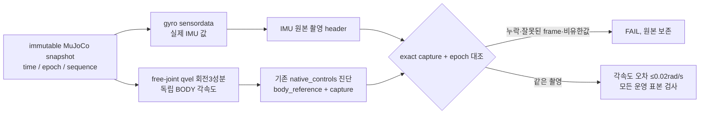

free-joint 선속도는 WORLD지만 각속도는 BODY라는 native 계약을 구분한다.
기준값은 gyro를 다시 읽거나 명령에서 계산하지 않는다. base_link가 free root인지,
주소와 유한값이 맞는지 검증한다. 원본 snapshot을 `mj_forward`로 재계산하거나
header를 변경하지 않는다. 엔진 스텝 내 sensordata/qvel 평가 단계 차이도 기존
0.02rad/s 한계 안인지 실제 실행으로 확인해야 하며 단위시험만으로 인수하지 않는다.

검사 수신은 별도 단일 소유 executor에서 진행하고 부모는 프로세스·파일 조회를 한다.
스레드 예외는 고착 실패, 종료 시 join 완료 전 ROS 자원과 로그를 해제하지 않는다.
프레임 신선도 기준·제어권·기존 명령 주기는 바꾸지 않는다. Gazebo의 동일 촬영
관측 계약은 별도 경로로 검증하며 MuJoCo 결과를 대신 사용하지 않는다.

## 2026-10-25 직렬 실행기 비용과 수명 경계

고정 3회 검증은 첫 10wall초 FAIL에서 중단했다. 물리 곡선의 수치 조합을 순회하지
않고 설치된 공식 실행기의 성공 시험과 실제 DDS 비용을 비교했다. rclpy7.1.12
EventsExecutor는 C++ event queue를 사용하고 콜백을 spin 호출 스레드에서 직렬 실행한다.
callback group의 병렬성을 제공하지 않으므로 보행/독립 팔 결과 수신기에는 적용하지 않는다.

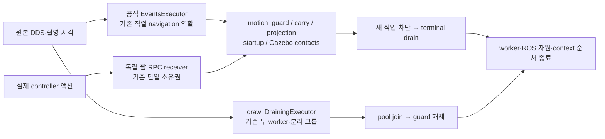

실제 DDS1,600개 순서·개수 보존 비교에서 CPU345.036→196.143ms였다. 이는 G1 10초
성공을 대신하지 않는다. 실제 guard 및 액션/종료 시험을 통과한 뒤 설치 bytes를 감사한다.
공식 event 구현은 MessageInfo가 필요한 콜백에 `(message, info)` tuple 하나를 주며
기존 Python wait-set 구현은 두 인자를 준다. Ch13 adapter는 원본 객체·required signature·
동기/비동기 형식을 보존하고 두 호출 형식만 수용한다. 외부 SDK를 수정하거나 metadata를
합성하지 않는다. 공유 `spin`에는 executor factory만 주입하며 기존 종료 프로토콜을 유지한다.

설치 감사는 navigation뿐 아니라 재사용 runtime/vision의 모든 Python bytes와 selected
prefix를 묶는다. 외부 symlink·누락·변조는 엔진 시작 전에 거절한다. SDK wrapper와 native
extension의 경로·SHA·버전도 기록하되 파일 증거를 실제 PID 매핑이라고 부르지 않는다.

## G2 중립 발 배치 후보 (2026-10-25, 실제 인수 전)

`3127f15e`에서 FL calf 명령0.79980582rad가 기존 footprint 하한0.8을 넘었다.
실측 명령·관절·모델 계산은 G2 디버깅 보고서와 원본 first_fault에 연결한다.
기존 이상적0.45m 재생은 통과했으므로 모든 조건에서 누적 발산한다고 단정하지 않는다.
후보는 이전 world endpoint에 전체 보폭을 더하는 대신 reset 명령 중립발을 기준으로
다음 stance를 중심에 배치한다. libchamp 고정 core의 zero_stance/half stance 원칙을
원문 확인했으며 소스/게인/Bezier 구현은 복사하지 않았다.

h = SWING travel budget + (cycle travel budget − SWING travel budget)/2 =4.4.
현재 velocity의 SE(2) 원호 이동을 travel 프레임에 적용한 중립발이 후보 목표다.
지지 무게 이동 offset은 이 프레임에 더하지 않는다. 후발 다리의 첫 이동처럼 후보가
기존8cm보다 멀면, 궤적 생성 전 목표를 그 거리 안에 계획한다. 이미 실행 중인 표본이나
IK 관절 값을 clipping하는 것은 아니다. 원래 stride 검사·full curve 속도 상한·접촉/CoM·
단일 소유권·G1 궤적/10wall초와 모든 실제 인수 기준을 유지한다.

현재 단계는 회귀와 실제 엔진을 통한 이 가설의 판별이며 G2 성공은 미확정이다.

## 일반 CRAWL 지지 예측의 기준점 수정

`46921c07`에서 절대 명령 CoM의 지지 여유27.172mm와 실제9.877mm가 달랐다.
실제8.163N이 남고 settled=false로 상승6.644mm에서 멈춘 뒤 원래6초에 FAIL했다.
새 실제 형상 회귀는 기존 계획기가 ZERO 이동을 선택하는 문제를 재현했다.
일반 CRAWL만 `CoM_est(delta)=CoM_measured+CoM_IK(delta)-CoM_IK(0)`를 사용한다.
원래25mm 계획 목표·10mm 실제 여유·6초/10mm/.002m/s를 유지한다. baseline도 별도yield로
처리하여 normal1후보/tick을 유지하고 G1 calibration의 기존 예측과10wall초는 변경하지 않는다.
실제 형상·슬라이스·G1·neutral·gait·가속도 관련48PASS59.62초 뒤 새 고정 소스 실제 시험으로 판별한다.

## 명령 시계와 단계 정지의 수명

f4157cd3 원본에서 SYSTEM 시각만 약2.17초 역행하고 ROS·monotonic/명령 송신은 진행했다.
순서는 DDS publication_sequence_number로 판정하고 source/RMW metadata 및 source epoch cutoff는 유지한다.
식별자 누락·중복·old epoch는 receipt를 갱신하지 않는다. 역행 감지 후 새 epoch의 RESET/활성화는
receiver 재시작을 요구하며 진행 중 명령의 ROS·wall200ms 계약은 그대로다. OS 시계 변경은 하지 않는다.
G2 단계 사이는 CRAWL의 건강한0속도 pause와 원래 실측1ROS/wall초 STOPPED를 사용한다.
명시 STAND는 최종에만 요청하며 서비스 ACK만으로 실제 이동을 선언하지 않는다.
실제 CRAWL이2초 안에 확인되지 않으면 긴 이동 timeout 전에 실패시킨다. fault/stop latch 자동해제는 없다.
원본 재현과45건 관련 회귀 뒤119소스 MuJoCo G1 776ece6c23/23PASS. G2 실제 검증은 별도다.

## 2026-10-25 회전 간섭 이후 정적 crawl 구조 검토

[Wang 등, A Static Gait Generation for Quadruped Robots with Optimized Walking Speed, SMC2020](https://linqi-ye.github.io/docs/2020A%20Static%20Gait%20Generation%20for%20Quadruped%20Robots%20with%20Optimized%20Walking%20Speed.pdf)의 II.D/III를 원문 확인했다. 네 발 지지 때 몸체 위치를 정하고 한 발 스윙을 분리하는 단계 구조, 지지 영역과 기구학 영역의 교집합을 쓰는 원칙만 참고한다. 논문의 중앙 CoG 가정·다른 형상·게인·속도 최적화·7cm 스윙·발 순서·V-REP 성과를 이 프로젝트의 검증으로 가져오지 않는다. 코드 복사 없음.

현재 Ch13은 실측 정착/해제 뒤에도 SWING/TOUCHDOWN/SETTLE에 몸체 이동을 적분해, 정적 지지 계획 이후 새로운 충돌 구성을 만들었다. 끝점 검사·2D 제약 탐색만 추가하는 후보는 각각 후속 SWING 간섭/미래 제약 불가로 실패했다. 원본 실패 회귀를 보존하고 구조를 재검토한다.

선택: 일반 CRAWL은 기존 SHIFT 0.7의 몸체 이동 예산만 네 발 지지 단계에서 실행하고, 실제 해제 이후 발 이동·착지·정착에서는 몸체 참조를 유지한다. 한 cycle의 실제 적분 예산에 맞춰 중립 발의 half-stance 예측도 바꾼다. 기존 명령 최대 속도/가속도·발8cm/0.02m/s·하중/관절/CoM/단일 소유권과 실제 G2의0.4m/±0.3rad/기존 시간 제한은 유지한다. 원래 G1의 별도 제자리 교정과10wall초는 유지한다. 따라서 이동 평균 속도는 낮아질 수 있으며 실제 완주·시간 예산은 새 인수에서 확인해야 한다.

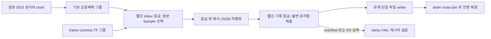

이구조는G2관측기에만적용한다. 다리/팔/TF/clock/명령의생산소유자를추가하지않는다. 두callback그룹은기존DrainingExecutor의2작업자에서실행하고소유수신thread종료후pool을drain한뒤ROS핸들을해제한다. 원본age를갱신하거나최신TF로대체하지않는다.

### 후속 선택: G2 관측 두 serial 실행기

42c6ad25의실제인수실패로그를보존하고위2-worker pool후보는채택을보류했다. 현재후보는같은좁은잠금·불변원본기록을유지하면서입력Node와기록Node를각각serialEventsExecutor로구동한다. 기록Node의새TimeSource구독은없고frame timer는기존입력Node의ROSClock을사용한다. node는같은context에속하고둘다join뒤ROS핸들을해제한다. 이는CPU개선이확정됐다는뜻이아니며실제G1/G2비교가필요하다.

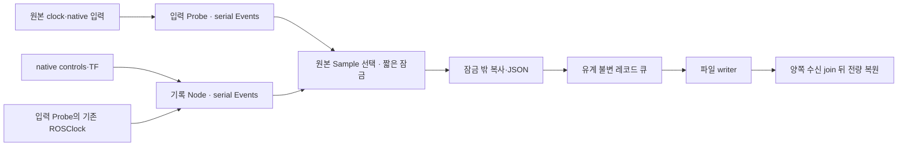

## 2026-10-26 실행 재승인: native 경계 계측 후 G1/G2 해결

사용자가 Task8 실제 실패 해결·고정본 연속 성공, 이후Nav2 Tasks9–14·최종회귀·commit/push를
명시적으로 재승인했다. 앞선 ‘원인 분석만’ 상태는 이 요청으로 종료한다. MuJoCo20ms 보간안은
미채택 상태로 보존하며, 첫 판별은 native 참조를 유지하는 측정으로 수행한다.

선택: Ch13 플러그인의 기존 update(CM write 뒤)와 공개 pre_step(실제 물리 직전)을 구분해
동일 ctrl 배열·원본 snapshot ROS시각·monotonic을 기록한다. Crawl도 실제 발행 직전/직후와
decision시각·12개 참조를 유계 기록한다. 새로운 명령 writer·보간·external소스 수정은 없다.
DDS 도청 수신은 실제 controller callback이 아니므로 그것을 대체 증거로 사용하지 않는다.
CM에서 선택된 배열과 발행 배열·pre_step 배열을 비교해 먼저 지연 경계를 나눈다.

기록은 init에서 미리 확보한 유계 공간, 생산자별 별도 lane, 경합 시 try-lock/drop count로
설계한다. physics hot path에서 JSON/파일쓰기·동적 배열 확장은 하지 않는다. overwrite/drop와
각 lane의 의미를 결과에 공개하며 이를 전체 인수 로그 대체물로 쓰지 않는다. 원래 Probe 기록·
모든 센서와 required_checks는 유지한다. 종료 측정정지·deactivate·팔terminal 뒤 일반서비스로
기록을 동결/회수하고 그 뒤 원래 native worker/노드/engine 종료를 따른다. 덤프는 재개하지 않는다.

RED: 실제 pluginlib+ROS 시험에서 경계별 기록 부재/서비스없음을 재현한다. GREEN: 서로 다른
staged snapshot과 live pre-step ctrl을 구분하고, 원본 ctrl/qpos 불변·동결/재요청 일관성을 검사한다.
Crawl 발행 trace는 실제 ROS 명령 시험에서 발행값·decision/monotonic과 대조한다. 빌드·감사 후
새UUID G1로 원래 실패를 수집하고 원인에 근거한 최소수정→회귀→고정소스 연속검증으로 진행한다.
원래10초·물리/속도/하중·관절·최초receipt/ROS age·단일소유권은 변경하지 않는다.

### G1 실제 착지 뒤 계획 복귀의 재시간화

새 G1 49324eec의 최초carry실패는gripper.0085978m/s>기준.005였다. 실제pre_step에서는그부근
arm2도.03219rad/s peak가있어낮은빈도의관절수신에서보이지않는과도응답을확인했다.
기존.01m/s 복귀가실제접촉이확인된뒤에도계속되며,32.636→32.714s 실제적용기준이
0.0215680→0.0207080m로0.86mm계단변경됐다. 앞선접촉snapshot32.478s에서FL하중10.49N,
32.532s에19.88N이었다. 새목표가팔에발행된것은아니고지지발압축/몸체와팔의과도응답경계다.
이관측을‘정확한물리단독인과완료’로쓰지않되,접촉뒤동일고속복귀를유지하는설계의판별근거로쓴다.

결정: native controller/게인/힘/물리/일반CRAWL은유지한다. G1의planned return에만,
선택발의원본고유접촉하중>=2N이확인되면한번만유계제동후느린계획곡선으로원래preload까지
이어간다. 제동과재출발은기존quintic velocity/가속도.1/속도.01상한을유지하고 loaded복귀의
상한을 min(기존return_speed, 2*기존seek_speed)=.004m/s로둔다. 별도contact search의.002m/s는
바꾸지않는다. 끝점이나원래10wall초·실제lift/3고유관측·최종1wall안정화는바꾸지않는다.
.004는원래seek의2배이내인planned preload 복귀경계로선택했으며기존실패의.86mm변경을
같은시간간격에서.344mm이하로줄이는판별후보다. 물리성공은새엔진으로확인하고임의속도grid를돌리지않는다.

접촉을감지했다고현재reference를즉시고정하거나측정발위치로대체하지않는다. 기존계획상현재z/속도에서
가속도연속제동→새곡선으로진행한다. 재접촉반복은새재시도/재활성화를만들지않는다. 계획상제동으로
원래끝점을넘거나원래기한안의안정화여유가없으면성공으로꾸미지않고명시적실패다.

## G2 관측기의 TF 변환 경계 (2026-10-26)

실제 d32fdf04에서 접촉은 DDS 도착 뒤 콜백까지171.632ms 지연됐다. frame 기록 전용executor와
JSON 잠금 분리는 이미 구현되어 있어 같은 수정을 반복하지 않았다. 별도 계측의 cProfile은
C++의 GIL 재진입 경로와 다중스레드에서 자체시간/누적시간이 모순되어 원인순위로 채택하지 않았다.

공식 rclpy7.1.12 bd637294 소스에서 take_message가콜백보다먼저TF를객체화함을 확인했다.
현재GID없는MessageInfo API는 원래 그내용을버리고 native C++ authority검사를필수로쓴다.
bounded TF구독만 public raw=True로받아 원본메타데이터를먼저확인한다. GID가있으면기존TF를해석하며,
원본촬영·링크·변환·QoS·단일소유권검사를변경하지않는다. 새실제DDS RED→관련36PASS/58.56초.
동일합성부하의 비계측 A/B는38.16%→30.32% CPU(한코어기준5초), 기록receiver6초CPU는
0.767→0.379초였다. 이는성능가설의근거일뿐 실제G2성공증거가아니다. 결과probe-tf-cost-2c99dda6에보존했다.

G1동일scene연속성공을위해실행helper는기존PASS의scene/profile만재사용하는명시적seed옵션을추가했다.
기존PASS를새소스의인수로대체하지않고 새UUID/전검사/소스·설치감사/정상종료를다시실행한다.

## MuJoCo의 프로세스 한정 렌더 스레드 판별 (2026-10-26)

cb66d879의팔2속도초과.023866rad/s는실제pre_step에서도확인했다. 고수준발행최대49.23ms,
결정ROS간격최대68ms, 첫실패직전같은34.706초기준중복뒤34.762초로진행했다.
원본native PID1253은65스레드였고 llvmpipe EGL eye카메라320x240/15Hz가작동했다.
이관측은상관이며렌더러만을근인으로단정하지않는다.

실제측정의FK/CoM고정입력오프라인비교는0.827ms 대0.833ms,양쪽이미1스레드였다.
BLASthread가설은기각한다. threadpoolctl가없어최초도구가실패했고추가설치없이별도자식환경으로비교했다.
정식결과native-math-cost-7dd23c6d에모델/입력/소스와통계를보존한다.

공식Mesa문서 https://docs.mesa3d.org/envvars.html#lp-num-threads 의프로세스환경변수와
기존Gazebo의LP_NUM_THREADS=2사례를참고해 동일MuJoCo고정본에서LP_NUM_THREADS=2만비교한다.
현재요청의프로세스별CPU스레드조정승인범위안이다. 드라이버/시스템/권한/해상도/카메라주기/
모터native참조/게인/물리/10wall/모든인수기준은유지한다. 소유nativePID/start tick/UID/PGID/
실제매핑/환경/스레드CPU를읽기전용기록한다. 첫FAIL은보존하며자동다른설정순회를하지않는다.

## G2 센서 수신 큐의 소유권 분리 (2026-10-26)

LP2 고정본G1 eb4e15f3은24/24PASS였으나 같은본G2 e21398d8은body ROSage206ms로FAIL했다.
해당몸체패킷의source→DDS2.260ms/DDS→callback101.005ms/선택뒤판정116.798ms를원본으로연결했다.
접촉도DDS→callback99.658ms였다. LP2/TF객체화최적화만으로문제가해결됐다고보지않는다.
정상STOP/비활성화/terminal/runtime/engine/reap/noForce/residual[]는별도로확인했다.

bounded 관측은이미시계없는기록node로TF/controls/frame을분리했다. 남아있던원생sensor/COM/body-source는
500HzTimeSource와상태/RPC의직렬queue를공유했다. 새실제DDS시험에서main queue를제어된대기로막으면
원본접촉의수신도막히는RED14.17초를재현했다. 기존ROS age/firstreceiptwall200ms나QoS/history는완화하지않는다.

같은프로세스에시계없는navigation_probe_ingress node와독립직렬EventsExecutor를둔다.
원래6sensor+MuJoCo body_source+COM만이큐로옮기고정규화/원본receipt/단일inbox잠금은그대로다.
parent만원본clock을구독하고결정시각을제공한다. 서비스/상태는parent,heavy기록은기존recording큐다.
세receiver모두오류고착·새진입차단→공통기한join→executor정리후ROS파괴를확인한다.
닫히지않은receiver가있으면전체join을거짓으로남기고자원을유지한다. 자동재시작/오래된값연장은없다.
첫관련25PASS35.68초뒤전체probe관련회귀를실행한다. 실제G1/G2효과와최종연속성공은다시확인해야한다.

주의: 실행기의G1/G2는둘다bounded_history=True이다. 최신G1 cb66실패를unbounded관측으로설명하면안된다.

## 실제 잠금 소유권과 first receipt 재설정 결함 (2026-10-26)

e1696f98의최초실패는body ROSage230ms였다. DDS→callback132.985ms/수신뒤98.097ms이며,
뒤따른raw wallage와journal capacity를최초원인으로바꾸지않는다. writer는최초거부시정상/peak65였고,
기록포화는약2.73초뒤였다. frames도37~50Hz였으므로catch-up폭주나큐용량단독가설을채택하지않는다.
재분석JSON derived-observer-cost-native-g2-mujoco-e1696f98…는CPU·잠금대기·전체프로세스부하를연결한다.
몸체콜백CPU.401ms/잠금대기54.998ms,상태콜백잠금46.5ms,frame벽91ms/CPU1.78ms를확인했다.

관측기는노드큐를나눴지만movement_decision에서같은inbox잠금을asdict/좌표계산/기록까지유지했다.
더근본적으로_dispatch가센서콜백을호출하기전inbox잠금을잡아_sensor의firstreceipt가잠금해제뒤로
바뀌었다. 이는벽시각age가수신대기를제대로포함하지못하는결함이다. 실제DDS잠금차단RED12.08초로재현했다.
이동판정RED는최초시험의carry_peer가body를발행하지않는시험준비오류가있었다. 그실패도보존하고,
별도Clock/Body/Contacts producer로바꿔잠금점유assert가실패하는정상RED11.53초를확인했다.

_dispatch의포괄잠금을없애고각콜백이먼저원본receipt/필드를정규화한뒤공유상태교체만짧게잠근다.
JSON/전량기록/좌표계산은잠금밖이다. movement_decision은동일결정ROS/wall/cutoff의불변Sample참조를
선택하고잠금밖에서복사·계산·기록한다. 그뒤들어온촬영으로선택결과를바꾸지않는다.
기존timing의lock_wait는wrapper범위뿐임을명시하고내부잠금대기0을측정했다고표현하지않는다.
직접관련22PASS18.26초뒤전체probe회귀를실행한다. 센서QoS/수신시각/age/원래기준은유지한다.

### 종료 진단 데이터의 처리 시점

실패e169의추적freeze 마지막steady13100225328771과기록포화13101624270453 사이약1.4초에
살아있는수신기와함께대형JSON을loads→indent dumps하고있었다. 계산을정상종료증거로
오인하지않으며, 이중변환이포화의단독원인이라고확정하지도않는다. 읽기전용진단이
입력수신을방해하지않도록서버응답문자열을먼저그대로저장하고,부모회수+모든probe수신기/
G2명령수신기join뒤JSONschema/frozen/관절순서/벡터형상/유한값/원본시각/행수상한을검증한다.
잘못된데이터는여전히EvidenceRun FAIL이다. 기록큐용량/버림/인수기준은바꾸지않는다.
추가로이서비스는MuJoCo플러그인전용이므로Gazebo는요청하지않는다. 기존Gazebo실측ctrl/
PositionReference/접촉기록과필수검사는그대로유지한다. 새경계RED14.68초→관련32PASS17.79초.

전체probe회귀의기존record-lock반례는inbox잠금까지함께막히는형태를전제로했다. 새잠금수명에서는
inbox는열려도serial센서콜백이기록잠금에서막혀후속촬영이200ms이상멈춘다. 이실제결과로반례를
계속거절하게고쳐기존반례를없애지않았다. 첫16PASS뒤해당단정실패로그를보존했고교정한전체54PASS72.17초다.

## 관측 값의 불변 소유권과 반복 복사 제거 후보 (2026-10-26)

최신95dfb687은 원본 body248ms/DDS→callback121.959ms로 실패했다. 기록큐 오류는 없고
94757개가 전부 복구됐다. 종료 뒤 raw age 오류를 최초원인으로 해석하지 않는다.
관측 프로세스는 실패 근처 한 코어의87~93%를 사용했으며 GC 최대15.4ms는 최초거부 이후여서
그 실패의 직접원인으로 채택하지 않는다. 더 많은 큐나 age 완화로 해결하지 않는다.

Python3.12 sys.monitoring 진단에서는 ingress와 frame의 반복 asdict 내부 호출을 확인했다.
다만 계측 자체가 부하를 키웠고 저널 스레드가 계측 전에 시작된 경계 불일치1건이 있어,
그 절대 CPU 수치를 무계측 성능으로 인용하지 않는다. cProfile의 비정상 누적값도 폐기 판정하고 원본은 보존했다.

후보는 bounded observer에만 적용한다. 원본 메시지를 정규화한 뒤 사전은 새 MappingProxyType,
수열은 tuple로 한 번 고정한다. 이후 frame/이동판정/저널은 불변 값만 공유하고 메타데이터와
바깥 사전만 새로 만든다. 기존 project_body는 새 바깥 사전을 복사하므로 변환 결과가 원본을 바꾸지 않는다.
JSON 경계에서만 불변 사전을 값이 같은 JSON 사전으로 인코딩한다. 최초receipt는 변환 전에 저장한다.
unknown mutable payload는 거부하며 원본/후속 입력 변경으로 과거기록이 바뀌지 않는 시험을 둔다.

첫 회귀에서 실제 FootContacts 고정배열의 numpy.float64를 거부하는 새 결함이 발생했다.
일반 Python fixture4개만으로 충분하지 않았음을 기록한다. 실제 생성 메시지로 RED를 추가하고
숫자 scalar만 같은 값의 Python scalar로 고정하는 최소 호환 처리를 추가했다. 허용시간은 바꾸지 않았다.
다음 판별은 관련 전체시험 → 같은 DDS 발행자의 baseline/후보/후보/baseline 비계측 비용 비교다.
비용 감소만으로 실제 G2 인수를 선언하지 않고, 새 소스 감사와 동일 scene/profile G1→G2를 수행한다.

### 불변 기록 후보의 채택 판정과 다음 실제 진단

61개 관련회귀78.73초는 통과했으나 비계측A/B baseline평균27.878%/후보27.974%로 전체개선이없었다.
후보는 실행경로에서 철회하고 원본probe70987f...로 복원했다. 새 구현·시험·오류·A/B소스는66215a66에 보존한다.
기존121/5b84 manifest의 모든 바이트와 다시 대조했고 8패키지 감사를 통과했다. 이 판단은 후보를
실제 엔진에 올려 실패를 또 반복하기 전에 이루어졌으며 물리·안전기준·기존 required_checks를 바꾸지 않는다.

합성 입력에서 command/clock-only/poll50Hz를 분리해도 실제 관측기87~93%를 완전히 설명하지 못했다.
다음 G2는 같은 G1 699d 원본/동일소스·설치·모드·LP2를 사용하고, 별도 읽기전용 수집기에서
소유 runner PID/UID/start tick과 /proc/PID/task의 OS 스레드별 CPU를250ms마다 저장한다.
ROS callback에 계측을 주입하지 않고 sys.monitoring/cProfile의 전역부하도 추가하지 않는다.
수집기는 소유 PID가 정상 종료되면 종료하며 정상회수 여부를 기록한다. 관리자/ptrace/드라이버 변경없음.
기존 인수 실행은 그대로 하며 실패도 보존한다. 합성69%값의 YAML재읽기 준비오류는 근인으로 사용하지 않는다.

## 관측기 연속 native dispatch (2026-10-26)

공식 API를 이용한 ABBA 비용 비교 aed69f11-e62c-4671-b647-dc334fd35c61:
old_poll38.1766/37.9521%, continuous34.3080/34.6210%. 같은 발행자·G2명령source·5ms판단반복,
원본모든메시지·촬영시각·정상join을보존했다. 전량CPU개선없는불변기록후보와달리 일관된감소를확인했다.
이 수치는합성부하이며 실제물리합격과구분한다.

실제DDS 회귀는120개촬영중 ProbeReceiver._spin의 Python행 복귀243회를 재현하며 RED14.30초였다.
고속촬영마다 Python에서 C++ spin_once를 호출해 Stop/Restart하는 경계를 없애는 성능계약이다.
수신횟수·원본촬영·firstreceipt·모든receiver종료도같이assert한다. 벽시간성능수치의불안정한임계값으로통과시키지않는다.

ProbeReceiver가소유한 EventsExecutor만공식 public spin()으로연속실행한다. G2명령source의기존
SingleThreadedExecutor와50Hz·상한·fault-stop은변경하지않는다. 정상종료는모든자식에
stopping설정→public shutdown(0)으로queue정지요청→공통기한thread join→최종shutdown으로해제한다.
upstream은활성콜백때timeout false로자원을보존하므로0을성공으로간주하지않는다.
닫히지않은스레드가있으면closed=false/실패를유지한다. ROS context는모든join뒤기존순서로만파괴한다.
report에native TID와dispatch모드를추가해다음실제CPU기록의역할을추측하지않아도되게한다.

외부checkout·설치rclpy·QoS·큐용량·원본clock·정규화·전량기록·모터참조·물리·인수기준변경없음.
관련회귀/8설치감사뒤새동일scene G1→G2로확인하고, 실패원본은제외하지않는다.

## 기록 인코더의 프로세스 소유권 재설계

연속 native dispatch의 실제 G1 ba55d70f는24/24PASS였으나 같은본G2 004cf6fa는body262ms로FAIL했다.
RMW→body callback125.093ms/receipt→판정129.903ms; source→RMW1.640ms다. contacts188ms였다.
정상정리/회수/잔여없음과원본72319000byte ZIP SHA3c0c781fa4b346a9593555157ea643d7fbf7f4d96c7a7ff6c3d6c78b752f1b14를보존했다.

더 많은 in-process 큐나 age 완화 대신, JSON 인코딩과 파일 소유권을 별도 단일 프로세스로 분리한다.
근거는 공식 Python3.12 multiprocessing의 독립 interpreter/spawn/유계 IPC 구조다.
https://docs.python.org/3.12/library/multiprocessing.html
ROS는 기존프로세스/원본header/콜백/inbox/시계/전체판정을유지한다. 기록worker는ROS를초기화하거나
명령·TF를발행하지않는다. fork로활성ROS스레드를복제하지않고 spawn을명시한다.

부모는기존private snapshot을즉시불변binary로복사해유계IPC에제출한다. pickle은이자기소유프로세스쌍의
내부값에만사용하며네트워크/사용자파일역직렬화를허용하지않는다. JSON트리의보수적wire상한을별도계산해
기존256record/8MiB상한을늘리지않는다. 반복참조를압축하는pickle길이만으로용량을판단하지않는다.
자식은원본snapshot→기존JSON값/형식→파일쓰기뒤순번과실제bytes를확정한다. wire상한불일치도고착FAIL이다.

부모의ROS콜백은파일쓰기/JSON숫자표현을기다리지않는다. IPC가차거나worker가실패하면고착FAIL이며
재시작/덮어쓰기/오래된값연장은없다. 오류후미기록payload도유계원본으로별도보존한다.
정상종료는새제출차단→기존수신기join→모든제출확인→worker정상exit/join→IPC정리순서다.
완료되지않은worker는성공으로표시하거나강제종료하지않고자원을유지한다. PID/UID/start tick/exitcode를기록한다.

기존thread journal은비교·회귀경로로보존하고새프로세스경로의원본동일성/오류고착/용량/소유권을먼저시험한다.
실제엔진전에동일입력비계측비교로부모ROS의CPU와수신지연을확인한다. 효과없으면다음엔진반복의근거로쓰지않는다.

## 프로세스 경계 비용에 따른 설계 수정

첫 JSON-worker 구현은3계약시험→실제ROS포함5PASS였으나비계측실제값동일입력ABBA72d2eccf에서
thread부모42.53/41.69% 대 process47.14/54.68%로악화됐다. 수신P95도2.73/3.05ms 대3.28/3.64ms였다.
parent 인코딩CPU .244/.228초 대 .284/.335초, 제출CPU전체 .069/.066초 대 .247/.283초로 IPC/용량계산의
비용이이득을상쇄했다. 따라서이코드를실제엔진에올리지않았다. 원본후보·5시험·실패로그·SHA는72d2eccf에보존했다.

다음경계는개별기록IPC가아니라독립적인전량관측기자체다. 별도spawn프로세스가원본ROS를직접구독하고
기존정규화/frame/전량JSON/TF·controls·history복구를모두자기파일에수행한다. 부모는mission관측(body/contact/
원본clock/상태·RPC)만유지한다. stage변경은드문ACK메시지로원래명령보다먼저적용하며, 종료뒤만전체snapshot을전달한다.
센서수신을매건IPC로중계하거나재태깅하지않는다. 두관측기는별도원본firstreceipt를가지며모두판정에남긴다.

각ROS노드명/파일writer/PID·UID·starttick을고유하게기록한다. 전량관측기에는명령publisher가없다.
stage ACK누락/프로세스오류/EOF/전량기록실패는고착FAIL이며재시작하지않는다. 엔진정지후자식의
전체receiver/journal join→history검증→자기소유snapshot→정상exit/join을확인하고기존독립판정을수행한다.
기준/촬영header/원본clock/QoS/큐/물리/command owner는그대로다. 새프로세스/clock구독자도명시적소유권감사에포함한다.

## 독립 관측기의 비교 결과와 적용 후보

probe-split-cost-714067e3-553f-44ab-995d-cd0f61faf206은 관측기준비→동일실제숫자입력→5ms판단의ABBA다.
부모CPU integrated54.967/49.074% 대 split36.381/36.088%. 별도전량관측기는측정5초동안2.08/2.13CPU초를썼다.
전체CPU합은늘지만mission과전량기록이서로의GIL을막지않게분리했다. 전량body DDS→callbackP95는
3.348/2.996ms 대2.233/2.335ms, mission P95는1.644/2.261ms였다. 모두300개body를기록했고각합성발행자와
관측기·journal·자식프로세스는정상회수했다. 합성결과이며실제엔진인수는아니다.

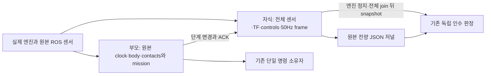

실행기 factory도분리관측기를선택하도록연결했다. 자식은자기ROS컨텍스트/고유node명/파일writer를갖고
명령을발행하지않는다. 원본clock구독은부모mission과전량관측기각각에하나이며고수준relay5노드는그대로다.
원생관절·TF·명령publisher는그대로다. 대형native trace JSON검증은새자식까지모든join이끝난뒤수행한다.

stage통신실패도runtime/엔진정리절차를막지않게별도기록한다. 실제입력오류·EOF·hash/패키지불일치·종료실패는
고착FAIL이고다시finish해도성공으로바뀌지않는다. child/module/PID/UID/PGID/start tick과정상exitcode를기록한다.

기동은기존실제실행순서대로관측기준비뒤엔진을시작한다. active입력발행뒤관측기를붙인시험은10초준비실패가
발생했고그대로보존했다. 예외정리범위밖시험용발행스레드는소유pytest PID874/UID1000/starttick136157에
SIGINT를보내정리했으며정상종료로기록하지않는다. 실제엔진은없었고SIGTERM/SIGKILL·관리자권한은사용하지않았다.
입력을관측기준비뒤시작하고constructor예외에서도발행스레드를정리하도록시험순서를교정했다.
뜨거운상태에서의동적연결은이실습에서검증했다고주장하지않는다. 기존측정인수기준은그대로다.

## 실제 G1 a50d와 목표 실패/정상 종료의 분리

분리구조고정122 manifest13a9098b96c10678c8bf25ab62ad3f4e516e2c58894b09a97db10d69920a2ed3의
MuJoCo G1a50d1fca는calibrate의SHIFT중carry자세감시로FAIL했다. 원본ZIP10450559bytes
SHAf0665ce6be3212b80b4aeae8d7f49ffa00cc624a0420f566c8571a4e28bd6913와모든원본을보존했다.
최초선택joint31559999999ns의팔2속도.0355856rad/s(허용.02), ROSage2ms/수신후7.192ms여서
이실패를센서age로바꾸지않는다. 실제2ms pre-step에서도31.564s에.0378499rad/s를확인했다.

그전SHIFT발행956→957의결정ROS차78ms/실제wall31.018831ms를확인했다. 해당목표는실제physics
31.528→31.538s 10ms간격에fr_thigh-.008297543rad변화로적용됐다. 비교호환벡터매칭의한계는기존분석에명시했다.
이큰참조단계가물리과도응답의후보원인이라는가설이며최소회귀와실제재실행으로판별한다.

새G1전용SHIFT참조진행은같은quintic경로를콜백마다min(원본ROS진행,원본wall진행,20ms)만소비한다.
원본phase_origin/센서stamp/receipt와계획geometry·duration·게인·힘상한은유지한다. native controller의
명령사이보간을추가하지않는다. 일반CRAWL/수직SWING·복귀프로파일은그대로다. preconditioning/unload의
G1참조진행만같은step을사용한다. 실제G1전체10wall초/기존SHIFT timeout/센서gap·pause·rollback은원래시각으로판정한다.
잔여지연은shift_reference_clock으로노출하며오래된목표시간을따라잡기위해단계를뛰어넘지않는다.
실제시각쌍fixture의이상적계산RED12.33초→기존교정/착지관련43PASS51.91초,
정지·재개/일반CRAWL유지/원래기한/분리관측기·trace·control-clock관련44PASS59.02초다.
초기명령한번은없는시험파일을지정해no tests였고그로그도보존했다. 실제효과는아직미검증이다.

또한a50d는모든관측receiver/journal/자식exit0/엔진·runtime0/회수·잔여[]가정상이었는데,
운동실패notice를통신실패와섞어shutdown stage와history복구를막는새하네스결함이있었다.
물리실패는runtime_fault로고착해계속전체FAIL로남기고,error는통신/관측프로세스실패로분리했다.
shutdown ACK·전량snapshot복구·정상join은운동실패와독립적으로확인하며finish성공을과제성공으로쓰지않는다.
실제ROS실패회귀RED23.20초→관련6PASS49.27초. 새runner는기록된runtime_fault가있으면반드시EvidenceRun FAIL이다.

관측기10초준비실패는입력없는상태에서도재현돼,앞선입력순서단독설명을정정한다. 원인은아직확정하지않았다.
엔진시작전spawn/모듈진입/node준비/receiver준비/부모수신시각을추가기록하고이새구성요소의준비상한을30초로명시했다.
엔진은준비ACK전에시작하지않는다. 원래물리G1의10초와엔진기동·센서·행동인수기준을늘리지않는다.

## G2 7c3373df: 신선도와 물리 수납 실패의 분리

122개 고정 소스 a694f432의 G1 68c877cc는24/24PASS였다. 같은 장면과 설치의 G2는 전진 중 실제 arm2 속도 -0.02046101222155071rad/s로 실패했다. 선택한 관절 촬영/판정 ROS126949999999ns가 같고 최초 receipt 후12.404441ms였으므로 신선도 실패가 아니다. 원본 pre_step에서도 같은 속도를 확인했다. 후속 guard의 carry:not_ready_or_binding을 최초 원인으로 바꾸지 않는다.

실패 위치는 SHIFT, 원본 phase 시작125549999999ns/계획2.625초/아직 unload 전이었다. 발행5343→5344가 ROS72ms/wall52.029145ms를 한 번에 진행하며 rl_thigh 목표를0.006552801855918111rad 변경했다. 직전에도74ms 분량의 진행이 있었다. 실제 모터는 native100Hz/물리2ms/영차 유지로 적용했고, 지연된 궤적 참조가 큰 단계로 도착한 뒤 몸체 각속도와 팔 속도가 변했다. 값·시각 호환 연결이며 반복 동일 목표를 고유 ID로 간주하지 않는다. 이 상관만으로 유일 원인이라고 단정하지 않는다.

### 판별 수정

일반 CRAWL의 SHIFT 진행을 min(원본ROS증분, 원본wall증분,20ms)로 제한한다. 보행 경로·명목 quintic 시간법·게인·입력 상한·native 모터 참조 적용은 유지하며 지연분을 다음 tick에서 따라잡지 않는다. 원본 ROS phase origin, 센서 age, control gap, SHIFT timeout은 계속 원본 시각으로 평가한다. SWING/접촉 탐색/정지 경로를 함께 변경하지 않는다. G1 전용 진행 제어는 유지한다.

이것은 고수준 경로 진행의 과도한 건너뛰기를 막는 가설 시험이다. 거절된 MuJoCo 모터 참조 보간과 다르며, 하위 controller가 여러 발행을 건너뛰는 상황까지 해결했다는 보장은 없다. 실제 두 엔진의 전체 G2와 고정본 연속 성공으로만 최종 판단한다. 이상적 피드백 시험은 기하학·시간 계산의 회귀일 뿐 물리 수납 성공 증거가 아니다.

새 회귀는 실제72ms/52.029145ms 간격에서 명목20ms와 목표를 비교해 RED13.53초를 확인했다. 전진·후진·회전, 센서 만료/control gap, 원래 SHIFT timeout과 명목 경로·가속도 검증을 함께 수행한다. 기존 명목 경로 검사는20ms 조건을 유지하고, 지연 조건은 새 실패 회귀로 분리한다. 인수 required_checks와 물리 기준은 변경하지 않는다.

G2의 물리 실패와 별개로 STOP/비활성화/액션terminal/센서 worker/모든 관측기·기록/runtime·engine 종료는 정상이다. 전량94033개 기록을 복구했고 모든 소유 프로세스가 회수됐다. 최초 motion fault를 기록 오류와 분리해 정상 정리와 실패 증거 복구를 끝낼 수 있음을 실제 확인했다. 실패를 PASS로 바꾸지는 않았다.

## SWING a68b9c1b 이후: 적용 확인을 포함한 참조 흐름 제어

SHIFT 한정 수정의 동일 고정본 G1은24PASS였지만 G2 a68b9c1b는0.13m 후 SWING에서 실제 gripper 속도-.0056556702m/s로 실패했다. 전량199023기록 및 모든 소유 worker/runtime/engine은 정상 회수했다. 실패 원본은 ZIP142489236/SHA84bee431260f93308c3a24af281116d121b73a4f223551c99f22be0d6f45a123 및 두72MB 이하 조각으로 보존했다.

실제 모터 적용은 pub12499(ROS261444000000)의 다음에12500·12501을 건너뛰고12502(261512000000)를 적용했다. physics 적용261496000001→261544000001ns의48ms 뒤 rr_calf 참조가1.0317002897511454→1.026328403635485로0.0053718861rad 변했다. 중간 발행 존재와 실제 적용은 다르다. 물리 gripper 과속은261546000000ns의 신선한 관절 촬영에서 관측됐고 pre_step에서도 초과가 확인됐다. trace는 반복 동일 목표의 고유 ID를 증명하지 않으므로 값/시각 호환 연결 범위로 제한한다.

단순히 SHIFT/SWING에 상수를 더하는 대신 native 모터 controller를 유지한 **한 개 미확인 목표만 허용하는 고수준 흐름 제어**를 최소 구조로 선택한다. 거절된 MuJoCo 모터 보간은 구현하지 않는다.

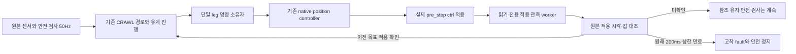

- 범위는 MuJoCo G2 명시적 검증 경로다. Gazebo의 승인된20ms 적용 프로필·기본 launch·G1 경로는 유지한다. native controller/underlay/물리/게인/힘 상한을 변경하지 않는다.
- pre_step에서 고정 크기 수치만 try-lock 복사하고, ROS 발행/할당은 별도 소유 worker에서 한다. 동일 적용 값은 now로 재포장하지 않는다. worker 종료/오류/누락 수를 보고하고 reset/stop 이후 자동 재시동하지 않는다.
- 새 목표는 정확한 관절 이름·값과 원본 실제 적용 시각/first receipt를 대조한 뒤에만 진행한다. publisher 단일 소유권, 원래 ROS/wall 신선도와200ms 미확인 상한을 유지한다. 최신 상태/시뮬레이션 재태깅으로 ACK를 만들지 않는다.
- 모든 tick은 원본 센서·시간·접촉·carry·명령·소유권을 검사한다. 미확인 동안 경로만 유지하고, fault·제로 명령·정지는 기존 안전 경로를 따른다. 정지 과정에서 폐기한 미확인 목표를 적용 성공으로 기록하지 않는다.
- SHIFT와 SWING의 참조 진행은 확인된 발행마다 한 명목20ms 이하로 제한하며 지연분을 따라잡지 않는다. 원래 기하학/명목곡선/시간 초과와 모든 실제 인수 기준은 유지한다.
- 먼저 중간 명령이 건너뛰어진 최소 재현에서 두 번째 이동 목표 차단/정확한 ACK/오래된·중복·미래 ACK 거절/원래deadline/정지우선권을 RED→GREEN으로 검증한다. 다음 실제 plugin의 CM snapshot과 pre_step 적용 구분·읽기전용·정상 worker 종료를 검증하고, 실제 엔진에서 개선을 판정한다. 아직 구현/실제 성공 결과가 아니다.

### 67646d9d 후속: 세 종류의 시간을 분리한다

적용 ACK는7–11ms 내 도착했으나 첫 하중 해제6.000000001초에 timeout했다. 참조곡선 진행을 버릴 때 접촉 탐색 시간까지 버린 결과 참조 상승은7.502873222mm뿐이었다. 이때 FL힘1.666260758N으로 해제 threshold 아래였지만 원래100ms 고유 확인까지 끝나지 않았다. timeout/높이/힘/확인 시간을 늘리거나 줄이지 않는다.

1. 센서·명령·미확인 목표의 안전 수명: 원본ROS와 처음 수신한wall, 기존200ms/phase deadline.
2. 몸체·SWING의 기하학적 곡선 진행: 적용 확인된 발행만 한 명목20ms 이하 진행, 지연분을 따라잡지 않는다.
3. 저속 접촉 탐색: 실제 검증된 안정/하중 조건의 min(원본ROS증분,wall증분)을 별도로 보존한다. 미확인 동안 목표는 유지하되 확인 후 누적 시간에 대응하는2mm/s 이내의 탐색만 수행한다. 보존 상한200ms, 조건을 잃으면 폐기한다. unload의 최대10mm/6초, touchdown의floor-2mm/1초를 유지한다. G1 경로는 변경하지 않는다.

같은 결함을 unload RED10.30초, touchdown RED9.23초로 각각 재현했다. unload 수정 관련52PASS55.12초, 양쪽 접촉탐색 수정 관련50PASS47.29초다. 이 시험은 이상적 피드백의 수학·상태 회귀이며 실제 물리 성공이 아니다.

### 접촉 deadline fault 뒤의 정지 수명

67646d9d는 엔진/부모/수신기/기록이 회수됐어도 runtime 정상 종료는false였다. 모델이FAULT에서 swing_foot을 지워 원래 움직이던 발을 더 이상 착지시킬 수 없었고, crawl.stopped가 끝내false였다. 원본 판정은 그대로 보존한다.

일반 CRAWL의 measured unload timeout/touchdown timeout에만 알려진 해당 발의 식별자를 보존한다. 명시적 STOP 이후에만, 매 tick의 원본 신선도·관절/몸체·나머지 세 발 지지와 안정 조건을 검증해 기존 단일 소유자의 안전 착지 경로를 수행한다. 첫 목표는 직전 참조를 유지한다. 해당 안전 착지에는 기존0.02m/s 상한을 만족하는 quintic 시간을 계산하되 원래 stop_landing_s=1초와 실측1초 settle은 늘리지 않는다. 제한 내 착지할 수 없으면 계속 미확정 실패다.

이 제한된 착지는 fault 해제가 아니다. 첫 reason·generation·explicit stop latch를 유지하고 CRAWL로 재활성화하지 않는다. 소유권·지지·신선도·시계 등 다른 fault나 착지 도중의 새 검증 실패는 모터 명령을 차단하며 이후 입력 복구만으로 다시 움직이지 않는다. 초기 G1 교정 fault에는 확장하지 않는다. 명시적 STOP 없이 FAULT가 스스로 이동하지 않는다.

접촉 fault 뒤 STOPPED 미확정은 RED9.92초로 재현했다. 수정의 단위/ROS 및 실제 엔진 결과는 execution ledger에서 따로 기록한다. nominal G2 성공이 이 fault 주입 경로의 실제 성공까지 증명하지는 않는다.

여기서 명시적 STOP은 단일 소유자가 request_stop/STOP 경로를 호출한 경우를 뜻한다. Guard fault의 안전 정지 요청도 포함하며, FAULT 진입 자체가 이동을 재개하거나 CRAWL 권한을 회복하는 것은 아니다. 해당 reason은 STOPPED 실측 뒤에도 남는다. 이 수정의 실제 fault 착지 실측은 아직 미완료다.

## 2026-10-26: 모델 계산과 직렬 수신의 실행 수명 분리

최신 f781의 최초 실패는 guard 촬영 age214ms다. 독립 관측기 둘은 생산이 계속됨을 확인했으나, 이는 Crawl의 receipt를 대신하지 않는다. 무엔진 동일50Hz 발행/직렬 판단 타이머에서 pool 수신 최대117.795ms/4000중3334, 수신 실행기만 직렬인 비교21.503ms/4000전량을 측정했다. 양측 SYSTEM 변동이 있어, SYSTEM 변화 하나를 모든 원인으로 삼지 않는다.

명시적 relay100 CRAWL에만 독립 직렬 수신 노드를 둔다. 센서·guard·final command·실제 적용 echo만 원래 콜백으로 수신한다. 수신 노드는 모터/TF/clock 발행·서비스·제어 타이머가 없고 원본 header를 갱신하지 않는다. 모델 소유자는 기존 inbox 잠금 아래 원본 후보를 선택하고 기존 시각/소유권/물리 기준으로 판정한다. 단일 TimeSource는 기존 lifecycle 노드에 남는다. 짧은 수신 콜백은 계산/서비스 pool과 경쟁하지 않는다. 수신 실패는 기록하고 자동 재시작하지 않는다. 종료는 새 입력 차단 → 수신 dispatch 중단·join → 수신 ROS 자원 파괴 → lifecycle ROS 자원 파괴다. join 미확정은 정상 종료가 아니다. native 기본과 MuJoCo 모터 참조 경계는 바꾸지 않는다.

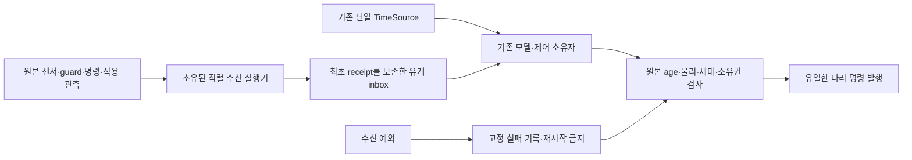

참고한 성공/결함 사례는 [rclpy1223](https://github.com/ros2/rclpy/issues/1223), [FastDDS5019](https://github.com/eProsima/Fast-DDS/issues/5019), [2.14.7 실제 소스](https://github.com/eProsima/Fast-DDS/blob/v2.14.7/src/cpp/fastdds/subscriber/history/DataReaderHistory.cpp)다. 해당 사례는 우리의 단독 인과 증명이 아니며 외부 코드를 복사하거나 수정하지 않았다. 직렬 수신은 이미 사용한 Ch13의 bounded mailbox/worker 수명 원칙을 적용한 자체 코드다. 최소 DDS 개선과 실제 G1/G2 성공은 별개로 인수한다.

### 후속 실제 G2와 TimeSource 수신 수명 보완

위 직렬 센서 수신 후보125파일8715b4ba는G1 24PASS였으나G2 cbe25816이SHIFT timeout으로실패했다. phase3.64초 동안참조진행2.0979초/필요2.625초였다. 최근16개적용ACK중8개는실제receipt가판정보다앞서도원본capture가판정ROS보다미래여서보류됐다. 이거부는유지한다. 제어소유자의TimeSource수신이pool에남아있는경로를최소회귀로분리한다.

보완후보는TimeSource가생성하는기존Clock구독하나만공개Node create/destroy_subscription위임으로같은직렬수신Node에둔다. 원래TimeSource콜백·ROSClock·수신메시지·remap·QoS를그대로사용한다. 시각중계나새TimeSource/Clock발행/최신값대입을추가하지않는다. 그Node의이름은crawl_controller_ingress이며모델/lifecycle소유자는crawl_controller다. 기존단일구독검사는새실제구독노드이름과1개조건을모두확인한다. use_sim_time공개해제/재생성도회귀로확인한다. native기본/물리/참조게인/모든기준은유지한다. 수신Node는부모생성중준비하되전체생성후한번만시작한다. 생성실패·정상종료모두join후자원을파괴하고자동재시작하지않는다. 실제모델성공은새고정본G1/G2로별도판정한다.

### 시계 구독 역할의 실제 프로세스 연결 검증
수신노드변경을인수도구의역할매핑에반영하지않아G1 e0d6af30이물리시험전에거부됐다. 이실패원본은보존한다. 검증대상은기존5개역할그대로이며Crawl의구독Node만crawl_controller_ingress다. 부모모델Node나ingress가원본/clock을추가구독하거나relay소비자가6개면거부한다. 별도소형evidence에receiver자체snapshot과실제/proc PID/UID/PPID/PGID/start_ticks/native TID,선택설치crawl_controller entrypoint경로·SHA를함께묶는다. 자체보고만으로통과시키지않는다. 기존relayproducer실제라이브러리/PID검사는유지한다. 원래TimeSourcecallback/ROSClock과단일모터·TF소유권도그대로다. 이것은실행중소유권증거이며정상종료증거와구분한다.

### 같은 촬영 시각의 직렬화 계약
고정 외부 c261f555의 publish_clock은 정수초 floor와 소수부 나노초 절단이다. 새 Ch13 적용 ACK는 llround(time*1e9)를 사용해35.29와35.33에서 실제원본보다1ns앞선값을만들었다. 실제plugin 최소회귀는 각각35290000000 대35289999999,35330000000 대35329999999의불일치를재현했다(160ms). ACK만같은 pre_step mjData.time의원본표현을쓰도록고친다. 헤더사후치환·현재시각조회·미래허용오차를추가하지않는다. 외부/clock과기존관측/카메라/trace는수정하지않는다. 재사용구문·Apache-2.0·원본NASA저작권·커밋을양REUSE에기록했다. 2~6ms보류와전체SHIFT성공까지이수정하나로해결됐다고단정하지않고재검증한다.

### 실행 전 읽기 전용 SYSTEM 안정성 게이트 (구현 선택)
외부시계가실제시동을차단했다. 시스템시각/clocksource/동기화서비스를변경하는안은기존금지범위라선택하지않는다. SYSTEM역행보호를무시하거나cutoff를자동초기화하는안도기존안전계약을훼손한다. 선택한안은엔진/ROS명령수신자를만들기전에SYSTEM-MONOTONIC차이를읽기만하는보수적사전게이트다. 관측된quiet gap중약32초뒤에도늦은변동이있어40초의연속무급변구간을요구하며총대기는150초로제한한다. 둘다이문제의관측근거로선택한구현값이지,사용자가따로정한물리기준은아니다. 한계를넘거나MONOTONIC이역행하면실패로종료하고엔진을시작하지않는다. 실패한엔진의재시도/재활성화가아니며사전게이트도무조건반복하지않는다. 이후새시각변동은기존수신자의재시작필요보호가그대로거부한다. 환경이완전히수정됐다고주장하지않는다.

작업순서는사전게이트의관측입력회귀→실제관측원본/유한대기검증→동일부팅에서새고정G1→정리/아카이브→같은고정G2다. 기존카메라/ROSclock/물리/모든required_checks와deadline은유지한다. 부팅초기외부불안정을최종실제엔진성공으로세지않고실패원본도남긴다. 읽기전용게이트와같은부팅직렬오케스트레이션으로외부설정을건드리지않으면서중복cold boot 비용을줄인다.

## 2026-10-27 SHIFT 시간 초과 뒤의 읽기 전용 정지 확인

실제 cbe25816/cb59e4f3의 SHIFT 시간 초과 뒤 `advance`가 FAULT에서 즉시 반환해, 새 STOP 요청 뒤에도 센서를 평가하지 않았다. 따라서 네 발과 몸체가 정지해도 runtime의 별도 measured-stop 확인은 영원히 실패했다. 종료 코드를 0으로 만드는 변경은 하지 않는다.

수정은 하중 해제 전 SHIFT 시간 초과 하나에만 관측 경로를 연다. STOP 요청·0 명령, 원본 시각 진행, 모든 관련 센서의 원래200ms freshness, 네 발 하중·지지 여유·슬립·전체 선속도/각속도 기준을 검사한다. 서로 다른 촬영3개 이상과 ROS/wall 모두1초 연속 정지가 있어야 `fault_stop_confirmed`가 된다. FAULT·원래 reason·generation은 유지하고 ready는 false다. IK나 새 모터 참조를 발행하지 않는다. 오래된 입력·시각 이상·접촉/소유권 이상은 관측 자격을 닫으며 나중 입력으로 다시 열지 않는다. 기존 알려진 발의 제한적 착지는 별도 경로로 유지한다.

회귀의 최초 이상 입력은 이동 중 속도를 정지 입력으로 잘못 사용했다. 원본 실패를 보존하고 실제0 속도의 이상적 hold 입력으로 바로잡은 뒤, 기존 FAULT 즉시 반환 분기에서 다시 RED(17.41초)를 확인했다. 수정 후 커널·기존 착지·적용 확인15건 PASS(26.16초)다. 실제 ROS 상태 경계도 RED(20.77초)를 확인했다. 이것은 물리 엔진 성공의 증거가 아니며 새 실제 G1/G2 및 오류 종료 검증이 필요하다.
## 2026-10-27 G2 제어 cadence와 안전 감시의 시계 분리

고정127파일 884f2171의 G1 a15f63f9는24PASS/정상 종료였고 같은본 G2 45d1585f는 SHIFT 3.630초/참조2.227365359초/필요2.625초로 실패했다. 새 오류 종료 경로는 실제 measured_stop·액션 terminal·runtime·엔진·journal 회수 모두 정상/강제 없음/잔여[]였다. G2 실패는 그대로다.

176회 발행 중 실제 값이 바뀐117회를 원본 decision ROS/wall로 재생한 합이 참조 진행2.227365359초와 정확히 일치한다. ACK 대기 뒤 기준을 마지막 발행으로 바꾸는 단순 후보도 계산상2.330834832초에 그쳐 기각한다. 근거 없는 deadline 연장은 하지 않는다. 마지막 적용16건 중4건은 수신 뒤에도 당시 control ROS 시각보다 미래였다. 두 독립 wall 타이머(100Hz 시계 중계와50Hz 제어) 및100Hz native controller의 위상 차이는 한 주기의 확인 대기를 다음 제어 주기까지 미룬다.

다음 판별은 명시적 MuJoCo G2 relay100 범위에 한해 제어의50Hz timer를 **기존 원본 ROSClock**에 연결하고200ms wall 감시를 독립시킨다. ROSClock가 진행해야 정상 제어가 진행한다. 별도20ms steady timer는200ms 동안 제어 dispatch가 없으면 sticky fault를 기록하고 종료/진단을 실행하며 움직임을 허용하지 않는다. 새 Clock 구독·시각 합성·원본 header 변경·미래 ACK 허용·모터 보간은 없다. G1·Gazebo·기본/native 프로필은 유지한다. 모델 소유자·callback group·worker 수명도 유지한다. 기존 모든 phase deadline·20ms 참조 상한·물리/age 기준은 유지한다.

[ROS 2 Clock and Time 설계](https://design.ros2.org/articles/clock_and_time.html)는 시뮬레이션 알고리즘의 ROS time과 장치 timeout의 steady time 용도를 구분한다. 이 원칙을 참고한 판별이며, 문서만으로 성능을 입증하지 않는다. 실제 DDS에서 동일 ROS 순간의 중복 제어 재현→수정 후 pause/watchdog/기존 회귀→설치 감사→새 실제 G1/G2 순으로 확인한다.
### cadence 판별 후 남은 짧은 주기 손실

고정6e207d57의 G1 b94f2264는24PASS였다. G2 4c5a8bb8는 참조가2.654710865초까지 진행했고 실제 세 발 지지·몸체 정지 조건이 처음 ROS34.263999999에 성립했지만, 기존SHIFT deadline은34.286999999였다. 필요한100ms 안정 중24ms만 확보해FAIL이다. cadence후 미래ACK는최근16건중1건으로줄었으나 성공은아니다. 종료/terminal/runtime/engine회수는모두정상이다.

다음 최소 결함은 ‘안전 검사 tick’과 ‘마지막 허용 참조 advance’가 같은 last 시각을 쓴다는 것이다. 대기tick에서 참조는0 진행인데 그 tick이 다음 참조의 기준시각을 갱신한다. 예를 들어 이전 허용20ms 뒤 적용 대기를 검사하고10ms 뒤 확인되면, 실제 마지막 허용 참조로부터30ms가 지나도 다음 참조는10ms만 진행한다. 한 번에20ms만 진행한다는 기존 계약과 양립하면서 이 손실은 분리할 수 있다.

수정은 참조 clock에 last_advance ROS/wall을 별도로 기록하고 **허용된 출력마다 최대20ms 한 단계**만 진행한다. 대기 동안 안전 ROS/wall·센서·deadline은 계속 소비/검사한다. 60ms 대기 뒤70ms에 확인돼도20ms 한 단계만 허용하며 누락된 여러 단계를 몰아 실행하지 않는다. G1 별도교정clock은변경없음. 연속허용GZ 경로는동일계산이며 새대기경로만차이가난다. 최소회귀 RED11.33초로손실재현, 기존보행/expiry/deadline/FAULT회귀와 함께검증한다. 앞서 이 후보 단독은2.331초로부족해기각했으며 cadence후 남은손실에대한수정으로 재평가한다. 실제 성공은새고정본실행으로만판정한다.
## 2026-10-27 적용 확인 이벤트로 단일 소유자 깨우기

고정27969d82의G1 b854d751는24PASS, G2 b248ef1b는더뒤의SHIFT(ROS59.084→62.714초)에서참조2.232406058초로FAIL이다. 초기단계개선만으로전체해결됐다고하지않는다. 원본166발행중112변경은약30.9Hz다. 2.625초곡선을최대20ms씩진행하고100ms안정을3.625초안에얻으려면최소132회/3.525초,약37.45Hz가필요하다. 주기적으로ACK를조회하는직렬대기에는두주기를기다리는경우가남는다. 실제최근16확인중future는2건뿐이므로나머지를전부future탓으로설명하지않는다.

다음구조는기존단일outstanding참조와모든ACK검사를유지하고, 원본Clock/ACK의도착이기존모델소유자를깨우게한다. 기존pool/단일control group내GuardCondition1개만쓰며새worker·Clock구독은없다. 수신자는bounded mailbox와알림후보만갱신하고모델/명령/권한을변경하지않는다. 원본TimeSource 콜백을먼저완료한뒤알림가능성만검사한다. 원래header/첫receipt는유지한다.

원본ROS와wall모두직전명령발행후20ms가되어야다음발행을허용한다. 알림은최대1개로합치고, timer가먼저처리하면낡은알림을취소한다. 실제소유자가다시owner/generation/센서/ACK정확값/미래거부/원본200ms/phase deadline을검사해야만20ms한단계를발행한다. 확인대기때중복된동일다리명령은재발행하지않는다. 기존native forward position controller가유지하는동일한참조를관측하며원래확인deadline은갱신하지않는다. 이변경은새시각목표나오래된비전목표를재사용하는것이아니다. STOP·오류·종료에는새깨우기예약을취소한다.

[공식 Jazzy forward controller 소스](https://raw.githubusercontent.com/ros-controls/ros2_controllers/jazzy/forward_command_controller/src/forward_controllers_base.cpp)는새입력이없을때기존command를재사용하는동작을보인다. 이를설계참고로읽었으며복사/외부수정은없다. 실제설치본의행동은native 관측과고정본인수로검증한다.

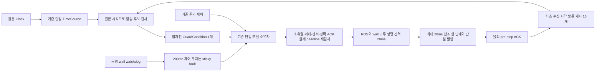

회귀순서: 알림합치기/양시계rate RED→GREEN, 실제DDS의future ACK 보류와Clock/ACK도착별깨우기, 기존callback/STOP/lease/명령상한회귀,설치감사,새실제G1/G2. 정상종료와물리실패는항상분리한다. 동일타임아웃실패에후보를계속추가하기보다명령확인의스케줄링계약을명시적으로검증한다.
### 이벤트 cadence의 계산 시각 기준 수정

고정128/33f66671의 G1 c5a1e9ea는24PASS, G2 a2edc08a는첫SHIFT3.628초/참조2.080초로FAIL이다. notifications109/issued123으로알림은실제로동작했으나기존시간예산을만족하지못했다. 정상STOP·terminal/runtime/engine/회수는유지했다. 이실패도그대로보존한다.

사후실제상태의오프라인측정/IK100회중앙값은0.669/0.629ms였다. 이는live stack이아니며실제GIL·lock·DDS지연을배제하는증거가아니다. 실제제어의판단→발행중앙값7.040ms/최대28.832ms였다. IK가19ms주원인이라는가정으로제품을최적화하지않는다.

새로넣은ReferenceDispatch가발행후부터20ms를기다려, 계산시간을제어주기에한번더더하는설계오류가있었다. 15ms계산을넣은실제ROS회귀에서‘이전판단시작+20ms에다음계산을시작할수없음’을RED22.38초로재현했다. 기준을원본판단ROS/wall로바꾼다. 적용확인200ms의wall기준은여전히**실제발행시각**이며원본pending lease를유지한다.

앞선실험설계의‘다리발행시각사이최소20ms’는이새gate에추가한조건이었다. 기존required_checks/검증기에는다리토픽의이조건이없고기존control_hz50은제어주기다. 현재구현은판단시작사이에20ms를둔다. 계산과발행의지터를20ms추가sleep으로고치지않는다. 기존raw/smoothed 속도명령의**실제발행간격≥20ms**, 팔명령5Hz, 참조한단계≤20ms, 모든실제속도/각도/하중/지지/phase deadline과required_checks는변경하지않는다. 다리발행시각과native 적용은그대로기록하고실측한계로판정한다. 기존인수기준을내리는변경이아니다.
### 현재 후보: 50Hz wall 기한과 원본 ROS 진행의 역할 분리

고정ec0c7d85의G1 0e8c5bd0는24PASS, G2 258e04e1는첫SHIFT3.626초/ref2.660초/settled46ms로FAIL이다. 정상STOP·terminal·runtime/engine회수는유지했다. 원본중계339발행의두표본간격337개중16개는12/16/18ms였다(analysis-clock-spacing JSON/원본SHA보존). 이를독립wall50Hz주기에도ROS20ms가추가로필요하다는조건에넣으면제어기회를더기다린다. 이분석은callback부재의증거가아니다.

최신후보는기존wall50Hz(판단시작간격≥20ms)를예약하고원본ROS는양의진행만요구한다. 데이터age·미래거부는계속원본ROS로검사한다. 궤적진행은여전히min(원본ROS진행,wall진행,20ms)이므로18msROS를20ms로외삽하지않는다. 기존raw/smoothed실발행≥20ms·팔5Hz·원래phase deadline/모든실측기준은불변이다. 이는앞선실험에서새로추가한ROS rate 필터를교정하는것이며future ACK에epsilon을넣는변경이아니다.

추가되는것은기존모델callback group의취소가능한**일회성steady timer 하나**다. 실제명령을낸직후다음판단시작+20ms에알림검사만예약한다. ACK가원본시각에서확인되고모든gate가통과해야기존소유자가한단계발행한다. 원본Clock/ACK가더일찍왔어도기한까지기다리며, 기한이왔는데자료가없으면다음자료도착을기다린다. 주기적인빈재시도나deadline갱신은없다. STOP/비활성화/cleanup/종료는예약을취소한다. 기본/G1/Gazebo·worker수·Clock구독수·엔진/모터코드는그대로다.

설치rclpy의공개create_timer(autostart=False),timer_period_ns setter,reset/cancel을확인했다. 최초inlineAPI조회는ROS환경미설정으로import실패했고설정후저장된조회도구로확인했다. 기한알림누락RED11.74초, ROS중복rate필터RED9.98초를확인했다. 첫green은이전실험의ROS20ms기대를유지한순수시험한곳이실패(3PASS1FAIL25.42초)해wall기준경계로바로잡았고, 원본18ms궤적/Clockpause/미래ACK/정지취소를포함26PASS42.70초다. 실제G1/G2성공은아직미확정이다.

### 2026-10-27 예약된 판단과 이른 주기 콜백의 경쟁

고정128파일 manifest5805faa8의 MuJoCo G1 `832d0582`는24PASS, 같은본 G2 `5400af69`는 후속 SHIFT에서FAIL이다. 첫 실패 뒤 연속 시험을 중단했다. 정상 실측 STOP·terminal·runtime/engine 종료·회수, noForce/residual[]와 timesyncd active/enabled 복원을 확인했다. 관련54PASS80.55초·8패키지 설치감사는 실제 이동 성공을 대신하지 않는다.

후속 SHIFT의 실제 시각은64.130→67.764초(3.634초), 허용 참조 진행2.636초/필요2.625초, settled 시작67.754초로 안정화100ms를 만족하지 못했다. 해당 단계133발행의 판단 간격132개는 최소20.120/평균27.423/최대87.333ms, 판단→발행은 평균8.378ms다. 마지막15개 적용 ACK의 발행→최초수신은 평균9.671ms다. 이 값들만으로 전체 지연을 특정 스레드나 IK에 귀속하지 않는다.

판별 가설: 기존 ROS 주기 timer가 예약 wall 기한 전에 ready가 되어도 `_dispatch_tick` 전체를 실행하고, 그 뒤에야 rate gate에서 거부된다. 같은 callback group에서 예약 알림 앞에 불필요한 계산이 놓인다. 실제 ROSClock/TimeSource/실행기와15ms 시험 계산으로, 원본 ROS+22ms가 wall20ms 전에 도착할 때 전체 계산이 먼저 시작하는지 실패 회귀로 확인한다. 다음 최소 후보는 이른 주기 wake만 저렴하게 보류하고 기존 예약 기한에 같은 소유자를 실행하는 것이다. 원본 시각, 정확 ACK, 200ms lease/watchdog, phase timeout, 참조≤20ms, 모든 실측 인수 기준과 native 모터는 유지한다. 아직 구현 성공이나 전체 원인 해결을 주장하지 않는다.

실제 ROS 회귀 RED12.92초에서 예약 뒤1.36ms에 전체 계산이 먼저 시작한 것을 확인했다. G2의 기존ROS 주기 timer 진입점만 `_periodic_control_tick`으로 분리하고, 정상 CRAWL의 이미 예약된 판단 기한 전에는 반환하도록 수정했다. 기한 알림·ACK 수신·원본Clock 진전은 기존 소유자로 이어진다. 정지/fault/lifecycle·200ms 독립watchdog 경로는 우회하지 않는다. 관련22PASS44.77초(이른wake/기한/미래ACK/원본200ms/계산시간/시각pause/참조18ms)를 확인했다. 계산은 시험용 재현 부하이며 실제native성능을 대신하지 않는다. 다음 실제판별을 위해 같은 검사를 다시 반복하지 않고 N빌드·8설치감사·원본시각사전관측/시동종료19회귀 뒤 새G1/G2로 진행한다. 전체최종회귀는 고정본 인수 뒤 별도로 남는다.

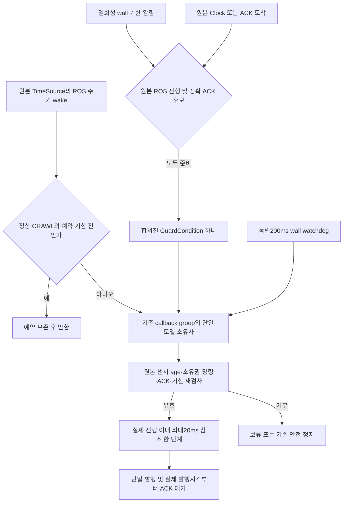

학습상 구분: **예약 알림의 지연**, **수신된 원본 시각의 지연**, **모터의 실제 적용 지연**은 서로 다른 경계다. 마지막 경계의 ACK만 고쳐 앞 두 경계가 해결됐다고 할 수 없다. 또한 '같은 콜백 그룹'은 중복 모델 접근을 막지만, 잘못 예약된 계산이 올바른 판단을 앞에서 막는 현상까지 없애지는 않는다. 시험 계산을 이용한 회귀는 이 스케줄링 성질만 증명하며, 실제 G2의 물리 성공은 반드시 별도 인수한다.

### 50Hz 예약의 누적 drift 재설계 근거

이른wake수정 고정d6ddf9b8의 G1 `528d7e3e`는24PASS다. 같은본 G2 `16bf2676`는120.264초 후속SHIFT에서FAIL(phase116.632/ref2.652/settled42ms)했다. 정상STOP·terminal·runtime/engine·회수/noForce/residual[]와서비스active/enabled복원을확인했다. 첫실패중단·ZIP/SHA·원본보존을유지한다. 더멀리진행한것을인수성공으로세지않는다.

해당단계의133발행간판단간격은평균27.222ms, 계산→발행8.876ms, 마지막16ACK발행→최초수신평균14.320ms다. 이른계산제거가끝난뒤에도각실제판단에20ms를다시더하는예약은지연을계속누적한다. ACK/원본Clock을기다린늦은판단이새주기의원점이되기때문이다. 원인설명은이측정과예약코드를구분해서대조하며, 특정CPU/GIL이모든지연의원인이라고단정하지않는다.

[ROS Jazzy rcl timer의 공식 구현](https://github.com/ros2/rcl/blob/18d96c9c2b98e616324ae9a2c7701dd0b0886ff0/rcl/src/rcl/timer.c#L299-L319)은예정시각에정확한주기를더하고놓친주기는건너뛰어callback지연을매주기에더하지않는다. 이성공적인기본timer설계를참고해Ch13의50Hz예약도고정된wall위상을유지하는방향을판별한다. 외부코드복사·수정없음. 예:100ms판단뒤120ms예정의판단이125ms에실행되어도다음예정은140ms다.185ms까지늦으면지나간slot을여러번실행하지않고다음200ms만예약한다.

이변경은새ReferenceDispatch가추가했던‘모든실제판단간격≥20ms’실험조건을표준50Hz예정주기로교정하는것이다. 기존required_checks·raw/smoothed실제속도명령간격≥20ms·팔5Hz는바꾸지않는다. 각참조진행은계속min(실제ROS경과,실제wall경과,20ms)이므로늦게실행된단계를큰단계로메우거나짧은간격에20ms를만들어쓰지않는다. 정확nativeACK단일미확인참조/200ms·원본센서age·시각역행·모든물리/phase기준도그대로다. 새실패회귀로누적drift와missed-slot burst거부를먼저확인한다.

누적 drift RED10.37초를확인한뒤,next_due_wall_ns를실제판단이아닌예정위상으로이동하도록수정했다. 기한timer와이른ROS wake의보류조건도같은예정값하나를사용한다. 부하/late5ms/놓친slot/ACK·시각pause·원본18ms·안전관련34PASS62.35초다. 기존새gate의rolling 간격시험한곳은동일slot의조기판단거부를그대로유지하고경계만고정위상140ms로바로잡았다. 원래required_checks는그대로다. 다음판별은N빌드·8감사→원래40초quiet/150초deadline→시각감시포함시동/종료19회귀→새G1/G2다. ROS수신자없는빌드앞의중복40초관측만생략하며엔진앞시각검증은유지한다.

### 예약 수정 이후 실제 콜백 경계 판별로 전환

고정1e075591/128파일의 G1 `dcd79bdd`는24PASS지만 G2 `38127c13`는SHIFT48.720→52.352초/ref2.347309254/필요2.625초/settled없음으로FAIL이다. 단계121발행, 판단간격평균29.958ms·계산→발행9.913ms다. phase수정은필요한예약성질을회복했으나실제지연의충분한원인설명이아니었다. 같은타이머가설만계속수정하지않는다. 정상실측STOP/terminal/runtime·engine·회수/noForce/residual[]와서비스복원을확인하고첫실패에서중단했다.

무엔진실제ROS+pool/serial비교도구는폐기했다. pool의시험ACK가동일시각다른값을보내정확보호에막혔고,여러스레드cProfile집계는유효한비교가아니다. serial은guard만료로활성화실패후빈pstats예외가cleanup앞에서발생했다. 소유PID1112/UID1000/boot·실행인수를확인한뒤SIGINT로중단했고C++abort가발생했다. 정상종료가아니며엔진시도0·비교결과채택없음·프로세스잔여없음을별도`diagnostic-owner-cost-assessment.json`에기록했다. 잘못된진단으로실행기를변경하지않는다.

다음판별은실제단일판단소유자내의숫자기록이다. `decision_cost_trace`는최대512개이며원본판단ROS와wall시작/끝,clock읽기·cache선택·명령선택·다리owner·guard·명령gate·nativeACK·rate·model.advance·발행·status단계끝의monotonic시각만보존한다. 파일I/O·cProfile·새스레드·센서/시각/명령/기준변경은없다. 전체후보의수정전실측을대신하지않으며단계비용은각기록의차이로계산한다. G2 relay100에만기록하고기본/G1/Gazebo동작은유지한다. RED12.40초→원본Clock/정확ACK/pause·안전포함19PASS47.79초. 새G1→정리후같은본G2 **진단1쌍**으로시간을소비하는경계를판별하며최종3연속인수로세지않는다.

### 실제 경계 결과: 적용 대기의 버려지는 IK 계산

고정baa3fdb5/128의 G1 `02376984`는24PASS, G2 `71eb7444`는SHIFT149.032→152.664초/ref2.697461240/settled72ms로FAIL했다. 정상STOP/terminal/runtime·engine·회수/noForce/residual[]와f922cdfe서비스복원을확인했다. ZIP·해시·원본과사후`analysis-decision-cost-native-g2-mujoco-71eb7444-4a56-4d7d-9dea-147e8d112f82.json`을보존한다(원본reportSHA24567173f76384804f1c76fbd1b139a523e9eb64e9b739000b94ca626c74ba4b).

실제실패단계196판단은phase처음부터기록됐다. 새발행139개에서model구간평균7.187ms(전체8.690ms), 발행하지않은대기56개에서도model8.495ms(전체10.099ms)를소모했다. nativeACK평균0.489/0.528ms, guard0.243/0.319ms로,주요경계는model이다. 이는wall경과이며CPU만의비용이라고단정하지않는다.

코드대조결과`reference_permitted=False` 경로도측정/물리/지지/시각·phase검사뒤 `_solve`를호출했다. 하지만동일소유자는확인대기중그결과를발행하지않는다. 이미검증해발행한참조와계획좌표는그대로인데새IK/계획충돌검사를계속계산한것이다. 실제접촉/관절/미끄러짐/지지/센서age/phase timeout검사는앞에서매번수행한다. 대기경로만새target없는결과를반환하도록최소수정했다. STOP·고장착지경로는이분기밖이며종전대로실행한다. SHIFT/SWING의회귀RED10.40초→기존대기·지지손실·착지·정지·정확ACK포함32PASS54.55초다.

다음실제실행에는같은callback의native TID와thread_time_ns도함께기록한다. 각callback안의시작/단계/끝CPU차이만비교하므로여러worker프로파일러집계를피하고다른스레드의CPU를자기계산으로세지않는다. 경과시간은계속monotonic으로별도기록한다. 누락RED12.07초→관련8PASS28.15초다. 외부구현·시각/모터/물리/phase기준·worker/실행기는변경하지않는다. 새G1/G2한쌍에서실제비용/물리영향을판별한뒤고정본3연속인수를진행한다.

### 질량중심의 고정 형상 컴파일

고정1df5e300/128의 G1 `d4a99361`은24PASS, G2 `17c2e988`는400초이상보행한뒤SHIFT425.062→428.704초/ref2.438803596/settled없음으로FAIL했다. 오류후정상STOP/terminal/runtime·engine·회수/noForce/residual[]와6ba8bc8d서비스복원true를확인했다. ZIP237174841/SHA336fe61b99f4ae7e1eea12a139e57abe4a7dd34db9342c7f73d36515f2a21a7c는4개72MB이하part와원본을보존한다. 아직전체G2성공이아니다.

동일callback CPU기록이있는182판단에서published126의model CPU평균4.468ms/wall7.969ms, held55는CPU2.607ms/wall4.317ms다. 대기중IK생략으로불필요한경로는줄었지만실제계산과대기가함께남았다. 실행기/CPU친화도/물리설정을추측으로바꾸지않는다. 코드와이전단일스레드함수측정을대조해,매관측마다고정질량점과fixed transform을재구성하는부분을다음최소비용대상으로정했다.

일반적인관절모델과측정데이터분리를참고했다([Pinocchio2.9.2 공식CoM문서](https://gepettoweb.laas.fr/doc/stack-of-tasks/pinocchio/jnrh2023/template/algorithm.html#mass)). 외부코드나의존성은추가하지않았다. `_mass_plan`은정확한URDF문자열과질량/질량점tuple을key로하는최대32개cache다. 고정관절의형상과질량가중1차moment만가장가까운가동관절로미리합한다. 매측정에서는현재q를가동관절별한번씩검증·평가하고현재몸체pose를적용한다. 이전q/pose/CoM이나센서시각을cache하지않는다. 모델/질량값이바뀌면다른key로컴파일하며,정적행렬/벡터는읽기전용이다. 시뮬레이터질량·관절·물리·측정/phase/속도기준은변하지않는다.

고정질량점재구성RED10.59초→초기23PASS18.91초, 100고정seed의전체관절/월드pose에서독립full-link FK가중합과2e-12m내일치·질량변경key·NaN/음수/차원거부·지지·보행·정지포함69PASS57.40초다. 이전Ch13계산을evidence의baseline으로보존했다(SHA431a426c79f29cdd974f6095d6a8940990f7f48debf169bb7829264bc2847994).

회수된동일실제상태로이전/수정계산을200회씩교대로측정한`benchmark-static-mass-a6c48026-64db-4334-9d1e-6d91ab5edd5e`의최대오차는5.55e-17m다. CPU평균0.469→0.240ms(약49%감소),wall0.471→0.241ms다. 이는실제엔진성공이나live부하시간상한의증거가아니다. 최초비교도구의body_rotation import경로오류는별도실패JSON에보존하고도구만교정했다. 제품코드는이오류때문에변경하지않았다. 다음은설치감사/원본시각검증/시동회귀뒤**동일고정본G1/G2세쌍**이며첫실패에서중단한다.

### 입력 분리 후 모델 소유자의 불필요한 pool 경계 제거

고정fad0dc84/128의 G1 `08d04232`는native CoM일치를포함24PASS다. 같은본 G2 `bad1d687`는SHIFT56.430→60.060초/ref2.470689023/settled없음으로FAIL했다. 정상STOP/terminal/runtime·engine·회수/noForce/residual[], ZIP30914260/SHA7435a34fcef0b705c223fe74e1175596706e8dd39ab25fecc90704f2d4085977, 4884d54c서비스복원true다. 첫FAIL에서세쌍중단/2·3회미실행, 성공선별없음.

실제188판단에서published125의전체CPU평균6.295ms/wall10.618ms,model CPU4.496/wall8.557ms였다. held62의model CPU2.228/wall4.242ms도기록했다. 오프라인CoM비용감소가전체엔진의성공을보장하지않았으며경과시간에는스케줄링대기가남는다. 이수치만으로특정waitthread나GIL을확정하지않는다.

CRAWL모델callback group은원래상호배제이고,원본TimeSource/6센서/상태/명령/ACK수신은이미별도직렬실행기에있다. G2에서만기존단일모델소유자의callback을추가Python pool queue로넘기지않고SingleThreadedExecutor에서직접수행하는비교로진행한다. 실제병렬모델처리는원래허용하지않았으므로모델소유권을약화하지않는다. 다른역할/native/G1/Gazebo의factory선택은유지한다. [rclpy#1223](https://github.com/ros2/rclpy/issues/1223)의Iron사례는유사현상참고일뿐설치Jazzy의원인확정이나성능증거가아니다. 앞서거부한cProfile비교도판단근거로사용하지않는다.

scoped실행기누락RED11.39초→실제DDS/Clock/ACK/pause·상태전이/정지24PASS44.66초다. 모델lock을잡은blocking작업중에도원본Clock·contact·guard·command가독립수신되는기존시험을G1/G2두scope로검증했다. scope밖MultiThreaded/nativeSingle선택과소유자없는발행금지를유지한다. 시험의worker alive조회는실제snapshot API로작성했다. 실제판단native TID와수신자PID/TID도기록하므로새엔진에서직접소유자실행여부를교차확인한다. 입력fixture가물리엔진인수는아니다. 후속은새설치감사/시각검증뒤G1/G2고정세쌍이다.

### 장시간 관측 기록의 분석을 ROS 종료 수명에서 분리한다

고정2cb4e1cc의 G1 `0f84fe58`은24PASS, G2 `e5f0aea4`는 모든 이동 시퀀스 후 관측 프로세스 join 실패로 FAIL이다. 엔진과 runtime의 종료 로그만으로 전체 정상 종료를 선언하지 않는다. 원본과 소스는 recovery4652fb42/ZIP SHA6951d3b9 및6분할에 보존했다. 원본 result/누락된 teardown은 변경하지 않았다.

기존 child는 receiver join 이후 1.89GB JSON을 전부 복원하고682MB pickle을 만든 뒤 종료했다. 부모는 이 전체 작업을20초 안에 기다렸다. 원본 재현의 복원34.55초/저장·해시41.87초는 크기에 비례하는 분석이 종료 기한과 결합됨을 보인다. 압축 작업과 동시 실행이므로 이 시간을 원래 실행 시간과 동일시하지 않는다. OOM을 입증하는 기록은 없으며 그것을 원인이라고 쓰지 않는다.

새 경계는 다음과 같다. 분석을 나중으로 옮기되 모든 원본 레코드·SHA·수량을 검증한다. 파괴 후 ROS handle에 접근하지 않도록 receiver 보고는 파괴 전에 수집하고 최종 보고는 실제 종료 후 기록한다. 관측 오류·runtime fault·미회수는 계속 실패이며20초 join 기한은 그대로다. parent의 mission journal도 전체 검증하되 중복된 전체 객체를 만들지 않는다.

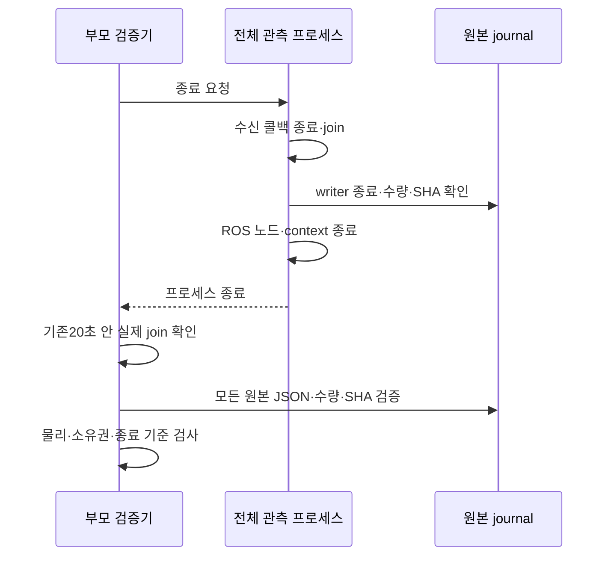

최소 실패 회귀10.21초→첫 수정의 실제ROS 파괴 후 접근 오류(7PASS/1FAIL)→수정 후 관련68PASS/162.26초다. 실패 로그도 보존한다. runner는 예외 시에도 `finalization_complete:false`인 partial teardown을 남기며, 확인되지 않은 join을 만들지 않는다. G2 metadata는 실제 factory의 direct single owner와 일치하도록 기록한다. 이는 새 엔진의 성공 증거가 아니다.

후속 사후 분석은 e5의58,619 운영 프레임을 전부 평가해 body 신선도3건 실패를 추가 발견했다. 같은 capture706.268초가 ROS706.498초 프레임에 남아230ms였다. 원본→odom 발행2.352ms, 전달0.156ms, 관측 콜백 대기213.556ms로 구분했으며 겹친 GC span은 없다. CoM/지지/자세/관절/stance slip은 통과했고 다른 센서 age 초과는 없었다. 새 장기 실행 전 이 관측 지연을 해결한다. 오래된 프레임을 제외하거나 시각·200ms 기준을 바꾸지 않는다.

### 전체 관측기의 라이브 JSON 비용을 종료 후로 옮긴다

같은 구간의 보존된 slow callback은 frame wall75.90ms/CPU12.41ms, 다른 frame wall60.95ms/CPU44.77ms다. frame journal의 JSON 변환 최대 경과 시간도60.40ms였다. 이를 특정 OS 대기나 GC로 단정하지 않는다. 같은 실제 실패 프레임을1000회 교대 측정한 ac4983c3에서는 JSON 평균CPU0.342ms, 원시 pickle0.0265ms였다. 단순 형식 변경 후 Python으로 매번 전체 값을 다시 검사한39b70e74 후보는 오히려0.389ms로 JSON0.326ms보다 느려 **실제 엔진에 투입하지 않았다**.

최종 후보는 전체 관측기만 라이브 `observations.capture`에 변경 불가능한 길이 구분 레코드를 기록한다. Python 표준 C pickler로 원래 값과 시각을 동결하고, ROS 고정 배열의 float64 하위형은 같은 builtin float로만 보존한다. 클래스 객체를 일반적으로 허용하지 않는다. 같은 실제 프레임의79b7d314 비교는 완성 인코더 평균CPU0.0309ms/JSON0.3587ms다. 이 비용 감소는 새 실제 엔진의 성공을 대신하지 않는다.

모터·센서·명령의 실시간 유효성 검사는 그대로다. 전체 관측 증거의 finite/schema/hash/count 검사와 JSON 변환은 엔진·수신기·관측 프로세스가 종료된 뒤 parent에서 수행한다. 원본 capture는 유지하고 모든 레코드를 JSON으로 내보내며, 손상·비유한값·순환·금지 객체는 인수 실패다. 원본 헤더·수신 시각·QoS·측정 빈도·cache/queue 용량은 바꾸지 않는다. JSON을 기다리는 프로세스·새 command owner·새 런타임 worker는 만들지 않았다. mission 관측기는 기존 JSON 경로를 유지한다.

binary reader는 이 실행이 생성하고 UID·경로·전체 SHA가 확인된 파일만 읽는다. 영구 교환 형식은 JSON이며 외부/업로드 pickle은 입력으로 받지 않는다. 해석기는 float 스칼라 복원 외의 class resolution과 persistent reference를 거부한다. partial JSON은 `.tmp`로 남고 원본 전체 수량/해시 검증 후에만 최종 파일 이름을 얻는다. 실패를 감추는 최신값 대체·프레임 제외·자동 재시도는 없다.

새 테스트는 live JSON 금지 상태에서600개 원본과 최초 시각이 보존되는지, 실제 ROS 고정 배열이 기존 JSON과 같은 값인지, 훼손·과대 길이·실행 객체·순환·NaN/Inf가 거부되는지 검사한다. 처음 ROS 경로는 float 하위형 거부로13PASS/1FAIL했고 별도 실제 배열 회귀로 재현해 수정했다. 초기 반복 검사에서 순환 입력의 무한 검증도200ms alarm 회귀로 재현·수정했다. 실패 로그를 지우지 않는다.

### ACK 왕복과 곡선 시간 예산의 불일치

고정129파일 c6752682의 실제 G1 aade6c3b는24PASS이고 G2 4163d57d는SHIFT94.094→97.726초에실패했다. 신선도·지지·CoM·관절·slip과 실제 액션 terminal·전체 관측 프로세스 exit0·정상 runtime/엔진 종료·잔여[]는통과했지만G2전체는FAIL이다. 원본ZIP SHA1ed0b25bc7220b1c311a09608ffd7be4d6bc8d1a0136394a11af4585a63d4304/50403732bytes를보존하고첫실패에서나머지2쌍을중단했다. 서비스36054a3a도복원true다.

최소 실제ROS 시험에서 보류후 ACK 예약 복원은 이미 존재해 ‘잃어버린 깨우기’ 가설을 기각했다(1PASS14.30초). 이 가설로제품코드를변경하지않았다. 같은실패자세/정확한limits의오프라인단일스레드계산은측정평균CPU0.419ms/IK0.615ms였으며, 실제엔진의전체model평균CPU5.267ms를이값으로대체하지않는다. 모델 전체의 실제지연과오프라인일부계산은다르다.

직접 확인된 불일치는 시간 예산이다. 3.632초 동안 실제발행101회, 필요한곡선시간2.625초인데 기존 ‘발행당최대20ms’로는최대2.02초밖에전진하지못한다. 실제참조시간은1.954639684초였다. ACK확인후다음참조를발행하는엄격한단일pending정책과추가20ms진행상한의결합이다. 이 조건에서는추적오차가0이어도완료할수없다. `test/fixtures/reference-4163.json`은원본보고서SHA589518c98cd9d0d6b081842fd75bc2e921084ef1491ff4e4018853ee93d8530a에서추출한101개발행시각offset이다. 합성피드백이나새물리증거가아니다.

수정범위는MuJoCo G2/relay100 검증모드의고수준곡선샘플링이다. 기본모드/G1/Gazebo는기존20ms정책을유지한다. 해당G2는새참조가허용됐을때마지막허용참조이후의원래ROS·wall경과시간중작은값안에서동일곡선을샘플링한다. 기존200ms데이터/적용확인기한보다길게진행하지않으며, 확인대기중에는참조를내보내지않는다. 센서검사·단일pending·원본ACK·마감시간·phase이동량·geometry·게인·30Nm·물리2ms·Controller Manager100Hz·고수준50Hz는유지한다. MuJoCo native controller에보간을추가하지않는다.

동일quintic 및SWING bump의미분상한으로, 두실제시계경과시간내샘플간변위/시간이기존속도상한을넘지않음을검사했다. 원래ROS18ms를wall20ms로늘리지않고, 대기중수신시각·phase시작·만료를갱신하지않는다. 실제모터의추적속도·파지상태는기존엔진인수로별도판정한다. [ROS2 Control Jazzy의시간지정궤적과샘플링 설명](https://control.ros.org/jazzy/doc/ros2_controllers/joint_trajectory_controller/doc/trajectory.html)은개념참고이며외부controller구현을복사하거나다리backend로교체하지않았다.

새API누락RED→기존기본정책/시각/ACK회귀25PASS36.30초→추가scope시험의G1에G2전용프로필을잘못준fixture실패(4PASS/1FAIL)→fixture입력을기존scope계약에맞춰관련43PASS61.53초다. 원본속도/STOP/센서/ACK/마감기준을제거하지않았다. 현재는새설치감사와실제고정본재검증전이며이단위시험을물리성공으로세지않는다.

### 시간 예산 보정은 SHIFT에만 적용하고 SWING의 원래 제한을 복구한다

129파일 manifest1b50624e의실제 G1 45772380은24PASS다. 같은본G2 242efeba는238.624초에 `measured carry posture lost`로실패했다. 팔최대속도0.013726rad/s·팔오차0.019172rad는기준내였지만, 그리퍼속도는0.005889m/s로기준0.005m/s를넘었다. 신선도·지지·자세·CoM·관절·slip은통과했고, 실제terminal·전체관측join/exit0·runtime/engine정상·회수/noForce/residual[]를확인했다. 4ca978fa서비스복원true, 첫FAIL에서나머지2쌍중단이다.

원본과소스는ZIP131403948bytes/SHA b9bbccbc7305b967c1aa90a3251cf9f108f5beb1643a98d955d9f491f118c4d5 및2분할로보존했다. 사후 `gripper-window-879e58d4`는같은원본촬영의접촉·명령·native관절속도를연결한다. 원본controller보고서SHA는8391540a0e315043a0b348077f16cef8aade3e758e082daec5636a6be39e3ffb다.

실패구간은왼쪽뒷발SWING이다. 명령간격이90.239003ms(ROS92ms),81.723803ms,94.793503ms까지벌어졌고 실제pre-step의종아리참조변화는0.006986rad에달했다. 공유시간함수에적용한보정이SWING까지확장되어, 기존20ms참조보다큰계단을만들었다. 곡선의연속미분속도상한만확인한시험은native모터의유지·계단입력에따른물리반응을보장하지못했다. 이확대는불필요했으며원본실패를그대로남긴다.

새후보 `applied_shift_elapsed`는MuJoCo G2/relay100의SHIFT에만두원래시계경과시간샘플링을적용한다. SWING은모든모드에서기존20ms로되돌린다. SWING에는이전SHIFT와같은짧은완료기한이없으며, 전체G2의원래이동/회전시간제한은그대로다. 별도접촉탐색0.002m/s·nativecontroller·게인·모든물리/종료기준은유지한다.

### 실제 전체 시퀀스에서 발견한 SHIFT 참조의 순간 변화

공유 시계의 복수 보정 소유자를 분리한 환경에서, 129파일 manifest8740e8e4의 MuJoCo G1 08d56c64는24/24PASS였다. 이어진 G2 095dc500은 실측0.40m·좌우0.30rad·최종STOPPED까지 수행했고, 전체 관측 복원·실제 액션 terminal·runtime/엔진 정상 종료·회수·강제종료 없음·잔여[]를 확인했다. 그러나31필수검사 중 `carry_measured_settle`이 실패했다. 최대 그리퍼 실측속도0.005524331430764654m/s가 기존0.005m/s를 넘었으므로 원본FAIL을 유지한다. 이후2·3쌍은 실행하지 않았다.

전체60,137운영프레임·56,970고유관절촬영을 스트리밍 조사해 초과1프레임/고유촬영1건을 찾았다. 시각1061.613999988초, 우회전 중 SHIFT다. shutdown 분류 문제가 아니었다. live carry owner는PASS/first_fault=null이었지만 독립 원본 검사는FAIL이다. 주기적으로 최신 상태를 검사하는 소유자 보고서가 전체 raw 관측을 대체할 수 없음을 보여준다. 이 차이를 숨기거나 raw outlier를 제거하지 않는다.

`carry-spike-6bcb0034-bc7a-4994-b07a-bd0541d96e36`에 원본SHA·모든초과·최초/최대·±0.6초 구간을 보존했다. 그리퍼 목표는 전 구간0.015m다. 약10ms 전 native 표본에서 FR calf 목표의 변화0.0055214877rad가 관측됐다. 직전 서로 다른 목표 표본 사이 간격은60ms지만, 이는 정확한 publisher 콜백 간격이 아니다. 제한된 native 표본의 시간과 실제 발행 시각을 혼동하지 않는다. 다리 참조의 큰 순간 변화가 몸체/팔을 거쳐 전달됐다는 가설을 우선 판별한다.

새 후보는 MuJoCo G2/relay100의 SHIFT 참조 진행 상한만200ms에서40ms(명목50Hz의두주기)로 줄인다. 피드백/명령 임대200ms·과거ROS/수신wall시각·single pending/ACK·native100Hz controller·게인·30Nm·SWING20ms·위치/속도·원래phase/900/600초기한은 그대로다. 누적 지연을 은행처럼 저장해 한꺼번에 따라잡지 않는다.

과거4163의 실제101회 발행 시각에 이 상한을 적용하면 진행 가능 예산은2.934486726초로 필요2.625초를 확보한다. 기존20ms 정책의 예산 부족을 다시 도입하지 않으면서 순간 변화를 줄이는 한 가설이다. 원본095의 최소fixture7998bytes를 기록했고 새 회귀는60ms 진행이40ms상한을 넘는RED16.26초→관련순수6PASS13.57초다. 이 시험만으로 그리퍼의 물리적 성공을 선언하지 않는다. 다음은 관련ROS회귀·새설치감사·같은고정본실제G1/G2이며, 첫FAIL에서중단한다.

### 연속 시험의 저장 방식

095 원본 native 기록은 유지했다. 전체 ZIP680,294,215bytes/SHA150cc22e532d9b06092c875205540b2257554a2c37c874aebe5f4a9dd0205ba6와10분할에도 같은 원본을 보존했다. 일반 복사 방식은 native와저장소에 같은 수GB 데이터를 중복 기록해 남은공간을약8.7GB까지소모했다.

다음 실행은 opt-in `archive_from_native`로, 종료·회수·잔여검사 후 큰 파일을 native원본에서 ZIP으로 직접 스트리밍한다. 저장소에는작은결과/종료/소스manifest와전체파일SHA목록을복사한다. 압축본의경로/내용은기존과같고모든원본바이트의SHA·CRC를검증한뒤에만다음엔진을허용한다. native원본을삭제하지않고FAIL을PASS로바꾸지않는다. 저장소의과거중복복사는native원본·ZIP멤버·복사SHA가모두일치하는경우에만가역적으로압축보관전환한다. 저장경로회귀는실제엔진없이7PASS이며,변경은물리실행후의보존단계에한정한다.

90.239ms 지연을적용한새회귀는수정전0.090239초진행을재현해실패(20.64초)했고, 실제동일시각쌍으로고친fixture와범위제한후44PASS77.35초다. 기존SWING과참조시퀀스가정확히같고,SHIFT의101발행예산·기존속도·두시계·ACK/센서만료·STOP·마감기한은유지하는지검사했다. 새실제엔진인수는아직미실행이다.

## 2026-10-28: 40ms 후보 실패 후 실행 경계 판별
고정본a5e10a9c의 실제G1 f703은24/24 PASS이나G2 1e495a5d는SHIFT 시간 초과로FAIL이다. 첫FAIL에서세쌍을중단했고정상runtime/엔진종료·회수·강제정리없음·잔여[]·두서비스복원true를확인했다. 이SHIFT의실제3.636초/60발행/참조2.145161177초는필요2.625초에못미친다. 그리퍼원본속도0.002177m/s로기준안이며carry전체FAIL은model fault에따른것이다.
200ms catch-up의실제그리퍼초과와40ms의실제진행부족을함께보면상한값만조절하는설계는발행지연에견고하지않다. 같은closed상태의분리measure/solve와전체advance오프라인재생은약1.0ms인데실제published callback model은중앙wall9.42ms/CPU5.55ms다. 합성DDS진단도127콜백/중앙2.93ms로차이를재현하지못했다. 그러므로IK수식만병목이거나GIL/렌더러하나가원인이라고확정하지않는다.
다음판별은기존512개숫자ring에model_validate/FK/mass/safety/reference/solve 경계만기록한다. 단일model소유자·기존원본ROS/wall/threadCPU를쓰며새worker/프로파일러/파일쓰기/모터보간은도입하지않는다. 관측유무가동일입력·동일credit에서명령/참조/실패를바꾸지않는RED→GREEN후관련회귀·설치감사를거쳐실제같은경계를측정한다. 기존deadline·40ms·20ms·native100Hz·게인·30Nm·모든인수기준은유지한다. 이판별만으로성공을선언하지않는다.

### 실제 세부 구간 결과와 같은 기하의 산술 경로
204f658b 비교는두서비스복원true/잔여[]로종료됐다. G10401은24PASS, G20deb는약0.12m전진뒤SHIFT3.636초/75발행/ref2.521346294초로미달FAIL이다. 새고정manifest58f57b96. 첫실패와전체관측을보존했으며최종연속인수로세지않는다. 읽기전용report를190.956초에한번호출해그이전512숫자기록을별도보존했고,이호출뒤지연가능성을원래기록과분리한다.
실제실패구간published75회에서model_total중앙wall9.553ms/CPU4.917ms,model_solve중앙wall2.622/CPU2.246ms이며다른구간에도일시지연이흩어졌다. 단일구간을전체원인으로확정하지않는다. 다만solve가수정가능한가장큰기본비용이며순수프로파일은thigh/trunk의3원소NumPy임시배열/분기연산을확인했다. 다음최소수정은기존선분-상자거리의동일구간별이차식과동일URDF변환을3원소scalar산술로표현해배열할당·작은NumPy호출을줄이는것이다. 캐시에는불변URDF기하만두고실측q/접촉/CoM는캐시하지않는다.
먼저tuple Vec3/유한입력/퇴화·경계·반전/고정난수기하를기존자체NumPy기준식과대조하고실제MuJoCo거리·기존충돌거절을회귀한다. 고정상태CPU비교후에만native한쌍으로실제처리량을다시판별한다. controller보간·native100Hz·게인·30Nm·40/20ms·deadline·원본시각·모든인수기준은변경하지않는다. 처리량개선이나물리성공은아직미검증이다.

### CF1: 실제 적용·최초 수신·처리 시점의 분리

cf1fad26은 첫 SHIFT들을 넘어 전진·좌회전·우회전 도중1174.907초에 `native reference unconfirmed`로 실패했다. 원본을 보존하고 정상 runtime/엔진 종료·회수·강제 정리 없음·잔여[]·서비스 복원true를 확인했다. 고정본 fb10의 연속시험 첫 성공으로 세지 않으며 추가 같은 소스 반복은 중단한다. 실제 pre-step 796행이 마지막12관절 목표와 정확히 일치하고 첫 적용은 발행 후15.9757ms였다. CM write는5.5185ms였다. 따라서 ‘모터 미적용’과 ‘클라이언트 확인 미확정’을 구분한다. 기존 보고서에 해당 ACK의 첫 수신이 없어 전달 지연은 확정하지 않는다.

단위 경계에서 별도 결함을 재현했다(RED21.26초). 적용46ms/첫 수신100ms인 명시적 합성 ACK가 처리210ROS/206wall ms에 평가되면 현재 capture age164ms/receipt age106ms로 모두 유효한데, 기존 코드는 보관된 ACK를 검사하기 전에 발행 후 경과시간으로 실패했다. 이 합성 수신시각은 CF1의 실제 수신 증거가 아니다.

수정 계약은 **적용 캡처와 최초 로컬 수신 모두 발행 후200ms 이내**, **평가 시점에도 원래 ROS age와 수신 후 wall age 모두200ms 이내**, 정확한12값·epoch·단일 소유권·미래 거부가 모두 충족된 관측만 확인하는 것이다. 조건을 만족하는 보관된 관측을 먼저 확인하고, 없을 때 기존200ms 미확인 실패를 유지한다. 늦게 수신된 ACK를 구제하거나 기한·header를 갱신하지 않는다. 기존 재발행/중복/1ns미래/미확인기한 시험은 그대로 두고 늦은 capture·늦은 첫 수신·현재 만료·다른 값의 거절을 추가한다. 이미 발생한 노드 stop/fault는 고착하며 자동 회복하지 않는다. 실제 확인 소비시각은 원래 capture/receipt와 별도 기록한다.

다음 실행의 원인 판별을 위해 credit의 원래 수신 sample16개와 최초 실패 순간의 future ingress cache를 읽기 전용 스냅샷으로 남긴다. 진단 복사로 pending을 해제하지 않고, 실제 제어 판단은 기존 단일 소유자만 한다.

추가로 전체57,166운영프레임 중 같은 body capture924.016초가3프레임에서ROS age208ms였음을 보존했다. DDS publisher→RMW1.4675ms, RMW→Python callback163.514201ms다. 다른 센서는 해당 신선도 기준 안이었다. 이는 별도 관측 수신 지연이며 ACK 수정만으로 해결됐다고 쓰지 않는다. body adapter나 센서 값을 바꾸기 전에 고주파 독립 관측 수신 경계를 구조적으로 검토한다. 원본3프레임을 제외하거나200ms를 늘리지 않는다.

## 2026-10-29 Gazebo G1 복귀 정책의 범위 회귀

새 고정137소스 `3bdbec12...`의 실제 G1 `c1eec4a8`는 첫 고유 재접촉 때 원래 wall 예산이2.437초 남았지만, MuJoCo용 loaded 복귀 제동/느린 tail과1초 안정화가 들어가지 않아 실패했다. 실제 lift49고유 관측·carry 원본 오차/속도는 통과했으나 owner FAULT와 실측 STOPPED 미확정으로 정상 종료 인수는 실패다. 모든 프로세스 exit0·reap·강제정리 없음·잔여[]와 root8904913a의 두 서비스 복원/foreground close는 별도로 확인했다. G2는 실행하지 않았다.

가설 판별: 원본 controller_report에서 request/stages/vertical 및 SHA를 최소 fixture `native_c1e_gazebo_return_budget.json`(SHA677c2afa...)로 남겼다. 기록된 시각에서 공통 loaded 정책의 동일 budget fault를 재현했다. Gazebo의 기존3연속 성공본 `af6da055` 보존 ZIP의 calibration.py SHA `3751c16b40dc6fff7fef803f484f309323b3b94e114228f84463d666e9f731f4`는0.02m/s·0.2m/s²의 bounded preload 법칙이며 loaded 제동이 없다. 이후 MuJoCo의 실제 충격 대응을 공통 G1에 적용한 범위 회귀다. CPU나 llvmpipe를 이 실패의 원인으로 단정하지 않는다.

결정: InPlaceCalibration/CrawlMachine에 명시적 return_policy를 전달한다. Gazebo owner는 기존 성공법칙 `bounded_preload`를 선택하며 MuJoCo 및 순수 계산 기본은 기존 `loaded_quintic`을 유지한다. 알 수 없는 값은 거부하고, fault 뒤 정책을 자동으로 바꾸거나 재시도하지 않는다. 일반 CRAWL·모터 적용·게인·30Nm·접촉·물리2ms·원래10초·측정 안정화와 인수 기준은 유지한다. Gazebo는 과거 성공법칙을 사용하지만 수정 후 현재 설치/소스로 실제 검증하기 전에는 성공으로 승격하지 않는다.

RED: 원본 budget 재현 통과 후 정책 인자 부재 FAIL(11.49초), 실제 ROS owner 설정에서 정책 부재 FAIL(14.09초). GREEN: 엔진별 설정/기록 시각 재생/force와 고유capture/속도·가속도/원래끝점·wall budget/MuJoCo loaded·jerk12시험27.28초 PASS. 이 재생은 동일 입력에 대한 참조 계산 비교이며 바뀐 궤적의 물리 접촉·carry·엔진 성공을 예측하지 않는다.

## 2026-10-29 접촉 노드 종료 경계

Gazebo G1 `00facc19`(source137 manifest e2f838d2...)는 수정 후 교정·carry·하중·관절·TF·단일 소유권21개가 true, 실측 STOP/실제 terminal과 엔진/부모 exit0·회수·강제정리 없음·잔여[]였다. 그러나 contact adapter PID1975가 종료 중 RuntimeError(pybind call argument0 conversion)로 exit1이어서 공통 clean_shutdown이 정상 runtime/engine 두 항목을 false로 유지했고 전체23/25 FAIL이다. G2는 시작하지 않았다. rootf521의 서비스 복원·두 foreground 정상 close를 확인했다. 원본을 PASS로 바꾸지 않는다.

단순 실제 ROS service→SIGINT3회는 모두 정상으로, 같은 문구의 예외를 결정적으로 재현하지 못했다. 이 로그를 RED로 주장하지 않는다. 실제 Clock 콜백에 test-only gate를 넣고 SIGINT를 보내자 `CLOCK_CALLBACK_ENTERED` 뒤 본문 완료 없이 main이 정상처럼 반환하는 수명 위반이 재현됐다(19.42초 FAIL). 따라서 이 최소 재현이 pybind 내부의 정확한 throw 위치를 입증한다고 쓰지 않는다.

설치 rclpy7.1.12 wrapper와 공식 bd637294dd02b1c128422395c059fa06df8387a3의 events_executor.cpp(blob3b50f8892f74aa9ccc44aa6979559c9ca6b1e6a4)에서는 spin이 context 상태를 조회하고 shutdown exception 경로로 연결된다. contact adapter만 기본 rclpy signal 처리와 무기한 spin_once를 사용했고, 다른 navigation 역할은 기존 Ch13 vision.execution의 deferred SIGINT 계약을 사용했다. 통합 수명을 맞추는 최소 보정으로 contact adapter에도 같은 계약을 적용했다: signal은 종료 요청만 남김→진행 콜백 완료→joiner stop→executor join→node destroy→ROS shutdown. 일반 RuntimeError를 잡아 숨기거나 외부 rclpy를 수정하지 않는다.

실제 service/일반 SIGINT3회·진행 중 Clock 콜백 완료·접촉 값/원래capture/순번/거부·EventsExecutor metadata18시험21.71초 PASS다. 이는 엔진 전체 종료의 대체물이 아니며 새 고정본 실제 Gazebo에서 판별한다. Source delta는 contact adapter1개뿐이므로, 직전73개 참조 회귀의 소스를 SHA로 대조한 뒤 반복하지 않는다.18개 직접 회귀와 매번8패키지 설치 감사·원본 시계·19시동/종료 검사를 유지하며 최종 전범위 회귀는 별도 필수다.

## 2026-10-29 전체 G1 통과와 G2 원본 증거 경로

같은137소스 manifest `afbbe4834376d7156032b24851c27e3e5706afe4dcbcc25587527113c28c85a4`의 Gazebo G1 `65ce2fad-60da-41cf-b37b-8c3b9f9f706d`는25/25 PASS다. 실제 terminal·실측 STOP·contact adapter 포함 정상 runtime/engine exit·launch 부모 회수·journal join·강제정리 없음·잔여[]를 확인했다. ZIP1,843,620bytes SHA458dcfb4e8fb1faa9726f2b8cfd0ed5ea1ff0a2291a2b88ff0f404aa52c199d4다. 이는 현재 고정본 G1 한 번이며 G2/3연속/절 완료가 아니다.

후속 G2 `9affb1fd`는 engine_started=false/preflight_install에서 G1 증거를 거부했다. 새 bounded export는50MB 초과 원본을 native canonical 위치에만 두는데, G1→G2 도구가 원본 형제 파일이 없는 요약 복사본의 result 경로를 넘겼다. 원래 인수 검증기는 모든 artifact의 크기/SHA를 확인하므로 이 거절은 올바르다. no-engine teardown에 residual 필드가 없어 export도 거부됐고 이를 정상 회수로 바꾸지 않았다. rootae219023의 서비스 복원/foreground close/관련 프로세스[]를 확인했다.

최소 판별 `proof-root-discriminator-5b5cabaf-e31b-4c4b-886d-56426d19077f`: 같은 result SHA8bef76820fb306527d49bb6a4b04f2584891ca7a7e15789a685f74dac605a079를 입력하고 기존 전체 validate_profile을 그대로 사용했다. 요약 경로는 invalid_native_evidence, 실제 원본 경로는 accepted=true였다. 엔진은 시작하지 않았고, 거부된 G2의5개 작은 원본 메타데이터도 별도 바이트 복사/해시로 보존했다.

도구 수정: 요약 descriptor가 가리키는 동일 UID·이름·한정된 native 증거 경로를 확인하고 result/source/install/teardown의 원본·복사본 해시를 대조해 canonical result를 반환한다. 실제 제품 인수 검증은 그 원본 경로에서 다시 모든 artifact를 검증한다. FAIL 결과를 PASS로 만들거나 대용량 원본을 다시 복제하지 않는다. RED(경로 연결 함수 부재0.33초)→17개 보관/바인딩 변조/경로 이탈 거부 회귀0.37초 PASS다. 런타임137개 소스는 G1 통과본과 같고 새 실제 연속 시리즈로 진행한다.

## 2026-10-29 G2 세 번째 발의 지지 참조·정지 경계

G1 `8b8d0fce`가25/25 PASS한 같은137소스 afbbe483...에서 G2 `bd67d364`는 실제 전진 중 세 번째 FR 해제에 실패했다. ROS58.340초, SHIFT50.344초 시작/명목2.625초, unload53.200초 시작이다. 원래0.002m/s로10mm 참조 상한에 도달했으나 FR하중18.213N, 관절/몸체 FK의 발 중심은 초기 바닥보다 약0.000000116m 높아 여전히 지지 중이었다. 앞선 FL/RR은 이미 정상 swing/착지를 수행했고 참조z는 각각 측정 바닥 .0199497477/.0199497927이었다. G2 전체 FAIL/정상 정지 인수 미달을 보존했다. 프로세스 회수·강제정리 없음·잔여[] 및 root5abc의 서비스/foreground 복원은 확인했다. ZIP1,963,162bytes SHA17ace163862bf95fb95f92e260561ea701f35d0e8d65e95389d8e6286b2d3106이다.

`stance-preload-discriminator-1780e1a3-d30f-4f85-b9ad-3871cf8a8d8e`는 report SHA2773cf.../고정URDF/선택q·body·contact를 대조했다. 그 보고서의 held-q FK는 **실패 시점의 명령 몸통 좌표**로 평가한 값이므로 초기 활성화 프리로드 자체로 해석하지 않는다. 센서 촬영 시각 차이도 명시했다. 코드에서 확인된 참조 계약 결함은 reset이 보존한 모터의 하중 참조를 보행의 미래 위치 예측/실제 swing 종점에서 측정 floor로 덮어쓴다는 점이다. 이 결함이 남은18N의 충분 원인인지는 새 물리 실행으로 판별한다.

최소 단위 재현은 명시적인 이상 피드백+0.025rad encoder load offset이다(물리 엔진 아님). 초기 유지 높이 .0212087191 대신 측정 floor .0242733741을 종점으로 계획해3.065mm 참조를 잃었다(RED11.66초). 별도 contact-search는 기존 floor clamp 때문에 .0212087191→.0222733741의 위쪽 불연속을 만들었다(RED11.32초). 공통 원인은 명령 프리로드와 측정 바닥의 수명/의미 혼동이다.

변경 결정: flat scene 전용으로 reset에서 각 발의 held-command 세계z를 별도 보존한다. 향후 지지/IK 예측과 동일 연속 swing의 종점에 이 값을 사용하며, 실제 floor·anchor는 측정값 그대로 두어 slip/접촉 판정과 섞지 않는다. 별도 탐색은0.002m/s·기존1초/2mm 범위로만 내려가며 새 하한이 이전 참조를 위로 밀지 않도록 두 기준 중 낮은 높이를 사용한다. original10mm unload·2cm swing·8cm step·게인·30Nm·2ms·소유권·모든 실측 인수 기준은 유지한다. G1의 자체 original-preload 복귀 계약은 그대로다. 초기/이전 장/외부 모델은 수정하지 않는다.

별도 종료 결함: 높이 상한도 실제 네 발이 이미 하중을 지탱하는 실패인데 기존 read-only FAULT-stop 관측 대상에서 빠져 있었다(RED9.86초). 해당 SHIFT+알려진 unload 단계에만 기존 관측을 재사용한다. 명시적 STOP 이후에만 원래 신선도/네 발 하중/지지/속도·양 시계1초/고유capture를 확인한다. FAULT/원인/세대는 유지하고 모터 목표를 전혀 발행하지 않는다. 한 번의 센서/지지 손실 뒤 자동 회복하지 않는다.

9개 직접 참조/정지 회귀14.10초, 보행·착지·활성화handoff·ROS·교정77개108.70초, 지지 제약/몸체 이동·가속도11개27.62초 PASS다. 다음은 공개 ROS stopped 경계와 설치 감사 뒤 고정 소스의 새 실제 양 엔진 판별이다. 단위 통과를 물리 성공으로 세지 않는다.

## 2026-10-29: G2 하중 해제의 구조 판별과 제한된 지지발 어드미턴스

고정137소스219258b0...에서 GZ G1 `676f7637`은25/25 PASS지만 G2 `1a27f18c-e6c7-4d36-b7f4-99a245f79d0f`는 두 번째 RR 해제10mm에서4.797N이 남아 FAIL이다. 프리로드 참조 보존은 필요한 명령 연속성 수정이지만 물리 문제의 충분한 해결은 아니었다. 이전 실패bd67의 세 번째 FR18.213N과 구분한다. 이번 실패 뒤 명시적 STOP의 실측 정지·terminal 결과·runtime/engine 정상 종료·부모 회수·강제정리 없음·잔여[]는 모두 확인됐다. root2eb 서비스 원상복원과foreground 종료도 확인했다. 실패를 성공으로 재분류하지 않는다.

리서치: [SEIKO 논문](https://arxiv.org/abs/2312.16465), [저자 공개 코드](https://github.com/hucebot/seiko_controller_code/blob/main/inria_model/src/SEIKOController.cpp) (조회blob0a693326647acc76b79ace97ec8f8f42e7d8b5f6, BSD-2-Clause). 이 실험은 위치 제어 로봇의 유연성 모델로 접촉력을 간접 조절한다. Talos 실험은 우리 4족 모델의 성공 증거가 아니다. 외부 코드·QP·의존성은 복사하지 않는다. 아래 계산과 제한된 피드백은 Ch13 자체 설계이며 SEIKO 구현이라고 부르지 않는다.

원인 가설: 정적 지지 삼각형 안의 CoM은 세 발 지지의 가능 조건이다. 네 발이 모두 접촉하는 동안 힘·roll/pitch 모멘트를 만족하는 하중에는 한 차원의 자유도가 남는다. 순수 기하학 IK와 한 발만의 유계 들어 올리기는 이 자유도를 명시적으로 조절하지 않는다. 따라서 기하학적 안전 여유와 실제 무하중 판정은 같은 사실이 아니다.

판별 `contact-load-discriminator-1141accd-f0a1-4115-91f0-75b0528cc449`: 원본 report SHA1109c5f7..., source219258b0..., 실제 URDF kp=[200,500,750]와 현재 관절/몸체/접촉을 사용했다. 수직 Jacobian과 관절 강성으로 `c_i=J_zi K_i^-1 J_zi^T`를 산출한다. `H_i=[1,y_i,-x_i]`의 전치 영공간 n은 총 수직력과roll/pitch모멘트를 보존한다. `deltaF=-F_selected*n/n_selected`로 RR0N일 때 목표분배[73.798,10.461,0,65.006]N을 얻었다. 선택발 명령은 그대로 두고 지지발 참조만[-0.18497,+0.12442,0,-0.15109]mm 바꾼 선형 예측에서 RR1.327N이다. 이는 작은 변형·평면·준정적 가정의 계산이며, 비동시 센서·중력관절토크·마찰·감쇠·동역학 오차가 있어 엔진 성공으로 세지 않는다.

구현 결정: 명시적인 Gazebo G2 검증 프로필만 `stance_admittance`를 선택한다. MuJoCo/G1/기본 프로필은 geometric 그대로다. 기존 단일 CrawlMachine 소유자가 몸체 이동을 마치고 실제 삼각형 지지·정지 조건을 만족한 unload 중에만 보정한다. 선택발은 기존2mm/s·최대10mm·원래6초unload deadline으로 계속 관리한다. 나머지 세 발은 실제 힘 오차와 현 관절 Jacobian에 의한1초 시정수 보정을 받으며 각 참조 속도도2mm/s 이하다. 각 발의 reset 참조 대비 추가 보정은 누적±10mm로 제한한다. 이 추가 보정 한도는 선택발의 원래unload 상한을 대체하지 않는다. 한 접촉capture의 재사용으로 적분하지 않으며 이전 명령 적용을 기다리는 동안 보정하지 않는다. 무하중100ms·실제 lift·지지/슬립/관절/팔/몸체·단일 소유권·기존 시간/힘 기준은 모두 원래대로 판정한다.

측정 floor/anchor는 보정하지 않는다. 완성된 swing 경로를 중간 수정하지 않는다. FAULT·STOP·SWING·G1에서는 새 피드백이 없다. 접촉값/모터강성/엔진상태를 조작하지 않으며 게인·30Nm·2ms물리·100Hz CM·50Hz제어도 유지한다. 부족하면 원래 상한/시간에서 실패해야 한다. 보정 수학·실행 소유권·설정 범위의 RED→GREEN 후 설치 감사와 실제 GZ G1/G2를 한 쌍 먼저 판별한다. 실패 시 다음 반복은 자동 시작하지 않는다.

### 2026-10-29 actual source138/223e5d49 discriminator
GZ G1 7c1a1f92=25/25 PASS, normal runtime/engine/noForce/reaped/residual[]. G2 ae04a225-410f-4f76-8c49-f4992703422e=FAIL at ROS41.704 forward: guard_state:scan:wall_age, no first CrawlMachine FAULT. First FL swing/landing sequence completed; second RR unload started. This does NOT establish full physical load-transfer success. G2 archive1936317B SHA5e892ead3aaf9ba240775653784e40716e1cac3a704ed930d7f303394977a7b3. Root562010f8 restoredtrue/restoration_pendingfalse/foreground_sessions_closedtrue; no next pair after failure.
Independent full observer scan41.6 receipt965635281033 -> scan41.7 receipt965993379626:358098593ns WALL for100000000ns SIM. Guard independently held scan41.6 until its300ms lease expired; this is not inferred from an absent trace. The engine and capture progress slowed; body capture arrivals also show the slowdown. Neither stale-target reuse nor a longer lease is acceptable. Process metrics show GZ59threads/~1.75cores, crawl17/~0.77cores, guard18/~0.55cores over the sampled4sec window; previous candidate had similar totals. This does not locate a unique CPU bottleneck and does not justify blaming llvmpipe alone.
Budget decision: existing10Hz SIM acquisition cannot satisfy300ms WALL at observed0.279RTF. New Ch13 Gazebo navigation scenes will acquire actual360-ray scans at20Hz SIM, leaving nominal179ms acquisition plus121ms delivery allowance at that measured slowdown. This is a producer-schedule change with new capture headers, not header rewriting or a timeout relaxation. Existing raw Xacro/legacy models and MuJoCo stay unchanged; RGB-D320x240/15Hz and all300/200ms safety leases, physics2ms, gains/force caps remain unchanged. Native scene hash changes, so create a freshscene/G1 proof and invalidate old proof reuse. Test real converted SDF schedule and camera/legacy invariants before actual comparison; actual timing and added cost must still pass.

### 2026-10-29 scan 촬영 시간 예산 검증
scan-age-discriminator-4ec06822-b54a-4b0a-8fc9-f21b09fda2ca에 종료된ae04 원본의 촬영/수신 행과 SHA·재현 방법을 저장했다. 독립 관측의 최장100ms SIM 구간은358.099ms WALL, 비율0.279253이다. 첫 crawl STOP에서 scan wall age338.157ms이며 가드의 최초 정지는 그보다 앞선 시점이다. 가드의 정확한 callback 수신 간격을 독립 관측과 동일하다고 주장하지 않는다.
실제 변환 SDF의20Hz 촬영 스케줄 RED20.63초를 확인한 뒤 scene.py의Gazebo navigation 장면 생성만 수정했다. 원본 Xacro10Hz/legacy opt-out·MuJoCo·360ray·마스크·카메라320x240/15Hz·변경 없는 모터/힘/명령 인터페이스·장면 해시/실제 파일 일치·하중 소유권35개 회귀39.57초 PASS다. 앞선138파일223e 소스의18+88회귀는 보존하고 변경 없는 보행 전체를 반복하지 않았다. 새실제 실행은 새장면/G1부터 시작하며 고정본3쌍을 첫 실패에서 중단한다. 실제 인수 성공은 아직 아니다.

## 2026-10-29: 보정 수명의 재검토 — 실제118초 실패와 임시 참조 복귀
새20Hz 장면의 고정138소스 a509df68...에서 GZ G1 6bb9ed4b=25/25 PASS(원격게시용ZIP1880388B SHA04de1211...), G2 7adc9a39-ed88-487b-b905-dc339bfee976는 ROS118.088초 FR 해제10mm에서2.087850867N이 남아 FAIL했다. firstfault에 마지막 하중 보정·현재stance 참조가 기록됐다. 해제 시작112.106초, 마지막 관측117.964초의FR2.290946N에서118.088초2.087851N으로 감소 중이었지만 기존2N 기준을 만족하지 못했다. 원래 높이/시간을 늘리거나2N을 완화하지 않는다. 이 실행은 G2 전체성공이 아니다. 실제 정지·액션terminal·runtime/engine 정상 종료/noForce/부모회수/잔여[] 확인, rootf258 서비스restoredtrue/pendingfalse/foregroundACK 확인했다. G2 ZIP1679732B SHA6a2c9f050f5451dae944f00dd558429eb126e3774e5c92303f09c753a016cf51.
충분 원인 판별은 계속 필요하다. 다만 코드 수명 결함은 직접 재현됐다: 임시 어드미턴스가 _stance_reference_z를 덮어써 다음 swing의 기본 프리로드로 계속 누적됐다(RED12.18초). 실제 실패 참조도 FR.013399/FL.014417/RR.011383/RL.013600m였다. 평면 대칭4접촉 근사에서는 선택발의 위쪽 해제는 swing 착지 때 되돌아오지만, 나머지 세 발의 보정만 남으면 한 주기 뒤 네 발 모두에 공통 하향 편향이 남을 수 있다. 이것이 이번 물리 실패의 충분 원인이라고 단정하지 않는다.
변경 결정: 1초 어드미턴스 시정수와 힘/높이/속도/원래6초해제deadline은 그대로 둔다. 각 해제 때 보정 전 지지발 참조를 별도로 저장하고 _stance_reference_z는 수정하지 않는다. 실제 착지 뒤 SETTLE에서 세 발의 임시 오프셋만2mm/s 이내로 정확히 복귀한다. 발의xy·측정floor/anchor·완성 swing 종점은 수정하지 않는다. 네 발의 실제 하중·신선도·지지·관절·slip·몸체/팔 기준은 계속 검사한다. 복귀 완료와 실제 몸체 정지 전에는 다음 SHIFT를 시작하지 않는다. 기존SETTLE의.25초는 최소시간이었고 새복귀는 임시 오프셋10mm/2mm/s+.25=최대5.25초로 유계 처리한다. 이를 넘으면 별도FAULT, 자동복구 없이 원래 안전정지 소유권으로 처리한다. 기존 전체 실행 시간 상한과 향후Nav2의240초 기준은 그대로다. 이 추가 복귀시간의 처리량 영향도 실제 결과로 평가해야 한다.
명시적으로 허용된 velocity pause 뒤에는 남은 임시 오프셋을 복귀한 후 중단했던 같은 발을 계획한다. STOP/FAULT 중에는 복귀 모터 명령을 새로 내지 않는다. 이 수정은 Gazebo G2에만 적용되며 G1/MuJoCo/일반모드에는 없다. 단순히 강한 피드백 게인으로 바꾸는 실험과 섞지 않는다.

## 2026-10-29: 고정 발을 포함한 네 접촉의 결합 역산
중단 전 root18c5fa08의 실행은 완료됐다: G1 01b714c5=25/25 PASS, G2 afa0c4d9-0a46-4393-a123-4b1dbc2a4545=ROS133.658초 RL 해제 상한10mm에서2.103419209N이 남아 FAIL. 소스138 manifest8eb0aa70..., G2 ZIP1707443B SHAb79936b95b0b4dd399104bb86266de2215d4f5cf9c8c513a94de048e16b025b7. 원래 neutral참조는 FR/FL.0167051576, RR/RL.0177270467로 보존됐다. 따라서 임시 보정의 수명 수정은 참조 계약을 고쳤지만 물리 해제 실패의 충분 해결은 아니었다. measuredSTOP·carryterminal·deactivate·consumers/clockstop 모두true, runtime/engine 정상/noForce/reaped/residual[], 서비스복원/foregroundACK도true. 앞선 읽기전용모니터 명령은 자동검토 사용량 한도로 실행되지 않았으며, 새 사용자 재개 뒤 기존 세션 결과를 회수했다. 승인 검토를 우회하지 않았다.

새 판별은 임의의 시정수 튜닝이 아니다. 수직 컴플라이언스 C=diag(c_i), H_i=[1,y_i,-x_i], H.T*n=0일 때 자유 몸통을 포함한 힘 반응은 P=n*n.T/(n.T*C*n), deltaF=-P*deltaZ이다. 독립 스프링의 deltaZ=-C*deltaF_desired에서 선택발 참조만0으로 고정하면 실제 선형 반응은 mu=(sum_{i!=selected}c_i*n_i^2)/(sum_i c_i*n_i^2)만 남는다. 기존 코드는 이mu를 빠뜨렸다. 독립행렬 평형 회귀에서 -0.096N을 요청했으나 -0.071059N만 나와 RED15.62초였다.

실제 실패의 고정URDF·현q/몸체/접촉으로 재계산한 contact-load-discriminator-18adc0c9-2803-4b4c-ac19-d0ce58a293ad는 mu=.730140274, 역수1.369599837을 얻었다(report SHAb2810f15...). RL2.103419N을0으로 하는 평형분배는 [11.054776,75.278806,62.855875,0]N이고, 원래 지지발만 조정한 선형 잔류 예측은.567628N이었다. 조정량을mu로 나눈 독립 평형 예측은 RL≈0이다. 이는 비동시 센서와 평면/작은변형/준정적 가정의 모델 판별이며, 마찰·중력관절토크·감쇠·동역학을 모두 검증한 물리 결과가 아니다.

구현은 현q/회전/실측접촉점에서 네 발의c_i와mu를 산출하고 세 지지발 보정을mu로 나눈 뒤 기존2mm/s 상한을 최종 적용한다. 고정한 선택발의 원래2mm/s·10mm·6초·2N/100ms 조건, 단계별 임시보정/착지후복귀, 게인/30Nm/2ms/100HzCM/50Hz제어, 카메라와모든안전기준은 유지한다. 실제 적용된mu·역수·컴플라이언스·속도제한배율과 선형예측(실측힘과구분)을 진단에 남긴다. 모델/소유권/복귀/안전정지35개44.07초 PASS; 네발선택/큰입력속도상한 추가 검증 뒤 설치감사와 새 실제 고정본3쌍을 첫실패중단으로 실행한다.

## 2026-10-29: 최종 해제 확인 동안 제어권이 끊기는 이산 상태 결함
결합역산 고정본ad56ec17...에서GZ G1 056a1c76=25/25 PASS, G2 b9c835b2-0b3d-4365-a56e-3dc7a9a65ce7는ROS104.126초 RR의원래6초해제deadline에서FAIL했다. 마지막하중2.057016N, 선택발참조상승8.975mm로높이여유는남아있었다. 마지막선형모델mu.728731/역수1.372249/속도제한배율1.0,18ms당예측하중감소-.037026N을기록했다. 이것만으로물리성공을주장하지않는다. ZIP2202589B SHAa7d55285792367ed649d1d8a0db6476beeb5e11d073d0f284c77f82acf94c17f. measuredSTOP·terminal·runtime/engine정상·noForce·reaped·잔여[] 확인, rootf0b28f11복원/foregroundACK확인.

추가측정 unload-threshold-discriminator-fd72c7bf-a4e3-43c7-9789-612f7d1b0625는닫힌원본의해제구간에서298고유접촉을선택했다. RR최소1.862998N,최대28.864625N,2N교차36회,연속기준미만최장80ms였다. 독립관측은정확한controller선택cache와같다고가정하지않지만,코드의prematurestop을판별할근거가됐다. 고정수치시험에서1.9N첫관측후100ms확인전선택발참조가정확히멈추는문제를재현했다(RED13.05초). 첫호출은시험파일경로오기로나오기전0건실행됐고하네스오류로그를보존했다.

원인은2N이라는지지판정문턱을제어소유권종료로재사용한것이다. 첫2N미만관측때선택발해제적분·지지발힘조절을모두멈췄는데,실제해제는100ms유지후에야확정된다. 순응성있는계에서문턱주변으로재반등하면확인시간이반복초기화된다. 모델역산만고쳐도이상태논리가남으면해제가끝나지않는다.

최소수정은명시적인GZ G2의stance_admittance모드만100ms확정완료까지기존제어를유지하는것이다. 힘이2N미만이라도확정전SHIFT동안은원래세발실측지지·몸체정지·신선도조건을만족할때기존2mm/s해제와실측힘조절을계속한다. 실제0N은힘보정0이며,SWING/STOP/FAULT에서는이피드백을종료한다. 원래2N판정/100ms유지·10mm상한·6초deadline은유지하고다시시작하거나오래된목표를재사용하지않는다. 일반geometric·MuJoCo/G1동작은유지한다.

관련보행·수학·복귀·안전정지75개70.95초PASS.추가로확인시간100ms보다이른handoff가없는지와일반모드원래동작/G1ROSscope를검증중이다. 계산·단위통과는실제인수성공이아니다.

## 2026-10-29: 높이 상한과 해제 완료 deadline의 분리
100ms확인제어 고정138소스18ad2630...의G1 3265d2ed=25/25PASS, G2 c6ee257f-512c-487b-9a1f-1f2be2ac05e1=ROS131.786초RL10mm상한에서FAIL이다. 이번최소하중2.100403N/283고유접촉/2N교차0회로,앞선b9의36교차/최장80ms와다르다(unload-threshold-discriminator-3d92d60c-4788-4c93-831e-cf18390a838e). 확인제어수정만으로충분하지않았다. 실제STOP·terminal·runtime/engine정상/noForce/reaped/잔여[], root1f3d서비스복원/foregroundACK확인. ZIP1701070B SHA34b66ccca02d878315b914245e948e4e429faf081f462101927b264d4616ea57.

원래해제시작126.030초,상한실패131.786초로6초deadline까지244ms가남아있었다. 높이상한도달은추가상승금지조건인데,제어가그즉시종료되면이미허용된시간내힘조절/100ms확인을완료할수없다. 최소회귀는높이10mm·경과5.75초에서FAULT가발생함을재현했다(RED15.07초). 수정은명시적GZ G2모드만선택발높이를동일10mm에유지하고남은원래deadline동안세지지발피드백을계속한다. 상한초과는여전히즉시실패,6초초과도원래실패이며일반geometric/MuJoCo/G1의기존동작은유지한다. 상한·시간을늘리거나힘판정을낮추지않는다. 기한후실패·확인시간·보행·복귀·정지·G1scope81개83.90초PASS다.

새물리실험전기존원본으로추가경계를확인했다. native-boundary-discriminator-c3c7ba73-3a08-4fae-8f15-51e3aebe302f는131.784초원본패킷을보존했다. ROS명령은controller관절순서와네이티브source_input에대응하며20ms적용참조가지연을보존했다. 네발의URDFFK와네이티브센터차이는1.95~5.92µm(근접시각비교)이므로대규모좌표/매핑오류근거는없다. FLcalf의force_command는-30Nm상한이다. 이는의도한입력이며실제일반화힘측정은null이다. static-wrench-discriminator-933b62bb-1ca1-4011-8150-9549630b64ab의-66.84Nm는미제한Kp오차역산이므로실제모터토크나583N실측힘으로해석하면안된다. 포화때선형강성모델이적용범위를벗어날가능성은남아있다.

full-contact-discriminator-d018b994-f5bf-4920-b465-7c89505b0d83는새실험대신기존120.174초접촉전환원본을추출했다. 그시점FL힘은[2.191,-2.304,70.880]N,RR[3.931,-.263,59.202]N이며최종실패시점과다르다. 따라서최종실패의수평힘이과도하다고단정하지않는다. postphysics force_command0은명령소비뒤상태이며적용토크0이라는증거가아니다.

실제설치버전gz_ros2_control1.2.20/controller_manager·hardware_interface4.48.1을확인했다. 해당공식태그의gz플러그인은PreUpdate마다CMwrite,PostUpdate100Hz에서read/update를호출한다(소스blob04a674cda4c776054748dbc8427dbf594524836a). RM기본rw_rate경로는write를직접호출한다(blobd720785039cb9c7136fab01112f653a0c495ce27). 소스확인만으로설치바이너리의모든실행을증명한것은아니지만,단순100Hz/500Hz비율만으로1/5토크적용이라고단정할근거는없다. 외부원본·설치파일·설정은수정하지않았다. 현재물리비교변수는상한에서남은시간을보존하는N커널수정뿐이다.

## 2026-10-29 재개 판별: 수직 힘 근사의 범위와 G2 설정 증명

G2 4342c86d는39.984초에 수납 팔 속도 상한 위반으로 먼저 정지했다. body/관절/접촉의 서로 다른 촬영 시각을 유지해 비교했고, 이 실행으로10mm 상한 HOLD 후보의 충분성을 판정할 수 없다. 실제 정상 종료와 실제 STOPPED 성공은 분리한다.

시나리오 검사 결함은 RED→GREEN으로 고쳤다. G1 stand/calibrate의 설정 검증은 유지하고, G2에는 그 시나리오가 실제 수행하는 모든 stand/movement/stopped 단계의 설정을 검증한다. G2가 G1의 교정을 다시 수행하는 것으로 위장하지 않는다. 승인된 profile이 기존 G1 원본/모델/라이브러리/물리 설정을 결합하는 계약도 유지한다.

물리 원인의 다음 판별은 힘의 차원을 늘리는 읽기 전용 관측이다. 현재 수직 강성 모델은 실제 관절 포화·수평 접촉력을 포함하지 않는다. 따라서 기존 native contact reference의 각 발에 sum_force_on_collision_world_n과 force_on_collision_valid를 추가한다. collision1이면 원본 body1 force, collision2이면 body2 force를 부호 보존하여 합산하며 식별 불가 시 null이다. 이 값은 원본의 중복/상대 물체 정보를 가진 진단 합계이며 ground-mapped/deduplicated FootContacts를 대체하지 않는다. 모든 기존 인수와 제어 입력은 원래 경로를 유지한다. full payload는 기존 사건 구간만 보존하고 추가 요약은 기존 기록 상한·정리 정책에 포함한다.

## 2026-10-29 — 15382b7e 실제 실패와 계획 구조 판별

최신G1 0f48f304=25/25PASS, G2 15382b7e는RL 하중 해제127.352→133.354초(원래6초기한)에서FAIL했다. 마지막선택ROS하중1.981N은2N미만이지만100ms확인을마치지못했다. 상한HOLD만으로충분하다는가설은기각한다. engine/runtime정상종료·실제carryterminal·reap·noForce·residual[]은확인했으나 measuredSTOPPED는실패했다. e363root서비스복원/foreground종료true,원본과실패를보존했다. G2 ZIP1706170B/SHA b24811f9ff30de9c43efecac4bd7408324f48e36f83c05b5c03323e4f08240af. 이번시리즈를성공횟수에넣지않는다.

spatial-contact-discriminator-899b3200-ee49-491f-be21-4a1f4c3ab31d는원본JSONL을한번순차읽어6초구간301개20ms요약만추출했다. RL마지막힘[-8.316,2.055,1.975]N, FL[9.879,-3.645,72.999]N이며FLcalf명령-30Nm포화다. 진단합계는정규화접촉판정이나실제모터일반화힘이아니다. 공식gz-sim Physics.cc의Contact ExtraData와세계축부호정의를재확인했다. 근접원본postphysics관절참조의write_capture가133.322/324/326/328초로2ms마다증가하는구간을확인했다. 단순100/500비율로1/5토크를주장하지않는다.

support-load-feasibility-5c1b9ab7-b66f-440c-87be-71af134bc95d의오프라인판별은현재CoM의세지지발수직하중비중최대50.4%를기존IK/관절/발점유/허벅지충돌제약안에서39.9%까지낮출위치가존재함을보였다. 모델이접선힘·포화·동역학을생략함을명시하고실제성공으로세지않는다. 분석초기tuple뺄셈오류는분석스크립트의오류로수정했으며제품RED로세지않는다.

수정설계: 명시적GazeboG2 stance_admittance에서만기존최소안전후보부터centroid방향의9개유계후보를비교한다. 세발준정적 평형 [x;y;1]f=[CoM_x;CoM_y;1]의최대비중을최소화한다. 모든기존margin/IK/발점유/충돌제약을적용하고 개선후보의중간3점·미래착지점도검사한다. 경로거부시기존검증후보를유지한다. 한yield당전체모델계산1회로기존안전callback을막지않는다. 같은방향에검증후보가없어기존constraint projection을쓴경우에는그원래경로를유지한다. 이는WBC/SEIKO구현도,포화의실제해결보장도아니다. 물리/게인/30Nm/해제2mmps10mm6초2N100ms/G1 10초는유지한다.

실제실패기하를고정한회귀는초기fixture시각오류(18.63초)를바로고친뒤 최대49.85%vs43% 조건의제품RED(17.88초)를확인했다. 첫GREEN시도는단위plant의예전원점에미래발을놓아새경로가정당하게거부됐다(28.28초). 원래오프라인시험의정지재계획의도대로미래착지XY를현재발위치로고정했다; 기록에없는실제travel상태를가공해채우지않았다. 이후새계획/기존G1/기본모드/계획분할/실제on_configure scope17개36.62초PASS. 추가무효후보RED16.68초,세대초기화RED및전체관련회귀를진행한다. 실제새모델인수는아직미실행이다.

## 2026-10-29 — b82af967: 점 자세와 후속 발 참조 영역의 차이

고정138소스 d7fd39fffead4f2d8316522e009a8afe0c27e9396d227c6cb4267092d634d870에서G1 5fcfafb3 25/25PASS. G2 b82af967은51.014초 FR해제시작후94ms에 thigh/trunk clearance 참조검사FAIL. actual unexpected contact를실측했다는뜻은아니다. 원래100µm검사가새명령을차단했다. load_balance_plan=null은centroid방향후보대신기존constrained projection을사용했다는실제기록이다. 하중목표최적화결과라고오인하지않는다. G2ZIP2023881B/SHA5dfdd0792ee8cef9845c5be80d932c2a71fe11b0808cc9ab69271e1cc9fc0ac8. 정상engine/runtime/reap/noForce/residual[] 및rootfcd3의서비스복원/foreground종료true; measuredSTOPPED는FALSE.

reference-clearance-discriminator-d8d0ba2b-048c-4ab3-b4f7-652fac2b0840에서실제실패참조RL clearance=99.921µm로원래100µm를넘지못했다. RL지지발을원참조보다약68µm올린구간이다. +10mm허용높이보정에서는clearance가음수이며, 다른발의반대방향보정은calf범위에도영향을준다. 기존계획은평형몸체의nominal/착지점만검사해이후admittance/해제/swing높이영역을포함하지않았다. 기한·여유를늘리는방법은쓰지않는다.

다음설계는명시적GZG2계획의같은후보검사와constrained fallback 모두에원래허용참조영역을포함한다. 평면네접촉영공간의부호로세지지발보정의단방향범위(원래10mmcap)를정하고, 선택발은원래해제·swing최고높이·착지탐색하한을포함한다. 선택발XY의기존시작→착지선분과높이극값/중간값을검사한다. 개별발의최소clearance/관절여유를집계해기존최대64개2D제약차원은유지하고전체mass계산은후보당1회로유지한다. 몸체이동중에는원래nominal발경로,이동완료자세에는후속발참조영역을적용한다. G1/MuJoCo/default geometric,형상·질량·게인·힘·속도·기한·충돌기준은그대로다. 유한표본검사는물리성공이나수학적연속구간증명의대체물이아니다. 기존계획이허용범위전체를수용하지못함을원본last-safe command FK의작은fixture에서RED로먼저재현한다.
