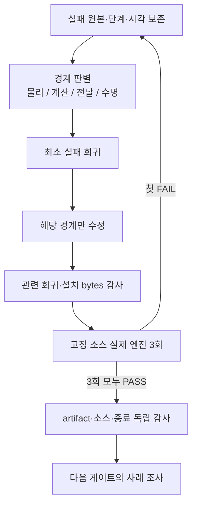

# 13.5 G1 교정·종료 검증 결과

2026-10-25. **MuJoCo와 Gazebo가 같은 런타임 소스에서 각각 3회 연속 G1을 통과했다.**
이는 정적 지지·carry·단일 발 교정 인수다. G2 연속 보행, Nav2 접근, 13.3/13.4 최종
전체 회귀와 13.5 원격 게시를 완료했다는 뜻은 아니다.

## 고정 검증

공통 source manifest SHA256:
`34f193697acb681c8d741999149785b3a49cab0f2b0b164afcbcad9a42e4bd92`.
114개 런타임 소스·설치 bytes를 묶었다. 시험 시점 HEAD는 `3fd278c6078d2e941a60d07476d7866b2ecea598`이며,
각 manifest의 dirty_scope와 압축본에 실제 시험 소스를 보존했다.

| 엔진 | 실행 UUID | 필수 검사 | 정상 부모/엔진 종료 | 강제 정리/잔여 |
|---|---|---:|---|---|
| Gazebo | `9a84b6f2-bec2-48e7-9ce8-5b8cc47ccb54` | 25/25 | 0 / 0 | 없음 / 없음 |
| Gazebo | `02c5c7e1-77d0-45b4-9cb1-2739618b91ee` | 25/25 | 0 / 0 | 없음 / 없음 |
| Gazebo | `af6da055-d082-43cc-a1b2-fe394ac7acee` | 25/25 | 0 / 0 | 없음 / 없음 |
| MuJoCo | `db816a78-a140-4932-873a-445671bf0280` | 23/23 | 0 / 정상 | 없음 / 없음 |
| MuJoCo | `8df657f3-0186-4b28-8b20-492ee5fa842b` | 23/23 | 0 / 정상 | 없음 / 없음 |
| MuJoCo | `99bfdd00-b83c-4340-be21-9fb68f812cac` | 23/23 | 0 / 정상 | 없음 / 없음 |

Gazebo series: `58c7013c-863d-469a-8ff6-1863be26a9d1`.
MuJoCo series: `4838bfd2-55fc-43d9-8ead-b515ece094c5`.
각 series는 첫 FAIL에서 중단하는 사전 정의 3회 검증이다.

독립 감사 `task8-current-g1-audit-7a9766b9-3c99-43e4-9a1d-89fc29b56e29.json`은
6회의 required_checks, 현재 소스, 모든 등록 artifact, 압축본 크기/SHA를 다시 대조해 PASS했다.

## 해결한 경계

1. **물리 접촉:** 0 허용 오차의 DART에서 나노미터 수준 분리→한 step 접촉 손실→복원
   충격을 관측했다. 승인된 G1 전용 50µm 비교에서 실제 getter·같은 PID의 라이브러리·
   실제 하중을 검증했다. 형상/질량·마찰·2ms·게인·30Nm은 유지했다.
2. **참조와 측정의 구분:** 명령 높이 3mm 상한에서 실제 발은 하중을 받는데 전처리가
   멈췄다. 같은 몸체 좌표계의 관절 FK로 남은 추종 압축 여유를 구하고 그 절반만
   사용한다. 원래 preload로 유계 복귀하며 실제 접촉과 관절/몸체 안정화를 별도로 요구한다.
3. **실행 비용:** 고주파 wait-set 반복 비용을 프로파일과 실제 DDS로 분리했다.
   기본 경고 이벤트 비용을 줄이고 기존 직렬 역할만 공식 EventsExecutor로 옮겼다.
   1,600개 전수신 비교 CPU345.036→196.143ms. 이 수치를 물리 성공으로 대체하지 않았다.
4. **메타데이터:** event 실행기의 tuple 전달 차이를 실제 DDS로 재현했다. Ch13 adapter는
   원본 message/MessageInfo·required signature를 보존한다. 촬영 시각을 바꾸지 않는다.
5. **콜백 종료:** crawl은 기존 DrainingExecutor의 pool join→guard 해제를 재사용한다.
   기존 2worker·수신 그룹·독립 팔 결과 receiver와 실제 terminal 확인을 유지한다.
6. **부모 종료:** direct Gazebo action에 빠졌던 공식 `on_exit=Shutdown()` 수명 연결을
   보완했다. 엔진 PID 소멸과 launch 이벤트 완료를 구분해 부모를 신호 없이 유계 대기한다.
   timeout과 SIGTERM/SIGKILL은 정상 종료로 인정하지 않는다.

## 실패와 검증 한계

`ebb5ab24` series는 첫 회 PASS 후 둘째 `f1b9b848`의 부모 종료 실패에서 중단했다.
엔진/runtime exit0이어도 부모-15·forced_cleanup=true이므로 23/25 FAIL이다. 원래 JSON은
중단 당시 RUNNING으로 남았고 공개 원장에 실제 종결을 명시했다. 종료 연결을 고친 뒤
새 소스의 series를 처음부터 수행했다. 실패를 제거하고 성공만 추리지 않았다.

원래 G1 10wall초, 실제 lift≥5mm/3고유 촬영, 관절 오차·속도·하중·지지·carry·
원래 참조 복귀와 연속 1wall초 안정화 기준을 유지했다. Gazebo의 relay100/ramp20ms/
50µm는 여전히 **G1 검증 전용**이다. 일반 CRAWL로 자동 승격하지 않는다.

현재 navigation/runtime 회귀는 앞부분460통과 후 옛 G1 계산 수 기대값을 교정하고
남은73통과로 전 범위를 확인했다. 공유 fixture/옛 기대값의 원래 실패도 보존했다.
종료 연결 변경 후 영향받는 실제 launch·장면·감사·실패 보존22개를 다시 통과했다.
최종 전체 matrix는 G2 이후 별도 동결본으로 실행해야 한다.

## 실행·증거 위치

공개 evidence 기준:
`Ch13/evidence/section_13_5/85670137-e73c-4c72-bcb2-0c73e755088b/`.
각 실행의 result/teardown/source_manifest/install_manifest와 ZIP 및 SHA ledger가 있다.
소유 엔진의 native 원본과 저장소 복사본을 보존했다. 실행 명령은 각 result의 command,
환경은 environment에 기록한다. 원본 실행/압축/독립 감사 명령은 작업 원장에 남겼다.

독립 감사는 `audit-current-g1-series.py`, 사전 고정 series는
`verify-fixed-g1-gazebo-series.py [gazebo|mujoco]`로 수행했다. 두 도구는 실측 성공을
생성하지 않고 기존 결과와 bytes를 검증한다. 코드 수정 후에는 과거 PASS를 재사용하지 않는다.
