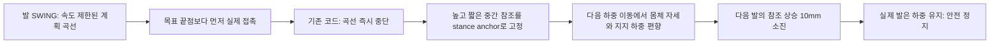
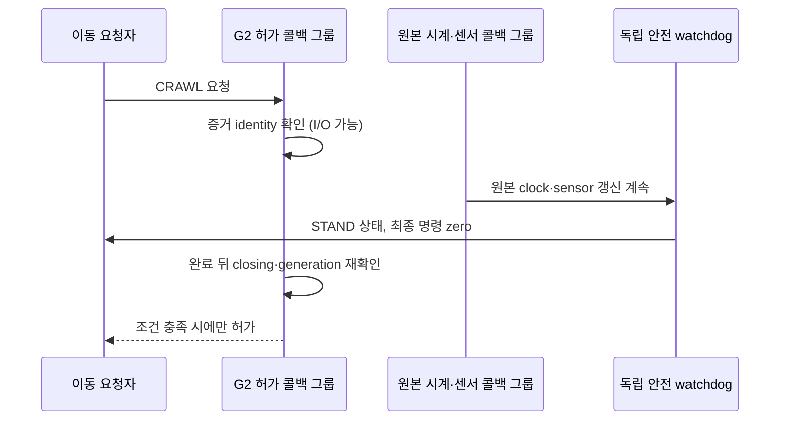
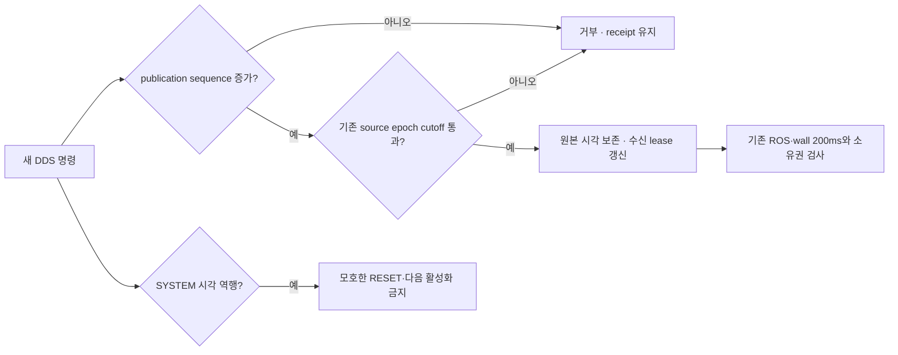
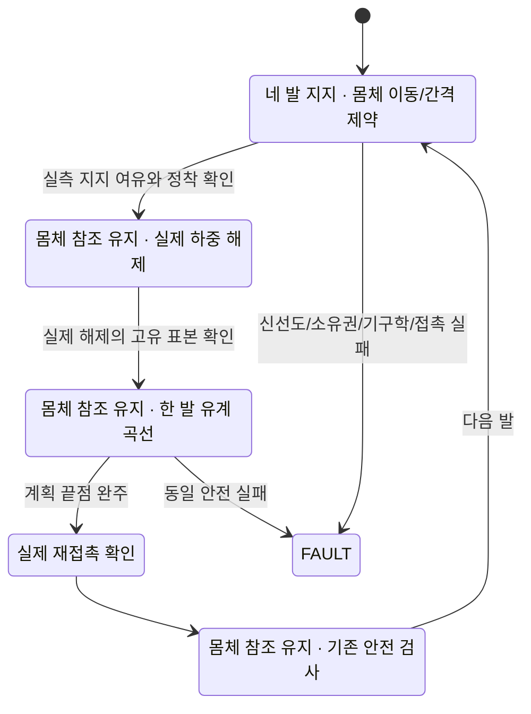
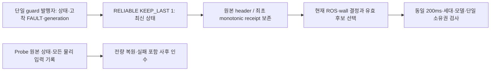
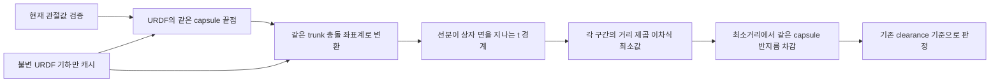

# 13.5 G2 실제 보행 실패와 판별 기록

2026-10-25. 기본 저속 crawl의 실제 인수는 진행 중이다. G1 성공은 G2나 Nav2 성공을 의미하지 않는다.

## 첫 실제 G2: 접촉과 명령 궤적의 완료를 혼동

현재 G2 구현을 포함한 고정118소스에서 전체 N/R 테스트600건, 설치 감사8건을 통과한 뒤,
새 MuJoCo G1 `8d9364b7-42be-44dd-b0b0-ec89b1a9dfe1`은23/23 PASS했다.
같은 소스·설치·장면으로 실행한 G2 `99ee5235-7e1d-4d7f-80c1-c817b3b6b9e7`은
FL, RR 두 발 이동 뒤 FR 하중 해제 중 `measured unload height bound reached`로 FAIL했다.
실패는 정상 보존한다. 부모/엔진 exit0·회수·강제 정리 없음·잔여[]는 확인했지만,
물리 STOPPED·건강한 런타임 인수는 실패했다. 종료 코드만으로 성공 처리하지 않는다.

이 오류의 10mm는 **명령 참조가 올라간 거리**다. 실제 발이 10mm 들렸다는 뜻이 아니다.
실패 순간 저장된 관절각·몸체 자세·접촉을 읽어 다음을 계산했다.

| 관측·계산 | 값 | 의미 |
|---|---:|---|
| FR 제외 실제 CoM의 지지 여유 |17.675mm|기존10mm 기준 충족. 지지 여유 부족이라는 가설은 이 순간의 원인이 아니다.|
| 참조 몸체·명령 관절로 예측한 지지 여유 |22.101mm|실제 값과 다름. 명령값으로 실측을 대신할 수 없다.|
| FR 실제 FK 높이−초기 실측 바닥 |0.581mm|10mm 참조 상승과 실제 lift는 다르다.|
| FR 실제 하중 |20.258N|발은 아직 하중을 받고 있었다.|
| FL 목표 높이−초기 실측 바닥 |7.388mm|이전 착지에서 미완성 높은 참조가 남았다.|
| FR 실제 q를 참조 몸체에 놓은 높이 |28.247mm|참조 목표27.608mm에 가까움. 관절 추종만 보면 몸체의 변위를 놓친다.|

위 값은 기존 엔진 로그에서 유도한 오프라인 계산이다. 새 물리 실험 결과가 아니다.
원본 `controller_report.json`, `frames.json`과 별도 `unload-derived-postmortem.json`을 함께 보존한다.
단계별 실제 접촉·높이·native CoM도 분석 파일에 기록했다.



코드와 회귀에서 C→D의 결함은 확인했다. D→F가 이번 물리 실패의 충분한 원인인지는
수정 후 새 실제 G2로 검증해야 한다. 여러 원인을 단정하거나 하중·높이 한계를 높이지 않는다.

## 최소 변경의 계약

정상 crawl의 이미 계산된 곡선을 기존 최대0.02m/s 이내로 끝까지 수행하고,
그 끝점부터 별도 TOUCHDOWN 접촉 확인·필요시0.002m/s 탐색을 한다.
접촉 후에도 계획된 참조 복귀를 완료한다는 원리는 이미 G1에서 검증한 원래 참조 복귀와 같다.
G1 전용 수직 궤적 자체는 변경하지 않는다. 명령을 측정된 압축 위치로 순간 이동시키지도 않는다.

기존 `test_landing_continuity.py`의 '접촉이면 즉시 궤적 중단' 가정은 실제 G2가 반증했다.
그 테스트를 지우지 않고 '동일 시각의 명령 연속성'으로 바꾸며, 새 테스트는
접촉 후에도 속도 상한과 원래 계획 끝점 완료를 함께 요구한다. 기존 접촉 반동·실측 압축 시
참조 점프 금지 테스트는 유지한다. `test_planned_landing_completion.py`의 최초 RED는
예상 끝점보다13mm 높은 참조가 SETTLE로 넘어가는 것을 실제 코드 경로에서 재현했다.
이상 피드백 테스트는 명령 계약 회귀이고 물리 보행 성공의 증거가 아니다.

게인·30Nm·형상·마찰·물리 주기·10mm unload 상한·접촉 하중·실제 안정화·센서 freshness·
G1 10wall초·TF/관절/명령 단일 소유권·기존 G2 인수 기준은 유지한다.
수정 뒤 소스가 바뀌면 이전 G1 성공을 재사용하지 않고 새 일치 G1 증거부터 만든다.

## 재현·출처

- 첫 G2 원본 디렉터리: `Ch13/evidence/section_13_5/85670137-e73c-4c72-bcb2-0c73e755088b/native-g2-mujoco-99ee5235-7e1d-4d7f-80c1-c817b3b6b9e7/`.
- 고정118소스 manifest SHA: `b75af9c06d1692d394ab560f09d4e9cba6f629dc1491cf13f990c05c25226e08`.
- 보존 ZIP: `task8-g2-first-mujoco-99ee5235.zip`, 21,015,127bytes,
  SHA `6db8cf1443c4555f46ecad5d6491b937ebbd7eb4de3614b10e9bc87d573bfa28`.
- 회귀 fixture `test/fixtures/g2_99ee5235_unload.json`은 실제 q/body/contact와 원본 보고서 SHA를 담는다.
  외부 소스 복사나 과거 촬영 시각의 재기입은 없다.

아직 G2 반복 성공·Gazebo G2·실제 Nav2 종단·최종 전체 회귀·원격 push는 미완료다.

## 수정 후 첫 실행: 허가 서비스와 시계 수신의 실행 수명

착지 끝점 수정본의 새 MuJoCo G1 `3542bc49-2b0c-4260-8eaf-cb2d413c647a`은23/23 PASS.
동일 소스118개 manifest SHA `dd0b3edd219b8c9d79eaeb2ae8de20de48211314e67cd71c588ec8ba4922ab2b`의
첫 G2 `3299043b-6c3e-46ca-bbe7-3bba8adaf506`은 CRAWL 서비스 응답 전에
`crawl:guard:ros_age`로 FAIL했다. 보행에 진입하지 않았으므로 착지 수정의 물리 효과는
아직 판정할 수 없다. 이 실패를 제외하고 같은 소스의 성공 횟수를 다시 세지 않는다.

`controller_report.first_stop.guard_receipts`에서 수신 wall 시각은 계속 증가했지만
guard의 원래 ROS stamp31.188초가31.375초까지 반복됐다. crawl은31.390초에
200ms 기준을 넘겨 중단했다. 이는 'guard callback이 없었다'는 증거가 아니다.
독립 watchdog은 계속 발행했고, 그 프로세스의 ROS 시계가 갱신되지 않았다.

실제 G1 증거20파일의 준비된 identity 검사10회는 무구동 상태에서도47.5–60.5ms wall,
2.1–2.8ms CPU가 걸렸다. 측정 파일은 `task8-prepared-admission-cost-78b6d28a-*.json`이다.
캐시가 내용 해시 재계산을 없애도 파일 시스템 I/O를 없애지는 않는다.
이 비용만으로 해당 실행의 전체200ms를 단정하지 않는다. 이벤트 큐 대기·실제 부하가 추가될 수 있다.

실제 DDS 회귀에서 허가 identity 검사 경계를 의도적으로 지연했더니, 기존 직렬
EventsExecutor는 원본 /clock dispatch까지 멈췄다(RED1FAIL9.39초).
원인을 재현한 뒤 G2 guard의 서비스에만 별도 MutuallyExclusiveCallbackGroup과 기존
Ch13 DrainingExecutor 두 worker를 적용한다. 기본/G1 guard와 다른 직렬 역할은 그대로다.
증거 검사 완료 전에는 STAND를 유지하고, 완료 뒤 closing/generation을 다시 확인해야
이동 허가를 발행한다. 서비스 중 검사 시작/종료의 원본 ROS·wall 시각도 기록한다.
반환된 ROS 시각을 now로 위조하거나 freshness 기준을 늘리는 변경이 아니다.



3299043b의 부모/엔진은 exit0·회수·강제 없음·잔여[]였으나 실제 STOPPED 인수 실패는 유지한다.
보존 ZIP `task8-g2-landing-first-mujoco-3299043b.zip`7,362,816bytes SHA
`a897bf88699cb32c910b2180c8975d8d099539667f15ccb7232f1b68d7df90b8`.

## 실제 네 발 이동 후: 관측 이력과 실시간 작업의 메모리 수명

허가 분리 수정본 G1 `cb81269f-7182-4e0a-ac12-c5ff4aca8bb5`23/23 PASS 뒤,
동일 고정118소스의 G2 `6cee0671-849f-4cf9-82e8-4b69ef99b117`을 실행했다.
실제 허가 검사는157.15ms wall이었고 원본 ROS 시계도156ms 갱신됐다.
이 실행에서 허가 시계 정체는 재발하지 않았고, 이전 FR 실패를 지나 네 발의 첫 이동을 수행했다.
그러나 약103ROS초에 관측 측 `native movement body:ros_age`와 guard의 `raw:ros_age`로 FAIL했다.
착지 수정만으로 전체 성공했다고 쓰지 않는다.

명령원과 관측기는 다른 executor thread지만 **동일 Python 프로세스**였다.
첫 중단 직전 명령 간격235.535ms와 관측 프레임 간격240.250ms가 겹쳤고,
그보다 앞선 공통 지연도 약58→99→131→208ms로 증가했다. 프로세스 공통 정체를 시사한다.
부하가 다른 child의 제어 callback 부재나 llvmpipe만으로 설명하지 않는다.

실제 관측 JSON의4,667프레임/4,854 native controls를 오프라인 할당 재생했더니,
전체 보존 시 generation2 GC 최대129.31ms, 최근128개 보존 시3.924ms였다.
동일 원본 전량을 읽었다. 오프라인 재생은 실제 엔진의235ms가 전부 GC였다는 증거는 아니다.
다만 누적 이력이 살아 있는 동안 메모리 회수 스캔 비용이 커지는 경로를 판별했다.
실제 다음 실행에는 GC 정책을 바꾸지 않는 시작/종료 wall 계측도 남긴다.

G2 관측기는 frame/native controls/몸체 참조/TF 각각 최근128개만 live cache에 둔다.
원본 header·receipt·sequence와 모든 표본은 `observations.jsonl`에 계속 기록한다.
엔진 종료와 receiver join을 확인한 뒤 전체 원본을 복구하며, 기록 건수와 복구 건수가
일치해야 한다. 최종 물리/센서/TF 검사는 최근 cache가 아니라 복구한 **전체** 기록으로 수행한다.
잘린 JSON·누락·건수 불일치면 FAIL이고 일부 cache로 검사하는 fallback은 없다.
기본 G1 메모리 경로는 그대로다. 안전 기준·발행 주기·관측 시각은 바꾸지 않는다.

새 회귀는 구현 전 실패를 확인했고(신규 모드 없음), 원본600개→live128개→전체600개 복구,
원본 식별자 보존·join 전 복구 금지·잘린/누락 journal 거부를 검사한다.
관측/실제 DDS/종료/허가 관련30건 PASS20.46초. 아직 이 변경의 실제 G2 성공은 미검증이다.

6cee0671 원본은 정상 회수·강제 없음·잔여[]지만 STOPPED 인수 FAIL로 보존한다.
ZIP `task8-g2-isolation-first-mujoco-6cee0671.zip`37,058,740bytes SHA
`877b15ac360ba3c08e8e325ea49ac7186d42b0e4b4b08d78c4cfea7b25452eae`.
`ingress-gap-postmortem.json`은 별도 오프라인 계산이며 원본 결과를 덮어쓰지 않았다.

## 메모리 분리 뒤: 그리퍼 실제 속도와 합성 몸체 참조

새 G1 `1132a704-2511-43d2-8ac0-c39a1e443a45`23/23 PASS 뒤 동일 소스118개
manifest SHA `d20447482f8d96c481a90810999eac1dcace607b603aafd8c9daabb172c7e9e4`로
G2 `206ac77a-c73e-4372-84d3-42dbac6bfaa5`을 실행했다. 약76.794ROS초에 carry가
`measured carry posture lost`로 먼저 실패했다. 후속 `carry:not_ready_or_binding`을 최초 원인으로
바꾸어 쓰지 않는다. 팔6관절은 범위 안이었지만 실제 손가락 속도±0.00507195m/s가
기존±0.005m/s를 넘었다. 과제 성공을 위해 이 기준을 넓히지 않는다.

관측기는3,659프레임/3,667 native controls를 전량 복구했다. live cache는각128개였고
구동 중 기록된 최대 GC 지연12.297ms였다. 정책 변경은 없다. 이전 실패가 전부GC 때문이었다는
확정은 아니지만, 누적 메모리를 줄인 실제 효과와 이번 최초 물리 실패를 구분할 수 있다.
원본 carry/body/contact 분석은 `carry-derived-postmortem.json`에 별도 보존한다.
정상 프로세스 회수·강제 없음·잔여[]지만 전체 G2는 FAIL이다.
ZIP `task8-g2-bounded-first-mujoco-206ac77a.zip`27,261,055bytes SHA
`eb3f8b4270f4a56a780af20a26a06a42979c2aadb2a2d4fcd4cbc1adba026f08`.

기존 가속도 검사는 G1의 명령0인 내부 지지 offset만 검사했다. 일반 보행은 여기에
전진/회전 travel을 더한다. 단계별 이동 거리만 제한하고 시간 진행은 선형으로 잘랐으므로,
SWING→TOUCHDOWN에서 몸체 참조 속도가 갑자기 바뀌었다. 실제 코드 경로의 새로운 산술
회귀는 가속도0.487366m/s²로 기존0.1m/s² 초과를 RED로 재현했다(9.24초).
이 결함은 확인했지만 해당 순간의 모든 손가락 진동이 이 결함 하나 때문이라는 뜻은 아니다.

수정은 가속도 수치를 낮추어 차례로 시험하는 방식이 아니다. 정상 보행의 travel도 지지
offset과 같은 quintic 시간 법칙으로 바꾸고, 합성 가속도와 현재 입력 ramp·회전 항의 예산을
해석적으로 계산한다. 단계별 travel 예산0.7/0.8/0.25/0.25의 합과 보폭은 그대로다.
곡선의 시작/끝에서 속도·가속도는0이고, 지지 대기 중 추가 거리를 적분하지 않는다.
입력은 매 tick의 현재 명령을 사용하며, 예전 명령을 고정해 재사용하지 않는다.

`s(u)=10u³−15u⁴+6u⁵`에서 `max|s'|=1.875`, `max|s''|=10√3/3`다.
travel의 입력 ramp 기여를 절반 이하로 제한하려면 `T≥3.75×단계 travel 예산`이다.
남은 선형 가속도 예산은 기존0.1에서 입력가속도 기여0.5×0.02와 회전기여
0.25×0.01×0.03을 뺀 값이다. offset과 travel의 변위 상한을 이 예산에 넣어 최소T를
계산한다. 각 가속도도 기존0.06rad/s²에서 같은 방식으로 제한한다.
게인·토크·마찰·형상·물리 주기·안전 측정 기준은 바꾸지 않는다.

접촉이 없는 정상 TOUCHDOWN의 탐색 timeout1초와 탐색 속도0.002m/s는 유지한다.
이미 접촉한 발은 연속 몸체 곡선의 남은 시간을 기다리고 나서 SETTLE로 넘어갈 수 있다.
명시 STOP의 별도 착지 timeout, 실제 STOPPED1ROS+wall초, G1 전용 궤적/10wall초는 그대로다.
관련43건 PASS41.26초이며 방향별 추가 산술 회귀와 새 실제 엔진 검증이 필요하다.

## 연속 몸체 참조 뒤: 실측 착지점과 명령 참조의 분리

전후진/회전/복합과 입력 ramp8건 PASS20.04초, 새 G1 `fb3cbe99-02f8-4bb3-bd29-913d7fcb7882`
23/23 PASS 뒤 동일 고정118소스 manifest SHA
`ea4072d639e0fcf6e1f3298b16edd134d5e2bf9b7a269405f6281b4d25a1700e`로 G2
`69f58225-2a9f-45d3-b389-c212c647453a`을 실행했다. 이전 carry/age 실패 시점을 지나
약0.19m 전진했지만272.702ROS초 FL TOUCHDOWN 중 `stance slip`으로 FAIL했다.
원본13,383프레임/12,973 controls를 전량 복구했고 실제 GC 최대10.537ms였다.
성공을 골라 세거나 이 실행을 인수 성공으로 바꾸지 않는다.

실패 순간 RL 발의 명령 참조까지 거리20.0039mm가20mm 기준을 넘었다.
하지만 마지막 **실측 착지 이후 실제 이동은6.3412mm**였다. FR2.527mm/RR6.383mm도
기준 안이었다. 당시 움직이는 FL은 stance 판정에서 제외한다.
`stance-anchor-derived-postmortem.json`은 단계 전환 직후 실측 landing과 최초 실패의
관절·몸체 FK를 연결해 두 거리를 구분한 오프라인 계산이다.

기존 코드는 reset에서 `anchors=실측`, `_targets=명령`을 구분했지만 정상 착지에서
`anchors=_targets`로 다시 합쳤다. 그 뒤 `anchors`를 실제 미끄러짐 검사와 명령 보폭 예측
양쪽에 사용했다. 명령 추종 오차가 실제 접촉점 이동처럼 누적된 것이다.
두 값은 같은 world 좌표를 쓰지만 **측정과 명령이라는 의미가 다르다**.

새 회귀는 실제69f58225의 q/body/contact/ref를 보존한 fixture로 TOUCHDOWN→SETTLE을
오프라인 재생한다. 발이 움직이지 않은 두 번째 tick에서 기존 코드가 `stance slip`을
발생시키는 RED1FAIL6.36초를 확인했다. 실제 기록의 원래 phase를 재현했다고 주장하지 않는
반사실적 전이 검사이며, native 보행 성공의 대체물이 아니다.

수정은 정상 착지의 `anchors`를 실측 FK 중심으로 저장하고 `_targets`는 완료한 명령 그대로
유지한다. 명령 보폭 예측은 `_targets`를 사용한다. 별도 회귀는 착지 뒤 실제21mm 이동이
여전히 FAIL인지 검사한다.20mm 한계를 높이지 않았고 실제 미끄러짐을 무시하지 않는다.

같은 혼동을 명시 STOP에도 점검했다. 실제 기록 상태에서 접촉 순간 명령0.034937rad 점프를
RED1FAIL6.44초로 재현했다. STOP의 첫 참조는 마지막 발행 명령으로 시작하고 접촉 뒤에도
그 명령을 실측값으로 되감지 않는다. 실측 접촉·속도·정착으로 STOPPED를 확인하는 기준과
기존 STOP 시간·궤적 끝점은 유지한다. 이 수정의 다음 실제 G2 효과는 아직 미검증이다.

69f58225 원본1.29GB는 전량 보존했다. ZIP107,195,528bytes는 로컬 원본으로 두고,
Git용72,000,000/35,195,528bytes 조각으로 분할한 뒤 연결 SHA를 원본과 대조했다.
전체 SHA `2c0dfc41f67b3c6c307847c42a9a3a65115d3ce561c51dfe1ea0907c5ad3092a`.
`task8-g2-continuous-first-mujoco-69f58225.json`에 각 조각 크기/SHA와 모든 원본 member를 기록했다.
프로세스 정상 회수·강제 없음·잔여[]와 물리 STOPPED 인수 FAIL은 구분해 보존한다.

## 실측 기준 분리 뒤: 센서 capture→수신 지연의 경계 판별

관측/명령 참조 분리와 STOP 연속성 수정 뒤 관련56건 PASS53.52초,
navigation/runtime 전체617건 PASS358.90초, 설치 감사8건 PASS를 확인했다.
그 고정118소스 manifest SHA `f3925d5d04542da5851db2e0d32680c54f9a85025eaee6946a0b8084675bfd28`의
새 G1 `bd53f5a0-b58b-4503-a02b-61cb8b97bf43`은23/23 PASS했다.
동일 설치 G2 `dfea9e68-c83b-4ebb-95d3-c768ee3332c1`은 관측 측
`native movement contacts:ros_age`로 FAIL했다. kernel의 first_fault/first_stop은 없었다.
이번에는 실제 measured stop·deactivate·carry terminal·native stop·consumer 종료가 모두
성공했고 엔진/부모 exit0·회수·강제 없음·잔여[]였다. 전체 이동 인수 실패와 정상 정지는 구분한다.
ZIP12,776,221bytes SHA `0dd0b6560c23c97dfcc64026a8bff70f19e85a744749620d2c51d6e63702ffd2`.

최근 수신 후 wall age18.877ms인 접촉이 capture ROS age224ms였다. 접촉 callback은 계속
들어왔고 같은 native snapshot의 controls도 지연된 흔적이 있다. 수신기 부재로 단정하지 않는다.
native 몸체 원본 DDS 발행 시각에서 추정한 capture→접촉 수신 지연은 최대약219.6ms였으나
가장 가까운 몸체 capture 차이가8ms여서 정확한 구간 분리 계측은 아니다.

오프라인 분석v1은 정규화된 `Sample.sequence=capture stamp`와 native lease 순번을 잘못
연결했다. v1을 증거로 사용하지 않으며 보존한 v2에 교정을 명시했다. capture로 정확히 연결하면
800ms 구간에 controls와 대응되지 않는 접촉 capture는2개였다. 모두 누락됐다고 해석하지 않는다.
정규화 의미는 유지하고 별도 transport trace에 원래 native sequence/epoch를 기록한다.

다음 판별은 G2에만 FootContacts와 native controls의 원래 DDS source timestamp,
RMW received timestamp, callback system/monotonic 시각을 추가하는 것이다.
이로써 발행 전 처리·DDS 전달·Python callback 대기를 구분한다. 원래 capture/제한값,
executor/QoS/native publisher 행동은 아직 바꾸지 않았다.
실제 DDS RED1(계측 없음)→관련22PASS44.62초. 새 계측 후의 실제 G2는 미검증이다.

## 04d65307: 콜백 대기와 기록 프레임의 결정 시점 혼동

새 transport 계측 소스118개 manifest `46b8df5b585ac6eb97f82b3bafb35211095f4d171475a96cd91430a58c0b13db`에서
G1 `0374f925`23/23 PASS 후 같은 모델/설치로 G2 `04d65307-094d-4bda-9216-84e8353826d0`을 실행했다.
G2는 `native movement body:ros_age`로 FAIL했다. 이후 정리 중 guard의 `raw:ros_age`가 보고됐다.
따라서 후자의 정지 사유를 최초 실패와 혼동하지 않는다. 물리 measured_stop/deactivate는 FAIL,
carry terminal/native worker/consumer 종료와 엔진 exit0/부모 회수/강제 없음/잔여[]는 확인했다.
실패 원본 ZIP28,611,118bytes SHA `0830bd51469fd488f5ec8a4aa96b15cd7a78ecf3cad2a8dafa28a1ff2d6446b0`.

`decision-edge-postmortem.json`의 최초 전진→0 명령 경계 전 실제 순서는 다음과 같다.

| 사건 | 원본 monotonic ns | 원본 ROS 촬영/결정 ns |
|---|---:|---:|
| 기록 frame의 body 수신 |219317838729|85791999999|
| 기록 frame 생성 |219362271487|결정85981999999: body age190ms|
| 더 새 body 수신 |219365317937|85835999999|
| 최초 0 명령 발행 |219376321787|최초 예외 이후|

이전 runner는 기록 타이머의 `latest_frame()`을 선택한 후 별도로 읽은 더 나중의 ROS now로
다시 유효성을 검사했다. 새 body가 이미 도착했어도 기록 타이머가 아직 실행되지 않았다면
190ms 표본을 선택해 추가 시간만큼 만료시켰다. 두 시점의 경쟁을 오프라인 회귀로 재현했다.

최소 수정은 G2 도착/정착 결정에서 수신함 lock 아래 원본 ROS/wall 결정 시각을 한 번 읽고,
그 시각 이전 촬영·수신된 body/contact를 직접 선택하는 것이다. 원본 촬영/첫 수신 시각을
바꾸지 않고 200ms를 그대로 검사한다. 기록 frame과 전체 사후 물리 평가는 유지한다.
각 결정은 원본 표본·결정 시각과 승인/거절 이유를 `movement_decision`으로 남긴다.
새 데이터가 없는 경우 기존 만료 오류가 계속 발생하는 음성 회귀도 포함했다.
RED1FAIL9.21초→관련25PASS21.62초. 실제 수정 후 G2 효과는 아직 미검증이다.

한편 전송 계측은 수신→콜백 대기(contact 최대156.5ms, controls281.5ms)를 확인했다.
최초 경계의 body는 DDS 전달0.124ms/콜백 대기182.645ms였다. 원래 촬영 시각이 있는 새
body도 대기했으므로 관측 선택 수정만으로 모든 지연 원인이 사라졌다고 주장하지 않는다.
전체 최대값에는 시동/정리 구간도 포함된다. 상세 원본 구간은 transport/common-stall/
decision-edge postmortem 세 파일에 보존하며, 실제 보행을 다시 확인해 남은 원인을 좁힌다.

## 3127f15e: 최초 실제 보행의 도달 범위 경계와 중립 발 위치 가설

관측 결정을 원자화한 소스118개 manifest `d044e1588f302cfa68fd4f92ccdfa3913e5ebf8100198a62b2a5b1129db5aece`에서
G1 `4e7ee50b`23/23 PASS, 정상 종료를 확인했다. 같은 설치 G2 `3127f15e-33dc-4697-b400-90687d0a20b7`은
349.300ROS초, 실측 약0.268m 전진 뒤 `ik footprint joint bound`로 FAIL했다. 이전 시각 오류로
중단되지는 않았으나 장시간/양 엔진의 모든 시각 지연을 해결했다는 증거로 확대하지 않는다.
실제 measuredSTOP은 FAIL, deactivate/carry terminal/native worker/consumer/engine0/부모 회수는 확인했다.

`ik-workspace-postmortem.json`은 실제 최초 오류의 원본 joints, reference_body, world target을
동일 URDF의 분석 IK로 계산한다. FL 목표는 world(0.651907,0.180000,0.019177)m,
body(0.363168,0.217890,-0.440538)m, calf0.79980582rad로 기존 footprint 하한0.8rad를 넘었다.
그 순간 실측 calf0.80232187rad와 원래 명령 한계 초과는 구분한다. 값 clipping이나 한계 완화는 하지 않는다.
다른 세 발 IK는 기존 범위 안이었다. contact/관절 측정과 이후 carry 연쇄 오류를 최초 원인과 분리한다.

반대로 **이상적 피드백의 기존 수식 재생은 travel0.45m까지 통과**했다
(`task8-g2-travel-cycle-replay-before.json`,18,746tick). 따라서 기존 수식이 모든 조건에서
반드시 누적 발산한다고 단정하지 않는다. 실제 preload·몸체 추종·support shift와 최악 순간의
발 도달 범위가 결합한 문제다. 기존 보고서에 travel/offset 내부 분리가 없어서 그 기여를
원본 데이터만으로 완전히 복원했다고 주장하지 않는다.

다음 수정 가설은 이전 world endpoint+전체8초 travel 보폭 누적 대신, **중립 발 위치 중심으로
다음 지지 구간을 배치**하는 것이다. 기존 코드의 첫 SWING은 중립점보다 전방73mm이며,
remaining swing0.8+다음 stance budget7.2의 절반으로 중심을 잡으면44mm다.
이 균형 조건을 실제 advance 경로에서 RED1FAIL7.55초로 확인했다.

참고한 성공 사례의 원문은 libchamp 고정커밋 `8c50f649b3fd28a123beaf6f9618ddfaa1589559`의
[leg_controller.h](https://github.com/chvmp/libchamp/blob/8c50f649b3fd28a123beaf6f9618ddfaa1589559/leg_controller/leg_controller.h)와
[trajectory_planner.h](https://github.com/chvmp/libchamp/blob/8c50f649b3fd28a123beaf6f9618ddfaa1589559/leg_controller/trajectory_planner.h)다.
실제 코드의 zero stance·half stance 위치 원칙과 BSD-3-Clause 라이선스를 확인했다.
외부 소스/게인/Bezier 궤적/보행기를 복사하거나 물리 성공으로 대신 사용하지 않았다.

Ch13 수정은 reset 때 보존한 명령 중립발을 **support offset을 제외한 travel 프레임**에서
예측한다. 남은 swing과 다음 지지의 절반인 travel budget4.4에 대해 현재 속도의 SE(2)
회전·원호 이동을 해석적으로 계산한다. 이는 실제 보행 주기가8wall초라는 뜻이 아니다.
현재 관절/TF/최종 명령 단독 소유자, 발 궤적의 시작 명령/높이/끝점과 속도 상한 계산,
보폭8cm·다리 범위·접촉·가속도·실측 미끄러짐 검사와 G1 전용 궤적은 유지한다.
이 후보의 실제 G2 효과는 새 고정 소스 시험 전까지 미검증이다.

실패 원본 ZIP160,160,295bytes SHA `2d16f8e40d0275f19b376edf64ad478894ccadd5b0387c0440baa431c499a54f`는
로컬 보존하고72MB/72MB/16,160,295bytes 조각의 연결 SHA까지 검증했다.
`task8-g2-decision-first-mujoco-3127f15e.json`에 전량 member·각 조각 SHA를 기록했다.

중립 후보의 첫 관련 회귀는22PASS 뒤 후발 다리 최초 목표의8cm 검사에서 FAIL했다. 목표 생성 단계의 기존8cm 거리 예산을 적용한 뒤 같은44건 PASS48.59초, 실제 실패 형상의 별도3건 PASS5.85초다. 이는 위험한 원래 목표를 계속 거절하는 검사와 명시적 반사실적 중립 프레임의 기구학 가능성 검사이며 실제 보행 성공이 아니다. G1/착지 회귀·설치 감사·새 실제 G1/G2로 이어간다.

## 46921c07: 명령 프레임의 절대 CoM과 실측 지지점의 혼합

중립 착지 후보의 G1 `5ea905a9`은23/23 PASS였으나 동일 소스 G2 `46921c07`은
433.744ROS초, 약0.382m 전진 뒤 RR `measured unload timeout`으로 FAIL했다.
기존 관절 경계 구간은 넘었지만 G2 인수 성공은 아니다. measuredSTOP은 FAIL,
deactivate/carry terminal/nativeworker/consumer/engine0/부모 회수·강제없음·잔여[]는 확인했다.
118소스 manifest `9e42586f4a93592c7f561d25d6f6b2cab34981968e27cf35d4b9d4dc9a6ade18`.
실패 ZIP205,251,613bytes SHA `733b09e012aeb4d852beeff0793701d6e27b93a4ea2e5510fbad378b71b358da`는
로컬 보존,72MB/72MB/61,251,613bytes 조각과 연결SHA 검증을 완료했다.

최초 오류의 실제 상태는 다음과 같다. 센서 수신 부재나 하중 탐색 상한 소진으로 단정하지 않는다.

| 값 | 실제 원본/동일 모델 계산 |
|---|---:|
| RR 제외 실제 지지 여유 |9.877044884mm (<기존10mm)|
| 명령 reference_body+IK 질량모델의 절대 CoM 지지 여유 |27.172126043mm|
| 위 CoM의 실측 대비 x/y 차이 |+23.5028/+4.3697mm|
| RR 접촉 하중 |8.16346N|
| 몸체 선속도/각속도 |0.000000505m/s /0.000002883rad/s|
| 명령 발 상승량 |6.644mm (<기존10mm)|
| unload 경과/기존 상한 |6.02초 /6초|

실측 여유가10mm보다 낮으면 settled가 false가 되어 발 상승을 멈추는 동작 자체는 안전 계약대로다.
실패의 상류에는 **실제 지지점과 명령 자세 모델의 절대 CoM을 결합한 낙관적 계획**이 있다.
명령 모델이 안전하다고 평가해도 실제 몸체는 추종·탄성 오차 때문에 다른 곳에 있다.
수신함 선택과 마찬가지로 좌표 이름이 같다는 이유로 측정과 명령의 의미가 같아지지 않는다.

새 `native_4692_support.json`은 원래 joints/body/contact/reference/targets를 보존한다.
그 형상에서 replan하면 기존 코드는 예측 여유27.17mm로 **0 이동**을 승인한다. 실측 기준
예상 여유는 그대로9.877mm에 머무는 실패를 RED1FAIL6.67초로 재현했다. 이는 오프라인 재계획
회귀이며 같은 시점부터 실제 엔진을 다시 돌렸다는 뜻은 아니다.

최소 수정은 일반 CRAWL의 계획만 다음 식을 쓰는 것이다.

`CoM_est(delta) = CoM_measured + CoM_IK(delta) − CoM_IK(0)`

몸체를 실제로 움직이지 않는 후보0의 예상값은 실측 CoM과 정확히 같고, IK·전체 질량 모델은
이동에 따른 변화량만 예측한다. 기본 목표 여유25mm와 실제10mm 검사·접촉·속도·하중·
6초/10mm/.002m/s는 유지한다. baseline 계산도 별도 yield로 분할해 normal 1후보/tick을
지킨다. G1 전용 calibration의 기존 절대 예측 경로·궤적·10wall초는 그대로 유지한다.
새 실제 인수 전까지 수정의 물리 성공을 선언하지 않는다.

실측 CoM 기준 변화량 예측은 실제 형상·계산분할·G1·일반 gait·가속도 관련48PASS59.62초,
Nbuild11.4초/설치 감사8PASS였다. 다만 새 G1 `8d7b5fd1-6345-4a44-b527-ac64ff587c83`은
35.742ROS초 G1 복귀 중 `measured carry posture lost`로 FAIL하여 G2를 시작하지 않았다.
손가락 실측 속도±0.00514751m/s가5mm/s를 넘었다. 촬영 age2ms, 팔 qd<0.011rad/s,
팔 오차<0.02rad, 원본 native 손가락 ctrl은 양쪽0.015m로 확인했다. 이때 CALIBRATING 상태라
새 normal CRAWL CoM 예측 경로는 실행되지 않았다. 따라서 그 수정이 이 실패를 해결/유발했다고
단정하지 않는다. 명령 유지·상태·실제 물리 속도를 분리한다.

이번 실패의 measuredSTOP/deactivate/carry terminal/nativeworker/consumer/runtime/engine0/부모회수는
모두 정상이며 강제없음·잔여[]였다. 전체 G1 FAIL과 구분한다.118소스 manifest
`a0d51d25827fedd7b8fb85438549974b1706d32946e21546649656f5633879f3`,
ZIP9,627,482bytes SHA `567a7ca91b55fe11b5907127ae8d91b517aff4e4259a577e1e13164c7e47fe21`.
원본 실패와 `carry-failure-analysis.json`은 보존했다.

## G1 복귀 충격 가설: 가속도 불연속을 없애는 시간 법칙

현재 MuJoCo는 이미2ms/implicitfast다. 명시 적분이나 부족한 damping으로 추측하여
물리 설정/게인을 바꾸지 않는다. 기존 복귀는 위로 움직이는 참조를 선형 제동한 뒤
삼각/사다리꼴 velocity로 원래 preload까지 돌아간다. 접촉 복귀 중 carry 실패가 있었고,
이 곡선의 가속도 단계 변화를 별도 수식 회귀에서 실제 RED로 재현했다.
20ms 표본의 jerk10m/s³이며 속도0.02/가속도0.2 이내라는 사실만으로 충격이 사라지지 않는다.
이 수식 문제와 실제 gripper 속도 초과의 인과는 다음 native 시험으로 판별할 가설이다.

새 후보는 upward brake와 return의 velocity ramp에 quintic blend `s(u)=10u³−15u⁴+6u⁵`를 쓴다.
위치에는 정확한 적분 `I(u)=2.5u⁴−3u⁵+u⁶`를 적용한다. ramp 시간은 원래 가속도 상한에서
`T=1.875·peak/0.2`로 정하고, 짧은 이동은 같은 거리 적분식에서 peak를 낮춘다.
기존0.02m/s와0.2m/s²를 높이지 않으며 acceleration을 제동/ramp/cruise/끝점에서 연속으로 잇는다.
제동 완료 시각을 정확히 사용해 별도 idle20ms를 추가하지 않는다.

원래 rest endpoint·접촉 뒤 참조 완주·4N/3고유 착지·owner의1wall초 정착·전체10wall초는 그대로다.
외부 코드/driver/underlay, 게인·30Nm·마찰·2ms·형상·질량·카메라는 바꾸지 않았다.
기존 preload/착지/시간 검사와 Python MuJoCo3.3.7 component를 포함한23PASS20.09초를 확인했다.
component는 ROS C++3.12 native 인수의 대체물이 아니다. 실제 native/양 엔진 성공은 미검증이다.
과거 Gazebo G1 세 실행의 STAND 후보 당시 남은 시간이2.563–2.949wall초였다는 자료는
후보 예산 검토에만 사용하며 새10초 인수 성공을 미리 보장하지 않는다.

## 305db3ec: 물리 carry 개선과 관측 수신 지연의 분리

새 G1 `305db3ec`은 전체FAIL을 유지한다. carry 소유자는 정상이며 손가락 최대속도
3.29619mm/s, arm최대0.01134rad/s였다. 새 return_plan의 quintic_velocity와 return_brake,
원래rest완주/3실측착지/남은4.480wall초를 확인했다. measuredSTOP/deactivate/terminal/
worker/runtime/engine0/회수·강제없음·잔여[]는 정상이다. 이 한 번의 결과는 물리적 인과나
3연속 성공을 확정하지 않는다. ZIP7,988,403bytes SHA `f9c3077cab676bc1d3e161794b9bd8d88ff03f873e109bf32888725046e535c4`.
118source manifest `fa34bd6e08f6358a95d3bdb899a7ceaddd0d8758de9a072715e72a1a63be4ce6`.

전체 G1 FAIL은 **복귀 전 STAND 기록**의 freshness에서 발생했다. 전량602프레임의
`freshness-postmortem.json`은 한 프레임에서 joints/imu/contact/body의 수신 후wall age
205–208ms, native CoM244ms, 이후scanROS age304/402/342ms를 확인한다.
해당 body의 정확한 DDS전달은0.1247ms, RMW수신→callback은161.1148ms였다.
scan의 경우 인접bodycallback137.9ms는 정황일 뿐 같은scan의 직접 전달 지연으로 단정하지 않는다.
C3 복귀가 시작되기 전이므로 이 관측 오류를 복귀 곡선 탓으로 해석하지 않는다.

관측 Probe는 여전히 기본 rclpy Node/대기집합 실행기를 썼다. 이미 Ch13의 직렬 navigation
노드에서 검증한 NavigationNode/공식7.1.12 EventsExecutor와 원본MessageInfo 어댑터를
Probe에도 재사용한다. Probe가 원래 직렬인 조건과 callback/worker join 순서는 유지한다.
ProbeReceiver는 소유node가 제공한 실행기 factory를 쓰고, 일반node와 G2CommandSource는
기존 SingleThread 경로를 유지한다. RMW/QoS메시지설정·촬영header/시계·안전age·GC정책은 바꾸지 않는다.

실제 DDS 원본메타데이터·sticky콜백예외·종료·전량기록 복구 관련15PASS23.54초를 확인했다.
첫 추가시험은 use_sim_time이0인데 오류 주입에 ROS타이머를 써 실행되지 않은 **시험 fixture오류**였다.
오류주입만STEADY_TIME으로 바로잡았으며 실패 로그를 보존했다. 제품의 시계/기준은 변경하지 않았다.
또 scan_transport 계측을 추가해 이후에는scan자체 DDSsource/RMW수신/callback 시각을 직접
연결한다. 계측 부재 RED1FAIL7.13초 후 원래capture/첫receipt를 그대로 기록하도록 구현했다.
실제 엔진의 수신 지연 해소와 G1/G2 성공은 아직 새 고정 소스 시험 전이다.

스캔 직접 계측과 Probe 실행기 수명 관련28PASS28.73초/설치 감사8PASS 후 새 G1
`09711391-a45c-4d08-ade4-fb68abf647f0`이23/23 PASS했다. 실제 수신 실행기는 EventsExecutor로
부모PID/스레드ID/설치 dependency fingerprint와 함께 기록됐다. 손가락 최대3.01630mm/s,
carry raw/owner와 freshness 모두 PASS, measuredSTOP/deactivate/terminal/runtime/engine0/
부모 회수·강제없음·잔여[]를 확인했다. 한 번의 G1 성공을3연속이나 G2/13.5 성공으로 확대하지 않는다.
118source manifest `4d84751c7591b41f9c0d115fa2df11dbd1fdf8cf98d191f9c14625d471e64f51`,
ZIP9,333,064bytes SHA `092a47e162587c7a5566b9092eb4c6d9c108e5185d1ebc07cd2fae22cc85ce84`.
같은 모델/소스/설치의 G2 `f4157cd3-e73c-4558-8533-f0d9ee06f9f2`는 아래 원인으로 FAIL했다.

## f4157cd3: 중간 정지의 의미와 SYSTEM 시각의 순서 혼동

이 실행은 실제 약0.40665m 전진 후 원래1ROS초·1wall초 실측 STOPPED까지 도달했다.
그러나 다음 좌회전에서 guard의 CRAWL 서비스는 승인됐는데 다리 소유자는 STOPPED에 머물렀다.
이는 전체 G2 성공이 아니다. 단계 사이 smoothed 명령이0이 된 직후 STAND를 요청하던 코드가
다리 수신과 경쟁해 명시 정지 latch를 걸었다. CRAWL 모드 ACK는 그 latch를 해제하는 물리 증거가 아니다.

기존 core의 명시 정지 계약은 유지한다. 단계 사이는 CRAWL 권한 아래0속도와 원래 실측 정착을
사용하고 최종 단계에서만 STAND를 요청한다. fault RESET/자동 재활성화는 추가하지 않았다.
실제 소유자의 CRAWL 상태가2초 안에 확인되지 않으면 긴 이동 제한시간 전에 실패시킨다.
명시 정지 latch를 모델링한 RED는 좌회전 timeout으로 실패했고 관련9건은11.26초에 PASS했다.

같은 실행의674.228ROS초 첫 정지 사유는 `final_command:ros_age`였다. 이를 callback 정체로
추측하지 않고 원본 source/RMW/수신 시각과 monotonic을 대조했다. `command-clock-edge-postmortem.json`에서
SYSTEM−MONOTONIC 차이가−2166.639ms 변했고 여러 DDS source 시각도 약−2140ms 역행했다.
반면 ROS·monotonic은 진행했고 raw 송신 최대 간격43.873ms, GC 최대12.378ms였으며
guard 수신은 신선했다. 이 명령 실패에서 단순 스레드 부족 가설은 기각한다.
운영체제 시각 조정의 주체가 NTP인지 WSL인지까지는 확인하지 않았고 시스템 설정도 변경하지 않았다.

기존 수신기는 조정 가능한 SYSTEM `source_timestamp`를 증가 순서로 사용해 새 명령을 버렸다.
실제 로컬 DDS의 `publication_sequence_number`가1,2,3으로 제공됨을 확인한 뒤 명령 순서는
이 식별자로 판정하도록 분리했다. 원본 SYSTEM source/RMW 시각은 그대로 보존하고 Sample의
기존 source 필드도 바꾸지 않는다. 중복·역순은 receipt를 갱신하지 않으며 식별자 누락은 거부한다.
기존 epoch의 source cutoff·ROS/wall200ms·시계 손실·단일 소유권 검사도 유지한다.
시각 역행을 발견한 receiver는 이후 RESET/재활성화 때 epoch가 모호하므로 재시작을 요구한다.
기존의 정상 진행 중 최신 명령 수신과 세대 재시작 허가를 별개로 취급한다.



시스템 시계를 바꾸지 않는 실제 ROS node 회귀에서 새 명령0.008이 이전0.004 대신 선택되지 않는
RED를12.10초에 확인했다. metadata dict/object, raw/smoothed/final, 중복·old epoch·누락,
guard RESET 및 기존 guard/실제 DDS admission/단계 전환 관련26PASS43.77초를 확인했다.
새 cold activation 회귀와 더 넓은 관련 검증은 별도 실행 결과를 기록한다.
이 수신기 수정의 실제 엔진 인수는 아직 미검증이다.

실제 f4157cd3의 measured STOP cleanup은 FAIL이며 이후 deactivate/carry terminal/runtime/engine0/
회수·강제없음·잔여[]와 구분한다. 소유 SIGINT helper는 이미 종료한 실행을 발견해 신호 전
assert에서 멈췄으므로 SIGINT를 보냈다고 기록하지 않는다. 원본 실패와118소스를 보존했다.
ZIP295,372,609bytes SHA `ba0c8bfde115cb11d2241b7a17cf9c06dcd465420e689aae19284fd300aaa75b`이며
원본 ZIP은 로컬 보존,72MB 분할5개와 개별·연결 SHA 검증 metadata를 게시 대상으로 둔다.

## 982b8ca2: 회전 중 비인접 허벅지·몸통 접촉

119소스 manifest b22d1862c313b069613caf31d928db24ecbfb5d881c0d389a525e3d211fe6883의 G2는 FAIL했다.
좌회전이 실제 시작돼 약0.198rad까지 진행했으나485.724ROS초 contacts의 unexpected_contacts=1,
485.752ROS초 첫 controller fault였다. 관절/몸체는485.744ROS초 표본으로 약20ms 차이가 있다.
Python MuJoCo3.3.7에서 그 원본 관절·몸체를 재계산하면 rr_thigh_link/base_link 간섭38.4986µm가
나온다. 이는 오프라인 형상 진단이며 ROS C++3.12 엔진의 접촉 쌍을 직접 계측한 결과와는 구분한다.
세계의 벽은±4.7m이며 해당 위치는약(0.413,-0.046,0.459)m다. 장애물 높이나 접촉 필터를 바꾸지 않는다.

별도 전체0.30rad 이상적 회전 회귀는 좌회전 성공/우회전 SHIFT에서 rl_thigh_link 간섭274.477µm로
실패했다(1FAIL/1PASS21.19초). 따라서 물리/관측 지연만으로 설명할 수 없고 원래 계획의 기하 결함이다.
기존 계획은 지지 여유·관절 제한만 확인했으며 예정된 몸체 회전과 비인접 허벅지/몸통 간격을
동시에 검사하지 않았다. 원본 URDF 원기둥을 capsule로 감싼 보수적 간격 계산을 추가하는 RED 후
실제 실패 형상·네 다리 native 형상 대조·기존 IK12PASS12.98초를 확인했다.
계획 수정은 일반 CRAWL에만 적용하고 G1 교정 궤적/기준은 유지한다. 새 실제 엔진 인수는 미검증이다.

실제 실패의 carry terminal/deactivate/nativeworker/consumer/engine0/부모회수/강제없음/잔여[]는 확인했다.
그러나 measuredSTOP과runtime 정상 인수는 FAIL이므로 전체 정상 종료 성공으로 쓰지 않는다.
압축본231241893bytes SHA f0308b4d6bef8c5f60d1027e249dab30ad2a10462aff548d65a4cde18614aa7d,
원본 ZIP은 로컬 보존하고72MB 분할4개와 연결 SHA metadata를 보존한다.
사후 파생 분석은 task8-982b-unexpected-contact-derived.json SHA
2aa59f75521137638f26e50db92bca4c08aaf5a38d153baf6006c7ecd5643757이며 원본 copy ledger에 끼워 넣지 않았다.

## 간섭 회귀가 드러낸 단계 설계의 결함

간격 판정을 더하는 것만으로 끝내지 않았다. 첫 후보는 centroid/vertex 탐색선에서 해를 찾지
못했다. 같은 한 자세의 오프라인 제약 계산은 약(-74.2,+18.9)mm 해를 찾아, 탐색선 제한을
실제 불가능과 구분했다. 자체2D halfplane 투영은 이 사이의 해를 유계로 찾지만, SHIFT 끝에서
간격이 양수라는 것만으로 후속 SWING의 몸체 회전까지 안전하지 않았다. 각각의 FAIL 로그를 보존했다.
미래 검사에서 스윙 발을 계속 고정한다고 가정한 후보 역시 실제 단계 모델과 달라 수정했다.
모든 엔진을 다시 반복하는 대신 참조 궤적 회귀에서 이 가설들을 판별했다.

더 근본적인 결함은 **실측으로 정지·해제를 확인한 뒤 다시 몸체 이동을 적분했다**는 것이다.
일반 CRAWL을 intermittent static gait로 정리해 SHIFT에서만 기존0.7 이동 예산을 실행하고,
SWING/TOUCHDOWN/SETTLE에서는 몸체 참조를 유지한다. 실측 접촉·CoM·미끄러짐·시계 검사는
모든 tick에서 계속하며, 참조 유지가 실제 몸체 정지를 보장한다고 쓰지 않는다.



중립 발의 half-stance 예측도 실제 cycle 적분 예산4×0.7에 맞춘1.4로 바꾼다. 기존 cycle_s8은
보수적인 명령/보폭 검사에 유지하며 물리 cycle이8wall초라는 주장은 하지 않는다.
기존 G1의 별도 제자리 교정/10wall초, 게인·형상·2ms·하중·0.1m/s²·8cm·발0.02m/s,
실제 G2 거리·각도·오차·시간 제한을 유지한다. 평균 진행은 더 느려질 수 있어 실제 시간 예산을
새 엔진 인수로 확인해야 한다. 연구 원문과 차이는 RESEARCH_DECISIONS에 기록했다.

스윙 중 몸체 이동을 잡는 RED9.96초 뒤, 전체 좌우 회전 간섭·몸체 참조 유지·중립 발·간격·
계산 분할·실측 CoM·기존 G1 관련19PASS53.72초를 확인했다. 현재 전체 navigation 회귀는 별도
실행 중이며 이 결과는 실제 native G2 성공을 뜻하지 않는다.

## 시험 송신자의 대기 경계: 전체 회귀 실패를 숨기지 않기

일반 crawl 구조 수정 후19관련PASS53.72초였으나 전체 navigation은38PASS 뒤 기존 carry 정착 timeout 시험에서 guard:wall_age로 FAIL95.49초였다. 같은 시험만 분리해도 FAIL29.37초였다. 두 실패 모두 보존했으며 허용 fault를 늘려 통과시키지 않았다.

첫 carry-wire-trace-3b6f557b 원본에서 guard 수신 후217.432716ms, 송신자의20ms 대기 구간273.344956ms/CPU0.3944ms를 확인했다. 두 번째 ea38aa37 역시211.2919ms/송신 최대278.5868ms였다. 제어 계산 비용과 구분했다.

세 대기 방식을 같은 프로세스의 세 스레드에서40초 비교한 task8-wait-latency-fefad094-e578-4fb0-9381-7c1bae364b66.json: multiprocessing.Event만305.3668ms(CPU0.2297ms), time.sleep21.8855ms, threading.Event21.1879ms였다. boot_id는 비교 시작·끝 동일했다. 해당 지연의 SYSTEM−MONO 순변화는−1.561287ms여서305ms 전체를 시각 역행량으로 단정하지 않는다. 일반 사용자 CPU 대기/부하도 읽었고 관리자·시스템 변경은 없었다. Windows CIM 읽기는 접근 거부돼 추가 권한을 요청하지 않았으며 대체 실측으로 진행했다.

CPython3.12.3 [multiprocessing semaphore.c](https://github.com/python/cpython/blob/v3.12.3/Modules/_multiprocessing/semaphore.c)와 [synchronize.py](https://github.com/python/cpython/blob/v3.12.3/Lib/multiprocessing/synchronize.py)를 읽어 이 경로의 realtime 기반 timed semaphore 계약을 확인했다. 외부 Python 소스 수정/복사 없음. Linux 커널 내부의 이번305ms 지연 원인을 확정한 것은 아니다.

최소 수정은 시험용 carry_feedback_peer의 주기 대기를 time.sleep(.02)로 바꾸는 것이다. 같은 stop 플래그는 다음20ms loop에서 확인하고 새 캡처·원래50Hz 목표/원본 timestamp를 유지한다. catch-up/재태깅/제품 변경/200ms 완화는 없다. 기존 stuck-arm 정착 timeout·실제 입력 손실·독립 송신3PASS42.16초였다. 전체 navigation은 고유 로그 task8-intermittent-navigation-monotonic-full로 별도 실행한다. 기존 두 FAIL을 제외해 전체 PASS로 계산하지 않는다.

## 동시 수신 안전 시험의 발행·수신 경계 교정

두 번째 전체 회귀 task8-intermittent-navigation-monotonic-full은137PASS 뒤 동시 입력 시험에서 FAIL205.69초였다. 이 시험은 오류 뒤 발행 금지를 수신 개수로 판정했다. 오류 이전 정상 메시지를 명시적으로 DDS 큐에 남기는 최소 재현을 추가하니, 실제 발행 호출0건인데 수신7→8건으로 기존 assert가 FAIL했다(10.97초). ingress-publication-boundary JSON은 ingress_seen=true/states=[STAND]/actual_publications=[]를 보존한다. 원래 제품의 소유 모델은 입력 callback에서 변하지 않았고 tick이 latch를 관측해 FAULT로 전환했다.

제품 코드는 바꾸지 않았다. 시험은 실제 Publisher.publish를 전달·계측해 오류 입력 이후 새 호출이 없고 이후 신선한 입력에도 FAULT가 유지되는지를 검사한다. 정상적인 이전 DDS 메시지 지연 수신을 새 명령 발행으로 오인하지 않는다. 입력 callback이 모델 lock을 기다리지 않는 기존150ms 검사·실제 engine epoch fault·단일 소유권 검사는 유지한다. 기존 FAIL을 지우거나 허용하는 fault를 늘리지 않았다. 관련 회귀는 별도 고유 로그로 기록한다.

## 현재 전체 회귀와 종료 경고 처리

수정된 송신/발행 경계의 전체 task8-intermittent-navigation-boundary-full은597PASS392.63초였다(JUnit XML·개별 소요시간 보존). 다만 test_control_clock_dispatch의 background spin 종료 경고와 뒤늦게 수집된 미처리 coroutine 경고2건을 숨기지 않는다. 해당 시험은 별도 spin 스레드가 돌고 있는데 실행기 풀부터 닫았다. 생산 실행 경로처럼 dispatch를 먼저 중단·wake·join하고 그 뒤 pool을 drain하도록 시험만 수정했다. 예외를 수집해 assert하므로 단순 경고 억제가 아니다. 관련29PASS11.60초는 -W error 조건으로 확인했다. 런타임 변경은 없으며 최종 동결 전체 회귀는 실제 게이트 뒤 별도 기록한다.

## 정적 crawl 후보의 계산 예산·정지 표류 추가 확인

- task8-intermittent-kernel-351bcacd-768f-45cd-a33f-5a8c2b19fac6.json: 이상적 우회전−0.3002556rad/6978tick, 전체 wall 최대8.285674ms/p99 3.356743ms, CPU최대8.2764ms. 계획 CPU최대5.4757ms. 별도63반평면 투영100회 CPU최대10.8308ms. 이 회전에서는 fallback 호출0건이므로 실제 fallback 소요를 그 회전의 tick 비용이라고 합쳐 주장하지 않는다. ROS scheduling/native50Hz 보장은 별도다. 세 소스 SHA를 포함하며 본 결과는 실제 엔진 인수가 아니다.
- 기존5cm yaw 표류 기준을 참조 궤적의 정상 pause/STOPPED까지 추가 확인했다. 첫 추가 시험의 NumPy import 누락(NameError)만 수정했으며 제품 변경은 없다. task8-intermittent-turn-stop-drift-corrected는좌우2PASS34.86초. 기존 실제 G2의 위치/각도/표류 인수는 새 엔진 결과로 별도 확인한다.
- 현재 N build/8패키지 설치 감사 후 새 고정 소스 G1을 진행한다. 이전776ece6c23PASS는 새gait 변경 전이며 현재 source proof로 재사용하지 않는다.

## a0631dc8: 실제 입력 도착과 관측 callback 실행의 차이

새 intermittent119소스 G1 49225530은23/23PASS였지만 동일 source G2 a0631dc8은126.051999999ROS초 이동 판정에서 contacts:ros_age로FAIL했다. 선택 접촉 stamp125.838/sequence5755, ROS age213.999999ms·수신 후wall127.611347ms였다. body age166ms, 제어기 first_fault/first_stop은null이고 carry는READY였다. 실제 G2의 stopped/forward/left/right/sensor_freshness/native_ctrl_observed/joint_tf_ownership은 완료되지 않았으므로 통과로 쓰지 않는다.

같은 lease5755는 DDS발행→RMW0.1663ms, RMW→Probe callback127.466747ms였다. native free body의 capture 차이−1ns에 따른 발행 시각 대조는약0.0994ms(생산 지연의 근사값)다. 다음 접촉5757/stamp125.912는 DDS0.157ms/RMW→callback216.813ms이며 callback wall386946244336은 거부 판정386904585751 이후다. 더 최신 입력이 middleware에 먼저 있었어도 application callback이 처리하기 전이었다. 원본 시각을 바꾸거나 늦게 처리한 값을 과거에 받은 것처럼 간주하지 않는다. controls 같은 lease와 native body 출처를 포함한 derived-decision-boundary-native-g2-mujoco-a0631dc8-5dcc-4dd6-8ab3-3dfac2b1ac17-v2.json에 보존했다. 첫 v1 파생 결과는 native 폴더에 별도로 남아 있다.

GC 최대6.585927ms, 실패 전후1초에 해당 GC span은 없었다. 따라서 이214ms를 GC 하나나 llvmpipe 하나의 원인으로 단정하지 않는다. callback 대기 자체는 확인했지만, callback 내부 CPU/lock/기록I/O와 다른 프로세스 부하는 아직 분리 측정이 필요하다.

G2 FAIL과 별개로 실제 measuredSTOP/deactivate/carryterminal/nativeworker/consumer/runtime/engine0/부모회수·강제없음·잔여[]를 확인했다. ZIP53958191bytes SHA856baf6f7af575aac4f8c9b676e84a946e1402c39e8fac86134c866f59259e56, source manifestf04031bd899108e72b670d69c30fdb54b0445c4782b37caac9854aa130e0551d. 원본 실패/고정 소스를 보존했으며 성공 실행으로 세지 않는다.

다음 판별용 계측은 Probe callback의 wall/CPU/lock wait 집계, 기록의 직렬화/쓰기 비용, 실패 시512개 slow callback snapshot, 부모 observer의 소유 PID/start tick·CPU를 추가한다.5ms는 계측 보존 임계값이며 안전 기준이 아니다. slow ring의 누락 수를 명시하며 전량 원본 journal은 유지한다. 시계/QoS/age/제어/실행기는 그대로다. controlled15ms 계측RED11.95초 후 기존 SimpleNamespace fixture의 새 인터페이스 초기화를 바로잡아 관련36PASS31.22초(-W error)였다. 원인을 이미 해결한 것으로 선언하지 않고 새 실제 source/install 감사와 G1/G2로 판별한다.

## d6715c71: 수신과 기록 I/O 결합의 분리 실험

G1 abb04d17은23/23PASS였다. 같은119소스 G2 d6715c71은188.108ROS초에 접촉 stamp187.906의 age202ms로 최초 거부됐다. 수신 후wall48.815ms이며 body age136ms였다. 원본 명령6162건의 최대 송신 간격94.113192ms로, 최초 원인을 명령 생산 중단이라고 쓰지 않는다. 종료 중 raw:wall_age가 추가 발생해 measured_stop/deactivate/runtime 정상 종료는FAIL이다. 엔진exit0·부모회수·강제없음·잔여[]는 확인했다. ZIP77711915bytes SHA7319cf77c40786fd1579b56c10a2bca5da0a616f08a97cd5cd486c1398f9c2e2와 파생 분석을 보존했다.

새 계측상 frame 기록 write최대181.556882ms/직렬화31.195988ms, native_controls write최대48.494713ms/직렬화36.9921ms였다. 실패 직전 controls callback49.455438ms, frame12.701699ms, joints19.708155ms 등 지연이 연속됐다. frame193.362198ms는 최초 거부 이후224.231811961wall초에 시작하므로 최초 실패 원인이라고 소급하지 않는다. 이는 별도의 종료 지연 기여 가능성이다. CPU시간이wall보다 큰 일부 WSL측정도 있어 개별 CPU값만으로 스케줄링 원인을 확정하지 않는다.

### 승인 범위 안의 최소 구조 변경

가설: 실제 관측 callback이 원본 JSONL 쓰기까지 inbox잠금 안에서 수행하므로 디스크 지연 하나가 후속 수신을 막는다. 느린 sink를Event로 정지한 최소 회귀에서 callback완료/잠금 획득을 검사한 뒤 수정한다. 모든 runtime/Crawl/시계/QoS/200ms/300ms/캡처시각은 그대로다.

G2의 bounded_history모드에만 기존 형식의 직렬화된 불변문자열을 유계 writer에 비차단 제출한다. 작업자는 파일쓰기만 소유한다. 기본256레코드/8MiB(in-flight포함), overflow/쓰기오류는sticky FAIL이며 레코드 덮어쓰기·누락·재시작은 없다. callback진입 순서대로 제출하고 종료는 수신join→새제출차단→전량drain→파일flush/close→writerjoin→전량원본복원/개수검사다. 완료확인 전 최근cache만으로 평가하지 않는다. writer보고서에 제출/쓰기/최대대기량/에러/join과 실제I/O시간을 남긴다. 원본G1의동기기록은 유지해 실험범위를 제한한다.

파일쓰기만 옮기므로 JSON직렬화·프레임복사·DDS대기·다른프로세스부하가 해결됐다고 주장하지 않는다. 최소회귀 통과 후 관련시험/설치감사/새G1→같은소스G2로 실제효과를 판별한다. G2실패 시 같은실행을 성공으로 세거나 관측age를 완화하지 않는다.

관측 기록 분리 후보: 느린sink RED9.80초→immutable journal 유계 계약 RED8.96초. 첫 related는 기록600쌍을 대기 없이 주입해 queue256 초과로5PASS 뒤FAIL15.63초였고 원본 로그를 보존했다. 캐시 복원 시험은64쌍마다 명시적인flush장벽으로 I/O작업자 진행을 기다리도록 범위를 바로잡았다. 별도 overload시험은 record/byte각각in-flight포함 한도초과·sticky실패·기존레코드보존을 확인한다. 관련16PASS24.34초(-W error). 실제DDS느린sink250ms중관절갱신/원본metadata/종료순서 확대회귀는 task8-probe-journal-dds-shutdown-green에 기록한다. 엔진검증 전 후보 상태다.

기록I/O격리의 최소회귀16PASS24.34초 뒤 실제DDS/원본transport/G2binding/종료25PASS32.53초(-W error)를 확인했다. callback직렬화/복사는 유지하므로 실제엔진에서성공을보장하지않는다. 새source/install감사→새G1→동일소스G2를수행하고, 변경없는전체matrix반복은하지않는다.

## 7e11d735: I/O 격리는 확인, 입력/처리 실행 경계는 남음

새source119/f633a449 G1fe1496cd23PASS 뒤 동일G2는111.225999999ROS초에 contacts stamp111.012의213.999999ms/receiptwall99.085047ms로FAIL했다. body age144ms/receiptwall1.556591ms. 같은 접촉4965 DDS2.015658ms/RMW→callback107.717571ms, 다음4968/stamp111.118은95.384648ms 후callback으로 판정후도착했다. producer lease가4965→4968로 건너뛰어 application처리뿐 아니라실제생산/도착간격도분리해봐야한다. 큐 크기·callback부재·한스레드만을전체원인으로단정하지않는다.

기록기87762제출=87762쓰기/peak126레코드243350bytes/오류null/jointrue. 실제I/O최대172.5907ms는여전히존재하지만inbox잠금밖이다. 이번실행정상STOP/deactivate/carryterminal/nativeworker/consumer/runtime/engine0/회수/강제없음/잔여[] 모두확인. 전체G2는FAIL이고연속성공으로세지않는다. ZIP40943053SHA2348062487c6fc279aef77aae1aa5eb803ddf130a1cb3d8935025b77f780e9e1. 원본및transport파생자료보존.

프로세스계측에서실패근처observer1.135논리코어, 엔진1.923, crawl.944, guard.650 등최소약6.36코어를사용했다(100Hz/proc USER_HZ, owned프로세스만집계). i7의4물리/8논리코어와실제보장시간은다르며전체호스트상태를증명하지않는다. 부모평균.845코어이므로파일쓰기만분리해도다른Python계산·실행큐의지연이남을수있다.

다음가설: G2관측기의기본serialEventsExecutor에서무거운frame/controls처리와native입력/clock이한실행경로를공유한다. 느린frame기록직렬화경계를주입해실제DDS입력진행을검사한다. G2에만이미Ch13에서검증한2-worker drain실행기와독립MutuallyExclusive그룹을적용한다. 기본그룹은clock/센서/서비스수신,별도그룹은frame/controls/TF기록처리다. frame은좁은잠금으로불변snapshot을선택한뒤직렬화/제출을잠금밖에서수행하고controls도parse/직렬화는inbox잠금밖으로옮긴다. 공유카운터/기록순서는별도기록잠금으로보호한다. G1기본serialEvents·명령송신소유자·모든시각/QoS/물리계약은유지한다. 이는우선순위/하드실시간보장주장이아니며최소회귀→관련실제DDS→감사→새G1/G2로판별한다.

### 기록 처리 분리의 회귀 보정

실제callback그룹분리전slowframe RED24.63초, 그룹분리뒤record잠금안직렬화RED24.59초. 다만초기시험은inbox.pending에서samples로승격하는frame자체를막으면서selected samples만읽는결함이있었다. 이를수신부재의독립증거로쓰지않는다. 새시험은같은ROS/wall결정에서SensorInbox.bundle로원본pending을선택한다. 구inbox전체잠금과구record직렬화잠금을각각명시적으로복원한counterfactual에서차단을확인하고,새경로에서잠금50ms이내획득·250ms중원본촬영갱신·receipt100ms이내를대조한다. 최초producerDDS시험또한아무기록의첫write가joints선택완료라는보장이없어,명시적첫원본관절수신을기다리도록고쳤다. 이수정들은시험전제교정이며제품의신선도완화가아니다. 초기FAIL로그를모두보존한다.

프레임은inbox잠금에서원본Sample참조/ROS·wall/stage를선택한후잠금밖에서deepcopy한다. 정규화한Sample은이후replace될뿐그data를수정하지않으므로새입력이기존프레임으로섞이지않는다. 실제JSON직렬화도record잠금밖이며짧은제출/카운터업데이트만기록잠금으로보호한다. 모든kind간파일순서는실제제출순서로정의하고원래capture/receipt/epoch/sequence를각행에유지한다. 스레드가동시에진입한callback의시작순서를파일순서와같다고주장하지않는다. 각stream·frame처리는MutuallyExclusive그룹으로직렬화한다.

입력/처리분리20PASS64.89초(-W error): 과거inbox전체잠금·직렬화record잠금counterfactual둘다수신잠금차단확인,새경로는같은JSON처리250ms대기동안원본DDS촬영갱신/receipt100ms이내. 기존유계캐시전량복원/오류/큐초과/join/신선도거부모두유지. 이전5PASS후첫sample선택전제FAIL29.26초와6PASS후selected캐시비교FAIL36.79초도보존했다. 소스구조효과와실제G2성공은아직별도검증이다.

확대회귀 task8-probe-group-transport-shutdown-green은실제transport·메타데이터·원래종료·G2binding등27PASS뒤native_controls의SimpleNamespace시험fixture에새명시적_lock이없어FAIL36.17초였다. fixture두곳에RLock만추가하고같은원본캡처/실제ctrl/타엔진스키마거부assert를그대로유지했다. 관련제품변경/기준완화없음. 해당파일만추가재검증한다.

## 42c6ad25: 두 worker 후보 실패 보존과 다음 구조 선택

새G1d3f8f61f23PASS 뒤고정119/88c5539f G2는최초native movement body:ros_age로FAIL했다. 종료관측의imu:ros_age는최초실패라고소급하지않는다. precleanup controller_report.first_fault는null이며이후raw:ros_age가STOP/deactivate를거부해runtime정상종료는FAIL이다. writer23994=23994/peak42/jointrue, engine0/회수/강제없음/잔여[]를확인했다. ZIP9945608SHA31044fb137e81f7be7b39466dc7b2d4490bc091c7b9addbde3b1b649ff1785a8. 기록I/O와처리잠금의단위격리성공을native G2성공으로대체하지않는다.

기존관측Events→2worker변경은입력과처리의동시진행을허용하지만500Hz시계등의pool handoff비용도추가한다. 이비용이이번실패의전부라는측정은아직없다. 같은구조를더많은thread로덧대지않고,기존13.4 ArmActionTransport의저교통독립ROS수신노드·별도실행기·같은context/명시적join패턴을재사용하는다음판별후보를선택한다(Ch13내부원본열람,외부코드복사없음).

G2에만입력NavigationProbe와기록전용NavigationNode를분리하고각각기존serial EventsExecutor를소유한다. 기록노드는use_global_arguments=False/use_sim_time=False로새clock구독을만들지않는다. frame timer에는기존Probe ROSClock을명시적으로사용하므로원본시각/50Hz목표는동일하다. runtime/controller/command/TF생산자를추가하지않는다. 실제native_controls/TF구독과frame처리만기록노드로옮긴다. 앞서검증한좁은inbox잠금·잠금밖deepcopy/JSON·유계writer는유지한다.

ProbeReceiver는두소유thread의stop/wake를먼저수행하고둘다join한뒤각executor를닫는다. child오류는sticky상위check실패로전파하며자동재시작하지않는다. 미회수thread가있으면ROS핸들/로그를닫지않는다. 기록노드는기존clock참조의수명보다먼저destroy한다. 기본G1은기록sidecar없이원래serial관측기를유지한다. 두실행기라서하드실시간/CPU상한이보장된다고주장하지않는다. 최소실패시험/기존실제DDS/설치감사→새G1/G2로판별한다.

두serial관측실행기RED14.18초→관련22PASS52.94초(-W error). 종료미확정/기존G1단일실행기/원본transport/오류고착/소유권/기존G2·종료확대36PASS33.34초. metadata-only수동실행기fixture는기록Node도명시적으로add_node하도록수정했다(수신worker실제분리시험은별도유지). teardown.probe_receivers에입력/기록node·thread ID/alive/closed/error를각각기록한다. 같은context/부모원본ROSClock하나와모든원본capture/age계약유지. 새후보실제엔진검증전이며기존42c6ad25실패를제외하지않는다.

## 76473ca6 G1 실패: 공통 acceptance 관측기에도 기록 격리 적용

G2용새후보를검증하려던G1은22/23이었다. scan신선도만FAIL이며stand32513999999ROS의scan32164000000은age349.999999ms/receiptwall118.366142ms,calibrate39588의scan39278은age310ms/wall15.122984ms였다. 다른물리·파지유지·actual lift30고유촬영·안전·정상STOP/terminal/runtime/engine0·회수/강제없음/잔여[]는PASS. 전체G1은FAIL이며동일소스PASS실행을골라재시도하지않았다. ZIP10370977SHA05ef1d81d94852f81f71616511294261953331ad87b2ba16964ab7695e56250e/source119cf129153. 보존후추가한frame-freshness-analysis는사후자료임을구분한다.

선택scan32164의DDS0.074525ms/RMW→callback223.702325ms,다음32278은220.275367ms로거부이후callback이었다. 두번째선택39278도DDS0.074433ms/queue275.811708ms였다. 원본센서는계속발행했으므로callback부재로해석하지않는다. G1기존동기frame write최대272.51345ms/callback285.500692ms,CPU최대13.172ms였다. G2에만I/O격리를적용하고G1을동기경로로남긴범위제한이실제인수관측을다시막을수있음을확인했다.

최소변경은실제acceptance runner에서G1/G2모두같은bounded_history=True를선택하는것이다. 이미검증한두serialNode/단일Clock/좁은잠금/불변유계writer/양쪽join뒤전량원본복원을공통적용한다. 기본NavigationProbe의legacy API는유지하되실제인수runner는사용하지않는다. G1의물리·10초·정적10초·촬영/수신기준·전체필수검사·G2입장결합은그대로다. 실패프레임삭제/300ms완화/scan재태깅/지난PASS선별은없다. 관련회귀/감사뒤새소스로G1부터검증한다.

실제G1의두scanFAIL을보존하고공통runner bounded journal경로로수정했다. scan DDS0.074525/0.074433ms, RMW→callback223.702325/275.811708ms. 동기frame쓰기272.51345ms최대는다른시각이므로이특정두scan의단독원인이라고단정하지않는다. callback/파일I/O공유라는구조는최소시험으로입증됐고공통경로로제거한다. 새전체G1/G2효과는검증전이다.

## d3e89913: 공통 관측 신선도 통과 후 실제 교정 착지 실패

현재119/03794a3e 공통관측G1은sensor_freshness PASS였지만carry:measured carry posture lost로전체FAIL했다. 최초실패38944ROS/선택joint38938ROS(age6ms),gripper좌−0.0062795536/우0.006279668m/s로기존0.005m/s초과였다. 팔최대관측속도0.01325rad/s/오차0.01902rad는각기준이내. 실제owner의first_fault와모든원본을보존했다. terminal결과는확정됐고runtime stop/deactivate/소비자종료·입력/기록양쪽join·writer28225=28225/jointrue였지만,roslaunch부모가최종SIGTERM으로정리되어launch_returncode−15/forced_cleanup=true/normal_engine_exit=false다. native엔진과TF관측프로세스는각exit0이었으나이를정상엔진전체종료로대체하지않는다. 잔여[]/부모회수확인. ZIP10648998SHA7e8abc209f5e40708c3528dcf32738682cd71ccbd31f5bc974f5e04c30ac8e53.

해당G1하강중원래preload(.017607732m)복귀참조는peak.02m/s/quintic velocity/return start.034089932m였고,선택접촉은baseline.018714378m부근에서실제하중을받기시작했다. 새fixture native_d3e_calibration_impact.json에는정확한request/10wall deadline/return brake·plan/selectedjoint와두원본보고서SHA를저장했다. 이는물리재실행/완전원인증명이아니다.

가설: preload보다앞선실제접촉시점에도20mm/s를유지하는교정하강이연성그리퍼를흔들수있다. 후보는G1하강만nominalpeak10mm/s·acceleration0.1m/s²로줄인다. 기존상한20mm/s/.2m/s²,상향brake·일반CRAWL·형상/질량/마찰/게인/30Nm/2ms/10wall초/실제lift·4N3촬영·full1wallsettle·그리퍼0.005기준은유지한다. 속도절반이실제그리퍼속도절반을보장한다고주장하지않는다. 기록된return초기조건에서원래deadline안에복귀와1wall초정착예산을남기는실패회귀→관련G1궤적·소유권회귀→새설치→실제G1으로판별한다. 원래개별unit의짧은반복횟수는새참조소요시간에맞추되원래10초/동일endpoint·속도상한/세고유측정요건은변경하지않는다. 강제정리원인과물리실패는서로대체하지않으며후속종료회귀도필요하다.

하강후보RED12.30초(기록된조건peak.02>.01)후return에만nominal.01m/s/.1m/s²를적용했다. 상향brake와원래max_swing_speed.02·전체.2상한은유지한다. 관련회귀는짧은1.18초내endpoint를가정한기존unit에서9PASS뒤FAIL25.85초,다른동일시간가정에서11PASS뒤FAIL22.39초였고모두보존했다. 단위fixture시간을2.38초로옮기고동일endpoint·submargin미완료·반복capture거부·다른발하중손실리셋·세고유접촉을그대로검사한다. 원래10wall초/ROS와수신200ms/최종1wall초측정정착은변경하지않는다. airborne test는기존‘2mm/s contact seek와혼동금지’목적대로새nominal이seek보다빠른지검사한다. 기존20mm/s를must-exceed10mm/s로검사하던구현기대만새설계에맞췄고실제인수상한/조건완화가아니다.

G1soft-return 관련24PASS28.54초(-W error): 기록된실패초기조건·원래deadline/1wall초예산·C3연속성·원래endpoint·하중/고유촬영·소유권·일반보행분리·실제ROS교정서비스. 이는실제그리퍼/정상종료통과증거가아니다. 두기존unit의짧은시간예상FAIL은보존하고원래10초안에서필요반복횟수만수정했다. N재설치/8감사뒤새G1을진행한다.

## a82b70d1: 사전 지정한 연속 검증 1회차 FAIL · 후속 중단

644923999998ROS 시점선택body644717999998은age206ms/receiptwall48.831705ms였다. 같은원본nativepub→adapter4.622614ms/DDS0.136995ms/RMW→callback154.445676ms. 다음644815999998도원본nativepub→adapter8.739338ms/DDS.169639ms/queue130.659368ms로판정28.246528ms후callback이실행됐다. 헤더를now로바꾸지않았고새목표를못받은것으로명확히FAIL했다. 접촉age166ms는동시관측이었으며callback부재/순수생산부재로단정하지않는다.

writer560205제출=560205쓰기/peak71레코드/jointrue,입력·기록receiver각closed/errornull. native engineexit0/부모회수/강제없음/잔여[]였지만measuredSTOP기한과deactivate가실패해runtime정상종료는FAIL. 삼연속시리즈는현재1회차FAIL에서중단했고2·3회차를시작하지않았다. 원본318여MB ZIP317798016/SHAf3e8b95fc657e9690dd0cabdda4410dc09386051cb1b017ddf2c3cf5d31f300a와72MB분할5개를재독·연결SHA검증해보존했다. 원본native와repository복사도유지한다. 소스119/311fbc4f와설치본을고정했으며결과를성공으로바꾸지않는다.

실패주변CPU계측: observer.9307/엔진1.8804/pose adapter.5413/camera-info adapter.4274/crawl.8832/guard.7408논리코어등. 4물리·8논리환경에서단일프로세스가가볍다는것과전체스택의여유는별개다. 정확한OS스케줄링원인을이값만으로확정하지않는다.

다음최소구조판별: native_pose.py와camera_info_adapter.py를읽으니둘다get_clock/timer없이원본header를그대로전달한다. navigation_enabled에한해서이둘의use_sim_time=False로불필요한500Hz TimeSource구독만제거한다. 원본엔진/5개제어노드clock·모든촬영header/TF·카메라320×240/15Hz·유효시간/물리·명령소유권은그대로다. 100Hz relay를MuJoCo로확장하는것이아니며해당G2실행프로필금지는유지한다. navigationfalse인기존13.4launch의simclock설정은유지한다. adapter진단로그가SYSTEM시각일수있어물리촬영은항상원본header로대조한다. 실제launch평가RED12.06초뒤시계유무각각실제DDS헤더/좌표/TF단일발행보존을먼저검증한다. CPU전체개선과G2완주는새실측이필요하며아직해결됐다고주장하지않는다.

헤더전달adapter시계후보: 실제DDSclock유무2PASS11.06초. /clock발행이전혀없는경우에도원본17초123ns의odom/TF/camera_info시각동일,90도회전에서MuJoCo world선속도→child선속도변환동일,원본K/P·정규화R·TF단일발행을확인했다. Ch13description의navigation_enabled일때만MuJoCo pose/camera-info및Gazebo pose adapter use_sim_time=False. V클래스/원본메시지·카메라율/엔진·제어clock은수정하지않았다. navigationfalse의기존13.4simclock설정은유지한다. launch설정RED12.06초와2wirePASS는실제CPU감소/G2완주증거와구분한다.

navigation 헤더전달 노드의 불필요한 시계 구독 제거 관련25PASS51.76초(-W error). 실제launch/원본헤더wire/기존13.4 Gazebo경로/단일소유권/G2프로필경계 포함. 기존5개nav노드와원본clock/원본촬영/물리/필수인수기준은동일하다. D+N새설치감사후새G1/G2에서CPU와연속갱신효과를실측한다. a82b의사전지정series1FAIL및후속중단은유지한다.

## 58dcbf31: Windows 공유 경로 쓰기와 종료 RPC의 수명 결합

119/47bd402c G1은저장장치기록실패로전체FAIL했다. writer제출1209=실제쓰기1209였으나in-flight포함레코드256/8MiB중256레코드한도를찍고overflow가고착됐다. peak277149bytes/한write최대272.128719ms. 빠진레코드가없었다는뜻은아니며거부된새레코드가있어인수는무조건FAIL이다. 원래큐한도를늘리거나오버플로를성공으로취급하지않았다. ZIP708651SHA d199579ead048949dfa0462e3a859accb12d87a2a1890d94b2cc030ad30b5637 보존. 엔진0/회수/강제없음/잔여[]/양수신·writerjoin은확인했지만진단·STOP·carryterminal·native-stop응답수신이끊겨runtime정상종료는FAIL이다.

추가결함: journal예외가ROS callback실행기까지죽여종료서비스future를받지못했다. 최소실제DDS회귀RED14.14초에서기록오버플로뒤RPC수신기가종료됨을확인했다. 새JournalFailure는운전fault()와전량복원/전체result실패에는고착시키되ROS수신기는유지해명시적STOP·deactivate·terminal·native-stop응답을받도록한다. 종료중ignore_faults는기존실패를지우거나동작재개를허용하지않는다. 보통callback예외의기존고착중단정책은유지하고기록실패만구분한다. 최초실패callback/ROS/wall을별도진단에남긴다.

기록위치판별: G1은지금까지/mnt/c에live journal을썼고G2는이미네이티브EXT4에기록했다. native-output-g1-mujoco.py로G1준비장면과live원본도기존소유native workspace/evidence에만만든다. 모델/물리/시계/큐한도/유효시간/인수조건은그대로다. 실제부모회수·잔여없음확인뒤Windows작업저장소에원본과준비장면을복사하고모든파일SHA를재독검증한다. 같은원본preparedscene을후속G2에넘기며native원본은삭제하지않는다. 이는실행위치라는통제변수를바꾼비교이며실패를제외한맹목재시도가아니다. 기존58dcbf31실패도원본/보고서/해시에계속포함한다. 저장위치변경만으로지연이모두해결된다고주장하지않으며새실측을요구한다.

기록 실패와 종료 통신 수명 분리 관련24PASS44.54초(-W error). 오버플로 뒤에도명시적cleanup RPC 응답은실제DDS로수신되지만fault()/journal오류/전량복원실패는고착돼인수가성공으로바뀌지않음을확인했다. 일반callback예외중단·유계메모리·원본복원·양쪽join은유지했다. 새G1은기존G2와같은native EXT4 live기록+회수뒤Windows복사/전파일SHA조건으로판별한다. 저장위치변경은통제변수이며실제효과는아직미검증이다.

### 재개 후 확정 — ef6a9b3d G2 실패와 정상 정리

고정 소스119개(manifest `674ab243460d2ea9d637350b9508784be443233dd6a3474526e83af89a67594d`)의 MuJoCo G2 `ef6a9b3d-f193-43b9-a155-98a5cb6ed0a6`은 전체 FAIL이다. 최초 거부는 body 촬영 ROS age242ms/최초 수신 후 wall age162.000459ms이며 contacts도234ms/161.393128ms였다. 다음 회차를 실행하지 않았다. 실제 정지·deactivate·carry terminal·native worker·runtime·엔진 exit0·부모 회수·잔여[]·양 수신 작업자와 기록 작업자 종료는 모두 확인했다. 이 정상 정리를 이동 성공으로 대체하지 않는다.

기록은92,346개 제출=저장, peak85/256, 오류 없음, 최대 실제 write88.761179ms다. GC는 실패 시간 창에 없고 최대24.351581ms는 다른 시각이었다. 따라서 GC·디스크 하나를 최초 원인으로 확정하지 않는다. body DDS→callback90.462804ms; 다음 body/source 수신까지 약221/207ms 공백이 있지만 reliable native_controls에는 그 사이 촬영109208/109262/109312ms가 존재한다. 엔진 전체 정지나 입력 callback 전체 부재로 단정할 수 없다.

공식 rclpy `bd637294dd02b1c128422395c059fa06df8387a3`의 events_executor.cpp/events_queue.cpp/rcl_support.cpp를 읽었다. 알림은 C++ FIFO에 들어가고 메시지는 실행 시 take한다. DDS 알림 경로 자체가 GIL을 획득한다는 가설은 소스와 맞지 않는다. 공개 API의 호출 비용을 엔진 없는 별도 domain219에서 먼저 비교한다. 아직 QoS·기준·시계·런타임을 추가 변경하지 않았다.

원본 보존 ZIP48,922,296bytes SHA256 `2450415be0341f4420204a7965e835c37c1651ae78d0fdf19106cf6a9d429358`. 파일 `task8-g2-clockless-forwarders-mujoco-ef6a9b3d.zip`; 본 절과 Task8 G2는 미완료다.

### Crawl guard 상태 수신 경계 수정

Ch13 `crawl_controller.py`의 guard_state 소비자만 RELIABLE KEEP_LAST10→1로 바꾼다. 상태는 현재 lease이며 오래된 명령의 순차 실행 큐가 아니다. 정상/중계 양 경로에서 최신 원본 header·generation·model·고착 fault와 최초 수신 시각을 그대로 보존한다. 시계 역행/미래후보 대기/최초 receipt 만료/200ms 기준/명령 단일 소유권은 바꾸지 않는다. guard 발행자와 관절·접촉·body/IMU/scan 등 물리 원본의 QoS 및 Probe 전량 기록은 그대로다. 외부 코드는 복사하거나 수정하지 않았다.

실제 DDS 유계 callback 정지/10상태 버스트는 기존 코드가 촬영9.970s 최신 상태보다9.700s 오래된 상태를 먼저 전달함을 RED1/12.43초로 재현했다. 최초 수정 관련17PASS/44.08초; native/relay 두 경로와 고착실패·ROS/wall 만료 확장 회귀를 수행한다. 관절 물리 원본을 버려 안전 검사를 통과시키는 변경이 아니다. 첫 실제 MuJoCo f99의 발행 지연/수신 큐 비중은 과거 metadata 부족으로 확정하지 않으며, 새 guard callback에 원본 DDS source/RMW-received/SYSTEM entry를 추가 기록해 구분한다. 이 시각은 진단만 하며 ROS 촬영/monotonic receipt 판정에 대입하지 않는다.



최신 상태가 전달돼도 입력이200ms 이상 갱신되지 않으면 그대로 실패한다. 고착 fault와 세대 변경은 최신 메시지에도 남으며 자동 해제하지 않는다. 위 DDS 재현은 실제 native G1/G2 성공을 뜻하지 않는다.

## 2026-10-28: 참조 진행량과 실행 처리량을 분리한 판별

동일한 기존 인수 기준에서 관측한 두 실패는 구별해야 한다.

| 실행 | 변경점 | 실제 결과 | 얻은 근거 |
|---|---|---|---|
| `095dc500` | SHIFT에서 적용 확인 뒤 원본 경과시간 사용, 최대200ms | 전진·좌우회전·정상정지/종료 완료, 30/31 FAIL | 그리퍼 원본 한 촬영의 속도0.005524m/s가0.005를 초과. 순간 native 다리 참조 변화와 시간상 인접하나 원인 확정은 아님 |
| `1e495a5d` | SHIFT의 한 번 진행 상한만40ms로 제한 | 첫 SHIFT 시간 초과, 전체FAIL | 3.636초/60발행에서 참조2.145161177초로 필요2.625초에 미달. 원본 그리퍼 속도0.002177m/s는 기준 안 |

두 번째 실행은 명령 발행 횟수와 참조 진행량의 부족을 직접 보여준다. 이전 실패의101회 발행 시각으로 통과한 순수 재생은 새 실제 실행의60회 발행을 보장하지 않았다. 이것이 이전 fixture의 유효 범위다. 40ms를 다른 숫자로 바꾸는 것만으로는 실제 처리량의 변동에 견고한 설계가 되지 않는다.

```mermaid
flowchart LR
    A[원본 촬영과 시계] --> B[동일한 안전·소유권 검사]
    B --> C[단일 소유자의 모델 계산]
    C --> D[실제 12관절 명령 발행]
    D --> E[MuJoCo 원본 pre-step 적용 확인]
    E --> F[다음 계산 허가]
    F --> C
    C -. 40ms 상한 .-> G[참조 진행 2.145초]
    A -. 실제 마감 3.625초 .-> H[필요 참조 2.625초와 정착]
    G --> I[미달 시 FAULT 유지]
    H --> I
```

같은 실패의 측정값으로 `_measure`와 `_solve`를 따로 재생하고, 전체 `advance`도 합성 SHIFT 상태에서 재생했다. 후자는 약1.04ms였다. 실제 통합 실행의 발행 콜백에서 model 구간 중앙값9.42ms와 같지 않았다. 합성 DDS 시험도 중앙2.93ms로 실제 차이를 재현하지 않았다. 따라서 순수 프로파일의 특정 수식, Python GIL, 렌더러 또는 OS 시계 중 하나를 전체 원인으로 확정하지 않았다. 다음 판별에서는 기존512개 숫자 ring에 validation/FK/mass/safety/reference/solve 경계만 추가해 실제 지연 구간을 구분한다. 이 관측은 명령·credit·원본 시각·실패 판정을 바꾸지 않는46개 회귀를 통과했지만 물리 해결을 증명하지 않는다.

`dd4d2f4a` 세션은 첫FAIL에서 나머지 두 쌍을 중단했다. 실제 terminal 결과, 정상 runtime/엔진 종료, 부모 회수, 강제 정리 없음, 잔여[] 및 두 시간 서비스 복원을 확인했다. 원래 실패와 ZIP SHA `8a27fc518d74361023c0505118cbf056c4eb7ea31a192ce12e06b8d8a10d6673`를 보존했다. 새 `204f658b`는 세부 경계 판별용 한 쌍이며, 최종 고정본 세 쌍 연속 인수를 대신하지 않는다.

## 같은 기하의 산술 경로 최적화

실제 세부 기록에서 명령을 발행한 callback의 `model_solve`가 가장 큰 기본 계산 구간이었다. 과거 순수 프로파일에도 thigh/trunk 검사에서 작은 NumPy 배열·boolean indexing·동차좌표 결합이 나타났다. 이 부분은 3차원 벡터만 다루므로, 기존 구간별 이차식의 의미를 유지하면서 고정 세 원소의 산술로 바꿀 수 있었다.



바뀐 것은 작은 벡터의 표현과 계산 방법이다. 충돌 형상을 줄이거나 관절 범위를 넓히지 않았다. 현재 관절값·몸체 자세·접촉·CoM·명령을 과거 결과로 대체하지 않았다. 원본 NumPy 식은 Ch13 자체 코드의 변경 전 파일 SHA `ed40a33c00029829bfcf3b4175680ea37bdd3dfe04fa1fced65f304acc8bfe01`과 함께 시험 기준으로 동결했다.

검증은 고정 Vec3 입력 실패를 먼저 확인한 뒤, 해석적 경계·퇴화 선분·잘못된 입력·고정 난수1,500개와 끝점 반전, 회전/오프셋 URDF360개 자세를 대조했다. 실제 PythonMuJoCo의 거리/접촉 부호 검사와 기존 IK·지지·보행·ROS 회귀까지75개가 통과했다. 같은 실제 q/URDF의 해당 함수 CPU 비교는 수정 전1.139배(목표2배 미달), 수정 후3.230배였다. 전체 프로그램이나 실제 엔진이3.230배 빨라졌다는 뜻은 아니다.

새 실제 고정본 `fb10a4f9`의 MuJoCo G1 `462d6ed4`는24/24로 통과했다. 같은 소스의 G2 `cf1fad26` 결과는 진행 중이며, 실제 전체 성공과 세 쌍 연속 인수는 별도 확인해야 한다. 런타임은 이 실행 동안 동결하며 원래 native 모터 제어·40/20ms 진행 상한·마감·모든 실측 기준을 유지한다.
