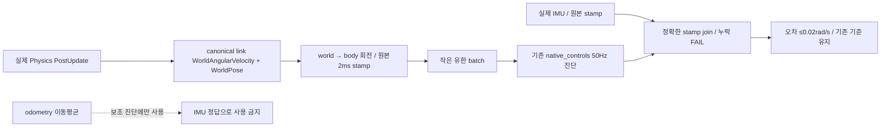

# 13.5 Gazebo IMU 검증: 시각 정렬과 물리량 의미를 따로 검증한다

## 판별 결과와 기각한 가설

- `5dbc1a36` 원본 operational IMU 682개는 전체 body journal에 정확히 같은 stamp가
  모두 있었다. latest-cache 비교의 최대 0.0235rad/s는 같은 stamp 비교에서
  0.01930168rad/s로 줄었다. 이는 캐시 선택 문제의 증거이지 최종 성공은 아니다.
- `571bdbe2`에서는 exact join에도 0.04321401rad/s였다. 따라서 **시간 정렬만으로
  해결됐다는 가설은 기각**했다. 원본 두 FAIL 결과와 새 postmortem은 별도 보존했다.
- 설치 엔진 버전과 같은 Gazebo8.15.0 원본에서 OdometryPublisher는 매 물리 단계의
  자세 차이로 각속도를 계산하고 rolling mean을 발행한다. 반면 Imu는 sensor의
  AngularVelocity component를 사용한다. 같은 header라도 평균과 순간값은 다른
  측정량이다. 원본 odometry/IMU·필터·허용 오차를 바꾸어 통과시키지 않는다.

근거: [OdometryPublisher8.15.0 원본](https://github.com/gazebosim/gz-sim/blob/gz-sim8_8.15.0/src/systems/odometry_publisher/OdometryPublisher.cc),
[Imu8.15.0 원본](https://github.com/gazebosim/gz-sim/blob/gz-sim8_8.15.0/src/systems/imu/Imu.cc).
외부 코드는 읽기만 했으며 복사·수정하지 않았다.

## 기존 native 관찰기의 최소 확장

기존 승인 Task8의 독립 native 물리 측정을 완성한다. 제어 구조를 바꾸는 실험이 아니다.
canonical base link의 WorldAngularVelocity와 그 시각 WorldPose를 PostUpdate에서 읽어
몸체 좌표로 회전한다. IMU 메시지나 sensor AngularVelocity를 복사하지 않는다.
실제 canonical link가 identity base_footprint→base_link 계약과 일치하는지 확인한다.

관찰기50Hz와 IMU50Hz는 실제 위상이 각각20ms의 나머지4ms/0ms였다. 임의의 최근값이나
시간 보간을 사용하지 않는다. 물리2ms 단계의 작은 immutable reference를 제한된
batch에 모아 기존50Hz native_controls 진단에 붙여 전달한다. stamp·epoch·sequence·
source·frame을 보존한다. 새500Hz Python subscriber/ROS topic은 추가하지 않는다.
누락·비정상 frame·rollback·용량 초과는 FAIL이며 다음 실행 자동 복구는 하지 않는다.

TDD 순서: 평균 기준 거부 회귀 → C++ 회전/독립성/미관측/불변성 RED → 최소 구현 →
native 패키지/설치 감사 → 새 UUID 실제 G1. 과거 로그에는 순간 기준이 없으므로
새 코드로 원본 FAIL을 PASS로 다시 붙이지 않는다. 실제 측정 전에는 미검증이다.

## 첫 실제 결과

`f5eff9bc-cc1a-49f1-a3d9-fc158b9b43db`: IMU410고유 capture에 원생 순간 기준이
모두 대응했고 최대오차는0.0000342422rad/s였다. 관찰기 stop ACK와 실제 native
PID1141의 정상 exit0·부모 회수·잔여없음도 별도로 확인했다.
전체G1은 carry팔속도0.0261044473>0.02와 lift 미완료로 **FAIL**이다.
이 한 번의 IMU 성공을 전체 보행 성공 또는 동결본3회 연속 성공으로 세지 않는다.
