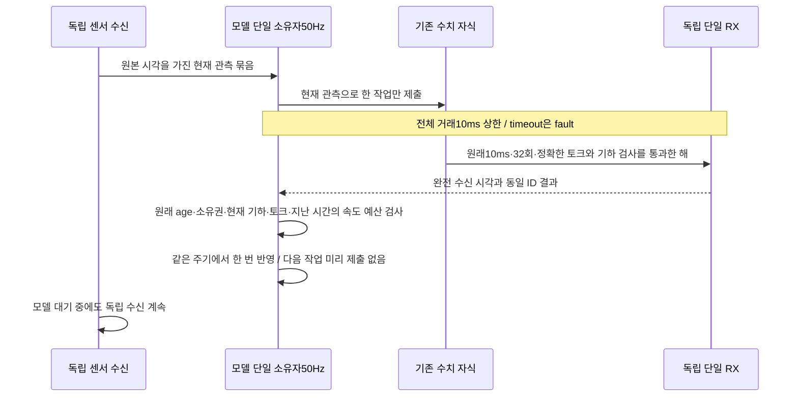
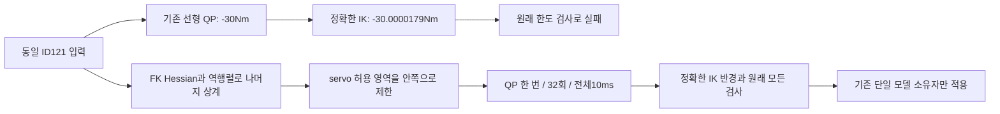
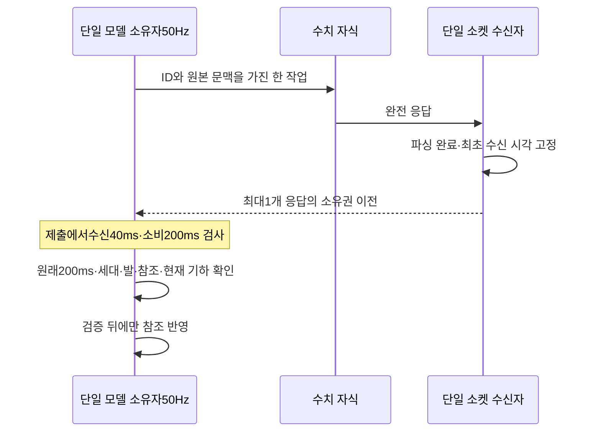
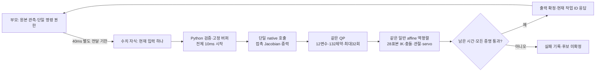
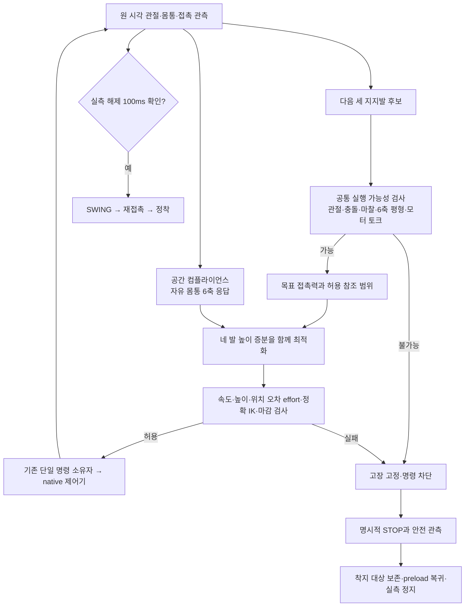
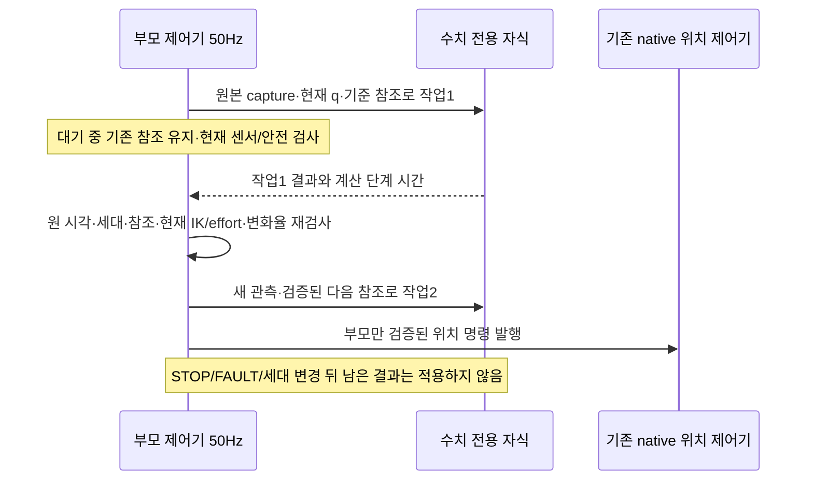
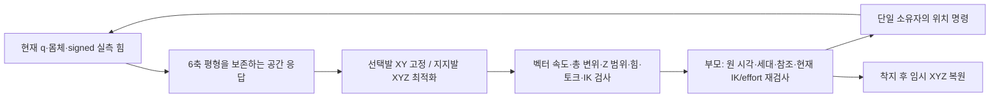
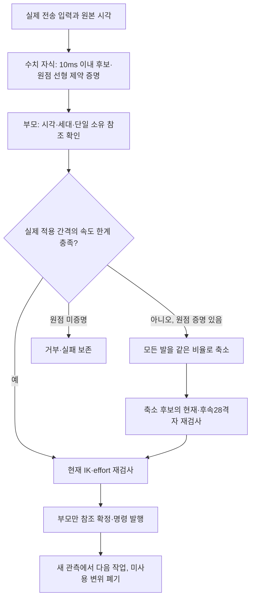

# 하중 전환 부분 재설계와 구현 계획

## 2026-11-02 후속: 최소 물리 시험과 암시적 감쇠·접촉 모델 불일치

최신 C1 실패267 이후 전체 로봇을 재실행하지 않았다. 독립 `force-semantics-0e189460`은1Nm/2ms/관성0.1의 매step/매5step에서 Δqd2.0/0.4rad/s로 PASS했다. 기존2ms이벤트60표본에서도write시각58개가2ms/2개4ms차이라 전주기미호출로 단정하지 않는다. `contact-force-3563b9ac`의 같은1Nm 매step/관성0.01/고정구면접촉에서 native damping0 대10.95445만 바꾸면 정지속도≈0인데 전달렌치1.0→0.31339281Nm, 접촉Fz12.9774→4.0672N이다. 세최소물리실행의각조건정상종료/잔여[]이며 서비스/시계/외부설치변경은없다.

원본실패267을DART공개API로오프라인비교한 `implicit-damping-comparison-bd4be4a1`은 `u=g−JᵀF+Dv−hD M⁻¹JᵀF`의정상순가속도가정에서FLcalf−30.0009629Nm를예측한다(실제명령−30Nm).12관절최대잔차는기존식22.61547→0.0041273Nm다.15.2101kg질량일치·M SPD·선형해residual4.29e−14를확인했다. 최초DartLoader기본관성17.2101kg결과와경로전달준비오류도성공으로세지않고보존한다.6ms관측차이·속도편향/가속도가정이남으므로실제폐루프성공은아니다.

원인은단순4배보정이나수신기한이아니라, 현재독립발spring응답에서빠진전체관성/암시적감쇠/접촉충격량관계로좁혀졌다. 런타임수정은아직없다. 다음은원래물리·native damper·게인·토크cap을유지한전체결합응답의독립검증이다. 상세·정확한UUID·공식근거·보존은 `SECTION_13_5_FORCE_APPLICATION_DIAGNOSIS_KO.md`를읽는다. 기존maintenance·same-cycle 실패와C1/G2미완료상태는그대로다.

## 2026-11-02: 정착 조건과 지지 토크 유지의 역할 분리

고정 same-cycle root `235a5ec8`는 G1 `7264d7d5` PASS, C1 `ab85a9a6`는 FL·RR 실제 들기/복귀 후 FR 준비의 job264에서 QP infeasible로 FAIL했다. 거래1.1533ms,263완료/폐기0/실패1이다. 정상 수치·엔진·runtime 종료, 서비스 복원·foreground 종료·잔여[]를 확인했다. source/install·원래 기한은 유지했다.

fixture264 SHA256 `19cc4abd30210422c4aaba23c8f1d6fd2e97cdde7658f9ae35b2400d5f658b87`의132개 행과12개 box를 비설치 진단 복사본에서 추출했다. 독립 HiGHS의 infeasible과 `infeasible-264-e19a7f50` Farkas 증명은 FL calf servo 하한·두 step L1 행·FL Z 상한 네 행의 충돌이다. 비음수 y에 대해 `max|Aᵀy|=5.55e-17`, `bᵀy=-1`이다. 마찰/정역학 제약 제거만으로는 해결되지 않는다. 이는 현재 참조의 -30.75934Nm를 한 주기40µm 이내에서 복구할 수 없다는 국소 충돌이며, 몸체를 재배치해도 전역적으로 불가능하다는 증거는 아니다. 반복 한도/토크/속도를 늘리지 않는다.

원본 관측 분석 `settle-feedback-window-50ec6795`에서 하중 해제 시작 뒤 40~60ms씩 몸체 속도가 원래 정착 기준을 벗어난 구간이 반복됐다. 코드의 `if settled`는 이때 선택 발 진행뿐 아니라 지지 토크 피드백 전체도 중단했다. 관측 부재나 callback 부재로 단정하는 것이 아니라, 기록된 속도와 해당 제어 분기의 관계를 확인했다. 발을 들기 위한 정착 조건과 이미 접지한 다리의 힘/토크 유지 조건은 별개다.

수정 방향은 명시적 same-cycle의 정상 SHIFT 하중 해제 구간에 한정한다. 몸체가 잠시 unsettled이면 선택 발 XYZ를 정확히 고정하고, 힘 목적값은 현재 측정한 네 발 힘으로 두어 의도적인 하중 해제를 요청하지 않는다. 원래2mm/s·10mm·Z envelope·정확한 토크·현재 지지·관절/충돌·관측 기한 안에서 지지발 참조만 조절한다. maintenance의 선택 발 envelope/future 목표는 현재 위치의 더 좁은 집합이며 정상 SWING 증명으로 재사용하지 않는다. 정착과 새 정상 full-future 수치 증명 없이는100ms release dwell/SWING으로 진행하지 않는다. 만료된 작업 재시도나 fault 후 복구가 아니라 정상 제어에서 제약 위반을 예방하는 피드백이다. 정착·기립·속도·10초·6초 기준은 완화하지 않는다.

`maintenance-264-075b380d`는 실패 직전의 세 unsettled 기록에 이 후보를 적용한 오프라인 반사실 검사다. 선택 발 delta는 모두0, 정확한 FL calf servo는 약-29.9967Nm였고, 이어지는 정상 요청도24회 이내에 통과했다. 이후 실제 상태가 원래 기록과 같다는 보장은 없으므로 물리 폐루프 성공으로 세지 않는다. 분기 RED→부모 선택 발 고정/현재 힘 목표·원래 범위 거부→원본 입력/실제 자식/정지/수신 회귀→고정 실제 G1/C1으로 검증한다.

## 2026-11-02: 지연된 힘 조절 해 대신 같은 주기의 현재 관측 사용

고정본 root `ae53a6b0`는 G1 `1e1a438c` PASS, C1 `dbdfa89a` FAIL이다. C1은 FL·RR 실제 들기/복귀를 완료했고 수치325제출/323완료/2폐기/0실패였다. 기존 비선형 나머지 실패는 재발하지 않았지만 FR 하중 해제 중 부모의 `current servo effort` 검사가 중단했다. 엔진·runtime·수치 자식 정상 종료, RX join/빈slot/STOP ACK/핸들 해제/회수·두 서비스 복원·잔여[]는 통과했다. 연속 성공 횟수는0이다.

fixture `native_dbdf_current_servo.json` SHA256 `de23c7c60ea12f5886ca987b7e34d300ccc431ad58db38aef5ecf2f005b4f1e2`는 성공한 job325와 부모 거부를 구분한다. `current-servo-ae995530`에서 FL calf가10ms 동안25.2647µrad 움직여 같은 해의 servo가 -29.9978807→-30.0168292Nm로 변했다. 그 시점에는 기존 참조 자체도 -30.0165978Nm였다. 이는 양자화된 다음 주기 적용에서 선형화 기준 상태가 바뀌는 문제다. `current-servo-182de9b6`에서 부모의 현재 joints/body/contact 묶음으로 한 번 계산하면 원래 속도·토크·기하 검사를 통과했다. 정확한 현재 토크 검사나30Nm를 완화하는 방법은 사용하지 않는다.

이제 커널 실측은0.5631ms이므로 과거 Python 다중 계산 때 필요했던 다음 주기 파이프라인을 Gazebo G2의 명시적 경로에서 제거한다. `same_cycle`은 기존 독립 수치 자식에 현재 관측 한 묶음을 한 번 제출하고, 독립 RX의 조건변수로 완료를 기다려 같은 모델 주기에서 검증·반영한다. 전체 제출/대기/수신 거래에도10ms 상한을 추가한다. timeout/오류는 latch·폐기 후 원래 fault/종료로 가며 재시도하지 않는다. 기존 커널10ms·전달40ms·관측200ms·32회·단일 소유권과 모든 물리 제약은 유지한다. 센서 ingress는 별도 실행 소유자라 이 유계 대기 중에도 수신한다. hard real-time 보장은 주장하지 않는다.

step의2mm/s 예산은 이 주기 시작 전에 이미 측정된 ROS/wall 최소 진행 시간(`unload_dt`)만 쓴다. 미래에 쓸 시간을 미리 인정하거나 이전 해를 기다리면서 크기를 줄이지 않는다. 다음 작업을 사전 제출하지 않으며 같은 촬영은 한 번만 사용한다. 기존 `strict`/`mature_horizon`·기본/G1/MuJoCo는 보존한다. 원래 numeric worker lifecycle/check는 실제 자식으로 계속 실행한다. 회귀는 원본 해의 새 관측 거부 negative control→현재 관측 한 번 처리→10ms timeout 뒤 재시도 금지→원래 async/age/ownership/ingress 회귀→고정본 실제 G1/C1 순서다.

## 2026-11-02: 실제 IK의 비선형 나머지를 포함한 servo 제약

root `e12b7875`는 서비스 복원·foreground 종료·잔여[]를 확인했다. G1 `779b5286` PASS, C1 `1a62bcc3`는 FL 실제 들기·복귀 뒤 job121에서 `complete XYZ nonlinear servo residual`로 FAIL했다. 121제출/119완료/1폐기/1실패이며 정상 수치·runtime·엔진 종료, 수신자 join·빈 slot·STOP/ACK·세 핸들 해제·자식 회수는 통과했다. 정상 종료와 C1 성공은 구분한다.

동일 실패 ID121·입력·응답을 결합한 fixture `native_1a62_nonlinear_servo.json`의 SHA256은 `ba8708696b5d5488c495f87aadfe0e2ce2e1544ec6b268381854a133e8ac70e0`이다. 독립 재현 RED 1FAIL/15.81초와 `nonlinear-servo-1688e330` 분해 실험에서 FR calf의 선형 예측은 -30Nm, 정확한 IK servo는 -30.00001789593626Nm였다. FK 참조 불일치는 약6.42e-17m로 배제됐다. 원인은 한도에 포화된 일차 근사에 IK의 이차 나머지가 빠진 것이다. 원래 1µNm 허용치를 늘리는 방법은 사용하지 않는다.

기존 FK를 f, 명령 관절을 q, J=Df(q), 역행렬 노름 상계를 a, 전역 FK Hessian 노름 상계를 B, 한 step의 국소 위치 변화 상계를 d라 둔다. 전역 B는 기존 다리의 sin/cos 절댓값≤1에서 자체 유도한다. `2a²Bd<1`일 때 `r=2ad/(1+sqrt(1-2a²Bd))`를 구하고 `ad+aBr²/2≤r`, `aBr<1`을 확인한다. 이 공 안의 역함수 나머지는 `aBr²/2` 이하이다. 부동소수점 역행렬 residual과 좌표 변환 오차도 보수적으로 합산한다. QP는 선형 servo 양쪽 제약에서 `gain × 나머지 상계`를 빼며, 원점 FK 차이의 선형 bias도 포함한다. 이 허용 영역은 이전 일차 QP보다 엄격하다. 기존 등가 presolve와 달리 같은 feasible set이라고 주장하지 않는다.

한 번의 QPMAD 뒤 정확한 IK가 인증한 반경 r 안인지 확인하고, 기존 정확한20/30Nm+1e-6 검사·전체 원래 primal·힘·28표본 기하 검사도 유지한다. 인증 불가/다른 IK branch/한도 위반은 계속 실패한다. 반복·시간·게인·모터·물리·재시도·명령 소유권은 변경하지 않는다. SEIKO의 actuation-feasibility 관점은 설계 참고이며 이 나머지 공식/코드는 Ch13 자체 유도·구현이다.

새 `inverse_remainder.hpp`의 해석적 곡선 역함수·특이점 거부·125개 관절 조합의 FK Hessian 검사를 포함한 C++17검사가2ms PASS했다. I/S/N 빌드1분52초·8패키지 설치 감사 PASS, 실패121와 기존57/72/130·정확한 목적값·ABI/시간 상한을 포함한22검사가16.69초 PASS했다. 실제 엔진 성공의 대체 증거는 아니며 관련 자식/소유권 회귀 뒤 소스를 동결해 실제 G1→C1으로 검증한다.

## 2026-11-02 최신: 수신 성공 이후의 정확한 원래 경계 복원

root `81e7c44f`는 정상 복원·foreground 종료·잔여[]를 확인했다. G1 `02c60438`는 PASS, C1 `59873b32`는 수치57제출/57완료/실패0/폐기0이다. 실제 job57의 완전 수신은 제출5.794499ms 뒤이고, 수신 thread join·빈slot·STOP/ACK·세 핸들 해제·자식 회수·엔진/runtime 정상 종료가 모두 통과했다. 그러나 부모의 참조 경계 검사에서 FAIL하여 실제 발 전환은0이다. 수치/전달 성공과 과제 실패를 함께 기록한다.

ID57·원본 입력·문맥·응답을 검증한 `native_5987_parent_bounds.json`(SHA `56a7fe61eb589a2da4671e11f4c8cd10b963fb40966a2700bc80a4ae66502053`)을 단독 재생한 `parent-bounds-cb727986`에서 높이·변위·envelope는 모두 통과했지만 선택 FL의 `deltaZ=-5.298264602323201e-22m`가 부모의 기존 엄격한 `deltaZ≥0`을 위반했다. 커널의 원래 normalized box 허용 오차1e-9는 이를 통과시키므로, 두 단계의 경계 표현이 불일치했다. 엄격한 비음수 회귀 RED1FAIL15.70초로 재현했다.

수정은 부모 조건을 바꾸지 않는다. QPMAD OK 뒤12차원으로 복원한 값에서 원래 box 오차1e-9를 넘는 값은 계속 실패한다. 이미 이 원래 오차 범위 안에 있던 값만 정확한 원래 경계로 표현하고, **그 뒤 원래132개 전체 행 residual1e-7을 다시 검사**한다. 힘·토크·servo·목적값·28표본 기하는 이 복원된 값으로 다시 계산한다. 적용 단계에서 발마다 별도로 명령을 잘라내거나 유의미한 위반을 허용하는 보정이 아니다. 결합 행이 복원 후 위반되면 실패하며, 추가 QP/재시도·반복/시간/힘/물리 한도 변경은 없다.

I/S/N빌드1분49초·8패키지 감사 PASS, 기존 및 신규 C++14증명2ms PASS, 실제 입력57/72/130와 부모의 음수(심지어-5e-22m) 거부를 함께 확인한8회귀13.93초 PASS다. 영향받는 수치/실제 자식 회귀와 실제 C1 전체 성공은 다음 검증 대상이다. 기본height의 앞선 간헐10ms 실패는 별도 미해결 기록으로 유지한다.

## 2026-11-02: 수신 완료와50Hz 적용 평가의 소유권 분리

root `fbfb6b7e`는 정상 복원·foreground 종료·잔여[]를 확인했다. G1 `5f4b235a`는 PASS, C1 `48f565a9`는 job19의40ms 전달/수집 기한에서 FAIL했다. 동일ID의 제출561028466027ns, 계산 완료561052928627ns(24.4626ms), poll 진입561067600826ns(39.134799ms), 완전한 JSON 수신561068729226ns(40.263199ms)다. 해당 응답에서 복사한 커널 완료 진단은0.588ms이며, 계산 자체 실패0·18완료/1폐기다. 이 경우 이전 QP 반복 실패로 해석하지 않는다. 정상 수치 자식/엔진/runtime 종료와 과제 실패는 별도로 보존한다.

현재 `poll()`만이 소켓을 읽으므로24.46ms에 완성된 응답도 다음50Hz 모델 평가까지 기다리고, 진입이39.13ms여도 파싱 뒤40ms를 넘는다. 수신을 모델 앞에서 한 번 수행하는 기존 보완만으로는 이 주기 양자화가 사라지지 않는다. 승인된 내부 callback/worker/cache 범위에서 다음 구조로 수정한다. 세부 선택은 구현자의 결정이며 추가 사용자 승인을 뜻하지 않는다.

- `numeric_receipts.py`: 소켓의 단일 읽기 소유자와 최대1개 완전 응답 slot. 실제 JSON 파싱 완료 후 MONOTONIC 시각을 한 번 저장한다. 부분 프레임은 완료로 인정하지 않고, slot을 덮어쓰지 않는다. 명령·ROS·모델 참조 접근 권한은 없다.
- `load_process.py`: 기본 `model_poll`은 유지한다. 명시적 `event_receiver`에서만 독립 수신을 쓰며 원래 제출→완전 수신40ms를 검사한다. 이후 모델 소비는 원래 입력의200ms wall 상한 이내이고, gait의 원래 ROS/wall age·세대·발·참조·현재 기하 검사가 모두 유지된다. 수신 시각을 소비 시각으로 바꾸지 않는다.
- `gait.py`/`crawl_controller.py`: 새 수신 선택은 async coupled Gazebo G2에만 적용한다. 기존 모델 소유자만 참조를 반영한다. MuJoCo/default/G1 경로는 유지한다.
- 종료: 새 제출 차단→미처리 작업 폐기 표시→수신 thread 깨우기·join→보관 응답과 stream 잔여 정리→원래 STOP/ACK·자식 회수·핸들/소켓 해제. thread가 살아 있으면 두 번째 reader를 시작하거나 정상 종료를 선언하지 않는다.

테스트 우선 순서: 기존50Hz 양자화의 실제 자식 negative control와 원하는40ms 수신/45ms 소비 RED → 부분 프레임/first receipt/1slot/EOF/종료 증명 → 구현 및 설치 감사 → 작업ID/늦음/중단/고장/기존 mode와 실제 ROS 범위 회귀 → 소스 동결 후 실제 G1→C1. 원래40ms/200ms/10ms/32회/물리·명령 한도는 변경하지 않는다. 이전 응답을 유지해 실패를 복구하거나 자동 재시도하는 구조가 아니다.

새 모드 부재 RED1FAIL20.32초 뒤 N빌드10.6초/8패키지 감사 PASS, 실제 자식·부분 프레임·최초 시각·단일slot·늦은 수신/소비·EOF·중단/정상join·범위11검사14.55초 PASS다. 실제 양 엔진/G1/G2 선택·소유권·고장·종료 등 나머지84검사는94.16초 PASS다. 최초 묶음에서 기본 `height/model_poll` 계산의10ms 예산 실패(1FAIL/1PASS62.44초)가 있었다. 이 자식 함수는 직전 소스와 AST가 동일하며, 단계 진단을 추가한 단독 시험은1PASS9.13초다. 앞선 실패를 삭제하거나 최종 전체 통과로 선언하지 않는다. 이 간헐 예산 문제와 최종 모든 시험을 별도로 확인해야 한다. 신규 실제 Gazebo G2 수신 모드의 물리 효과는 아직 미검증이다.

## 2026-11-01: 첫 실제 발 복귀 뒤의 job130와 고정 좌표 전처리

root `ac1edd56`에서 G1 `0196fc1d`는25/25 PASS, C1 `48d02b49`는 FL 실제 최대19.713mm 들기·재접촉을 완료한 뒤 RR 하중 해제의 job130에서 FAIL했다. 정상 engine/runtime 종료·수치 자식 ACK/회수·두 서비스 복원·foreground 종료·잔여[]를 확인했다. 따라서 시간 지평 정책의 첫 물리 진전과 전체 C1 실패를 함께 기록한다. 고정본 연속 성공이나 Task8 완료가 아니다.

ID130/원본 입력/문맥/응답을 연결한 fixture `native_48d0_xyz_iterations.json`50,755B(SHA `70d458bba3e25223af2d20644523fbf54e1d16acbbab48f85a1b067fc1ce0e4f`)의 단독 재생은18.68초 시험에서 동일 MAX32 실패를 재현했다. 미설치 진단 `job130-qp-diagnostic-2c2471e8-b4e1-4bfa-a5da-bf2b2b38967d`는 원래132행 중33행 전달·반복계수33·원래 residual0.64437을 확인했다. 선택 발 Z=-1.64437인 중간 primal은 거부한다. 독립 오프라인 SLSQP는30회/residual4.57e-13/목적값22.68447로 수학적 해의 존재를 확인했으며 런타임32회/10ms 통과 주장에 쓰지 않는다.

다음 단일 가설은 일반적인 presolve가 빠뜨린 고정 좌표와 singleton 제약이다. 선택 발 XY=0을 실제 행렬에 남기면 그 발의8개 L1 facet은 실질적으로 `±Z≤1`의 중복이다. 정확히 같은 상·하한인 좌표에만 `x=c+E y`를 대입하여 `H'=EᵀHE`, `g'=Eᵀ(g+Hc)`, `A'=AE`, `b'=b-Ac`로 변환한다. 0행은 feasibility를 검사하고, 정확히 비영 계수가 하나인 행만 원래 bound와 교차한다. 근사 equality/근접 행 제거·목적함수/정규화 변경·재시도·warm start는 없다. 재구성한 원래12차원 primal은132행·원래box·힘/토크/28표본 기하/servo를 모두 다시 검사한다. 한 번의 QPMAD 호출, 원래32회/10ms를 유지한다. 구현·C++ 증명·실제 실패72/130 회귀를 먼저 검증하고 실제 엔진은 그 뒤 실행한다.

참고한 일차 자료는 [PlaCo의 hard equality elimination](https://placo.readthedocs.io/en/latest/kinematics/equalities_elimination.html), [MathWorks의 presolve/postsolve](https://www.mathworks.com/help/optim/ug/quadratic-programming-algorithms.html)다. 아이디어와 수식만 참고했으며 외부 코드는 복사하지 않았다. QPMAD vendor는 변경하지 않는다.

별도 호스트 관측 `host-performance-296a0bdd`는2초 간격280표본, 실행 중 조회 최대2.0048ms였다. 같은 G1의 SHIFT는4.680ROS/4.939wall초(RTF0.94747), Windows 성능88.31–94.85% nominal/AC 연결이었다(`host-phase-correlation-e03a2578`). 이전 실패에는 대응 호스트 자료가 없으므로 과열/QoS/전원 원인으로 확정하지 않는다. QoS 조회의 접근 거부5를 기록하고 권한을 높이지 않았다. 이 진단은 로봇 인수나 시계 기준을 대체하지 않는다.

### 제약 선택 순서의 판별과 현재 채택 후보

고정 좌표/singleton 정리만으로는 job72만 PASS, job130은 여전히 MAX32(1PASS/1FAIL18.90초)였다. 새 실제 엔진을 실행하지 않았다. QPMAD 고정 원본 `implementation.h`의 `chooseConstraint`/`checkConstraintViolation`를 확인하면 simple bounds를 우선 처리하고, 일반 행의 위반량은 단위 정규화 없이 비교한다. 고정된 수학적 허용 영역도 N 단위 힘 행과 정규화된 이동량 행을 다르게 표현하면32회 내 경로가 달라진다. vendor 결함으로 단정하거나 원본을 수정하지 않는다.

미설치 오프라인 비교 `qp-formulation-7565ee8f-fddd-416a-8725-2a053fca5d6a`는 같은 두 원본 행렬에서 세 방법을 미리 구분해 한 번씩 실행했다. fixed/singleton만 적용하면 job72=20회, job130=MAX32다. 모든 bounds를 일반 행으로 합치는 것만 적용하면26회/MAX32다. 일반 행으로 합친 뒤 각 행을 `sqrt(a H⁻¹ aᵀ)`라는 양수로 나누면 두 입력 모두16회 PASS다. 목적값은 독립 원본 oracle과 일치하고 원래 행/box residual은 각각 약3.49e-14/4.84e-13이다. 각 비교의 더 낮은 목적값을 가진 실패 primal은 원래 제약을 위반하므로 버린다. 이 비교는 실제 엔진이나 런타임의 여러 번 재시도가 아니다.

채택 후보는 마지막 한 표현이다. 고정 좌표 치환 뒤 모든 finite bounds를 일반 제약으로 포함하고, 원래 양의 정부호 Hessian의 LLT로 같은 거리 단위에 맞춘다. Hessian/목적함수/정규화 계수/최종 원래 제약은 바꾸지 않는다. QPMAD 호출은 한 번,32회·solver tolerance1e-12·전체10ms를 유지한다. solver의 scaled 행 허용 오차와 별개로 원래 단위의 모든 primal/힘/속도/토크/기하 증명을 통과해야 한다. 실제 입력72/130 회귀에는 독립적으로 재구성한12차원 원래 목적값도 검사한다. 전처리만의 두 실패와 최종 후보의 빌드·회귀·실제 결과를 별도로 보존한다.

## 이전 실제 결과와 시간 지평 적용 수명

root `c73353c6`는 boot `2f69e310`에서 원래 시계·설치8패키지·시작19회귀를 통과했다. source175 manifest `3896bf19d537cbdc62de9b09b786e0fbcb000a8ca037df6dc2a0ce36710afa1b`의 Gazebo G1 `154db0ac`는25/25 PASS다. C1 `33573eb6`는 수치64제출/64완료/실패0으로 수치 작업 계약을 통과했다. 그러나 부모의 `elapsed reference rate` 검사에서 FAIL하여 실제 발 전환0이다. 정상 engine/runtime 종료·ACK/자식 회수·서비스 복원·foreground 종료·잔여[]는 별도로 확인했다.

job64의 원래 시간 지평은19.929004ms였고 결과를 적용하려던 ROS 경과는18ms, wall 경과는20.105904ms였다. 두 시계 중 짧은 것을 적용하므로 full endpoint를 적용할 수 없다. 선택 FL의 원래 `Fn=1.23172N`, `Fy=1.05656N`은 보수적 마찰 원뿔의 `Fn/√2≈0.871N`보다 커 origin이 feasible하지 않다. 따라서 endpoint를 원점 쪽으로 축소하면 feasible라는 보장도 없다. 기존 거부는 옳았다. 수치 반복 실패나 단순 허용 오차로 오해하지 않는다.

새 `mature_horizon`은 명시적 Gazebo G2 async coupled 경로에서만 선택한다. 유효하고 과거 기하 증명이 있는 한 결과가 아직 rate 지평에 도달하지 못하면 기존 단일 reply slot에 그대로 보관한다. 새로운 작업 제출·실패 재시도·참조 변경·시각 재명명·부분 축소를 하지 않는다. 다음50Hz 평가에서 같은 원래 입력의200ms dual age·세대/foot/reference/geometry 소유권·현재 모델을 다시 확인하고, ROS와 wall 양쪽의 실제 경과가 충분할 때만 한 번 적용한다. 원래6초 하중 해제 기한도 계속 진행하며 연장하지 않는다. STOP/고장/리셋/단계 전환은 기존 slot 폐기 경로를 쓴다. 만료나 소유권 변경은 실패한다. 기본 strict 모드와 origin 없는 축소 거부 시험은 유지한다.

실제 성공 수치job64와 부모의 시간 거부는 ID64/원본 문맥을 검증해 `native_3357_parent_horizon.json`49,369B(SHA `8f8d9a2b4dd6255f3b5c7fcd5e0a65262c34c3563767723212f9f570ef6be9e4`)로 보존했다. 유효 결과의 수집과 적용 가능 시각은 다른 수명이다. 새 정책은 오래된 목표를 유지해 성공으로 세는 방식이 아니며, 필요한 시각 전에는 모터 참조를 전혀 갱신하지 않고 모든 원래 유효기간·기하·힘·속도 검사를 적용한다.

RED1FAIL23.91초 뒤 N설치15.9초/8패키지 감사 PASS, 성숙 후 단일 적용·만료·세대·중단·기존 엄격 모드 등55회귀75.60초 PASS다. 실제job64의 비축소 조건과 양 엔진/G1/G2 정책 선택·시계·수명14회귀38.98초도 PASS다. 실제 물리 효과는 다음 고정본 G1→C1에서 판정한다.

## 최신 수치 판별 결과: L1와 좌표 box의 중복 표현

box로 이미 보장되는 행102개를 제거하는 것만으로는 job72가 해결되지 않았다. 원본 QP·실패 primal·목적함수를 별도의 미설치 진단 라이브러리로 추출했다(`job72-qp-diagnostic-bc0ea286-2a78-4644-a890-f17bf750e5eb`). 독립 오프라인 SLSQP는8회에 원본 residual3.55e-15·목적값-4.8998059087로 풀었다. 이 오프라인 oracle의512회 상한은 원인 판별용이고 런타임32회와 무관하다. 실패 QPMAD의 더 낮은 목적값-4.90573은 RL=`(-1,-1,-1)`이 L1 제한을2만큼 위반했기 때문이며 해로 인정하지 않는다.

원래 QP는 좌표별 `[-1,1]` simple bounds와 발별 L1 ball의8개 facet을 동시에 전달했다. L1 ball은 각 좌표의 `[-1,1]`을 이미 보장하므로, cube 경계와 L1 facet 사이를 처리하는 데 불필요한 pivot을 소비할 수 있다. 새 표현은 실제 행렬의 canonical L1 facet32개를 정확히 확인·항상 유지하고, solver에만 전달하는 정확한 `±1` 좌표 bounds를 생략한다. 고정XY·양의 selected Z·더 좁은 높이 bounds는 유지한다. 최종 결과는 원래132개 행과 원래 모든 coordinate bounds·힘·토크·28표본 미래 기하·비선형 servo를 재검사한다.

논리는 `C=B_unit∩B_narrow∩L∩R`에서 `L⇒B_unit`이므로 `C=B_narrow∩L∩R`이라는 것이다. 앞선 strict-box 행 정리도 `B_narrow∩L⇒B_original`이 보장되어야 하므로 L32행을 강제로 보존해 순환 증명을 피한다. 경계 불확실성은 보수적 guard로 남기고, L1 proof가 없거나 바뀌면 실패 처리한다. 이는 허용 영역·목적함수·32회·10ms·기존 허용 오차를 바꾸는 방식이 아니다. solver는 한 번만 호출하며 partial/오래된 해·재시도·fallback을 사용하지 않는다.

I/S/N 빌드1분59초·설치8패키지 일치 감사 PASS 뒤, 재구성 없이 실행한 C++6개 증명/실패거부 검사가 PASS다. 정확한 job72는 기존 커널 RED(19.25초), strict-row-only FAIL(19.09초), L1 동등 표현 GREEN(15.24초, 모두 시험 전체 시간)이다. GREEN은 원래32회/10ms와 독립 primal·기하·토크 검사를 포함한다. 현재는 기존 실제 입력·독립 oracle·수치 자식·부모 소유권·고장/종료 회귀 중이며 실제 물리 성공은 아직 미검증이다.

## 2026-11-01 현재: 정확한 job72의 QP 재현과 동등 전처리

root `7fd8724b`는 새 boot `159d3734`에서 원래 시계 인수·설치8패키지 감사·시작19회귀를 통과했다. source173 manifest `453af6c851307899678882964e994413b0d6614202f7e517577e8a8fb8762a2f`의 Gazebo G1 `9d8f83b8`는25/25 PASS였다. C1 `4d26fb83`는72제출/71완료/1실패·물리 발 전환0이다. 최초 실패는32회 QP 반복 초과이고 solver279.4µs wall/278.7µs CPU로10ms 초과와 구분된다. 신선도·STAND·정상 engine/runtime 종료·자식 ACK/핸들 해제/회수는 통과했다. root 서비스 복원·foreground 종료·잔여[]를 확인했다.

이번에는 `numeric_input_job_id=worker.last_input_id=worker.last_reply.id=72`, `ok=false`가 일치한다. guard를 통과해50,750B fixture `native_4d26_xyz_iterations.json`(SHA `06abd46dfae57fa4add4fffc51b1c92dbc3acaf97550c25d50a2a53f524b6f26`)를 내보냈다. 기존 커널에서 단독 RED(1FAIL19.25초)로 같은 `native XYZ solver status4`를 재현했다. 앞선 ac904의 잘못 섞인 입력과 달리 이 사례는 수학적 실패의 재현 자료다.

판별할 최소 변경은 strict box implication presolve다. 각 부등식 `a·x≤b`에 대해 기존 변수 상·하한으로 계산한 최댓값이 보수적 부동소수점 guard를 포함해 `b`보다 작을 때만 solver 입력에서 제외한다. 원래 변수 box가 그 부등식을 이미 보장하므로 허용 영역과 목적함수는 동일하다. 경계·불확실·비유한 입력은 제거하지 않거나 실패 처리한다. 기존12변수·132개 원본 부등식과 box는 반환 전 전부 다시 검사한다. solver는 한 번만 호출하고32회/10ms/허용 오차를 유지한다. 제한 증가·이전 답 재사용·fallback·반복 재시도는 없다.

이는 [SciPy 공식 presolve 설명](https://docs.scipy.org/doc/scipy/reference/generated/scipy.optimize.linprog.html)의 중복 제약 정리 원리를 참고한 자체 구현이며 외부 코드는 복사하지 않는다. QPMAD의 unconstrained 시작점이 box 바깥에서 중복 제약을 처리하느라 pivot을 소모하는 가설을 판별한다. 단위검사·정확한 실패 입력·기존 독립 primal/기하/토크 회귀를 먼저 통과해야 채택하며, 실제 물리 성공은 이후 고정본 엔진 인수로 별도 판정한다. 아래의 '미선택 초안' 기록은 job72 재현 전 시점이며 그때의 보류 판단을 보존한다.

## 2026-11-01 실행기 구조 단순화의 근거와 한계

root07bd의 G1 교정은 STAND 후보까지8.954wall초/6.544ROS초였다.1초 실측 안정화에1.046초만 남아10초 기한을 실패했다. 접촉/lift/신선도는 통과했고 수치 자식이 없는 G1이므로 C1의 QP 실패로 설명하지 않는다. 같은 기한·궤적·게인에서 유효 진행 시간이 줄어든 경계를 검토했다.

현재 모델 콜백·서비스는 이미 하나의 MutuallyExclusive 그룹이며, 센서와 원래 TimeSource는 별도 serial ingress에 분리돼 있다. [ROS 2 공식 callback-group 문서 원본](https://github.com/ros2/ros2_documentation/blob/rolling/source/ROS-Framework/nodes/Working-with-nodes/Using-callback-groups.rst)의 원리에 따라, 모델 그룹에 작업자2개를 줘도 콜백 병렬 실행은 생기지 않는다. 공식 Jazzy 웹페이지는 접근 거부여서 공식 저장소 원본과 설치 코드/API를 확인했다. 실행기 교체가 실시간 우선순위나 기한을 보장한다고 주장하지 않는다.

실제 비활성 CrawlController·기존50Hz 타이머·분리된100Hz 원본 시험 시계에 고정2ms CPU 합성 콜백을 붙여 ABBA4초씩 비교했다. ingress는 두 대안 모두 wait-set으로 고정했다. 기존 풀0.2825/0.2943core 대비 직접 실행0.2608/0.2604core로 CPU가약9.6% 감소했다. 네 구간 모두200콜백·명령0회·비활성·정상 ingress join이다. 근거 `model-dispatch-85416b3b-672f-4799-a434-cda2ea2fb6ae.json`과 method. 앞선 ingress ABBA약36%와 서로 다른 비용이므로 퍼센트를 더하지 않는다. 합성 시험은 실제 모델/물리 성공이 아니다.

따라서 명시적 Gazebo relay100 G1/G2 검증 프로필에서만 모델을 직접 단일 실행하고, 기존 Events ingress도 G1까지 동일하게 적용한다. MuJoCo 경로·native 기본값·독립 모델/수신 소유권·50Hz steady 타이머·ROS 시계·20ms 모터 참조·물리·기한·모든 인수 기준은 유지한다. G1에도 실제 process/TID/의존성 Events attestation을 요구한다. 양 엔진·G1/G2의 실제 DDS 차단 콜백 중에도 시계/접촉/guard/command 수신이 진행되고 종료 순서가 보존되는 회귀를 확장했다. 예상 RED(1FAIL15.35초) 뒤 구현하며 실제 인수는 별도다.

## 2026-11-01 최신 판별: 수치 실패 입력의 소유권

root `86f2bc1c`는 원래 교차 시계·150초 진행률·40초 사전 검사·설치8패키지 감사·시작19회귀를 통과했다. 소스173개 manifest `c6bce035d4f6b6254e751183906203227dfc5f3dfa8282c29aaf307bc682ee58`에서 G1 `ed0a4f30`는25/25 PASS, C1 `ac904b6c`는61제출/60완료/1실패다. C1은 신선도·STAND·제한·정상 engine/runtime 종료·수치 자식 정상 ACK/핸들 해제/회수를 통과했지만 물리 발 전환 완료0이다. root 복원·foreground 종료·잔여[]를 확인했다. 이를 전체G2나 연속 성공으로 세지 않는다.

오류 `native XYZ solver status 4`는 고정 QPMAD `implementation.h`의 `MAXIMAL_NUMBER_OF_ITERATIONS`다. 같은 시도의 solver_finished는 wall250.3µs/CPU250.2µs로10ms 초과와 구분한다. 실패/수치 성공/40ms 결과 수신/정상 종료는 별도 판정이다.

처음 `load_transfer_observation.numeric_input`을 내보내 단독 재생했으나 기존 kernel에서 PASS(10.11초, 시험 전체 시간)했다. 여기서 수학적 수정을 중단했다. `_collect_load_transfer` 오류 경로가 기존 성공 보고를 복사해 attempt/worker/error만 갱신하여, 실패job61의 상태와 직전 성공job60의 입력·문맥이 한 보고에 섞였다. 조기 수집 전의 기존 `_transfer_spatial_async` 오류 경로는 현재 worker 입력을 복사하고 있었다. trace가 있다는 이유만으로 동일 작업의 입력이라고 가정한 것이 잘못이다.

`test_failed_early_collection_reports_failed_job_not_previous_success` RED(1FAIL14.43초)로 서로 다른60/61 입력을 주어 재현했다. 수정은 오류 보고를 새로 만들고 현재 worker의 입력·원래 문맥·작업ID를 함께 깊은 복사하는 것이다. 단일 outstanding 소유자는 제출 때 ID를 보존하고, 성공 reply에도 해당 ID를 포함한다. 실패 데이터는 참조를 적용하지 않으며 원래32회/10ms/40ms/200ms·모든132개 제약 검사를 유지한다. 마지막 성공 모델을 실패 시도의 모델로 표시하지 않는다.

새 파생 fixture `native_ac904_xyz_iterations.json`은 직전 성공 입력임을 scope에 명시했다. 최초 export SHA `313554b3…`는 scope 교정 전 값이며 원본 실패 보고는 그대로다. 이 fixture의 PASS는 실패 재현이나 해결의 증거가 아니다. 검토했던 box implication presolve 초안은 실행/설치하지 않고 작업 폴더의 `*.unselected.*`로 옮겼다. 수학 수정·반복 상한 증가·자동 재시도는 채택하지 않았다. [QPMAD 공식 API](https://www.sherikov.net/qpmad/classqpmad_1_1SolverTemplate.html)와 [SciPy의 presolve 설명](https://docs.scipy.org/doc/scipy/reference/generated/scipy.optimize.linprog.html)은 검토 참고이며 이번 물리 실패의 해결 근거로 쓰지 않는다. 다음 판별은 정확한 실패ID에 연결된 입력의 독립 재생이다.

2026-10-29. 사용자가 SEIKO와 Improved Feasible Region을 함께 참고하는 부분 재설계를 지시했다. 앞선 구조 검토·참고 사례 조사에서 선택한 방향을 구현한다. 단일 작업자이며 세부 구현 선택마다 재승인을 요청하지 않는다.

## 설계와 선택

### 2026-11-01 C1 수집 변경 뒤의 G1 교정 실패와 종단 감속 판별

**현재 판별 결과:** smooth 실측 `03f1ca75`도 FAIL이다. STAND 후보9.473초/잔여0.527초로1초 안정화를 확보할 수 없었다. 원본 실패·곡선 코드·27회귀는 보존하고 G1 검증 선택은 기존 `bounded_preload`로 복원했다. smooth를 성공한 기본값으로 승격하지 않는다. 성공 `b06558d5`와 두 실패의 요청→후보 시뮬레이션 시간은6.548/6.466/6.628초로 비슷하지만 wall은7.035/8.574/9.473초, 실제 진행률은0.931/0.754/0.700이었다. 서로 다른 시점/코드이므로 곡선이나 특정 하드웨어의 단독 인과로 확정하지 않는다. 자체 observer의 step당CPU도196→271µs로 달라졌다. `g1-process-cost-fa3a4810-a6eb-4182-93c6-22e258a0e91f.json`/방법에 비교·원본 해시·보존 정책으로 이미 정리된 원본의 미확인을 기록했다.

기존 metrics의 realtime−monotonic offset 점프는 세 실행 모두1ms 미만이나, 실행 중 RAW 대비 진행률과 스레드 대기는 없어서 slew/연산/스케줄 대기를 구별할 수 없다. 기존1Hz 기록에만 `runtime_cpu_probe.py`의 RAW-before→monotonic→realtime→RAW-after 및 자기 소유 Gazebo/다리 프로세스의 thread runtime/runqueue wait/timeslice를 추가한다. PID 시작 ticks/PGID/UID를 전후 대조하고 프로세스당96개(최대128)·종료 경합/잘림·계측 자체 경과/CPU를 기록한다. 스레드/클록/priority/affinity를 쓰지 않으며 제어·센서 헤더·인수 판정에 사용하지 않는다. 현재 NumPy는 기본/1스레드 지정 모두 실제1스레드이고 작은 역행렬 median3.21/3.30µs라 이 설정은 채택하지 않는다. 기존실행은 LP_NUM_THREADS=2였다. llvmpipe·열·타 프로세스 단독 원인으로 단정하거나 드라이버/전원/VM 설정을 바꾸지 않는다. 새 실행에서만 기존 안전 기준을 모두 유지한 채 연산/대기/원본 진행률을 구별한다.

root `4e7e532d`의 원본150초 진행률과 설치감사·시동19회귀는 통과했으나 G1 `1e7eda2b`가10초 교정 기한에서 실패해 C1은 시작하지 않았다. 실제 원래 preload까지 복귀/STAND 후보는8.574초이며1.426초가 남았다. 팔 실측은0.02188rad/0.01256rad/s로 허용 안이고 실제 FJT terminal도 수신했다. 독립 probe의 마지막53표본에서는 관절 속도9건·몸체 속도24건이 기준을 넘었고 가장 긴 관측상 정상 구간은0.6076초였다. 이 proxy는 제어기 선택 캐시/내부 dwell의 대체 증명이 아니며 원본 FAIL을 유지한다. 분석·방법은 `g1-settle-window-005b4cdf-ac0d-4f4e-bb5e-e5281dbd7807.json`/`.method.py`에 최소 보존했다. 실제 속도 안정화 실패는 수치 자식/팔 제어 권한 실패와 구분한다.

다음 가설은 기존 G1 `bounded_preload`의 복귀 끝에서0.2m/s² 감속이0으로 불연속 전환돼 몸체의 잔류 운동이 길어진다는 것이다. **명시적 Gazebo native G1 검증 선택에만** `bounded_preload_smooth`를 추가한다. 기존 Ch13 `loaded_quintic`의 quintic 속도 적분/가속도·jerk envelope를 재사용하되, 별도 loaded 저속 전환 없이 원래20mm/s/0.2m/s² 상한으로 원본 preload까지 복귀한다. 이 실패 거리의 복귀 계획은 기존1.092ROS초에서 약1.179ROS초로 길어진다. 따라서 이를 단순 시간 단축으로 주장하지 않으며, 종단 안정화가 충분히 빨라져 **같은10초·1초 실측 인수**를 만족하는지 실제로 판별한다. 일반/default bounded 경로·MuJoCo loaded 경로·G2 보행 선택, 게인·30Nm·물리·접촉·해제·들기 기준은 유지한다. 현재 코드의 동일 quintic 샘플러를 공유하고 외부 의존성을 추가하지 않는다. 단위 검사는 원본 실패 거리의 endpoint/속도/가속도/jerk 및 접촉 부재/10초 기한 거절을 먼저 재현한다. 새 실제 시험 없이 성공으로 승격하지 않는다.

### 2026-11-01 수치 경로의 구조 재검토

후속 실제 C1 `9b6038a5`는 새로운 complete ABI를 사용했고13개 제출 중12개를 회수했으나,13번째 결과의40ms 전달/수집 기한에서 실패했다. 원본 수치 시도는 유실돼 이 실패를10ms 계산 초과로 단정하지 않는다. 부모의 `model_mass→model_safety` 구간은19.0483ms/CPU1.3405ms였다. 특정 함수의 CPU 폭증이나 스케줄러 단독 원인으로 해석하지 않는다. 현재 결과 수집이 모델 검사 뒤에 배치돼 있어, 준비된 응답까지 검사 경과에 노출되는 구조를 판별한다.

두 결함을 분리한다. 첫째, 스트림에서 결과를 소비한 뒤 기한을 검사하고 `pending`을 지워, 늦은 결과가 영구 대기로 남았다. 실제 자식의 RED로 재현한 뒤 결과 ID 검증→소비 수명 정리/증거 보존→기한 실패 순서로 고쳤다. 늦은 결과는 적용하지 않고 실패를 고정한다. 둘째, 같은 단일 부모 제어 콜백 안에서 현재 작업의 수집만 모델 검사 앞으로 옮긴다. 최대 한 개의 완료 응답을 부모가 보유하며, 실제 참조 반영은 계속 현재 측정/참조/세대/기하/servo 검증 뒤에 한다.40ms는 원래 제출부터 실제 결과 수집까지 그대로 검사한다. 수집 뒤 모델 검사에서 지연될 수도 있어 적용 직전 실제 monotonic으로 원래 receipt의200ms 제한을 추가로 대조한다. 촬영 시각·결과를 새로 retag하지 않는다. STOP/reset/fault/단계 전환에서 완료 슬롯도 폐기한다. 별도 스레드·ROS·모터 소유자·동시 작업·재시도·이전 관측/해 재사용은 추가하지 않는다. 준비된 응답→느린 측정 실패, 오래된 원본/다른 generation/STOP, 단 한 번 반영을 회귀로 검사한다. 이는 전달 경계를 분리하는 변경이며 실제 C1/G2 성공은 별도 검증한다.

새 measured-clock witness로 원본 시계 검사가 통과한 실제 두 실행의 G1은 각각25/25 PASS였다. C1 `7e642180`은 FIFO 촬영 연결227건/누락0 뒤 수치10.4469ms(CPU3.4507ms)로, 관측 JSON 왕복 제거 뒤 C1 `9c62136f`도10.5811ms(CPU3.6444ms)로 실패했다. CPU와 전체 시간 차이는 스케줄 대기 등을 포함하며 특정 OS/열/디스크 단독 원인으로 확정하지 않는다. 후자는 중간 공간 응답 및 최종 IK 단계에서 시간이 늘었다. 따라서 관측 비용만 줄이는 수정은 불충분했다.

다음 판별 가설은 **같은 수학의 Python↔C++ 세 번 왕복·임시 배열·일반 역행렬 wrapper 비용을 제거해, 계산 작업의 전체 노출 시간을 줄일 수 있다**는 것이다. `CompleteXYZTransition`은 미리 소유한 입력/출력 버퍼를 사용하고 C++에서 기존 contact ABI1→동일 QPMAD QP→reference ABI1의28표본→정확 servo 제약을 한 번에 수행한다. 기존 분리 경로는 독립 비교기로 남긴다. 전체10ms는 Python 검증 시작부터 세며, C++에는 남은 예산만 주고 반환 객체 생성 후에도 검사한다. 부당한 최신 측정 재사용·실패 재시도·권한·물리 설정 변경은 없다. 실패 입력4건과 독립 primal/기하 검사·잘못된 입력/수명·출력 미확정 회귀를 먼저 수행한 뒤 실제 C1로 판별한다. 이 설계 채택을 실제 성공으로 간주하지 않는다.

전체 NMPC/WBC 이식은 현재 위치 인터페이스·의존성·주기를 크게 바꾼다. 기존 수직 스프링 보정에 비용만 추가하면 공간 결합과 포화를 설명하지 못한다. 따라서 **다음 세 발의 준정적 힘/모터 실행 가능성을 공통 평가하고, 공간 힘 응답을 이용한 유계 위치 보정을 별도 실행하는 방식**을 선택한다. 논문 전체를 재구현했다고 부르지 않는다. 근거는 CONTACT_CONTROL_REFERENCES 문서의 고정 출처다. 외부 코드 복사는 없다.

### 계획

현재 URDF의 질량·관절·기구학과 다음 세 지지발로 평형을 구성한다. 접촉력은 3차원, 떠 있는 몸통은 힘/모멘트 6차원이다. 마찰 피라미드·다리 자체 중력·관절 effort 한계 안에서 최소 최대 토크 사용률을 계산한다. 관절·충돌·후속 참조 영역의 기존 검사도 유지한다. 방향 검색과 대체 투영 모두 같은 평가기를 사용한다. 수치 계산 실패·불충분한 접촉·비유한 해·잔차 실패는 승인하지 않는다. 이는 위치 제어의 실제 추종 성공을 뜻하지 않는다.

### 실행

명시적 Gazebo G2에 새 결합 모드를 적용하고, G1과 MuJoCo의 native 참조·물리는 유지한다. 기존 수직 보정은 비교 회귀용으로 구분하며 새 모드의 물리 성공으로 세지 않는다. 접촉 메시지에는 원 촬영 시각을 유지한 world 힘 벡터와 유효 여부를 추가한다. 기존 normal force 판정은 유지한다. 접촉 방향/성분이 검증되지 않은 데이터를 공간 힘 제어에 사용하지 않는다.

관절 강성·현재 Jacobian에서 접촉 유연성을 구하고 자유 몸통 6축의 결합을 포함해 작은 높이 참조 변화에 따른 공간 힘 변화를 예측한다. 선택발의 기존 해제 입력도 함께 모델링한다. 세 지지발 높이 보정은 원래 2mm/s·reset 기준 ±10mm 안이며, 모터 제한과 지지발 하중을 고려한다. 실제 적용 보정과 요청 보정을 구분하고 상한에 막힌 참조를 내부에서 계속 적분하지 않는다. 접촉력에서 유도한 관절 토크 추정은 내부 force_command/실측 관절 토크와 구분한다.

### 고장과 종료

최초 고장은 보존한다. 후속 오류를 유계 기록하고, 일시적인 정착 미충족은 착지 대상을 지우지 않는다. 센서·지지·소유권 오류는 별도로 착지 권한을 차단한다. 기존 명령 소유자가 명시적 STOP 이후에만 안전 조건을 평가해 착지/정지를 수행한다. 자동 재활성화는 없다. 프로세스 종료와 실측 STOPPED의 인수는 구분하고 전체 판정은 엄격하게 유지한다.

## 변하지 않는 계약

- Ch01–12·sources·외부 underlay 원본은 수정하지 않는다.
- 다리 위치 단일 소유권, G1 10초, 해제 2mm/s·10mm·6초, 실제 2N 미만 100ms, swing 20mm/s, 힘 상한과 모든 원래 인수 조건을 유지한다.
- 2ms 물리·50Hz 고수준·100Hz CM, MuJoCo native 참조·게인을 유지한다. 새 수치 모델은 엔진을 직접 쓰지 않는다.
- 13.4의 해상도·원 시각·age·TF·팔 명령 상한을 유지한다.
- 엔진은 순차 실행한다. 소유권·종료·잔여 검사 전 다음 엔진을 시작하지 않는다. 실제 엔진 중 CPU 회귀·압축을 병행하지 않는다.
- 기존 승인된 시간 동기화 서비스의 검증 중 임시 중지/복원 경로만 사용한다. tick·드라이버·Windows 관리자 설정은 변경하지 않는다.
- 이동 시간 예산의 기존 위험은 별도 기록하고 이번 수정에서 거리·기한을 늘리거나 줄여 숨기지 않는다.

## 구현 계획

실행 방식은 `superpowers:executing-plans`와 테스트 우선이다. 새 승인 대기 없이 사용자가 지시한 설계를 구현한다.

1. **평형 부품** — 새 `contact_equilibrium.py`, `test_contact_equilibrium.py`. CoM 지지 여유가 있어도 모터 한계 때문에 불가능한 경우, 좌표 회전, 중력 토크, solver 실패·잔차를 먼저 실패 회귀로 만든다. SciPy의 기존 설치를 사용하고 패키지 의존성을 명시한다. 계산 스레드/시간을 제한하며 실제 비용을 측정한다.
2. **공통 계획 승인** — `gait.py`, 실제 실패 fixture 기반 시험. 검색·대체 경로 모두 같은 물리 평가를 수행하고 보고한다. G1·기본 모드의 원래 경계와 경로 분할을 회귀 검증한다.
3. **공간 하중 전환** — `FootContacts.msg`, Gazebo 정규화/수신, 새 `load_transition.py`와 시험. 벡터 방향·평형 보존·포화·모델 실패·높이/속도 한계를 RED→GREEN으로 검증한 뒤 실제 G2 경로에 연결한다. 실측 결과를 모델 테스트로 합성하지 않는다.
4. **고장 수명** — `gait.py`와 기존 fault landing 회귀. 일시적인 속도 미정착 뒤의 착지 대상 보존, 후속 오류 기록, stale/owner/support 고장의 차단, explicit STOP 조건을 검증한다.
5. **실제 부품 검증** — 설치본/소스 일치 감사 뒤 고유 UUID로 원본 시계 검사→G1→짧은 실제 하중 전환 구간→명시적 정지/terminal/정상 종료를 수행한다. 허용된 제한 크기의 샘플만 기록한다. 이 부품 시험은 기존 G2/고정 3회 인수를 대체하지 않는다. 부품이 실패하면 해당 예측·실측 차이를 먼저 분석하고 전체 보행을 반복하지 않는다.
6. **통합 회귀·문서** — 관련 원래 시험과 영향받은 실제 시험을 수행하고 evidence/REUSE/상태를 갱신한다. 물리 인수에 도달하지 못하면 실패와 외부 차단을 그대로 남긴다. 원래 전체 Task8·Nav2·최종 절 단위 게시의 완료와 구분한다.

## 검토 초점

solver가 제한 시간에 도달한 해를 성공으로 쓰지 않는지, 접촉 힘의 부호/프레임을 섞지 않는지, 선택발의 기존 상승 명령을 중복 적용하지 않는지, 포화 후 모델 상태가 실제 적용 참조와 벌어지지 않는지, 고장 사유 보존이 복구 대상의 소실을 가리지 않는지를 각 부품 시험에서 확인한다.

## 2026-10-30 구현과 실제 시험 전 확인

평형 LP·공통 계획·공간 응답·부호 있는 접촉력·단일 높이 명령 소유권·고장 복구 수명의 관련 회귀 **178개가 143.99초에 통과**했다(`task8-load-redesign-regression.log`). 공간 제어는 정적 접촉력에서 추정한 토크 외에 native 위치제어의 `Kp × (목표 관절각 − 실측 관절각)`도 제한한다. 정확한 IK 재검사에서 상한을 넘으면 명령하지 않는다. 모터의 실제 힘 추종을 증명한 결과는 아직 아니다.

고장 착지 진입은 기존 저속 crawl의 측정 속도 범위에서만 기다리거나 수행한다. 최종 STOPPED는 원래의 더 엄격한 정착 속도 기준을 유지한다. 접촉이 먼저 돌아와도 원래 preload 참조까지 유계 복귀를 마쳐야 발의 복구 소유권을 해제한다.

최초 공간 시험의 10ms 계산 예산 실패는 동시 빌드 중 발생한 원본으로 보존했다. 이후 직렬 비교 24회는 모두 예산 내였다. 두 조건 모두 기존 수치 라이브러리 스레드가 1개였으므로 ‘스레드 수 변경으로 해결’했다고 해석하지 않는다. 실제 엔진 중 빌드·회귀·압축을 병행하지 않는다.

별도 `probe_contact_transition_13_5.py`는 네 발 각각의 원 시각 접촉력·실측 FK 높이로 하중 해제/5mm 들기/재접촉을 관측하고 명시적 정지를 검사한다. 최대 180초이며 원래 G2의 거리·좌우 회전을 생략한 **부품 진단**이다. 원래 G2 결과/required_checks는 그대로 남기므로 그 판정은 FAIL이며, 별도 관측 결과는 `full_G2_acceptance=false`다. 이 시험을 G2 연속 성공에 포함하지 않는다.

### 첫 실제 판별과 계산 경로 수정

서비스 임시 중지/복원 세션 `clock-single-owner-c8261d16-fc9d-4842-9537-5d78ba73709f`는 초기 tick9166에서 정상 속도로 스스로 수렴했다. tick 쓰기 없이 원래 시계 검사와 시작/종료 19회귀를 통과했다. 같은143파일 manifest `8cd8bad87f619f51dbfb2f2090bbbc794c4cdb07a656c57e31c9f8d6afedd08d`에서 G1 `7e966373`은 **25/25 PASS**, 부품 `26a3a7d1`은 **첫 하중 전환 계산 예산 초과로 FAIL**이다. 유효 signed 힘 벡터는 수신됐으며 실제 lift는 발생하지 않았다. 물리 지지·관절·자세 검사는 유지됐고 강제 정리 없이 실행 노드/엔진 종료와 서비스 복원이 확인됐다. 부품 성공이나 전체 G2 성공으로 세지 않는다.

원본 입력의 단독 재생 24회는 실패0, 2.9001~5.3888ms였다. 따라서 입력 불가능성이나 단일 CPU 원인으로 단정하지 않는다. 프로파일에서 일반 `cross`의 축 처리와 반복 FK 수치 미분 비용을 확인해 검증된 Rx/Ry/Ry 기구학의 정확한 해석 Jacobian·중력 식으로 바꿨다. 측정 데이터 캐시나 제약 완화는 없다. 독립 FK/위치에너지 미분과 힘·토크·소유권 회귀35개가26.40초에 통과했다. 동일 입력의 수정 후24회는 실패0, **1.894925~2.667709ms**였다. CPU 재생의 개선이며 실제 엔진 중 마감 보장은 별도다.

추가 회귀에서 solver 후 정확 IK 검사가 마감에 포함되지 않는 누락을 재현해 수정했다. 10ms 기준을 늘리지 않고 검증 후에도 검사한다. 실제 최초 입력·모델은 `test/fixtures/native_26a3_spatial_budget.json`에 controller report SHA와 함께 보존했다. 새 실제 판별 전 설치본을 다시 감사한다.

### 두 번째 실제 판별과 초기화 수명 분리

세션 `29ba2fc2`의 수정본 manifest `2fcddae95fbf152828d9807e32219164a2f461d07c8a5e8f5e9aa14acd5b5e31`에서 G1 `945fe319`은25/25 PASS였지만 부품 `ccf0b474`도 **첫 최적화 호출에서 10ms 초과**했다. 해석 계산의 CPU 재생 개선만으로 실제 문제가 해결되지 않았다. 원래 해제 시각과 고장 시각이 같은 tick이므로 두 실패 모두 첫 호출임을 확인했다. 원본 실패는 제외하지 않는다. 고장 후 teardown의 measured_stop/deactivate/carry_terminal/consumers_stop/clock_stop은 모두 true, 강제 정리0, 잔여0, 서비스·foreground 수명 복원이 확인됐다. 부품의 네 발 완료/전체 G2 성공은 아니다.

다음 판별은 반복적인 식 축약 대신 **수치 solver 초기화와 제어 실행 수명의 분리**다. 명시적 Gazebo G2의 configure에서 센서·명령과 무관한 유계 4변수 수치 문제를 한 번 풀어 solver 준비를 검증한다. 실패하면 configure가 실패하고 모터 명령을 내지 않는다. 이 준비는 접촉 계획 또는 CRAWL 승인이 아니다. 실제 입력 계산의10ms 기준은 유지한다. 첫 호출 지연을 초기화 탓으로 확정하지 않는다.

실제 각 시도에는 입력 범위→공간 응답→제약 구성→solver 반복/완료→정확 IK의 누적 wall/현재 thread CPU 시간을 유계 기록한다. 거부된 입력도 최초 고장 보고서에 남겨 CPU 연산과 스케줄링 대기를 구분한다. 새 준비·실패 관측·실제 ROS configure·명령 소유권 회귀30개가39.11초에 통과했다. 새 worker/시스템 권한/스레드 설정 변경은 아직 없다.

### 세 번째 실제 판별과 공간 계산 경로 공유

세션 `c94bfd7d`의 G1 `56acce2d`는25/25 PASS, 부품 `b09405c9`는 첫 호출 마감 FAIL이다. 준비는1.5201ms(CPU1.2439ms)에 성공했으나 공간 응답까지8.5404ms(CPU7.3429ms), 제약 구성까지9.9673ms(CPU8.7684ms), solver 첫 반복까지15.3936ms(CPU10.4096ms)였다. **초기화 분리만으로는 해결되지 않았고, 공간 기구학 CPU 비용과 스케줄링 대기가 모두 포함**된다. 후속 measured STOP·비활성화·실제 terminal·실행 노드/엔진 종료·서비스/foreground 복원은 통과했지만 실제 하중 전환은 아직 시작하지 못했다.

이를 근거로 기존 Ch13 `NativeMassEvaluator`의 불변 URDF 계획·현재-q FK를 공간 접촉 Jacobian/다리 중력 계산과 공유한다. 기존 mass ABI1을 보존하고 별도 contact ABI1을 추가한다. 명시적 Gazebo G2의 현재 CoM 계산도 같은 검증된 기구학 경로를 사용한다. G1·기본 프로필·MuJoCo native 명령/물리/게인은 유지한다. 새 계산은 동기 함수이며 ROS/엔진/시계/명령 쓰기나 측정 캐시/worker를 갖지 않는다. 기존 핸들 정리 수명을 재사용하며 오류 뒤 Python으로 자동 fallback하지 않는다.

새 접촉 계산과 기존 질량 계산의 독립 전체-link FK 비교15개가25.63초에 통과했다. 실제 configure 경계·소유권·수명20개가41.95초(변경 없는 기존 scalar 적분 스트레스1개는 이번 표적 실행에서 제외, 최종 기준에는 유지)에 통과했다. 실제 실패 입력의 정확한 제어 결과와 공간 제어19개가21.41초에 통과했다. 동일 입력 CPU 재생24회는 실패0, **1.171623~2.104481ms**였다. 이는 실제 엔진 성공의 대체가 아니며 다음 새 고정본에서 검증한다.

### 네 번째 실제 판별과 수치 계산 프로세스 분리 계획

세션 `84e52d32`/manifest `8ae599bf7e51e2f8cdf5cce22147ecacfc7257525490293de258ce6117521ea4`의 G1 `027edf99`은25/25 PASS, 부품 `ce729fb3`은 첫 호출 마감 FAIL이다. 공간 응답까지 CPU1.3868ms로 줄었지만 전체 CPU4.4979ms/경과13.211901ms였다. 실행 대기 약8.71ms가 포함되므로 공간 식의 비용만 더 줄이는 방식으로 해결했다고 주장하지 않는다. measured STOP·비활성화·terminal·실행 노드/엔진 정상 종료와 서비스/foreground 복원은 모두 확인했다.

동일 원본 입력과 20ms당4ms의 합성 Python 경합을 이용한 비교32회씩에서 기본 전환 간격5ms는 실패0(최대7.494445ms),1ms는 실패1(최대10.050527ms)이었다. 이 합성 부하는 실제 ROS의 재현이 아니다. GIL이 실제 대기의 유일한 원인이라고 단정하지 않고, 근거 없는 전환 간격 변경은 적용하지 않는다(`task8-spatial-dispatch-comparison-01.json`, 실험 프로세스의 원래 간격 복원 확인).

다음 설계는 ROS 콜백의 인터프리터와 수치 최적화의 실행 수명을 분리한다. 명시적 Gazebo G2만 configure에서 Ch13 수치 전용 자식 프로세스를 준비한다. 자식은 원본 URDF와 현재 입력으로 공유 기구학/기존 최적화만 계산하며 ROS 초기화·센서/TF/명령 발행·물리 쓰기를 하지 않는다. 기존 단일 부모 소유자만 결과를 검증하고 명령한다.

- 숫자 작업은 한 번에1개, 로컬 소켓의 유계 메시지로 전달한다. 대기 중 제어 콜백을 막지 않는다. 결과 적용 후 현재 원본 관측·갱신된 참조로 다음 작업을 제출해50Hz 파이프라인을 유지한다.
- 자식의 실제 계산10ms 기준을 유지한다. 전달/회수는 별도 최대40ms(50Hz 두 주기)이며, 원 촬영 ROS age와 최초 수신 wall age200ms를 모두 다시 검사한다. 헤더를 다시 찍거나 미래/과거 TF를 대체하지 않는다.
- 작업은 generation/선택발/원본 capture/기준 참조에 묶는다. 재설정·SWING·STOP·FAULT 뒤 남은 결과는 적용하지 않는다. 실제 적용 전 현재 관절·IK·참조 속도/높이·effort를 다시 검사한다. 오래된 작업을 새 작업으로 표시하거나 무조건 재시도하지 않는다.
- 고장 시 작업을 무효화하고 기존 착지 소유권을 유지한다. 종료는 새 제출 차단→outstanding 결과 정리/취소 기록→자식 정상 종료 ACK/부모 회수→기존 ROS/엔진 종료 순서다. join 실패를 정상으로 쓰거나 강제 종료로 숨기지 않는다. 프로세스 손실/계산 실패는 고정 고장이고 자동 재시작이 없다.

먼저 프로토콜·결과 신선도·중복/과거 작업 거부·취소·수명·기존 명령 소유권의 실패 회귀를 만들고, 관련 회귀/설치 감사 후 짧은 실제 부품 시험으로 판별한다. 이 변경도 전체 SEIKO/WBC 이식 또는 실제 하중 전환 성공을 뜻하지 않는다.

### 프로세스 경로의 구현·인수 경계

`load_process.py`는 configure에서 별도 Python을 시작하고 소켓으로 준비를 확인한다. OS 권한·스레드 전환 간격·드라이버는 바꾸지 않는다. 자식은 수치 계산만 수행한다. 부모는 generation·선택발·기준 참조·원본 센서 시각을 검사한 뒤 현재 IK와 위치 오차 effort를 재검증한다. 계산 당시 dt와 실제 참조 경과 시간 양쪽으로 높이 변화율을 검사한다. 다음 작업 제출에 실패하면 아직 발행하지 않은 참조를 내부에 적분하지 않는다.

프로토콜9회귀가17.26초, 비동기 소유권9회귀가12.21초에 통과했다. 실제 경과 시간 속도 누락은 추가 RED13.84초로 재현해 보완했고 실제 ROS configure/기본 역할 경계를 포함한20회귀가25.27초에 통과했다. 아직 실제 엔진의 새 프로세스 경로 성공은 아니다.

정상 종료를 로그/잔여 없음으로 추정하지 않도록 Gazebo G2에 `numeric_worker_normal_close` 인수를 **추가**했다. 기존 required_checks는 유지한다. 실측 STOP→비활성화→팔 액션 terminal→`stop_numeric`의 자식 종료 ACK/부모 회수→ROS 소비자 종료→clock/엔진 종료를 검사한다. 활성 노드에서는 수치 종료 서비스를 거부한다. 종료된 수치 소유자는 cleanup/reconfigure 전 재활성화하지 않는다. 종료 확인 실패는 재호출해도 실패로 유지한다. 관련 프로토콜·결과 적용·종료 인수39회귀가25.10초에 통과했다.

자식은 runtime 그룹 SIGINT를 부모의 정상 stop/ACK 절차에 맡긴다. 부모 소켓이 사라지면 자식은 종료하지만 ACK가 없는 종료를 성공으로 합성하지 않는다. SIGTERM/SIGKILL로 정리하거나 실패를 정상 종료로 바꾸는 경로는 추가하지 않았다.

### 높이 보정의 구조적 한계와 제한된 XYZ 보정

다섯 번째 엔진 시험 전에 최초 실제 입력 `native_26a3_spatial_budget.json`을 고정해 도달 가능성을 비교했다. 높이 네 개만 바꾸는 응답 행렬의 rank는1이었다. 같은 Z 방향 범위와 발별10mm L1 제한에서 힘 원뿔만 고려한 최소 선택발 수직력은1.872178N이었다.2N 기준보다 작지만 여유가0.128N에 불과하며, 접선력을 포함한 선택발 힘 세 성분을 독립적으로 제거할 수 없다. 이는 높이 정책의 절대 불가능성 증명이 아니다. 모터·속도 제약을 생략한 선형 완화 문제이므로 실제 성공으로 해석하지 않는다.

선택발 XY는 고정하고 세 지지발 XYZ와 선택발 Z만 허용하면 rank6이고 같은 완화 문제에서 선택발 힘0이 가능했다. 원본·정확한 방법·한계를 `task8-load-force-reachability-01/02.json`과 각각의 `.method.py`에 보존했다. 추가 엔진 반복 전에 제어 가능한 방향을 개선하는 근거다.

명시적 Gazebo G2만 다음의 제한된 XYZ 정책을 사용한다. 기존 높이 커널은 비교 및 기본 부품 시험용으로 보존한다. G1·일반 CRAWL·MuJoCo native 참조·게인·힘/토크 상한·물리 주기·기존 실측 인수는 바꾸지 않는다.

- UNLOAD 시작 당시 부모가 소유한 네 발 참조를 원점으로 고정한다. 선택발 XY는 원점과 같고 Z만 상승한다. 지지발은 XYZ를 함께 보정한다. 실측 발 앵커나 바닥을 명령으로 갱신하지 않는다.
- 발별 **벡터** 변화율2mm/s와 총 변위10mm를 제한한다. 성분마다10mm를 허용하는 방식으로 범위를 키우지 않는다. 기존 방향성 Z envelope도 함께 적용한다.
-6축 몸체 평형을 보존하는 전체 공간 응답에 signed 실측 힘을 입력한다. 힘 원뿔·지지력·정적 토크·native 위치 오차 effort를 제한하며 선택발의 별도 상승 적분은 없다. 예측 힘을 센서 값으로 사용하지 않는다.
- 새 XYZ에서 현재 IK·관절 범위·몸통 간섭과 계획된 다음 swing의 기존 Z 범위/경로 표본을 검사한다. 수치 자식은10ms, 전달/회수는40ms이며 실패를 취소로 지우거나 자동 재시도하지 않는다.
- SETTLE에서 임시 지지발 XYZ를 원점까지 동일 벡터2mm/s로 복원한다. 기존5.25초 복원 마감과 엄격한 실측 STOP 기준을 유지한다. 정지·고장 후의 작업은 적용하지 않는다.

구현 전 비동기 경계 회귀에서 속도0 정지의 취소 누락, 취소 capture 재제출, 취소된 실패 결과 은폐를 재현했다. 실패는 정상 종료와 별도로 `numeric_worker_job_contract`에서 검사한다. 실제 전송 JSON 입력과 원본 문맥을 소유 복사해 성공·거부 양쪽을 재생 가능하게 남긴다. 이 설계/수치 비교는 아직 물리 하중 전환 인수 성공이 아니다.

### XYZ 수치 조건·설치 경계 검증

최초 곡면 벡터 제약과 선형 L1 제약은 반복32 상한에서 실패했다. 높이 문제와 달리 전체 공간 응답에는 힘을 바꾸지 않는6차원 운동이 포함돼 기존1e-10 정칙화에서 Hessian 고유값2e-10~6.724, 조건수약3.4e10이었다. L1 다면체는 원래 벡터 구 안쪽에 있어 상한을 완화하지 않는다. 상대 정규화/정칙화를 적용한 뒤에도 변위 경계에서 반복 실패가 남아, 고정 좌표를 제거하고 Cholesky 변수 변환으로 **같은 엄격 볼록 이차 목적함수/선형 제약**을 단위 Hessian 좌표에 옮겼다. 최종 해는 원 좌표의 모든 제약·정확 IK로 다시 검사한다. 반복32·10ms는 유지한다. 세 실패 로그와 수치 진단은 원장에 연결했다.

설치된 자식의 실제 JSON 입출력 시험에서 좌표 목록을 배열처럼 계산하던 오류를 재현해 reference_envelope 입력을 정규화했다. 부모 XYZ 적용/복원과 기존 높이 소유권21회귀가20.51초에 통과했다. 최종 관련37파일 **287회귀가222.99초에 통과**했고 소스/설치본8패키지 감사도 통과했다. 앞선 중간 실행에서 기존 높이 입력 재생이10ms를 넘었던 실패는 보존한다. 이 최종 회귀의 통과가 실제 마감 보장을 대신하지 않는다.

저장된 실제26a3 힘·관절 입력을 XYZ 형식으로 변환한24회 계산은 실패0,3.874967~6.264262ms였다(`task8-stance-xyz-old-input-replay-01.json`과 정확한 `.method.py`). 당시 미래 swing 경로는 기록되지 않았으므로 이 비교에서는 현재XY로 고정했다. 원본 시나리오 전체를 재현했다거나 실제 XYZ 힘 추종이 성공했다고 해석하지 않는다. 이제 새 고정본으로 원래 시계 검사→G1→C1 실제 시험을 수행한다.

### 다음 실제 판별의 G1 마감 실패

root26344774의 G1 `330b055b`는21/25 FAIL로 C1을 차단했다. 실제 들기·원래 프리로드 참조 복귀는 완료됐으나 마지막 STAND 진입 때 남은 벽시계가1.01367초였다. 필수1초 정착 이후 제어 주기/측정 정착 여유가약14ms뿐이어서10초 마감에 도달했다. 이전 통과 G1 `027edf99`는2.49009초가 남았다. 같은 복귀 궤적의 ROS 시간은거의 같고 Gazebo 바이너리/실행 환경도 같지만, SHIFT의 ROS/wall 비율이0.880→0.711로 낮아졌다. `task8-g1-deadline-comparison-01.json`과 방법/원본 SHA에 연결한다. 이를 새 XYZ 실패나 팔/TF/엔진 hang으로 단정하지 않는다. 팔 원시 측정은 통과했고 전체 정상 종료 인수는 실측 STOP 미확정 때문에FAIL이다.

엔진 밖 고정 입력/비활성 ROS 비교에서 다음 가설을 판별했다. 수치 스레드1은 관측+IK 중앙값0.708→0.844ms로 개선되지 않았다. 별도 주인 작업자 전달을 없애는 비교도 CPU17.23→17.63%로 개선되지 않았다. 센서/시계를 포함한 수신기 비교는18.11→17.21%로 차이가 작고 단회/순서 효과를 분리하지 못한다. 모두 물리 시험이 아니며 설정을 적용하거나 단일 원인으로 확정하지 않았다. 기록은 `task8-g1-numerical-*`, `task8-g1-executor-*`, `task8-g1-ingress-*`다.

계산 관측+IK만의 비용과 실제 전체 tick 비용 사이가 남아 있어, 기존 MuJoCo 검증의 유계 단계별 CPU/wall 관측을 Gazebo 검증에도 연결한다. 모델 검증·FK·CoM·지지 검사·IK·ROS graph 소유권 조회·발행을 구분한다. 계측 선택은 실행기/50Hz 주기/센서 시각/게인/궤적/마감을 변경하지 않는다. 새 최적화 설정을 추측해 적용하기보다 실제 비용을 판별한다.

### 정확한 전송 입력에서 형상 비용과 적용 시간 분리

root49b2a01c의 G1 `47892299-1722-4a76-acdb-942585899d39`는25/25 PASS다. 같은 소스145파일 manifest SHA `45e1b79118428de3bc9ae98643ac67b572d12a3225830de9e11099a8b337fdb3`에서 C1 `c3719b6e-a20f-43a2-b8bf-2edeb0353737`는 첫10ms 계산 예산을 넘었다. solver는5회 반복/status0으로 경과7.331ms/CPU5.029ms에 끝났지만, 정확한 후속 형상 검사가 CPU7.330ms를 더 사용해 총 경과14.660ms/CPU12.358ms가 됐다. 참조 적용0·실제 들기0이다. 수치 작업 실패는 유지하며 정상 stop/ACK/reap·팔 terminal·모든 프로세스 정상 종료·잔여 없음·서비스 복원은 별도로 확인했다.

실패 뒤의 최신 q로 대체하지 않고 `numeric_input`에 보존된 실제 JSON과 원본 문맥을 `test/fixtures/native_c371_xyz_budget.json`에 추출했다. `native_c371_parent_reply.json`은 같은 report SHA의 부모 실제 수신 표본이다. 고정 입력의 형상100회 프로파일은28개 IK/112개 FK가 호출되는 중복을 보였다. 자체 `compiled_reference.py`는 URDF의 불변 Rx/Ry/Ry 길이·관절 범위·몸통 상자 변환만 한 번 준비한다. 매번 현재 q·참조 몸체·각 격자 위치에서 같은 branch 선택·FK 잔차·관절 범위·capsule/box 거리를 계산한다. Python 스칼라 계산 계획이며 기계어 컴파일·실측 캐시가 아니다. 원래 독립 `reference_envelope.py`를 보존한다.

현재/후속28격자와 모든 여유·속도·10ms/40ms 상한은 유지한다.64개 무작위 자세와 실제 실패 입력의 독립 비교 및 경계 회귀를 통과했다. `task8-c371-batch-comparison-01.json`의 교대24회 비교는 잔차 차이0, 형상 중앙값2.730350→1.006800ms다. 전체 커널24회는2.4854~5.5245ms/실패0이다. 이 수치는 엔진 밖 계산이며 실제 운영체제 대기/물리 성공을 보장하지 않는다.

같은 실제 기록에서 수치 작업은18ms 간격을 입력받았지만 부모의 다음 ROS 간격은12ms였다.36µm 후보를12ms에 모두 적용하면2mm/s를 넘는다. 실제 c371은 그 전에 예산으로 거부됐으므로 이것은 **다음 검사에서 발생할 반사실 결함**이다. 원 시각을 바꾸거나 후보를 무조건 재시도하지 않는다. 각 발을 따로 자르는 대신, 선형 제약의 원점도 실행 가능함을 수치 자식이 증명한 경우에만 모든 변위를 공통 계수로 줄인다.

`A·0≤b`, `A·δ≤b`이면 `0≤α≤1`에 대해 `A·(αδ)≤b`다. `α=min(1, 2mm/s×min(실제 ROS 간격, 실제 wall 간격)/최대 발 변위)`를 사용한다. 동일 비율이6축 선형 평형과 선형 토크/힘 원뿔을 보존한다. 비선형 기하에는 이 증명을 적용하지 않고 **축소된 후보의 전체 현재/후속28격자와 현재 Kp 위치 오차 effort를 부모에서 다시 검사**한다. 원점 미증명·오래된 입력·소유권/세대/참조 불일치는 그대로 거부한다. 남은 변위를 적립하지 않으며 다음 작업은 새 관측과 실제 검증된 참조에서 만든다. 예측 힘은 명시적으로 예측으로 기록한다.

실제12ms 부모 입력 재생은 `task8-c371-parent-replay-green.log`의1PASS/16.03초로 확인했다. 원점·속도·기하·높이 비교 회귀42개도32.90초에 통과했다. 이 결과는 실제 힘 변화·연속 G1/G2 인수와 별개다.

### 실제8d4fff0e 이후: C++ 현재 형상 일괄 계산

root36d2615d의 원본 시계·설치 감사·19개 시동 회귀를 통과한 뒤 G1 `4187f73b`는25/25 PASS였다. 같은146소스 manifest `1aa043b2f2fea3783595f55c3ccd806ab4e8e7776902e8141b07a11d396094cd`의 C1 `8d4fff0e`는7개 수치 후보를 처리·적용한 뒤8번째에서10ms를 넘었다. solver는5회/status0, 경과5.956ms/CPU5.031ms였고 형상 뒤 총10.888501ms/CPU7.902ms로 거부했다. 형상 CPU는2.8714ms로 이전7.3297ms보다 작지만 대기 약2.987ms를 포함하면 예산을 넘는다. 실제 들기는 아직0이며 모델/물리 성공으로 해석하지 않는다. 첫 실패를 보존하고 재시도하지 않았다. 실제 액션 terminal·수치 stop/ACK/reap·runtime/engine 정상 종료·잔여 없음과 두 서비스 복원을 확인했다.

최종 후보의 정확한 입력을 `native_8d4f_xyz_budget.json`에 report/source/install SHA와 함께 보존했다. 이전 fixture와 같은 URDF SHA임을 확인했고 참조·힘·q는8번째 실제 전송 입력을 사용한다. 불변 한계만 동일 source의 앞선 fixture에서 재사용하고 그 SHA도 기록했다. 앞선39파일 회귀의 기존 Python 높이 커널10ms 실패도 보존한다. 이후7파일85개 표적 회귀가 통과했으나 이를 전체 회귀 통과로 바꾸지 않는다.

다음 구현은 검사 표본을 줄이는 대신 같은28개 현재/미래 기하를 Ch13 자체 C++ `reference_geometry.cpp`의 한 동기 호출로 옮긴다. Python은 기존 URDF 검증/불변 기구학 계획과 전체 관절·현재 배열·affine 자세 검증을 유지한다. C ABI1은 유한 입력60개·출력40개·선택발 인덱스와 핸들 수명을 검사하고, 모든 역기구학·FK 잔차·거리·관절 여유가 계산된 뒤에만 출력을 확정한다. 실패 뒤 Python fallback이나 자동 재시도는 없다. C++에는 ROS·시각·worker·측정 캐시·명령 권한을 넣지 않는다. 기존 Python 두 경로를 독립 비교 기준으로 보존한다.

먼저 두 실제 입력과100개 현재 자세의 독립 parity, 비정상 입력·닫힌 핸들·배열 차원 오류의 실패 회귀를 추가했다. 미구현 RED `task8-native-reference-red.log`는13.48초다. 코어 일치와 성능을 먼저 검증한 뒤 실제 부모/수치 자식에 연결한다. 이 구조가 실제10ms/하중 전환을 해결했는지는 새 엔진에서 다시 판별한다.

2026-11-01 재개 시 부모/자식의 동일 reference 라이브러리 SHA·정상 ACK 전 해제까지 연결한 **41파일324회귀/246.80초 PASS**를 확인했다. 완료된 회귀는 반복하지 않고 여덟 패키지 소스/설치본 감사를 재확인했다. `task8-native-reference-comparison-aa297ed9-279c-4e89-93af-1a6887aa0c33.json`의 교대 비교에서 c371의 원래/축약 Python/C++ 형상 중앙값은5.722/1.832/0.274ms,8d4는5.422/1.589/0.235ms였고 잔차 차이0이다. 두 실제 입력 각24회 전체 커널은실패0이며 c371은2.525~6.463ms,8d4는2.646~3.822ms다. 모든 시도·방법·소스/라이브러리 SHA를 보존한다. 이 기록은 엔진 밖 비교이며 실제 시계·IPC·물리 하중 전환을 보장하지 않는다. 현재 런타임을 다시 바꾸지 않고 새 G1→C1에서 검증한다.

### G1 재발로 인한 차단과 같은 계산 코어의 제한적 재사용

새 root aeb37ac7의 G1 `7057d83b`는21/25 FAIL이고 C1은 시작하지 않았다. 첫 오류는 기존 `calibration original wall deadline`이다. SHIFT4.642ROS초가7.200wall초였고 실제 lift 표본3개를 확인했지만 원래 참조 복귀가 약0.14mm 남은 시점에10초가 됐다. `task8-g1-owner-cost-bcbc49bc-3821-4ac8-b1bd-ce565c9d68a3.json`은 두 통과와 이번 실패의 유계 trace/프로세스 요약만 비교한다. 이번 교정의487판단에서 CoM0.596CPU초·IK0.645CPU초, 전체 소유자2.639CPU초/4.228wall초였다. 이 수치로 외부 주파수·렌더러·특정 스레드를 단일 원인으로 확정하지 않는다. 새 C1 커널 실행 실패와도 구분한다. 원본 실패와 정상 프로세스 종료/서비스 복원을 보존하고 전체 정상 종료 인수는 실측 STOP 미확정으로FAIL이다.

같은 실패 표본의 실제 q·관측 몸체·소유 참조에서 CoM과 명목 IK만 교대48회 비교했다. `task8-g1-native-arithmetic-2af0aaa2-528d-4b7a-bfae-8737ef043f74.json`에서 원래/C++ 중앙값0.857450/0.227350ms, CoM차이6.94e-18m·IK차이0이다. 전체 엔진을 무변경 재실행하는 대신 이미 검증된 불변 수식을 **명시적 Gazebo G1 validation/relay100의 CoM·명목 IK**에만 연결한다. MuJoCo·기본 실행·G2 명령 궤적·엔진/시계/게인/10초·실측 인수는 유지한다.

명목 IK의 C++ 호출에는 현재 발 참조를 같은 현재/미래 위치·동일Z 격자로 전달한다. 기존 `_solve`의 moving 여부에 따른 물리/가동 범위와 CRAWL 비교정 시 몸통 간섭 검사는 호출자에 그대로 남긴다. 현재 관측은 캐시하지 않고 실패 시 Python fallback 없이 구성/판단을 거부한다. G1의 동기 형상 핸들은 소유 모델 종료에서 명시적으로 닫는다. 계산 일치와100자세/범위·미도달·수명·역할 회귀를 먼저 확인하고 실제 시간 이득은 새 엔진에서 판별한다. 이 선택이10초 내 정착을 보장한다는 주장은 아니다.

### G1 실제 통과와 남은 QP 실행 여유

고정148소스915ec2b4의 G1 `aa3fdca8`는25/25 PASS이고 C1 `141b0434`는17개 후보를 처리한 뒤18번째 solver_iteration에서경과12.542302ms/CPU4.456ms로FAIL했다. 정상 수치 핸들 해제/ACK/회수·팔terminal·엔진/runtime exit0·잔여 없음·서비스 복원은 확인했다. 실제5mm 들기와전체G2 성공은 아직 없다. 새 G1의487~497판단 유계 비교에서 CoM/IK CPU합은1.241→0.394초, 소유자전체는2.639→1.512초였다(`task8-g1-owner-cost-f1921c61-...json`). 단회 통과로 간헐성이 해결됐다고 선언하지 않는다.

실제 수치 자식의 최대 스레드는1이었다. 이후 읽기 전용 CPU 설정은8개 허용 코어/할당량 제한 없음이었으며 실패 순간의 스케줄러 기록과는 구분한다. `task8-numeric-scheduling-efb8d1ab-...json`은18번째 정확한 입력의 idle/shared/reserved 각48회 비교다. 모두실패0, 최대3.561/7.377/9.036ms였고 코어 분리가 개선되지 않아 **런타임 affinity 변경은 채택하지 않았다**. 배경14자식은 모두협력exit0, 부모코어배정복원 확인. 합성 부하를 실제 실패 재현으로 주장하지 않는다.

남은 Python 행렬 구성/SLSQP 반복을 같은 양의 정부호 문제의 단일 C++ 호출로 옮긴다. QPMAD1.5.1 `asherikov/qpmad@11602ec9f87a62a97ba8318ebd81da6646f3c631`의 dense Goldfarb–Idnani solver를 참고·재사용한다([원본](https://github.com/asherikov/qpmad/tree/11602ec9f87a62a97ba8318ebd81da6646f3c631)). 최소헤더·LICENSE/NOTICE·blob/SHA256를Ch13에기록한다. Eigen dense/MPL2-only 및 QPMAD_PEDANTIC_LICENSE를 사용하고 외부underlay/checkout은수정하지않는다.

원래 목적은 `||A·x-desired||²/||A||₂²+0.001||x||²`다. C++는같은12변수H/h와132개힘·토크·위치오차·L1 제약 및고정좌표 bounds를 직접푼다. 조건개선을위한기존소거/whitening과최적점이같다. QPMAD반복상한32·오차후독립primal검사·전체커널10ms·IPC40ms·정확28격자/Kp검사를유지한다. 저장된관측/참조를다음계산에warmstart하지않고workspace만재사용한다. 준비단계산술검증·오류/닫힌핸들·정확세실패입력의기존SLSQP비교를먼저확인하며, 실패뒤자동fallback/재시도는없다. Python SLSQP 경로를독립oracle로보존한다. 신규native_xyz회귀의미구현RED13.90초확인. 아직새QP구현/설치/실제인수성공은아니다.

### 2026-11-01 — native QP 코어와 실제 수치 자식 연결

QPMAD의 최소 원본 14파일(79,301B)·Apache-2.0 LICENSE/NOTICE·고정 commit·Git blob/SHA256를 Ch13에 보존했다. 자체 C ABI1은 입력175개·출력208개·별도 timing8개를 검사하며 실패 시 참조 출력을 확정하지 않는다. 기존 Eigen dense/MPL2-only를 사용한다. 외부 원본과 underlay는 변경하지 않았다.

코어 미구현 RED(13.90초) 이후 정확한 세 실제 실패 입력과 54개 섭동의 독립 제약 검사를 포함한 10회귀가 13.13초에 통과했다(`task8-native-xyz-convex-properties.log`). 새 시험의 임의 2nm 비교가 한 섭동에서 실패한 원본도 보존했다. 그 경우 두 해의 차이는2.444nm이고 새 해의 목적값이3.133e-11 더 작았다. 기존 SLSQP의 목적함수 종료 조건은2nm 좌표 정확도를 보장하지 않으므로, 이 신규 비교 시험은 강한 볼록성의 해 거리 상계와 독립 L1속도·전체변위·힘·마찰·정적토크·Kp·6축wrench·기존28격자 검사를 사용한다. 실제 세 입력의2nm 비교와 모든 런타임/물리 인수 한계는 유지했다.

같은18번째 실제 입력의 엔진 밖 idle/shared 부하 각48회에서 native 전체 커널 중앙값은0.364/0.697ms, 최대2.707/6.148ms였다(`task8-numeric-scheduling-8abfb6da-...json`). 이전 SLSQP 비교의 최대3.561/7.377ms보다 여유가 생겼지만 실제 스케줄러 지연이나 물리 성공을 보장하지 않는다. 코어 분리 실험은 개선되지 않아 채택하지 않았다. 모든 배경 자식 정상 종료·부모 CPU 배정 복원을 확인했다.

실제 자식 연결 시험은 먼저 기존 SLSQP가 선택되는 RED를14.28초에 확인했다(`task8-native-xyz-process-red.log`). 이어 명시적 Gazebo G2의 stance_xyz에만 NativeXYZTransition을 연결한다. 준비 응답은 모델/PID/mass/reference/optimizer 해시를 대조하고, 보고서에는 선택 backend와 설치 라이브러리 해시를 남긴다. 종료 ACK는 reference와 optimizer 핸들 모두 해제한 뒤에만 인정한다. 산술 실패·작업 누락·40ms transport 제한과 단일 부모 명령 소유권은 그대로다. hash 불일치 후 재시도하거나 기존 SLSQP로 fallback하지 않는다. MuJoCo·height·일반 이동 정책은 변경하지 않는다.

### 2026-11-01 — 76b 실제 하중 마감 실패로 목적식 경계 판별

native QP를 연결한 G1 a71d1e8a는25PASS, C1 76b1aac2는6.004ROS초의 최초 FL 하중 해제 마감으로FAIL했다. 수치작업289개는completed288/discarded1/failed0, 정상해제/ACK/회수/exit0이고 계산 예산 실패가 재발한 실행은 아니다. 정확297개 고유 촬영에서Fn29.509→5.577N, 실제5mm 들기0, 선택발 참조상승2.719mm로10mm한계 미도달. 동결 source166 SHA63479b0880ac2723495e4cad5ea116733edfc4690db5d465daf53fab69f07daa. 원본시계와서비스복원·앞선엔진정상종료/잔여없음·foregroundclose 모두확인했다. 단일성공/전체G2성공으로세지않는다.

근거: task8-contact-76b-series-ddc2934b-...json(297촬영/초단위힘), task8-contact-76b-native-boundary-20e10186-...json(동일폐쇄실행의실제요청/적용참조·force_command·write_capture). native force_command와constraint wrench는서로다른값이며실측generalizedforce는null이다. 이기록으로모터effort의5배오차나1/5적용주기를단정하지않는다. 기존외부원본/물리설정은수정하지않는다.

현재QP는변수δr[m], 응답Rδr[N]인데목표를(target−measured)*dt로설정해암묵적1/s감쇠를사용한다. 이는같은구속집합에서가능한최대진행보다작은증분을선호하며실제6초내해제를보장하지않는다. 이제진행문제를계산시간문제와분리한다. 검토한대안은①기존감쇠계수증가(수치튜닝의존),②마감연장(금지),③동일속도·힘·토크·기하집합에서최종힘오차를직접최소화하는명시적목적식이다. 승인된부분재설계범위에서③을선택한다. 모델오차가사라진다는주장은아니다.

구현계획: 정확76b입력을해시고정fixture로추출→신규목적식미구현RED→native구성에rate_1_per_s(기존독립비교용)/bounded_terminal_force(명시적GZG2실행용)구분→같은H/132구속/32반복·10ms·40ms·28격자와부모소유권그대로→독립전체primal검사와기존대비목표오차감소확인→설치감사→관련회귀→새G1/C1단일판별. 속도2mm/s·변위10mm·6초·2N미만100ms와모터게인/힘상한은유지한다. dt는속도한계에계속사용한다. 최종힘목표를달성했다고실측해제를대체하지않고기존측정실패시그대로중단한다. 기존감쇠oracle와실패원본은보존한다.

최종설치 task8-terminal-force-build 3패키지1m43초+8auditPASS(기존tl_expected외부경고만). 신규목적식3회귀통과후기존Python oracle의8d4섭동이constraints_ready10ms를넘어 task8-terminal-force-green은1FAIL9PASS40.63초로보존했다. 기존check-load-redesign과동일한명시적단위시험1스레드설정으로표적7파일을실행한 task8-terminal-force-related-singlethread는69PASS62.83초다. 사후새프로세스읽기task8-unit-numeric-threads-0204cae7-...는환경변수미설정·import후프로세스1스레드/열린openblas경로없음이었다. 따라서스레드수가그원인이라고확정하지않는다. 실패순간스케줄러증거가없고원본실패는그대로남긴다. 실제런타임설정변경0/기준완화0.

정확76b한입력두목적식비교 task8-terminal-force-comparison-bf35515e-954d-47f7-a662-d4588dce9fc4.json+방법: 기존/최종힘의선택참조증분1.746748→24µm, 최대요청속도0.639263→2mm/s(원상한), 예측FL5.526742→4.475807N, 계산0.751245/0.747049ms. 독립전체primal검사는69회귀에포함되며예측힘을실측힘으로사용하지않는다. 준비응답/각작업/닫힘기록에force_objective를남긴다. 이제새소스동결후원래G1→C1단일판별을시작한다.

### bcec91e5: 실제 제어 실패와 관측 조합 실패의 분리

새 목적식 source166/f793b410의 G1 28109276은25PASS다. C1 bcec91e5는수치43개완료/실패0·crawl/팔first_fault=null이지만부품 관측기의독립최신값조합이기존40ms기준을넘어중단됐다. 앞선설명의20ms는부정확했고소스의40ms를그대로유지한다. root b6e10b19 CLOSED/restored/pendingfalse/foregroundclosed/residual[]와수치두핸들해제/ACK/reap/exit0를확인했다. 아직실제4발들기/전체G2성공이아니다.

실제mission_probe수신원본한번을읽어497개중3개최신조합44~56ms어긋남을재현했다. 회귀에는그중240ms/36수신/74,058B만남겼다(`bcec_component_capture_join.json`, SHAeb3c66510f4ae536d9f007a98cac9ae84ac5287db094ca713d05c743cba01f3c). 원본journalSHA/최초불일치세표본·축약전크기/SHA를포함하며원본은보존한다. 최신값조합불일치를센서부재나실제제어실패로단정하지않는다.

부분설계: C1의읽기경계에만ComponentCaptureJoiner를연결한다. 같은원래콜백진입receipt로정규화한immutable Sample을채널별32개유계보관한다. baseline선택후접촉촬영은FIFO로모두처리하고, 근접body/joints를기존전체span40ms·촬영/수신각200ms안에서선택한다. 미완성접촉은기한안에서만대기하며오래된접촉을건너뛰거나high-force표본을버리고dwell을연결하지않는다. pending만료/역행/overflow는실패를고정한다. begin전baseline의과거접촉만관측시작전으로분리하고,관측종료뒤close하여새증거를차단한다. headers/TF/age/FK/2N100ms/5mm/180초/50Hz/기존G2required_checks는불변이다. 새ROS발행자/실행기/worker/모터권한은추가하지않는다.

구현순서: 실제44~56ms직접실패와coherent순차수신·만료·중복·중간high-force펄스회귀RED→유계joiner→C1기존_sensor의같은receipt읽기wrapper와frame선택연결→N설치/8audit·관련회귀→새G1/C1단일판별. 실제하중목적식/모터/physics는이번판별에서추가변경하지않는다.

C1결합회귀 RED13.88→관련22PASS34.16초,만료비건너뛰기보강4PASS11.51초. N설치11.5초/8auditPASS. 새로fresh한세채널이들어와도이전미완성접촉의200ms만료는실패다. C1은mode RPC ACK뒤(속도명령은아직0)네실측지지baseline으로arm하고상태발행대기중에도FIFO를소비한다. 같은프로토콜마감180초·FK/저하중/복귀/정지·기존G2인수는그대로며계산/모터/물리를추가로바꾸지않았다. 실제C1성공은아직없다.
# 재개 기록: C1 FIFO 소비와 WSL 복구 (2026-11-01)

## 재부팅 뒤 판별: 보조 기록이 시계 executor를 막는 경계

새 root `460fee6d-a09a-4bf6-8b7a-1df5d5a35f03`는 수렴101표본·교차60초·연속150초·원래40초quiet·시동19회귀를 통과했다. 그러나 G1 `8500b070-e207-43ec-bf3a-d3b34aa42a06`가 C1 전에 `imu:wall_age`로 실패했다. 실패 뒤 재시도·C1 시작은 없고, root의 정상 복원/foreground 종료/잔여 없음이 확인됐다. relay exit1 및 실측 STOP 미확정 때문에 기존 정상 runtime/엔진 인수는 FAIL로 남긴다.

최초 고장에는 IMU19.220~19.280초와 body/contact의 새 표본이 원래 receipt로 대기했다. 따라서 IMU callback 부재로 단정할 수 없다. 제어 시계는19.210초에 머물렀고, 같은 relay의 마지막 발행 뒤 `trace_started_wall_ns=563789719265`부터 `trace_finished_wall_ns=564005908460`까지216.189195ms가 걸렸다. 그 executor가 `/clock` 수신도 담당하여 기존200ms source lease를 넘었다. 이는 trace 구간의 경과이며 정확한 write syscall 시간·디스크 단독 병목은 미확정이다. 분석 방법·입력 SHA는 `task8-clock-trace-8500-34ef586c-21c6-44fc-b39d-d7c6bf76abc9.json`과 task의 `analyze-8500-clock-trace.py`에 있다.

가설 판별은 느린 파일 sink를 주입하는 시험이다. Ch13 내부의 파일 쓰기만 단일 작업자로 분리하고 시계 executor에는 직렬화/유계 제출만 남긴다. 미기록/in-flight 합128개·4MiB를 넘으면 실패하며, 수신 헤더를 바꾸거나 오래된 시계를 허용하지 않는다. 큐 FIFO·고장 latch·쓰기 오류·새 입력 차단/drain/join/fd-close 수명을 검사한다. 기존 시계 로그 schema는 유지하고 별도 `.writer.json`에 실제 회수 결과를 남긴다. runner는 원래 clock 계약에 이 증거를 추가하며, 없거나 미회수이면 정상 종료로 인정하지 않는다. 이 변경은 하중·게인·참조·물리·시각/인수 기준을 변경하지 않는다. 설치·회귀·실제 검증은 각 실행 결과로 구분한다.

실제 root `a16d4ef6-b91d-420b-9213-84f7e47d563f`는 G1 `51dfcb66` 25PASS 뒤 C1 `36900d72`에서 중단됐다. 결합기175회 발행/최대 시각차16ms/일치 대기0이므로 앞선 독립 최신값 조합 문제는 재현되지 않았다. 그러나 한 관측 주기당 한 표본만 처리하여 접촉9개가 대기했고, 오래된 표본의 원래 수신 후 시간이200ms를 넘었다. 수치 자식17제출/16완료/1폐기/실패0, 네 발 완료0이다. 엔진과 runtime의 정상 종료, 자식 회수, 두 서비스 복원 및 잔여 없음은 별도로 확인했다.

수정은 C1 읽기 경계에 한정한다. `observe_contact_cycle`은 기존50Hz 읽기 주기에 이미 수신한 FIFO 표본을 최대32개 처리한다. 모든 표본에 기존 촬영 차이40ms·dual age200ms·실측2N/100ms·FK5mm 검사를 그대로 적용한다. 높은 접촉힘 표본도 생략하지 않으므로 저하중 유지 시간이 거짓으로 이어지지 않는다. 만료된 선행 표본은 후행 최신 표본으로 대체하지 않고 실패한다. 센서 발행률·제어 주기·worker·명령·G2 인수 기준은 변경하지 않는다. 회귀는 버스트 안의 고하중 재설정과 만료 선행 표본의 생략 금지를 검사한다. 실행 보고서는 주기 수/최소 간격/한 주기 소비 최대값과 FIFO의 마지막 평가·대기 원본 시각을 기록한다.

RED `task8-component-cycle-red.log`와 N설치/8패키지 감사는 재부팅 전에 완료했다. 후속 회귀는 WSL 무응답으로 결과를 얻지 못했으며 성공으로 세지 않았다. 일반 종료와 승인된 서비스 정상 재시작도 실패했다. 사용자가 Desktop PC를 재부팅한 뒤 새 Linux boot `8c545a6f-8ccd-42a2-b2d3-7b0ef577bf04`에서 응답 및 잔여 시험 없음, 설치본 일치 감사를 확인했다. 준비했던 서비스 PID 강제 종료 helper는 실행하지 않았다. 이 환경 복구는 로봇 시험 성공이 아니다.

# 2026-11-01 추가 판별: 관측 지연과 수신기 비용

이 항목은 실제 인수 성공 선언이 아니다. root `5588b9e4`는 서비스 복원·foreground 종료를 확인했다. 원래 Gazebo G1 `835a4a4c`는25/25 PASS, 이어 C1 `76838bec`는 STAND에서 `contacts:wall_age`209.302ms로 FAIL했다. 수치 작업0건이므로 앞서 수정한40ms 수집 수명의 실제 효과는 이 실행으로 판정하지 않는다. 수치 자식의 ACK·회수·핸들 해제와 물리 성공을 구분한다.

`runtime-boundary-66817455-60de-4f5d-8f77-98ad86be9c26.json`에서 원본 MONOTONIC/RAW 진행률은 약3ppm 이내로 일치한다. 과거 시계 드리프트를 이번 실패 원인으로 재사용하지 않는다. 제어 수신기와 독립 관측기가 모두 오래된26.304초 접촉을 보유한 동안 관절은 갱신됐다. `contact-delivery-gap-5e0441a9-aae7-4130-a3e6-bf7d4d6214e3.json`에 원본 경계를 남겼다. 분리된 feet/contacts 중 어느 전달이 누락됐는지는 현재 기록만으로 확정할 수 없다. trace 부재를 callback 부재로 간주하지 않는다.

추가했던1Hz 전체 스레드 계측은 최대72.224ms wall/20.387ms CPU를 사용했다. 이 자체의 교란 가능성을 배제할 수 없어 `--thread-diagnostics` 명시 선택으로 제한한다. 원래 프로세스 CPU·소유권·RAW 시각·모든 required_checks는 유지하며, 이 추가 진단을 인수 조건으로 쓰지 않는다. 비활성 경로는 `/proc/task` 읽기를 전혀 수행하지 않는 회귀로 검증한다.

현재 Gazebo ingress의 높은 CPU 비용에 대해 엔진 없는 ABBA 비교를 먼저 수행했다. 동일7개 합성 DDS 입력·원본 header/첫 수신 시각·센서 파싱·유계 inbox로4초씩 비교했고, wait-set의 프로세스 CPU0.2093/0.2088core 대비 Events0.1350/0.1316core였다(송신 비용 포함, 약36% 감소). 네 구간 각각1840메시지의 개수·엄격한 순서·정상 join을 확인했다. 근거는 `ingress-dispatch-fd9490c1-2dd6-43c4-97ac-64f8a2a541ef.json`과 동명 method다. 이것은 실제 부하·실제 TimeSource·물리 성공의 증거는 아니다.

따라서 이미 MuJoCo G2에서 쓰던, 설치 의존성 해시를 확인하는 serial Events ingress를 명시적 Gazebo G2에도 사용한다. G1/native 기본값·모델 실행기·50Hz 제어·물리2ms·모든 시각/기한/소유권/접촉 이력은 변경하지 않는다. Gazebo G2 선택의 예상 RED를 먼저 확인한 뒤 구현한다. 실제 프로세스/TID/Events 의존성·단일 시계 소유권 attestation도 같은 선택을 요구하며 생략하지 않는다. 다음은 영향 회귀·설치 감사 뒤 새 고정 소스 G1→C1 한 쌍이다. 첫 실패에서 멈추고 실제 효과를 판별한다.

동일 실패가 생겼을 때 미지의 분리 전달 경계를 다시 추측하지 않도록 `GazeboContactJoiner.snapshot()`을 추가했다. 기존 각10개 pending/첫 수신 시각은 유지하고, 별도 상수 크기 카운터·스트림별 최대 수신 공백1건·마지막 성공 짝1건만 보관한다. 메시지마다 파일을 쓰거나 입력을 재명명/보간하지 않는다. `~/report`는 읽기 전용이며 종료 진단에서 `contact_adapter_report.json`으로 한 번 수집한다. 중복이 첫 수신 시각을 갱신하지 않고, 한쪽 누락·원래200ms 만료·최대 공백을 구분하는 RED 뒤 구현했다. 실제 ROS 서비스 응답과 원래 SIGINT/진행중 callback 종료를 함께 회귀한다.

