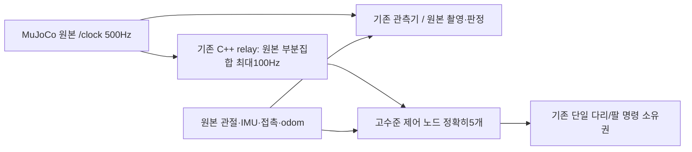

# MuJoCo G1/G2 고수준 시계 전달 비교안

상태: **사용자 승인됨, 최소 구현·검증 진행 중; 실제 성공 아님**. 기존 MuJoCo `native/native/native`와 모든 기본 launch를 유지한다. Gazebo의 물리 설정을 MuJoCo에 복사하지 않는다.

## 근거와 반증

현재 MuJoCo G1 `250b1a4a`는23/23 통과했지만 동일 소스 G2 `ef6a9b3d`는109.410s 결정에서 body ROS age242ms로 실패했다. 최초 receipt 기준 wall age162ms, DDS→콜백90.46ms였다. 그 시간에 reliable native_controls의 촬영은 이어졌고, guard/crawl 상태 자체도 각각 약290/286ms 과거 시각이었다. 전체 엔진 중단·GC·한 개 그래픽 드라이버를 원인으로 확정할 수 없다. 세션의 정상 정리와 기록92,346개 저장은 확인했다.

별도 domain219/500Hz 원본 시계/3초×5구간 비교(`task8-event-api-comparison-56d5c09a-5c0c-4fd1-b1b8-5ae67673269b.json`)에서 기존Events spin_once CPU10.8/11.1%, wait-set28.3%, Events batch12.2/10.5%였다. 엔진·명령 없이 수행했으며 모든 peer를 exit0으로 회수했다. 단순 실행기 교체/묶음 호출이 근본 해결이라는 가설은 채택하지 않는다. 실제 다중 프로세스/CPU 경합 비용을 별도로 줄이는 한 가지 비교가 필요하다.

기존 공식 자료와 이미 구현·검증한 Ch13 `ControlClockRelay`를 재사용한다. 새로운 외부 실행기 수정, 스레드 우선순위, 관리자 권한, 시스템 변경은 필요하지 않다.

## 구체적 변경 경계

- 신규 **명시적 MuJoCo 검증 전용** 조합: `control_clock=relay100`, `position_reference_mode=native`, `dart_contact=native`, 기존 MuJoCo 물리 SHA 필수.
- 기본 실행 조합은 그대로다. `validation_mode` 및 G2의 정확한 실행 프로필/새 G1 증거가 없으면 거부한다. Gazebo의20ms reference/DART50µm는 MuJoCo에 허용하지 않는다.
- 기존 relay 바이너리/원본 단일 `/clock` 발행자를 사용하고, `motion_guard`, `crawl_controller`, `carry_manager`, `nav_projection`, `crawl_startup` **5개만** 원본의 부분집합을 최대100Hz로 받는다. 기존 relay arm·원본 역행/소유권/200ms 고착 실패·최초 receipt 계약을 모두 유지한다.
- 엔진2ms, 원본 `/clock`, 관측기 및 그 원본 clock, ROS/센서/영상/TF header, 제어50Hz, 모든200/300ms와 팔5Hz, G1의10wall초 및 G2 물리 인수 기준을 바꾸지 않는다.
- 초과·pause·실패의 자동 복구나 재시도는 없다. 원본 기록을 그대로 남긴다.

## 구현과 판별 순서

1. 실행 프로필의 명시적 경계 실패 회귀를 먼저 만든 뒤 최소 허용 조합만 추가한다. 기존 잘못된 engine/물리/Gazebo혼합/기본 launch 거부 시험을 유지한다.
2. 기존 원본값/최초 receipt/정지·복수발행자·clock pause 실제 DDS 회귀, 정확히5개 remap, source/install audit를 수행한다.
3. 새 UUID/고정 소스 MuJoCo G1을 먼저 실행한다. 원래 모든 검사에 control_clock_contract를 **추가**하고 실제 binary/lib/PID·wire·CPU·정상 종료를 확인한다. 정상 정리·원본 보존 전 다음 엔진을 시작하지 않는다.
4. 통과한 동일 소스·설치본·장면·프로필의 G1 증거로 G2 한 회를 실행한다. 첫 실패면 중단하며 성공을 고르거나 동일 소스를 무조건 반복하지 않는다. 성공해도 아직 최종3회 연속·양 엔진·전체 회귀 완료로 선언하지 않는다.

100Hz는 CPU 압력을 줄이는 가설이지 시한 보장이나 이동 성공의 증거가 아니다. 관측기/생산자 또는 물리 실패가 계속되면 그 경계를 다시 분석한다. 2026-10-26 사용자가 MuJoCo 전용 비교 구현·검증을 승인했다. 이 범위에서 추가 세부 승인을 반복 요청하지 않고 아래 순서로 진행한다.

### 승인된 MuJoCo relay100 비교: 소스 회귀

실행 프로필의 `relay100/native/native` MuJoCo 조합만 추가했다. 기존 다른 물리·기본 승격 거부를 유지한다. RED1/13.63초→관련51PASS/41.72초, 실제 ROS 중계 wire5PASS/2.60초, 최신 전체 navigation624PASS/460.54초(-W error). 실제 guard 서비스의 명시적 MuJoCo G2 admission fixture도 전체에 포함된다. 이 schema/센서 fixture는 물리 엔진 성공 증거가 아니다. 새 빌드·8패키지 감사→native 저장소 새 G1→같은 고정 소스/설치/장면·프로필 G2로 이어간다. 첫 실패를 제외하거나 기준을 변경하지 않는다.

## 첫 실제 비교 — f99a643c, 전체FAIL

MuJoCo G1 `f99a643c-cad9-4c5f-9a0d-33ef9778211d`는 measured_startup에서 `crawl:guard:ros_age`로 실패했다. 첫 stop의 ROS16.288s, 선택한 guard header16.062s(226ms 전), 최초 receipt부터31.131560ms였다. guard 자체의 state는STAND/fault빈값이었다. 시계중계 원본 부분집합/최초 receipt 계약은1556개 발행/최대26.556743ms로 통과했고, source/relay소유자 및 정확히5개 구독도 확인했다. 이를 이동 성공으로 대체하지 않는다. G2를 시작하지 않았다.

정리의 measuredSTOP/deactivate/carryterminal/nativeworker/consumers/relayexit0/runtime/engine0/reaped/noForce/residual[]/양receiver+writerjoin은 정상이다. 기록9,676개 전량 저장, peak96/256, 오류없음. 보존 ZIP2,905,291bytes SHA256 `bab716b98c6eccf945b3180fd759f8f54c0f560483d18c9593bfc3a5ee0c1d53`; source119 manifest `01242d0077a523a329ce32599b418a831a9e876ff8877cb8d8cfcd47bd673fe0`.

실패 시점±1초 프로세스 CPU는 engine2.274/관측기0.969/crawl0.905/guard0.400 core였다. engine66threads는 스레드 용도·함수 스택의 증거가 아니다. [Mesa 공식 환경변수 문서](https://docs.mesa3d.org/envvars.html#lp-num-threads)는 LP_NUM_THREADS가 렌더링 작업자 수이며 기본값이 CPU코어 수임을 설명한다. 그러나 이번 실패를 llvmpipe 하나로 확정하거나 현재 엔진 설정을 추가 변경하지 않는다.

현재 guard_state의 RELIABLE KEEP_LAST10은 최신 상태보다 오래된 상태를 먼저 전달할 수 있다. 먼저 별도 실제DDS의 유계 수신 정지/상태 버스트 최소 재현으로 이 의미를 판별한다. 관절·접촉 원본 QoS나 전체 물리 기록을 줄이는 방식은 채택하지 않는다. 최신 guard 상태 자체가 고착 FAULT/새generation을 보존하는지 확인하고, 원래 촬영·최초 receipt와200ms 판정을 유지한다. 실제 f99의 guard 발행 지연과 Crawl 큐 지연은 현재 metadata만으로 분리 확정할 수 없으므로 다음 guard 수신의 원본DDS source/received 시각도 함께 기록한다.

### 최신 guard 수정본의 실제 G1 — 61422188, FAIL 보존

MuJoCo G1 61422188-2d9d-4915-bdaf-eb06a8b1e4e0는 교정 하중 이동에서 arm_joint_2 속도0.0210090315rad/s>0.02로 실패했다. 선택 joints ROS32.021999999s/receipt 후1.314989ms로 신선한 물리 관측이다. guard 상태는ROS32.033999999s/receipt 후4.89ms이며 정상 최신 수신이었다. 정확한 source/RMW/callbackSYSTEM metadata가 저장됐다. 따라서 guard 캐시 회귀 통과와 물리 실패를 구분한다.

최초 소스119 manifest4a6731f9618581b88c4ca1011ae7cf851ce6c5b7ec1c1128186e6d0918baaadb; 보존 ZIP7,843,159bytes SHA42d461db29e4b87af0b99ccbfb090bdd74f1c6c1d3a3a034243dd2017065b21e. 실제 measuredSTOP/deactivate/terminal/native/consumers/relay0/runtime/engine0/reaped/noForce/residual[]/수신·기록작업자join을 확인했다. 기록22,841개 전량 저장/peak57/오류없음. G2를 열거나 동일 소스를 재시도하지 않았다.

원생 FR thigh ctrl은31.996→32.018s 표본 사이0.0050445065rad 변했다. 이 관측만으로 중간 callback/물리 인과를 확정하지 않는다. 기본 Controller Manager100Hz와 MuJoCo 물리2ms를 구분했다. 과거 효과 없던 SHIFT 가속도 절반 실험을 반복하지 않는다. 기존 Gazebo20ms 적용 성공과 공식 ROS2 controller 사례를 검토해, 별도 Ch13 MuJoCo 모터 참조 적용 비교안을 SECTION_13_5_MUJOCO_REFERENCE_PROPOSAL_KO.md에 작성했다. 이는 앞선MuJoCo native 참조 승인 범위를 넓히므로 승인 전 구현하지 않는다.

## 2026-10-26 후속 분석: 적용 시각 해석 정정

사용자는 MuJoCo20ms 보간 controller 제안을 채택하지 않고 native 유지·원인 분석만 선택했다.
[후속 원인 분석](SECTION_13_5_MUJOCO_NATIVE_CAUSE_ANALYSIS_KO.md)에서 36개 명령 벡터의
세 지지 다리 일관성을 확인했다. 외부 write()는 이전 physics snapshot의 ctrl을 새 요청으로
갱신한 뒤 Ch13 update()를 호출하므로, native_controls의 header는 새 요청의 실제 물리 적용
시각이 아니다. 앞선 ‘22ms 표본 간 변화’를 적용 지연·팔 초과의 인과 증거로 사용하지 않는다.
팔 속도 초과와 원본FAIL은 유지한다. 새로운 controller·mode·게인·엔진 비교는 수행하지 않았다.
