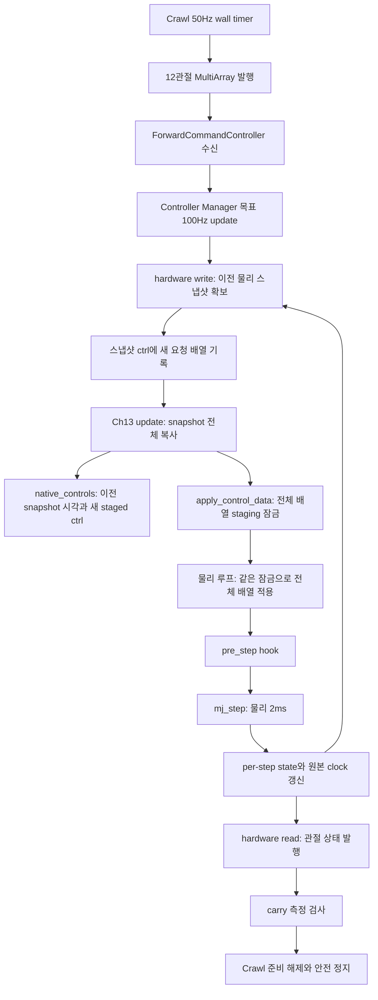

# 13.5 MuJoCo native 참조 실패의 원인 분석

확인일: 2026-10-26. 분석 UUID `a1ee6678-35ab-484c-9fba-aa861f1af230`.
대상 실제 실행: G1 `61422188-2d9d-4915-bdaf-eb06a8b1e4e0`, `relay100/native/native`.
사용자 결정은 **native 참조 유지·원인 분석만 진행**이다. 새 보간 controller·mode·게인·기준 변경,
새 엔진 시행은 수행하지 않았다. **물리 실패의 최종 원인은 아직 미확정이며, 13.5 완료가 아니다.**

## 1. 이번에 확인한 결론

1. 최초 정지 원인은 신선한 관절 측정의 `arm_joint_2` 속도 초과다. carry가 준비 상태를 해제했고,
   Crawl이 이를 받아 정지했다. 최신 guard 캐시 결함과 구분해야 한다.
2. 실패 전후 SHIFT 및 정지 직후의 36개 표본에서 FR/RR/RL 세 지지 다리의 명령은 하나의 동일한 몸통 기준을
   나타낸다. 현재 표본과 잠금 소스로는 관절별 명령이 섞이는 현상을 뒷받침할 수 없다.
   같은 36개 표본의 팔6관절·그리퍼2관절 staged 목표도 각각 일정했다. arm2는 모두 1.2rad다.
   이 표본들에는 새 팔 목표로 전환된 흔적이 없다. 표본 사이의 모든 적용까지 입증한 것은 아니다.
3. **`native_controls.capture_ns`는 실제 새 명령의 물리 적용 시각이 아니다.** 현재 플러그인은
   이전 물리 스냅샷에 새 요청 `ctrl`이 채워진 상태를 `write()` 안에서 복사한다. 따라서 기존
   ‘22ms 동안 0.00504rad 변화’는 두 기록의 차이이며 실제 적용 간격·원인으로 확대 해석하면 안 된다.
4. 조건부 곡선 역산은 참조 유지 후 진행량 증가를 보여준다. 그러나 고수준 발행·DDS 수신·controller
   update·물리 적용을 잇는 직접 trace가 없어 어느 경계에서 지연됐는지, 그것이 팔 속도 초과를
   유발했는지 분리할 수 없다. 이 불확실성을 보간 필요성의 증명으로 사용하지 않는다.

## 2. 실패의 직접 경로

| 경계 | 원본 기록 | 해석 |
|---|---|---|
| carry 최초 실패 | 관절 header 32.021999999s, 최초 수신 후 1.314989ms | 오래된 receipt 때문에 실패한 경우가 아님 |
| 실제 관절 값 | arm2 속도 −0.02100903152126743rad/s, 허용 절댓값 0.02 | 기준 초과이므로 정지 판정 유지 |
| gripper | 약 ±0.00061635m/s, 기준 0.005 | 이번 최초 초과 항목이 아님 |
| Crawl 정지 | `calibration_carry_not_ready`, ROS 32.033999999s | carry 준비 해제에 대한 후속 정지 |
| 선택 guard | header 32.033999999s, receipt 후 약 4.89ms, STAND·fault 없음 | 최신 guard 수신 회귀와 물리 실패를 구분 |
| 당시 동작 | SHIFT, SWING 없음, unload 시작 전 | 들기·착지/복귀 알고리즘의 실패로 오인하지 않음 |
| 정리 | runtime/engine 정상 종료, 부모 회수, 강제 종료 없음, 잔여 없음 | 이동 성공과 종료 성공은 별도 결과 |

여기서 ‘관절 header’는 원본 ROS 메시지 시각이다. 외부 hardware `read()`는 per-step
`control_state`의 qvel을 읽고 read 호출 시각을 메시지에 넣는다. 수신이 신선하다는 사실을
별도 물리 샘플 시각/적용 명령 시각까지 완전히 일치한다는 주장으로 확대하지 않는다.

원본 인수 결과는 그대로 FAIL이다. required_checks 중 `carry_measured_settle`, `contact_lift`,
`joint_tf_ownership`, `native_ctrl_observed`는 false이고 `native_library_loaded`는 결과에 없다.
마지막 항목의 MuJoCo 최종 확인은 runner의 교정 이후 단계이므로 도달하지 못했다.
이를 새 라이브러리 로드 실패나 다섯 개 독립 원인이 발생했다고 단정하지 않는다.

## 3. 명령은 어떻게 전달되고, 현재 기록은 어디서 찍히는가

아래 순서는 로컬 readonly 외부 checkout `ros-controls/mujoco_ros2_control`의 깨끗한 커밋
`c261f5552edf124d1000a23fb25b6c07cadeb807`과 고정된 Ch13 소스를 대조한 결과다.
외부 소스를 편집하거나 재빌드하지 않았다. 이 사후 소스 조사는 당시 바이너리를 재빌드하여
소스와 대조한 별도 입증이 아니며, 해당 범위는 evidence에도 명시했다.

- 외부 `mujoco_system_interface.cpp:1172–1220`: snapshot 확보 → ctrl 갱신 → 각 plugin `update()`
  → `apply_control_data()` 순서다. Ch13 `NativeNavigationSensorsPlugin.update()`는 이 경로에서
  `SensorWorker.submit()`으로 전체 복사를 수행한다. `pre_step()`을 재정의하지 않는다.
- 외부 `mujoco_simulation.cpp:1364–1370, 1407–1419`: staging 및 live ctrl 복사는 같은
  `control_staging_mutex_`로 보호한다. 소스상 관절을 쓰는 도중 물리가 중간 배열을 읽는
  단순한 모델은 맞지 않는다. 모든 경쟁 조건이 없다는 포괄적 보장은 아니다.
- Ch13 `normalization.cpp:155–158`: `ctrl`·qpos·qvel·force를 전달받은 data에서 읽는다.
  복사한 값의 출처가 native여도, 새 ctrl과 과거 상태가 동시에 적용됐음을 입증하지 않는다.
- 외부 node의 CM 루프는 read → update → write → ROS clock 대기다. 100Hz는 목표 주기이며
  각 실행의 엄격한 10ms 간격 보장은 아니다. **물리 2ms를 CM 500Hz라고 설명하면 안 된다.**

현재 `assess_native_controls()`는 매핑·유한값·형식·위치/속도/힘 상한 등을 검사한다.
실제 명령 적용 시각이나 새 ctrl과 같은 물리 step의 동역학 일치까지 검사하지 않는다.
따라서 이 검사 통과만으로 계단 입력의 실제 적용 간격이 검증됐다고 쓰지 않는다.

## 4. ‘관절 명령 혼합’ 가설을 기존 기록으로 판별하기

G1은 정지 상태에서 하중을 이동하며 명령 회전 R은 일정하다. unload 전 SHIFT에서는
FL의 사전 하중 보정만 변하고 FR/RR/RL의 world 발끝 목표는 고정된다. 각 지지 다리 i에 대해:

`t_i = p_world_target_i − R × FK_i(q_ctrl_i)`

하나의 몸통 참조로 생성된 q_ctrl이면 세 t_i가 일치한다. 이는 **명령 기준의 역산**이며
측정 몸통 위치·오도메트리·제어 입력으로 쓰지 않는다.

실패 전후 선택한 36개 snapshot(31.338–32.088s)에서 최대 편차는
**1.5700924586837752×10⁻¹⁶m**다. 빠른 analytic FK와 일반 URDF matrix chain도 최대
**1.1443916996305594×10⁻¹⁶m** 차이였다. 진단 감도 점검으로 한 다리 thigh만 0.001rad
바꾼 합성 입력에서는 약 **0.441573mm** 차이가 검출됐다. 합성 입력은 실제 관측에 섞지 않았다.

결론은 ‘선택된 표본에서 혼합이 관측되지 않음’이다. 50Hz 사이의 모든 중간 명령까지
완전하게 검사했다거나 잠금만으로 모든 시스템 결함이 배제됐다고 주장하지 않는다.

## 5. 곡선 역산과 시간 해석의 한계

G1 SHIFT의 quintic blend는 `s(u)=10u³−15u⁴+6u⁵`이고, 이번 duration은
1.744655038853971s, 가속도 예산은 0.1m/s²다. 소스의 duration 식을 역산하면 이동 거리
0.05272052975520194m를 얻는다. 위 t_i의 일치와 고정된 직선 방향을 이용해 곡선상의
시점을 조건부 역산했다. 가정·전체 36개 결과·입력 해시는 JSON에 보존했다.

| snapshot header(s) | staged FR thigh(rad) | 곡선에 해당하는 추정 decision ROS(s) |
|---|---|---|
| 31.976 | −0.5120330785009180 | 31.935999999 |
| 31.996 | −0.5120330785009180 | 31.935999999 |
| 32.018 | −0.5170775850096944 | 31.985999999 |
| 32.044 | −0.5208692969113139 | 32.021999999 |

첫 두 표본의 값이 같고 다음 값은 곡선상 50ms 더 진행되어 있다. 하지만 snapshot은 요청
생성·도착·물리 적용을 직접 기록한 것이 아니다. 중간 표본 누락, 고수준 시계/콜백 지연,
DDS/controller 수신 및 staging 지연을 이 표만으로 분해할 수 없다.

특히 `first_stop.tick_spans[].ros_ns`는 `_dispatch_tick()` **끝**에서 읽는다.
이를 `_tick()` 시작의 decision 시각으로 사용하거나 같은 end 시각 두 개만으로 동일한
decision clock을 단정하면 안 된다. relay 파일의 publish 시각 역시 Crawl 수신 시각이 아니다.

관절 원본에는 32.021999999s의 속도 peak가 있지만, 50Hz native_controls의 앞뒤 snapshot에서는
그 peak가 그대로 보이지 않는다. 따라서 물리 검사를 낮은 빈도로 줄여 실패를 없애는 방식을
사용하지 않는다. 원본 관절·접촉·전체 Probe 기록을 보존했다.

## 6. 배제/보류한 설명과 다음 판별점

| 설명 | 판정과 근거 |
|---|---|
| 최신 guard를 못 받아 이번 정지 | 이번 첫 정지에서는 신선한 guard와 carry 실패를 확인. 이전 f99와 다름 |
| planning 시간이 motion 시간으로 누적 | 소스가 planning 완료 시 phase_start를 다시 설정함. 반복 수정 대상 아님 |
| 모든 원인이 llvmpipe/GC | 해당 실행의 명령·실제 관절 peak 인과를 입증하는 근거 없음 |
| 관절별 ctrl 중간 배열 혼합 | 선택한 36개 벡터 일관성 및 staging 잠금으로 뒷받침되지 않음 |
| 22ms 기록 차이가 정확한 물리 입력 간격 | 기록이 snapshot+staged ctrl이므로 확정 불가 |
| 참조 유지 후 진행이 팔 진동을 유발 | 유력하게 판별할 가설이지만 실제 적용 trace 부재로 인과 보류 |

native 참조를 유지한 채 다음에 필요한 것은 **동일 명령의 단계별 식별 기록**이다.
발행 직전 12개 값/순서/decision ROS/monotonic, DDS 도착, CM update에서 선택한 값,
물리 적용 직후 또는 pre-step의 실제 ctrl/step 시각을 유계 기록으로 연결해야 한다.
새 writer·명령 보간·root setter·시각 재태깅은 필요하지 않다. 물리 hot path에서 파일 쓰기나
JSON 직렬화를 하지 않고, 유계 수치 기록을 종료 후 내보내는 경계가 적합하다.

이 문서는 필요한 **측정 요건**을 정리한 것이며 그 계측을 구현/실행했다는 뜻이 아니다.
현재 사용자의 ‘원인 분석만’ 결정을 유지해 이 단계에서 런타임을 바꾸지 않았다.
보간안을 채택하지 않은 결정을 [이전 제안서](SECTION_13_5_MUJOCO_REFERENCE_PROPOSAL_KO.md)에 남겼다.
원인이 정량적으로 확인되기 전 게인·마찰·주기·기한 조합을 늘려 시험하지 않는다.

## 7. 재현과 보존

- [분석 실행 코드](../evidence/section_13_5/85670137-e73c-4c72-bcb2-0c73e755088b/analysis-a1ee6678-35ab-484c-9fba-aa861f1af230/analyze.py)
- [분석 결과·입력 SHA·외부 소스 구간](../evidence/section_13_5/85670137-e73c-4c72-bcb2-0c73e755088b/analysis-a1ee6678-35ab-484c-9fba-aa861f1af230/result.json)
- [팔·그리퍼 목표 불변 점검](../evidence/section_13_5/85670137-e73c-4c72-bcb2-0c73e755088b/analysis-a1ee6678-35ab-484c-9fba-aa861f1af230/arm-hold.json)
- 결과 SHA256: `aebcd0ea1188d6a0184427b824529f2820756552b39b445713828b735f61af9b`.
- 원래 실패 ZIP SHA256: `42d461db29e4b87af0b99ccbfb090bdd74f1c6c1d3a3a034243dd2017065b21e`.
- 당시 manifest의 런타임 119파일이 현재와 일치함을 다시 확인했다. 원본 실패·판정은 수정하지 않았다.

분석은 numpy가 있는 WSL 일반 사용자 `/usr/bin/python3`로 repository 루트에서 실행한다.
엔진·ROS setup은 필요하지 않다. `analyze.py`의 docstring에 명령이 있으며 출력 파일은
기존 파일을 덮어쓰지 않도록 새 경로를 지정한다. 외부 readonly checkout도 필요하다.
단위 수치 self-check/해시 감사와 실제 엔진 인수는 구분한다. 이번에는 새 엔진 시험이 없다.

남은 작업은 Task8 G1/G2의 실제 실패 해결 및 고정본 연속 성공, 이후 Nav2 Tasks9–14,
최종 회귀·절 단위 commit/push다. 이 분석을 13.5 완료나 새로운 물리 성공으로 세지 않는다.

## 8. 실행 재개 뒤 실제 판별(2026-10-26)

앞의1–7절은 a1ee6678 당시의 분석 기록이다. 이후 사용자가 Task8 실제 해결부터 Nav2·최종회귀·
commit/push까지 재승인했다. native모터 참조는유지하며 Ch13에만 읽기전용 계측을추가했다.
실제 pre_step lane은 sourceROS/steady·적용ctrl·이전step qvel을, CM lane은 stagedctrl/과거snapshot을
분리한다. Crawl의발행 전후/decision시각과값도유계로보존했다. default명령writer나rootsetter는없다.

새 G1 13728e5d는24/24PASS/정상종료/회수/잔여없음이었다. 같은소스121 manifest e733c072...의
G2 e75b4e86은forward에서 final_command:ros_age로FAIL했다. decision60.260s,선택명령60.020s,
원본receipt뒤182.582234ms였다. guard의60.212s CRAWL/ready는신선했다. CM/실제물리계측의
최근arm2peak는.00798rad/s로,이실패의최초이유는이전G1의팔속도초과가아니다.

소스에서 최종Twist수신이기본control callbackgroup과model lock에남은점을발견했다.
센서·guard·clock을분리한기존수정에이경계가빠져있었다. 별도실제ROS에서긴제어작업중
command수신만막히는현상을RED1/14.24초로재현했다. 수신은기존sensor group+짧은inbox로
분리하고원래callback-entry시각·DDS순서를보존한다. 결정시점이후/미래의값을선택하지않고
원래200ms ROS/wall검사를유지한다. 오류의고착만수신자가수행하고모델과최종발행은단일owner가판정한다.

추가로 G2정리의 STOP이이미고착된carry fault때문에거부돼measuredSTOP/deactivate가실패했다.
프로세스회수·force없음·잔여없음을정상runtime/engine종료로잘못대체하지않는다.
STOP ACK는fault·generation과0출력을유지한채허용하고,실제정지/해제/종료는원래검사를별도로거친다.
별도RED→순수/실제ROS21PASS로검증했다. 이수정들은다음실제고정본G1/G2로재검증해야한다.
