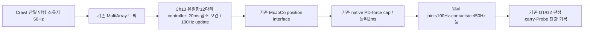

# MuJoCo 다리 참조 적용 경계 — 검증 전용20ms 보간 설계

상태: **채택하지 않음 — 사용자 결정: 현재 native 참조 유지·원인 분석만 진행**(2026-10-26).
보간 controller·새 mode는 구현하거나 실행하지 않았다. 아래는 당시 제안의 보존 기록이다.
앞선 MuJoCo 승인은 `relay100/native/native`였다. 이 문서는 그중 모터 참조 적용 경계를 넓히는
구체안이었으며 현재 실행 계획으로 사용하지 않는다.

후속 [native 원인 분석](SECTION_13_5_MUJOCO_NATIVE_CAUSE_ANALYSIS_KO.md)에서
`native_controls`가 이전 물리 snapshot에 새 staged ctrl을 결합한 기록임을 확인했다.
따라서 아래 표본 간 22ms를 정확한 물리 적용 간격이나 보간 필요성의 증거로 해석하지 않는다.
실제 팔 속도 초과는 유지하지만 그것과 명령 적용의 인과는 아직 미확정이다.

## 현재 실패와 판별 한계

G1 `61422188-2d9d-4915-bdaf-eb06a8b1e4e0`는 시동·정적 관측 뒤 교정 SHIFT에서 실패했다. 최초 carry 실패는ROS32.021999999s/receipt 후1.314989ms의 신선한 관절 측정으로 arm_joint_2 속도−0.0210090315rad/s(기준0.02)를 관측했다. gripper속도0.000616m/s는0.005기준 이내였다. 직후 Crawl이 준비 해제된 carry를 보고 정지했다. guard최신상태 수신은 정상이며 촬영32.033999999s/수신 후4.89ms였다. metadata도 보존했다. 물리 실패를 오래된 메시지 문제로 재분류하지 않는다.

원생 `ctrl` 표본의 FR thigh 목표는31.996s의−0.5120330785에서32.018s의−0.5170775850rad로 바뀌었다(22ms/0.0050445065rad). 이전 표본 변화는 약0.001rad였다. 50Hz 표본이므로 그 사이의 정확한 command callback·2ms 적용 횟수나 인과를 확정하지 않는다. 다만 입력의 일정한50Hz 가정과 실제 적용 경계가 다를 수 있어 이 경계를 직접 비교할 근거다. 기존100Hz Controller Manager와2ms MuJoCo 물리 주기를 구분한다. controller_manager500Hz라고 쓰지 않는다.

기존 Gazebo G1의20ms 참조 적용과 고정 소스3회 성공은 가장 가까운 내부 사례다. 거기서는 DART 접촉 설정도 함께 검증돼 있어 그 성공을 MuJoCo로 일반화하지 않는다. G1 SHIFT 가속도를 절반으로 줄이는 과거 대책은 효과가 없어 폐기했으므로 반복하지 않는다.

## 공식 사례와 선택

- [Jazzy ForwardCommandController](https://control.ros.org/jazzy/doc/ros2_controllers/forward_command_controller/doc/userdoc.html)는 Float64MultiArray 명령을 hardware interface로 전달한다.
- [Jazzy JointTrajectoryController의 보간](https://control.ros.org/jazzy/doc/ros2_controllers/joint_trajectory_controller/doc/trajectory.html)은 시간 지정 waypoint와 linear/cubic/quintic을 지원한다. 선형 보간의 속도 불연속과 trajectory replacement 제약도 명시한다.
- JTC로 바꾸면 메시지·action 입력·trajectory 소유권까지 넓어지므로 이번 최소 비교에는 선택하지 않는다. 기존 MultiArray 토픽과 단일12다리 position claim을 유지하는 Ch13 전용 controller를 권장한다. 외부 소스/underlay를 수정하지 않고 공개 controller_interface API를 사용한다.

## 구현 경계

`integrated_robot_navigation_sensors`는 이미 Gazebo PositionPDSystem을 소유한다. 같은 Ch13 패키지 안에 별도 `ReferencePositionController`와 plugin XML을 추가한다. 외부 controller 구현을 복사하지 않는다. 기존 Ch13 Gazebo의 ramp_from/applied/requested 알고리즘을 출처·커밋과 함께 공통 수치 core로 추출하거나 동일 식으로 재사용하고, Gazebo 경로의 동작을 바꾸지 않는다.

- 기존 MuJoCo ForwardCommandController **대신 하나만** 선택한다. 중간 pub/두 번째 하드웨어 writer·physics sensor plugin의ctrl 덮어쓰기는 만들지 않는다.
- 토픽 `/leg_position_controller/commands`와 MultiArray의12관절 순서, 기존 controller manager100Hz/물리2ms/고수준50Hz는 유지한다. 20ms 보간은 실제100Hz update의 이산 표본이다. 2ms마다 적용한 것처럼 설명하지 않는다.
- 새 목표가 도착하면 현재 적용 참조에서 새 목표까지20ms 선형 보간한다. 재입력은 현재 진행 중인 참조에서 시작하며 이전 목표를 먼저 완주하지 않는다. 활성화 시 실제 관절 위치를 초기값으로 사용해 jump를 피한다. 로봇 root/qvel을 조작하지 않는다.
- 기존 관절 위치/유한값 검사, 단일 publisher·resource claim·source순서/초기화 경계를 검증한다. 잘못된 입력은 실패를 고착하고 원인을 보고하며 자동 재활성화하지 않는다. 기존 고수준 fresh/stop 검사는 유지한다.
- 모델·관성·접촉/마찰·게인·30Nm/기타effort cap은 바꾸지 않는다. 팔/그리퍼 controller와action 수명도 그대로다.
- 유계 C++ 기록에 원본 요청 시각·요청/적용 참조·update 시각을 남긴다. hot path에서 JSON/파일 쓰기나 graph 탐색을 하지 않는다. actual MuJoCo `ctrl`과 비교하고 실제 로드된 controller type/단일claim/PID/library SHA를 확인한다.

## 명시적 검증 프로필과 인수

새 조합은 MuJoCo **검증 전용** `relay100/g1_ramp20ms/native`다. 기존기본 `native/native/native`와 승인된 `relay100/native/native`는 그대로다. 검증 flag·장면 mode·실행 프로필이 모두 일치하지 않으면 새 controller를 로드하지 않는다. Gazebo 전용 DART 설정을 MuJoCo에 허용하지 않는다. mode가 다른 G1 proof는 G2를 열지 않는다.

1. RED로 순수 수치 core의 step/중간 재목표/유한값/위치·clock역행·초기화·유계기록을 검증한다.
2. 실제 ROS controller_manager/resource claim/명령·종료·잘못된 입력·다중 소유권 거부 시험과 native-default 유지 회귀를 수행한다.
3. 선택 패키지 source/install 감사 뒤 새 UUID 실제 G1. 원래 모든 검사에 **native_reference_contract를 추가**한다. G1의10wall초·실제 lift·기존 모든 속도·하중·안정화 기준은 그대로다.
4. 첫 실패는 그대로 중단/보존하며 원생ctrl·요청/적용·carry/joints와 연결한다. 임의 게인/가속도/기한 sweep을 하지 않는다.
5. G1이 전부 통과하고 정리/보존된 경우 같은 고정 소스·설치·장면·mode로 G2를 한 번 실행한다. 실제 G2도 통과해야3회 연속/양 엔진/최종회귀로 진행한다. 보간 단위시험만으로 성공을 선언하지 않는다.

같은 소유 프로세스에서만 적용하며 관리자·드라이버·시스템·외부 원본 변경은 없다. 이 설계의 모터 적용 경계 확장 승인 전에는 controller 코드/허용 mode를 구현하거나 해당 엔진 비교를 실행하지 않는다.
