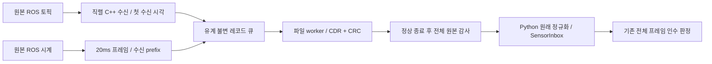

# Task8 원본 관측 수신 경계 수정

## 근거와 범위

실제 MuJoCo `cf1fad26`은 전체 FAIL이다. 몸체 촬영 하나가 3프레임에서 208ms였고, 발행→RMW 1.4675ms에 비해 RMW→Python 콜백은 163.514201ms였다. 별도로 마지막 다리 목표는 native prestep에서 발행 후 15.9757ms에 적용됐지만 ACK 첫 수신은 기존 기록에 없어 원인을 확정할 수 없다. ACK의 유효한 관측을 검사하기 전에 처리 시각의 마감을 선언하던 순서 결함은 실패 회귀 후 수정했고 관련32시험이 통과했다. 실제 실패 해결의 증거로 대신하지 않는다.

## 수신 계약

- 기존 Python 전체 관측 경로는 비교용으로 보존한다. Task8의 명시적 `native_cdr` 선택만 새 수신기를 사용한다.
- Ch13 C++ 프로세스가 기존 토픽/QoS를 직접 구독한다. 원본 CDR, 콜백 첫 MONOTONIC 시각, SYSTEM 시각, RMW 메타데이터와 GID를 보존한다. SYSTEM 시각을 MONOTONIC으로 취급하지 않는다.
- 원래 ROS 시계의 20ms 타이머가 프레임의 ROS/wall 시각과 stage를 기록한다. 직렬 실행기의 당시 수신 prefix를 프레임에 고정한다. 종료 후 해석기가 이 prefix만 원래 SensorInbox에 넣고 같은 선택·검증을 수행한다. 미래 수신을 소급하지 않는다.
- 파일 기록만 별도 worker가 수행한다. 최대256레코드/8MiB 큐, 초과·기록 실패는 영구 실패다. packet 누락·오래된 프레임 제외·헤더 갱신은 없다.
- stage ACK 이후에만 다음 명령을 내린다. 실시간 motion fault와 수신/기록 오류를 부모에 알린다. 센서 내용의 전체 해석 오류는 종료 후에도 반드시 FAIL이며, 제어기의 독립 안전 검사는 그대로다.
- 종료는 새 수신 차단→실행기 종료→writer drain/join→파일 종료→ROS 종료→프로세스 exit0 순서다. 기존20초 join 안에 JSON 해석을 넣지 않는다. 전체 원본 hash/CRC/순번/개수 확인 후 Python 해석·JSON 내보내기를 수행한다.
- MuJoCo의 `/navigation/applied_reference`도 독립 수신 원본을 기록한다. 이 시각은 제어 클라이언트의 수신 시각이 아니며 credit을 부여하지 않는다. 실제 제어기의 실패 snapshot과 native 적용 trace를 별도로 대조한다.
- 관측기만 바꾸며 native 모터 제어·게인·물리·200/300ms·G1/G2 마감·기존 required_checks는 유지한다.

## 구현 순서와 검증

1. 원본 CDR reader의 CRC·잘림·순번·크기·첫 수신/미래 촬영·중복 회귀를 먼저 실패시킨다. `native_observer_13_5.py`의 `read_records(source)`와 `replay_recording(root, report)`가 이를 검증한다.
2. `integrated_robot_navigation_sensors`에 독립 실행 파일 `navigation_evidence_recorder`를 추가한다. 자체 journal 유계 큐·오류·정상 drain 시험과 실제 DDS 수신·stage·종료·TF GID 시험으로 검증한다.
3. 기존 `ObserverProcess`와 같은 API의 명시적 native backend를 연결한다. 동일 합성 원본에 대한 legacy/native 프레임 의미·촬영 시각·중복 첫 수신 보존을 비교한다. 모든 기존 observer 회귀를 유지한다.
4. S/N 빌드·8패키지 설치 감사·관련 회귀 후 코드 동결한다. 새 G1/G2 한 쌍에서 모든 원래 검사와 ACK 실패 snapshot을 확인한다. 첫 FAIL에서 중단한다. 성공하면 고정 소스의 양 엔진3회 연속 인수로 진행한다.

검토 초점은 잘린 파일을 정상 종료로 오인하는 경우, 수신 prefix보다 뒤의 값을 사용하는 경우, duplicate로 수신 나이를 갱신하는 경우, writer 초과를 숨기는 경우, 종료 후 남은 worker다. 각각 회귀에 포함한다.

## 참고

설치된 Jazzy rclcpp 28.1.22의 GenericSubscription API와 [rosbag2 0.26.11 recorder](https://github.com/ros2/rosbag2/blob/cb8fa198b93bfed90e2417b52b8645fb9ef89c2b/rosbag2_transport/src/rosbag2_transport/recorder.cpp)의 직렬 메시지 소유권 방식을 참고한다. Apache-2.0 원본의 코드 복사는 없으며 Ch13에서 새로 작성한다. rosbag의 SYSTEM 기록 시각을 안전용 MONOTONIC 나이로 전용하지 않는다.

## 구현 중 관측된 회귀

첫 실제 native CDR G1 `cdcc24c2`의24검사·모든 정상 종료는true였으나 빈 stderr artifact 때문에 전체FAIL이다. 원본 CDR27562레코드/31,259,763bytes와 전체 해석·CRC·해시는 정상이었다. 기존 증거 계약의 `size>0`를 유지하면서 Python 로그 생산자가 실제 명령/SHA·시작/종료·PID/exit·native stderr 바이트 수/위치를 담도록 고쳤다. 원래 stderr payload는 바이트 그대로 남긴다. 최소 실제 종료 RED17.81초→관련60PASS25.93초, 기존FAIL/source133/9374f13e/ZIP008d565a 보존이다. 파일명 문제라는 초기 가설은 근거로 기각했다.

최종 준비는 센서 빌드58.7초/큐3시험, navigation 빌드14.3초, 8패키지 설치 감사, 관련163시험183.61초 PASS다. 준비 스크립트가 두 빌드에 같은 로그 이름을 써 센서 빌드 뒤 중단한 사례는 별도 보존했고, 이름을 구분한 뒤 완료 지점부터 이어갔다. 실제 엔진 성공은 이 결과에 포함하지 않는다.

최초 reader RED12.98초→9개 reader 회귀 PASS 후 프로세스 부재 RED11.98초다. C++ 최초 빌드와 큐3시험 통과 후 실제 DDS/기존 수신23시험14.91초 PASS, 명시적 backend 연결 RED23.28초→legacy/native 관련33시험103.35초 PASS다.

부모 stdin이 닫힌 경우 Python이 ValueError로 조기 이탈하는 RED12.47초를 확인했다. 자식이 먼저 drain·exit하도록 기다리고 실패를 유지하도록 고쳤다. C++도 부모 연결이 없어져도 파일 worker를 마무리하고 독립 종료 보고서를 남기도록 했다. 종료 오류를 정상 성공으로 바꾸지 않는다.

추가 시험의 최초 입력은 `FootContacts` 고정 길이4를1로 잘못 만들었다. 직렬화 단계에서 전체 실행은 SIGSEGV, 분리 실행은 RuntimeError였다. 실제 수신 코드 결함으로 분류하지 않았다. 입력을 네 발로 수정한 뒤 부모 손실·오래된 프레임·미래 촬영을 포함14시험이 통과했고, 미구현 독립 ACK 해석 회귀가 의도대로 실패했다. 해당 원본 로그도 보존한다. 최종 새 수신기·실제 엔진 판정은 별도다.
