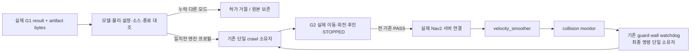

# 13.5 남은 구현: 성공 사례 조사와 채택 결정

2026-10-25. G1 양 엔진 3회 연속 통과 뒤, G2/Task9–14 구현의 시행착오를 줄이기 위한
선행 조사다. 아래 외부 사례는 원문·코드를 읽었으며 이 환경에서 직접 실행한 것은 아니다.
README의 데모 주장을 Ch13 실측 성공으로 세지 않는다. 외부 소스는 복사하지 않았다.

## 비교한 사례

| 사례·고정 커밋 | 확인한 범위 | 채택 | 제외·이유 |
|---|---|---|---|
| [quadruped_ros2_control](https://github.com/legubiao/quadruped_ros2_control/tree/5434c5810d1a7fe223bcfd04550e9d3bfdd4b458), `5434c581…` | Jazzy/Harmonic, native update/FSM, FixedStand·실행 안내 | 하나의 제어 소유자, 모델/추정/상태 전이의 순서 | pos/vel/effort/Kp/Kd와 Ch13 position 인터페이스가 다름. 문서의 불안정 주의·시간 기반 Stand 완료·다른 게인과 로봇을 이식하지 않음 |
| [ChampQuadbot](https://github.com/IbrahimZantoutt/Quadruped-Robot-using-CHAMP-ROS2-/tree/d1d8123bc8b4ed7e80b8db63b746154a1956bd5f), `d1d8123b…` | 저자 Nav2 이동 데모, README·gait.yaml·nav2.launch.py | Nav2 속도→스무더→보행기 경계, 로봇별 관절 매핑 | Humble/Classic·effort JTC·다른 질량/치수·0.3m/s 설정. 팔 적재와 Ch13 crawl 검증이 아님. 원문 root 라이선스 미확인으로 코드 복사하지 않음 |
| [Tiffany](https://github.com/SENAI4LIFE/tiffany_gazebo/tree/65979b3c8ae390047e58625709bf303ddbcd5c17), `65979b3c…` | Jazzy/Harmonic, 저자 이동/Nav2 데모와 시스템·보행 설명 | Nav2를 수정하지 않고 50Hz 자체 보행기를 연결하는 구조 | 6족 tripod·횡이동·자동 탈출/후진·재시도. 4족 삼각 지지와 carry를 대신 검증하지 못함. root 라이선스 미확인, 코드 복사 없음 |
| [Nav2 Jazzy 공식 구현](https://github.com/ros-navigation/navigation2/tree/426682ff88405a99617294f5cc8401a61aa5fa50), `426682ff…` | navigation_launch.py·BasicNavigator 실제 구현 및 공식 Jazzy 문서 | 서버/lifecycle/토픽 연결, 스무더 이후 collision monitor, result future 확인 | 기본 속도·footprint·진행 판정·Spin/BackUp 복구·최신 배포판 기본값을 그대로 쓰지 않음 |

CHAMP ROS2 wrapper `049b33ccaf77847bbea168cbb0a11c260ce119cd`도 확인했다. core는
libchamp submodule `8c50f649b3fd28a123beaf6f9618ddfaa1589559`이므로 wrapper SHA만으로
보행 소스 전체를 특정할 수 없다. wrapper 라이선스는 BSD-3-Clause다. 이번에는 구조만
참고하며 새 보행 라이브러리·RL·MPC/WBC 의존성을 도입하지 않는다.

## 구현 방향

**G2는 이미 G1에서 측정한 제어·센서 경계를 재사용하고, 보행 허가의 증거 연결을 먼저 완성한다.**
기존 CrawlMachine의 4족 저속 crawl, 지지 다각형·실제 접촉·IK·미끄러짐/기울기·carry 제한을
유지한다. 모델·마찰·게인·주기를 여러 조합으로 순회하거나 외부 로봇으로 바꾸지 않는다.

현재 확인한 통합 공백은 실제 runner의 artifact **목록**과 profile 검증기가 기대하는 역할별
artifact **사전**의 차이다. 오프라인 flag를 바꿔 움직임을 허가하지 않고, 실제 결과의 원본
schema·필수 검사·모델/설정/물리·소스/설치·종료·artifact bytes를 연결하는 회귀부터 만든다.
형식 변환만으로 성공을 생성해서는 안 된다. G1 전용 실험 설정의 결과가 일반 설정으로
전이되는 경우도 반드시 거절한다.

**Task9:** [Jazzy 충돌 모니터 공식 튜토리얼](https://docs.nav2.org/jazzy/tutorials/general_tutorials/using_collision_monitor/using_collision_monitor/)에
따라 스무딩 뒤에 안전 차단을 둔다. 추가 Ch13 guard가 최종 명령을 단독 발행하므로
공식 출력 토픽도 Ch13 중간 토픽으로 remap한다. 스무더·collision monitor·guard가 동시에
최종 cmd_vel을 발행하지 않는다. 기존 200/300ms와 정지 직후0 출력을 그대로 검증한다.
[공식 velocity smoother 설정](https://docs.nav2.org/jazzy/configuration_and_development/configuration_guide/core_servers/configuring_velocity_smoother/)의
Jazzy Twist 기본값을 명시하고 원고의 단순 x축 ramp로 대체하지 않는다.

**Task10–11:** 일정 반경 공식은 후보 생성에만 사용한다. 실제 arm mount·IK·swept footprint·
costmap/path 검사를 거친다. 원 촬영 header는 Nav2 Goal stamp와 별도 보존한다.
[공식 BasicNavigator](https://github.com/ros-navigation/navigation2/blob/426682ff88405a99617294f5cc8401a61aa5fa50/nav2_simple_commander/nav2_simple_commander/robot_navigator.py)의
cancelTask는 취소 요청 완료와 별도로 result_future를 다룬다. Ch13은 기존 독립 액션
receiver를 재사용해 terminal 수신과 실제 STOPPED/carry를 모두 확인한다.

**Task12–14:** 공식 데모의 ‘Goal succeeded’를 최종 인수로 대신 쓰지 않는다. 기존
고장 주입·실제 이동량·최종 자세·정상 종료·13.3/13.4 전체 회귀와 원격 SHA를 그대로 요구한다.

## Gazebo G2에서 추가로 확정할 범위

최근 승인은 relay100/ramp20ms/50µm를 **G1에만** 적용한다. 현재 코드는 그 결과로
일반 CRAWL을 허가하지 않는다. G2 Gazebo를 같은 검증 물리 프로필로 진행하려면
다음 범위를 명시적으로 연결해야 한다.

- 검증 프로필: G1에서 측정한 동일 100Hz clock 전달·20ms 참조 적용·50µm DART 설정을
  G2의 소유한 단일 엔진에도 명시적으로 선택. 기존 기본 launch와 일반 profile은 유지한다.
- 허가: 실제 G1 evidence의 해당 모드·모델·하드웨어/물리·소스 해시가 맞는 G2 전용
  admission만 발급. offline flag/다른 엔진/원래0 설정으로 바뀐 경우 거절한다.
- 범위: 게인·30Nm·마찰·형상/질량·2ms·foot speed·하중·10초 G1·모든 G2 기존 기준은 유지.
- 인수: 정지10초→전진0.40m→좌/우 각0.30rad→실측 STOPPED를3회 연속, 후진0.10m 별도.
  첫 실패에 중단하며 실패 뒤 재활성화·무조건 재시도·합성 odometry는 사용하지 않는다.

이 범위 확정 전에는 G1 실험을 일반 보행으로 자동 확장하지 않는다. MuJoCo 기본 native
프로필의 증거 연결과 이동기 구현은 별도로 진행할 수 있다. 전체 설계·일정은 기존
`SECTION_13_5_IMPLEMENTATION_PLAN_KO.md` Task8–14를 유지한다.
