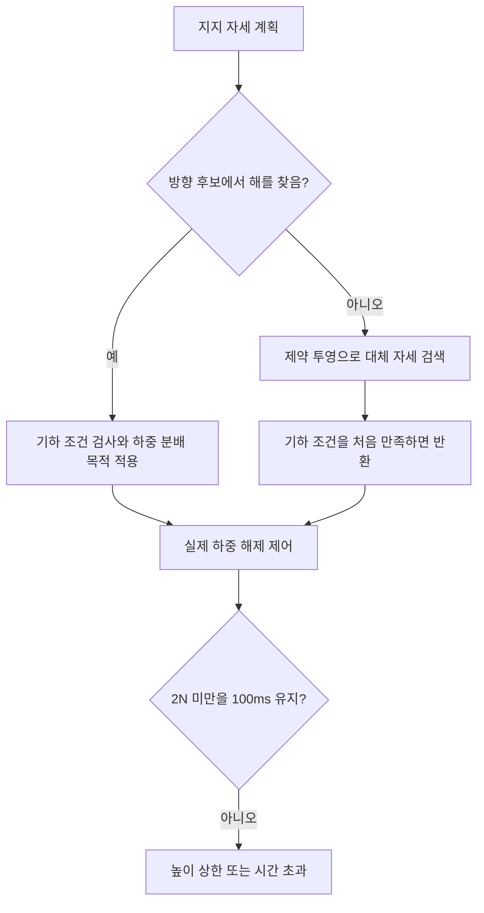
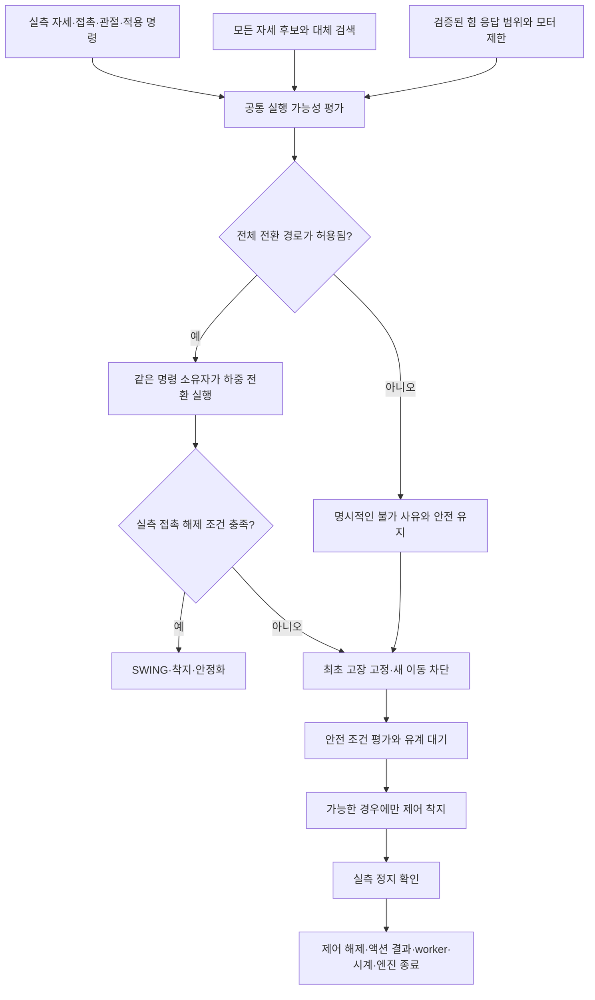

# 13.5 반복 실패의 구조적 원인과 개선 순서

검토일: 2026-10-29. 브랜치 `feat/ch13-section-13-5`, HEAD `4e87f6f6031d0ac5e73b2575bcee261e92a0e59e`와 미커밋 작업트리를 대상으로 한다. 이번 검토에서는 엔진을 새로 실행하거나 런타임을 수정하지 않았다. 기존 실패·사용자 파일은 보존했다.

## 1. 결론

현재 반복되는 핵심 실패는 **Task8 G2의 발 들기 전 하중 전환**이다. 제자리 교정 G1 통과 이후에도, 이동 중에는 선택한 발의 하중을 나머지 세 발로 옮기는 과정이 반복해서 실패한다. Nav2나 YOLO를 다시 조정할 단계가 아니다.

**지지 자세 계획, 실제 힘 응답 모델, 고장 후 정지 절차를 함께 재검토해야 한다.** 개별 높이·타이밍 보정으로 우회하기보다 이 세 구성 요소가 같은 물리적 실행 가능성을 전제로 동작하도록 부분 재설계하는 것이 필요하다. 저장소 전체를 다시 작성하거나 토크 제어로 전환하자는 뜻은 아니다.

지금까지의 수정에는 실제 결함을 고친 부분이 있다. 그러나 각각의 국소 회귀 통과를 다음 전체 보행 시험의 충분한 근거로 사용했고, 접촉 전환이라는 작은 물리 동작의 독립 검증이 부족했다. 이 점은 구현·검증 순서의 문제이며, 구조 검토를 더 일찍 했어야 한다.

## 2. 어디에서 반복해서 실패하는가

아래는 이번에 함께 검토한 Gazebo G2 종료 실행 8건이다. 서로 다른 수정본을 포함하므로 고정 소스의 성공률이나 전체 실험의 통계로 해석하지 않는다. UUID 앞 8자리로 표시했으며, 전체 식별자와 원본 SHA는 [검토 결과](../evidence/section_13_5/85670137-e73c-4c72-bcb2-0c73e755088b/architecture-review-5e477e12-0cd1-4ecf-b6f0-85aa0a75bdc1/result.json)에 있다.

| G2 실행 | 직접 실패 조건 | 실패 시 선택발 하중 | 실측 정지 확인 |
|---|---|---:|---|
| `1a27f18c` | 해제 높이 상한 | RR 4.797N | 성공 |
| `afa0c4d9` | 해제 높이 상한 | RL 2.103N | 성공 |
| `b9c835b2` | 해제 시간 초과 | RR 2.057N | 성공 |
| `c6ee257f` | 해제 높이 상한 | RL 2.108N | 성공 |
| `4342c86d` | 팔 수납 자세 속도 초과 | 해당 없음 | 성공 |
| `15382b7e` | 해제 시간 초과 | RL 1.981N | 실패 |
| `b82af967` | 허벅지·몸통 참조 충돌 여유 부족 | FR 21.385N | 실패 |
| `b8360ed1` | 해제 시간 초과 | FR 2.161N | 실패 |

6건이 하중 해제 실패다. `15382b7e`의 순간값이 2N 미만이어도 원래 조건인 **2N 미만을 100ms 유지**했다는 뜻은 아니다. 기준을 그대로 적용한 실패 판정은 타당하다.

최신 소스 묶음은 139개 파일, manifest SHA `c41684c67f0fe5d430cee3a304aa5a928173ce2cf2641b4f71fb65e118af7d5b`다. 같은 묶음에서:

- Gazebo G1 `e75bb1cf-4425-4d2e-afef-32d155fb00c0`: **25/25 PASS**.
- Gazebo G2 `b8360ed1-0caf-4a98-91bb-c80eda79f1ac`: **ROS 59.532초, FR 해제 시간 초과로 FAIL**. 해제는 53.522초에 시작했고, 실패 당시 하중은 FR/FL/RR/RL 순서로 약 **2.16/80.81/53.27/12.69N**이었다.

G1은 제자리 교정의 증거다. 이동·회전·후속 발 전환까지 검증한 G2의 대체 증거가 아니다. 과거 MuJoCo 성공 기록도 현재 수정본의 양 엔진 고정 3회 연속 성공을 대신하지 못한다.

## 3. 확인된 구조적 결함과 아직 검증해야 하는 가설

### 3.1 대체 계획 경로가 하중 분배 목적을 잃는다 — 코드와 실제 사용 경로 확인

`integrated_robot_navigation/gait.py:472–475`는 방향 후보 검색에서만 `balanced_support_weight()`를 호출한다. 후보를 찾지 못하면 `:482–483`의 `_constrained_shift()`로 넘어간다. 이 대체 경로는 기하·관절·지지 여유를 만족하는 첫 결과를 `:542`에서 반환한다. `:552`의 최소 거리 제약 투영에도 공통 하중 분배 목적은 없다.

최신 G2 원본 `controller_report.json`에는 `load_balance_plan: null`이 기록돼 있다. 이 기록을 실제 제어 경로와 대조하면 하중 분배 최적화가 있는 방향 검색이 아니라 대체 경로를 사용한 것으로 판단된다. 단순히 trace가 없다는 이유로 callback이 실행되지 않았다고 추정한 것이 아니다.

따라서 “하중 분배 계획을 추가했다”는 설명은 일부 경로에서만 성립했다. 후속 참조 영역을 두 검색 경로에 반영한 최근 수정은 충돌 검사의 범위를 넓혔지만, **대체 경로의 힘 실행 가능성까지 해결하지는 않았다**. 이 결함만 고치면 물리 성공한다는 증거도 아직 없다.

### 3.2 힘 보정 모델과 실제 모터 제한이 일치하지 않는다 — 불일치 확인, 지배 원인은 미확정

`contact_transfer.py:74–83`은 관절 강성과 수직 Jacobian으로 `Σ(Jz²/Kp)` 형태의 유연성을 계산한다. `:104–127`은 평면 지지·수직 하중·자유 몸통의 높이/roll/pitch 결합을 가정해 발 높이 보정을 계산한다.

반면 실제 Gazebo 연결 코드 `integrated_robot_navigation_sensors/src/gazebo_position_system.cpp:263–265`는 위치 오차에 비례한 힘 명령을 계산한 뒤 모터별 상한으로 자른다. 최신 원본 진단에는 **FL calf의 force_command=-30Nm, effort_limit=30Nm**가 있다. 이것은 제한된 내부 명령이며 실제 관절 토크를 직접 측정했다는 뜻은 아니다.

현재 보정 함수는 실제 적용 참조·포화 상태를 입력받지 않는다. 포화된 축에도 비포화 선형 강성의 힘 응답을 기대할 수 있어, 더 내린 참조가 예상한 만큼 하중을 이동시키지 못할 수 있다. 최신 실행에서 한 발에 전체 수직 하중의 약 54%가 집중된 관측과 함께 검토해야 할 불일치다.

또한 원본 접촉에는 수평 힘도 있다. 기존 수직 모델의 적용 범위를 실제 응답으로 확인해야 한다. **수평 힘 또는 포화 하나가 모든 실패의 유일한 원인이라고 확정하지 않는다.** 먼저 작은 허용 참조 변화에 대한 실제 하중 변화의 방향·크기·지연과 포화 여부를 비교해야 한다.

근거: [공간 접촉 진단](../evidence/section_13_5/85670137-e73c-4c72-bcb2-0c73e755088b/spatial-contact-discriminator-ae02b048-7227-41ce-93e7-53a07dd19ed4/result.json). 원본 충돌 측 힘 합계와 중복을 제거한 지지력, 내부 force_command와 실제 일반화 힘은 구분해 보존한다.

### 3.3 단위 테스트의 plant가 구현과 같은 근사를 사용한다 — 검증 범위의 공백

`test_stance_load_transfer.py:38–46,54–61`의 가상 plant는 같은 수직 유연성에서 만든 선형 스프링 투영식을 사용한다. 이는 결합 계산·부호·속도 상한·선형 수렴을 확인하는 유용한 시험이다. 파일 첫 줄도 물리 G2 인수가 아님을 명시한다.

그러나 이 시험에서 성공했다고 해서 실제 엔진의 비선형 접촉·수평 결합·모터 포화까지 검증한 것은 아니다. 최근 관련 **86개 회귀 PASS**와 **실제 G2 FAIL**은 모순이 아니다. 서로 다른 범위를 검증했다. 필요한 보완은 비슷한 단위 테스트의 추가보다 **독립적인 실제 접촉 전환 부품 시험**이다.

### 3.4 고장 후 착지 권한과 실패 사유의 수명이 불안정하다 — 작은 코드 반례 확인

`gait.py:96–99`는 특정 첫 실패에서 `_fault_landing_foot`을 설정하고 `swing_foot`을 지운다. 이후 다른 오류로 `_fail()`이 다시 호출되면 착지 대상이 `None`이 될 수 있지만, 첫 실패 사유는 `self.reason or reason`으로 남는다.

이번 검토는 실제 커널을 사용해 다음 상태 전이를 실행했다. 엔진 재실행은 하지 않았다.

1. `measured unload timeout` → FAULT, 착지 대상 FR 보존.
2. `fault landing measured support/settle lost` → FAULT, **착지 대상 소실**, 표시되는 사유는 첫 timeout 유지.

이는 복구 상태의 수명 결함을 보이는 코드 반례다. 최신 실제 실패에서 이 두 번째 오류가 실제로 발생했다고 단정하지 않는다. 당시 기록에는 후속 오류 원인이 별도로 남지 않았다.

추가로 `gait.py:763–766`은 고장 착지에 진입하기 전에 이미 정지 속도 조건을 요구한다. 최신 첫 실패의 실측 속도는 선속도 약 **0.00529m/s**, 각속도 크기 약 **0.01924rad/s**로 정지 기준 0.003m/s·0.01rad/s보다 높다. 안전 조건을 없애면 안 되지만, 일시적인 진입 불가와 복구 불가능을 구분하고 대기·착지·정지 확인을 명시적으로 관리해야 한다.

### 3.5 보고된 종료 실패와 엔진 프로세스 실패를 분리해야 한다

검토한 8건 모두 엔진 프로세스 종료 코드 `[0]`, 실제 carry terminal 수신, 부모 회수, 강제 정리 없음, 잔여 없음이 확인됐다. 최신 실행도 `teardown.json`의 `engine_exit=true`이고, 실패한 단계는 `runtime_shutdown.steps.measured_stop=false`다.

`run_navigation_13_5.py:708–733`은 모든 종료 단계가 성공해야 `runtime_exit=true`를 준다. `verify_navigation_13_5.py:319–324`는 이 값을 포함한 전체 종료 계약을 요구한다. 그래서 최신 결과의 `normal_runtime_exit`와 `normal_engine_exit`는 모두 실패한다.

**프로세스가 종료됐어도 안전 정지가 미확인인 인수 결과는 계속 FAIL로 유지해야 한다.** 다만 이를 새 Gazebo hang으로 오인하면 엉뚱한 디버깅을 반복한다. 보고서에는 ‘실측 정지’, ‘액션 terminal’, ‘노드 종료’, ‘엔진 종료’, ‘회수’를 각각 표시하고 최종 집계는 엄격하게 유지한다.

## 4. 시간 요구도 구현 전에 다시 계산해야 한다

`gait.py:29`는 정상 이동량을 SHIFT에만 배정하며, `:336`은 SHIFT 시간을 최소 `3.75 × 0.7 = 2.625초`로 만든다. 현재 최대 전진 입력 0.01m/s에서 한 SHIFT의 명령 이동량은 0.007m다.

- SHIFT만으로 계산한 평균: 약 **0.00267m/s**.
- 명령 기준 0.60m 이동에 SHIFT만 필요한 시간: 약 **225초**.
- 현재 발 기준으로 가장 낙관적인 추가 swing 곡선 시간까지 포함한 참조 평균: 약 **0.00155m/s**. 하중 해제·착지·안정화·계획 시간은 제외한 값이다.

뒤의 접근 과제는 wall deadline 240초이고 native 이동 0.60m 검증도 요구한다(`SECTION_13_5_IMPLEMENTATION_PLAN_KO.md:28,231,241`). 현재 시간 배분은 그 거리의 접근에 충분한 여유가 없다. **240초는 G2 하중 해제의 6초 기한과 다른 요구**다. 이 계산을 최신 G2의 직접 실패 원인으로 혼동하지 않는다.

이 수치는 명령 참조의 산술 검토다. 몸통 지지 offset·실제 추종·엔진 진행률이 있어 실제 도착 불가능의 엄밀한 증명은 아니다. 다만 Nav2를 연결하기 전에 궤적의 이동량/가속도/발 이동/시간 요구를 함께 검증해야 할 충분한 경고다. 거리·기한·속도 기준을 조용히 바꾸는 방법으로 해결하지 않는다.

## 5. 근본 개선의 범위

### A. 계획 경로마다 달랐던 계약을 통합한다

방향 검색과 제약 투영은 후보를 찾는 방법으로만 구분한다. 결과 승인에는 **같은 평가 함수**를 적용한다. 지지 여유, 전체 발 참조 범위, 관절·충돌, 하중 분포, 모터 제한을 함께 평가하고 경로·거부 이유를 남긴다. 최소 거리 또는 CoM 삼각형 포함만으로 실행 가능을 선언하지 않는다.

힘 실행 가능성 모델은 검증 범위를 가져야 한다. 관측 부족·포화·모델 오차가 크면 그 후보를 검증됐다고 승인하지 않는다. 단순히 fallback에도 기존 비용 함수를 붙이고 전체 시험을 다시 하는 것으로 재설계를 끝내지 않는다.

### B. 실제 엔진의 접촉 전환 응답을 작은 부품 단위로 검증한다

현재 위치 명령 인터페이스와 단일 소유권을 유지한다. 기존 허용 높이·속도 안의 작은 참조 변화에 대해 자세, 수직/수평 접촉력, 적용 명령, 포화, 응답 지연을 같은 시각으로 비교한다. 근사 모델의 예측 부호와 크기가 맞는지, 어느 자세·접촉 조건에서 유효한지를 확인한다.

유효하지 않은 근사는 교체하거나 적용 범위를 좁힌다. 공간 결합 모델이나 실측 민감도를 사용하는 방법은 후보지만, 새 복잡한 모델을 검증 없이 정답으로 채택하지 않는다. 외부 성공 사례에서도 가져올 것은 **유연성과 접촉 전환을 함께 취급하는 원리**다. 예를 들어 [SEIKO 연구](https://arxiv.org/abs/2312.16465)는 위치 제어 로봇에서 유연성과 접촉력을 통합 최적화한다. TALOS 휴머노이드 연구이므로 이 프로젝트의 4족 Gazebo 성공 사례나 복사 즉시 적용 가능한 구현으로 제시하지 않는다.

### C. 복구를 별도의 명시적인 상태 흐름으로 만든다

최초 고장은 유지하면서 후속 오류와 착지 대상의 수명을 별도로 보존한다. 일시적으로 착지 조건이 부족하면 허용된 시간과 안전 조건 안에서 기다리고, 조건이 회복되지 않으면 미확인 정지를 그대로 실패로 남긴다. 자동 재활성화·무조건 재시도·정지 기준 완화는 하지 않는다.

최종 정지 판정까지 기존 명령 소유자가 유지돼야 한다. 부품 종료 순서와 상위 FAULT 전파도 이 수명을 침범하지 않는지 검증한다. 현재 startup이 실제로 조기에 소유권을 해제했다고 확인된 것은 아니므로, 이를 원인으로 단정해 수정하지 않는다.

## 6. 다음 검증은 이렇게 줄인다

| 순서 | 해야 할 일 | 다음 단계 진입 조건 |
|---|---|---|
| 1 | 기존 실패 8건·힘/기하/종료 사유 분류, 공통 계약 누락 확인 | 이번 보고서와 작은 재현으로 완료 |
| 2 | 대체 계획의 공통 평가, 포화/모델 유효 범위, 고장 상태 수명, 시간 예산의 실패 회귀 작성 | 실제 실패와 같은 전제를 검사하며 공통 근사만 반복하지 않음 |
| 3 | 허용 범위의 작은 실제 하중 전환 부품 시험 | 선택발 해제·지지발 하중·팔 안정·충돌/포화·정지까지 확인 |
| 4 | G1/G2 통합 시험과 실패 복구 | 부품 시험이 실패한 채 전체 보행으로 넘어가지 않음 |
| 5 | 소스·설치본 동결 후 양 엔진 고정 3회 연속·후진·원래 최종 회귀 | 실패를 빼고 성공만 세지 않음 |
| 6 | Nav2 Tasks9–14와 절 단위 게시 | 실제 이동·정지 기반이 통과한 후 진행 |

개별 G2 결함을 수정할 때마다 관련 없는 전체 회귀를 반복하지 않는다. 다만 실제 엔진을 시작할 때 필요한 시계·설치 일치·소유 프로세스 정리 확인은 생략하지 않는다. 더 작은 시험을 만들어 비용을 낮추며, 인수 기준을 낮춰서 비용을 줄이지 않는다.

큰 원본 로그를 추가 수집하기보다 기존 접촉·명령 관측을 제한된 구간과 샘플 수로 묶는다. 실험 전에 판별 질문, 예상되는 서로 다른 결과, 최대 시간/기록 크기, 종료 조건을 적는다. 같은 근거로 이미 반증된 가설은 다시 전체 실행하지 않는다.

## 7. 이번 검토의 증거와 미완료 범위

- 읽기 전용 검토: `architecture-review-5e477e12-0cd1-4ecf-b6f0-85aa0a75bdc1/{method.py,result.json}`. 입력·소스 SHA, 8건 분류, 실제 커널의 고장 전이 반례, 시간 계산을 보존했다. 새 엔진 실행 0회, 런타임 변경 0건이다.
- 위 `result.json` SHA256: `bd6b5ce0a4a26468245c075124cbd78fa3dba4d43070e5a993944506651b7951`.
- 최신 실제 G1/G2: `native-g1-gazebo-e75bb1cf-4425-4d2e-afef-32d155fb00c0`, `native-g2-gazebo-b8360ed1-0caf-4a98-91bb-c80eda79f1ac`의 결과·보고서·teardown.
- 실행 관리 root `clock-single-owner-74f8cd84-315a-44ce-aac3-3ed5d8b0293c/session.json`: `restored=true`, `restoration_pending=false`, `foreground_sessions_closed=true`. 검증 exit 1은 G2 실패로 보존한다.

**Task8 전체 성공, 현재 수정본의 양 엔진 3회 연속·후진, Nav2 Tasks9–14, 최종 13.3/13.4 회귀, 절 단위 commit/push는 아직 미완료다.** PPO 적재 보행·MoveIt·물리 파지는 이번 검토에서 새로 검증하지 않았다. 이번 결과는 원인과 개선 경로를 정리한 검토이며, 위 재설계를 구현해 물리 인수에 성공했다는 보고가 아니다.
