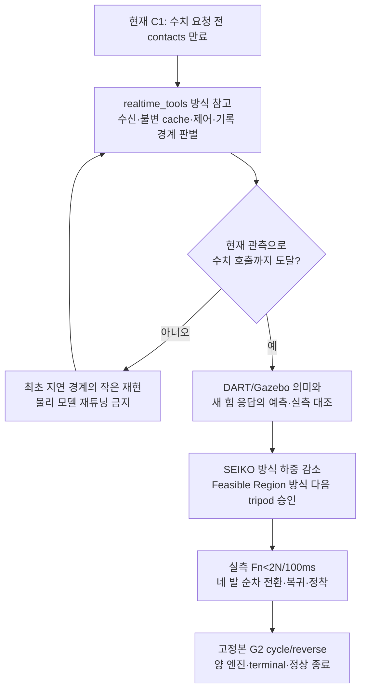

# Task8 해결을 위한 참고 모델·코드 선정

조사일: 2026-11-02. 기존 10/29 조사와 11/02 반복 분석을 재사용하고, 공식 논문·저장소·실제 소스 일부를 다시 확인했다. 단일 작업자로 조사했다. 외부 코드를 설치·이식하지 않았고 엔진을 실행하지 않았다. 아래 ‘권고’는 조사 결과에 근거한 적용 판단이며, Ch13에서 재현된 성공을 뜻하지 않는다.

## 현재 실패에 맞춘 결론

**완성된 외부 보행 스택으로 교체하는 것보다, 현재의 실행 경계와 물리 모델을 각각 검증하는 조합이 우선이다.**

현재 두 종류의 실패를 분리해야 한다.

- 이전 C1 `d50469aa`: FL·RR 완료 뒤 job267 국소 infeasible. 물리 힘 응답·구동 실행 가능성 문제를 조사했다.
- 새 이산 모델 커밋 `29742315` 뒤 C1 `da616654`: 접촉 wall age214.065ms로200ms 계약을 위반했다. **수치 요청0건**이므로 새 힘 모델의 실제 효과를 평가한 실행이 아니다. 직전 제어 tick50.263ms/wall·36.429ms/CPU와 중복 기하 계산이 관측됐지만, 이것이 접촉 손실의 단독 원인이라는 증명은 없다.

근거: [최신 실제 요약](../evidence/section_13_5/85670137-e73c-4c72-bcb2-0c73e755088b/task8-discrete-first-actual-20261102.json), [현재 물리 모델 판별](SECTION_13_5_FORCE_APPLICATION_DIAGNOSIS_KO.md).

따라서 참고 우선순위는 **실행 경계 → 엔진 물리 의미 → 힘 제어 → 다음 지지 자세 계획 → 전체 스택 구조 비교**다. 이 조건을 모두 만족하는 ‘그대로 넣으면 Task8이 통과하는 코드’는 이번 조사에서 확인하지 못했다.

## 우선 참고 5개

| 순위 | 모델·코드 | Task8에 참고할 부분 | 적용 비용·한계 |
|---:|---|---|---|
| 1 | ROS2 `realtime_tools` | 최신 상태 mailbox, 유계 queue, 제어에서 발행/기록 분리 | 비교적 작음. 설치 버전/API 확인 필요. 현재 소유권·원본 시각 검사는 직접 유지 |
| 2 | DART6.13.2 + Gazebo sim8 실제 물리 코드 | 암시적 감쇠·접촉 처리·명령 소비·렌치 의미 | 모델 검증용. 새 controller가 아니며 외부 엔진 수정 불필요 |
| 3 | SEIKO 논문·C++ | 위치 명령→전신 접촉력 응답, 힘 해제와 접촉 제거 분리 | 현재 위치 인터페이스에 가장 가까움. TALOS·고주파·토크 관측 가정은 다름 |
| 4 | Improved Feasible Region + jet-leg | 다음 세 발의 토크·관절·마찰 실행 가능 영역 | 계획 승인용. 힘 추종이나 전체 궤적 성공을 보장하지 않음 |
| 5 | legubiao/quadruped_ros2_control | Jazzy controller/hardware 분리, 명시적 참조 인터페이스, PD/균형 QP | 구조 비교용. effort·Unitree SDK 경로로 즉시 교체하면 범위·물리가 바뀜 |

### 1. realtime_tools: 최신 실패의 실행 구조 참고

공식 [Jazzy 문서](https://control.ros.org/jazzy/doc/realtime_tools/doc/index.html)는 최신값만 필요하면 `RealtimeThreadSafeBox`, 중간 표본도 필요하면 `LockFreeQueue`, 제어 thread에서의 ROS 발행은 별도 thread의 `RealtimePublisher`로 분리하도록 안내한다. Box 접근은 best-effort이므로 성공 여부를 처리해야 한다.

**권고 적용:** 현재 native 계산을 다시 작성하지 말고, 센서 수신→불변 입력 묶음→현재 상태 검증→유일한 명령 소유자의 반영을 분리한다. 제어 중 JSON/파일 I/O와 중복 기하 계산을 제거하고 동일 결과를 재사용할 수 있는지 검증한다. ‘최신값’은 최초 촬영·receipt를 유지해야 하며, 캐시 접근 시 age를 갱신하면 안 된다. 접촉 연속100ms 증명에 필요한 고유 표본은 최신값 하나로 대체하지 않는다.

**작은 판별 시험:** 실제 DDS 입력에 의도적 writer 지연을 넣고 제어/수신이 분리되는지 확인한다. frame/epoch/GID·최초 receipt·만료·overflow·join과 중복 소비를 검사한다. 실패 당시 지연이 publisher, middleware, callback, 계산 중 어느 경계에서 증가했는지 연결한다. 같은 조건의 짧은 실제 엔진 관측이 필요하다.

**주의:** [공식 async controller 문서](https://github.com/ros-controls/ros2_control/blob/master/controller_manager/doc/running_controllers_asynchronously.rst)는 작업이 다음 trigger까지 끝나지 않으면 이전 결과를 재사용하는 동작을 설명한다. 이를 켜는 것만으로 현재 상태에 해가 유효해지지 않는다. 현재 same-cycle·age·sticky failure 계약과 충돌하는 재사용은 채택하지 않는다. master 기능을 설치 Jazzy4.48.1의 지원 기능으로 단정하지 않는다. FIFO/우선순위/affinity 설정도 이번 권고의 필수 조건이 아니다.

### 2. DART/Gazebo: controller 모델과 실제 plant의 독립 기준

핵심 원문은 [DART GenericJoint6.13.2](https://github.com/dartsim/dart/blob/v6.13.2/dart/dynamics/detail/GenericJoint.hpp), [Gazebo Physics sim8](https://github.com/gazebosim/gz-sim/blob/gz-sim8/src/systems/physics/Physics.cc)다. 확인할 부분은 DART의 암시적 관성·감쇠 처리와 Gazebo의 `JointForceCmd` 적용/정리 순서다. Ch13의 기존 최소 물리 판별과 함께 읽어야 한다.

**권고 적용:** 힘 명령, 포화 전 P값, 전달 렌치, 실제 접촉력을 별개로 기록한다. 단순 연속식 `g−JᵀF`나 독립 spring 응답을 실제 이산 engine과 동일하다고 가정하지 않는다. 기존 새 전체 평형 모델의 미분을 다른 자세/하중·선택 발에서 교차 확인한다. 외부 DART 코드를 수정하거나 damping을 제거하는 처방은 아니다.

**작은 판별 시험:** 자유 관절의 `Δv=τΔt/I`, 접촉 단일 관절, 다중 지지점, 원본 로봇 정지 자세의 ±미소 위치 입력 순서로 비교한다. 모델을 만든 입력과 검증 입력을 분리한다. 팔 고정 명령과20축 한계도 포함한다. 이미 끝난 같은 시험은 재실행하지 않고 원본 SHA와 범위를 재사용한다.

**현재 성과/한계:** 새 이산 모델은 독립 미분·국소 힘 응답 검증을 갖췄다. 그러나 최신 C1에서 호출되지 않았으므로 ‘DART 모델 수정으로 실제 Task8 해결’이라고 쓸 수 없다. 이 항목은 현재 구현의 검증 근거를 보강하는 참고이며 새 스택 도입 제안이 아니다.

### 3. SEIKO: 위치 제어 접촉 전환의 가장 가까운 알고리즘

[Rouxel·Ivaldi·Mouret, RA-L2024 논문](https://arxiv.org/html/2312.16465v4)은 전신 유연성 모델을 이용해 위치 명령으로 접촉력을 제어하며 실제 TALOS에서 검증했다. 전체 코드가 완성된 시뮬레이션 배포본인 것은 아니다. [공식 README](https://github.com/hucebot/seiko_controller_code)는 시험·시뮬레이터·viewer·teleoperation 일부가 포함되지 않음을 명시한다.

이번에 직접 확인한 고정 소스:

- [SEIKOWrapper.cpp:218–269](https://github.com/hucebot/seiko_controller_code/blob/972e3a69af9334eec324e61566433fabf05bf061/inria_model/src/SEIKOWrapper.cpp#L218-L269): disabling 상태에서 힘을 줄인 다음 접촉을 제거한다. 내부 계획 힘을 기준으로 하므로 Ch13의 실측 Fn<2N/100ms 증명을 대신할 수 없다.
- [SEIKOController.cpp:905–923](https://github.com/hucebot/seiko_controller_code/blob/972e3a69af9334eec324e61566433fabf05bf061/inria_model/src/SEIKOController.cpp#L905-L923): 보정 QP에 joint torque 제한을 구성한다.

**권고 적용:** 기존 SEIKO 참고 재설계를 유지하되 ‘계획한 하중이 가능함’과 ‘위치 명령으로 실제 하중이 줄어듦’을 별도 확인한다. 접촉 제거 요청/진행/실측 완료를 분리하고 실제 release 전에는 swing 권한을 주지 않는다. 토크 command를 실측 torque처럼 사용하지 않는다.

**통과 조건:** 힘 예측의 방향·결합·오차 검증, 원래 속도/변위/힘 한계, 실제 연속 release, 복귀·정착·정상 종료다. TALOS의 주기·게인이나 논문 실증을 Ch13 성공으로 옮겨 적지 않는다. root 라이선스는 BSD-2-Clause이며 이식 시 파일별 출처를 확인한다.

### 4. Improved Feasible Region: 들어 올린 뒤 지탱할 수 있는 자세 계획

[Abdallah 등 논문](https://arxiv.org/abs/2011.07967)은 관절 도달 가능성과 구동/균형 실행 가능성을 결합하고 HyQ·Aliengo에서 검증한다. [연계 jet-leg](https://github.com/abdelrahman-h-abdalla/jet-leg)은 기존 Feasible Region과 reachable region의 결합을 구현한다.

직접 확인한 [force_polytope_constraint.py:34–80](https://github.com/abdelrahman-h-abdalla/jet-leg/blob/73cc3d3fdfa6f4fecb6548e089e16c41c49cde8a/jet_leg/constraints/force_polytope_constraint.py#L34-L80)는 Jacobian·토크 한계·다리 자체 무게와 body/world 회전으로 구동 제약을 구성한다. workspace 밖 결과도 별도로 반환한다.

**권고 적용:** 방향 검색과 fallback 모두 같은 승인 함수를 사용한다. 네 발 현재 평형뿐 아니라 다음 세 발 지지와 swing 경로 표본의 토크/관절/마찰/간섭을 검사한다. 팔 적재 질량·CoM·engine별 actuator 의미는 현재 모델로 계산한다. 실패 자세에서 국소 QP가 infeasible이면 반복 상한을 올리는 대신 하중 해제 전 몸체 목표를 검토한다.

**한계:** LP feasible은 비선형 과도 경로의 충분조건이 아니다. 동작 중 매번 전체 영역을 Python으로 생성하기보다 오프라인 독립 oracle와 작은 온라인 후보 승인에 참고하는 것이 적합하다. LGPL-3.0 소스를 복사할 때는 라이선스 검토가 필요하다. 이번에는 개념·구성만 참고했다.

### 5. legubiao: 가까운 Jazzy 스택이지만 actuator 차이를 먼저 본다

조사한 main tree SHA는 `5434c5810d1a7fe223bcfd04550e9d3bfdd4b458`다. [README](https://github.com/legubiao/quadruped_ros2_control/blob/5434c5810d1a7fe223bcfd04550e9d3bfdd4b458/README.md)는 Jazzy, Gazebo Harmonic, 별도 Unitree MuJoCo/SDK 경로를 제공한다. 현재 Ch13의 MuJoCo 연결 방식과 같지 않다.

직접 읽은 코드:

- [LegPdController.cpp:32–40,89–141](https://github.com/legubiao/quadruped_ros2_control/blob/5434c5810d1a7fe223bcfd04550e9d3bfdd4b458/controllers/leg_pd_controller/src/LegPdController.cpp#L89-L141): effort interface를 claim하고 위치/속도/effort/Kp/Kd 참조로 torque를 계산한다. 읽은 update 함수에는 torque clamp가 보이지 않는다. 다른 계층의 제한까지 없다는 뜻은 아니지만 Ch13 안전 clamp를 대체할 근거는 없다.
- [BalanceCtrl.cpp:65–96,142](https://github.com/legubiao/quadruped_ros2_control/blob/5434c5810d1a7fe223bcfd04550e9d3bfdd4b458/controllers/unitree_guide_controller/src/control/BalanceCtrl.cpp#L65-L96): 접촉 다리는 마찰 제약, 비접촉 다리는 힘0 제약으로 구성한다. `solve_quadprog` 호출만으로 상태·잔차·실측 해제를 확인했다고 간주하지 않는다.

**권고 적용:** 명시 인터페이스·관절 순서·하드웨어 소유권과 작은 compiled update 구조를 비교한다. 전체 Unitree SDK/OCS2/RL을 가져오거나 explicit PD를 Gazebo native damping 경로와 같다고 간주하지 않는다. README의 RMW 변경·sudo 관련 해결책도 현재 작업에 자동 적용하지 않는다. root Apache-2.0 외 `LICENSES`의 upstream별 조건도 확인해야 한다.

## 추가 후보를 핵심 해결책으로 선정하지 않은 이유

| 후보 | 확인한 자료·코드 | 판단 |
|---|---|---|
| Quad-SDK | [고정 main50b58ce8의 inverse_dynamics_controller.cpp](https://github.com/robomechanics/quad-sdk/blob/50b58ce8f248ff8995270eae3fa0488c91eeddd4/robot_driver/src/controllers/inverse_dynamics_controller.cpp#L98-L155), [GRF PID](https://github.com/robomechanics/quad-sdk/blob/50b58ce8f248ff8995270eae3fa0488c91eeddd4/robot_driver/src/controllers/grf_pid_controller.cpp#L114-L140) | contact mode→역동역학 feedforward와 stance/swing gain 분리 참고. 현재 위치-only 경로와 다르므로 단기 교체 비용이 큼. 읽은 GRF PID는 네 접촉을 고정한 경로이므로 contact-release 구현으로 복사하지 않음 |
| CHAMP | [quadruped_controller.cpp](https://github.com/chvmp/champ/blob/master/champ_base/src/quadruped_controller.cpp) | 가벼운 gait/IK·속도 입력 구조 참고. 센서 피드백이 없을 때 gait phase를 contact로 발행하는 경로가 있어 Task8 실측 접촉의 대체 불가. 읽은 master는 ROS1 코드 |
| ROS2-Quadruped-Locomotion-Control | [작성자의 현재 경계 설명](https://github.com/AREIVAN/ROS2-Quadruped-Locomotion-Control#roadmap) | 정적 하중 전환·joint-limit-aware stance가 진행 중이고 forward locomotion도 미완료라고 명시. 유사 실패의 교훈은 있지만 ‘성공한 대체 보행기’로 채택하지 않음 |
| MuJoCo Menagerie Go2 | [공식 모델 설명](https://github.com/google-deepmind/mujoco_menagerie/tree/main/unitree_go2) | URDF→MJCF·freejoint·default 정리의 비교 기준. 발 접촉 softness/impratio 보정이 포함된 맨몸 Go2이며 현재 통합 모델과 물리가 다름. asset 존재는 controller 성공 증거가 아니고 모델 교체도 권하지 않음 |

## 실제 적용 순서와 재시험 진입 조건

권고하는 다음 작업은 새 controller 전체 도입이 아니다.

1. 이미 구현된 native geometry 재사용과 수신 수명 보완을 영향 회귀·설치 감사로 검증한다. 원래200ms/10ms/32회는 유지한다.
2. 수신·완성 입력·계산·반영·거부 이유를 같은 capture/epoch/작업ID로 연결한다. 상세 기록은 유계로 하고 원시 대용량은 종료 후 읽는다.
3. 고정본 G1→C1 한 쌍에서 수치 호출 전 실패와 호출 후 실패를 구분한다. 센서 만료를 해결하지 않은 채 solver/힘 모델만 다시 조정하지 않는다.
4. 실제 하중 전환에 진입하면 이미 검증한 새 이산 모델의 예측과 실측이 처음 갈라지는 곳을 검사한다. 독립 오프라인 oracle와 전 제약 잔차를 보존한다.
5. C1 이후에만 전체 G2와 현재 승인된 필수 시나리오로 확장한다. 기존 G1 성공·단위 PASS·외부 논문 성공을 종단 완료로 계산하지 않는다.

성공을 보장하는 외부 자료는 없다. 이번 조사의 가치는 후보를 늘리는 것이 아니라, **현재 실패를 실제로 구분할 수 있는 참고 코드와 판별 시험을 좁히는 데 있다.** 기존 해상도·촬영 시각·힘/속도·명령 단일 소유권·정상 종료 기준과 최신 승인 정책을 유지한다.

## 코드 조회 고정 정보

| 코드 | ref 또는 tree SHA | 직접 조회한 blob SHA |
|---|---|---|
| SEIKO Wrapper | `972e3a69af9334eec324e61566433fabf05bf061` | `eebb0699166bc08b9380707e4db8d306b5d3b570` |
| SEIKO Controller | 같은 ref | `0a693326647acc76b79ace97ec8f8f42e7d8b5f6` |
| jet-leg ForcePolytopeConstraint | `73cc3d3fdfa6f4fecb6548e089e16c41c49cde8a` | `d04b62529b1cfc2a840b93dd4fd6458ada535131` |
| legubiao LegPdController | `5434c5810d1a7fe223bcfd04550e9d3bfdd4b458` | `ed5a07bb4f602ea4b9fe3c6915b78024b6179884` |
| legubiao BalanceCtrl | 같은 ref | `5565f5dea9420ef2d5cf968b99e92cf8ce428271` |
| Quad-SDK inverse dynamics | `50b58ce8f248ff8995270eae3fa0488c91eeddd4` | `ec6cbe23724273e25528d448342509c9cc7320a2` |
| Quad-SDK GRF PID | 같은 ref | `c2ad66618f6eda887a904bcf23b13a07ec641189` |

위 SHA는 원문 식별용이다. 조회된 외부 소스를 Ch13에 복사·빌드하거나 이 프로젝트의 engine 인수를 통과시킨 기록은 아니다. Jazzy 온라인 문서는 조회일 기준이며 설치 API/패키지 버전과의 일치는 도입 전에 확인한다.
