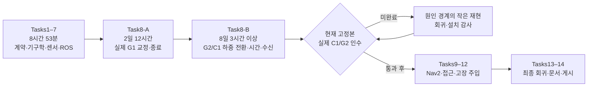
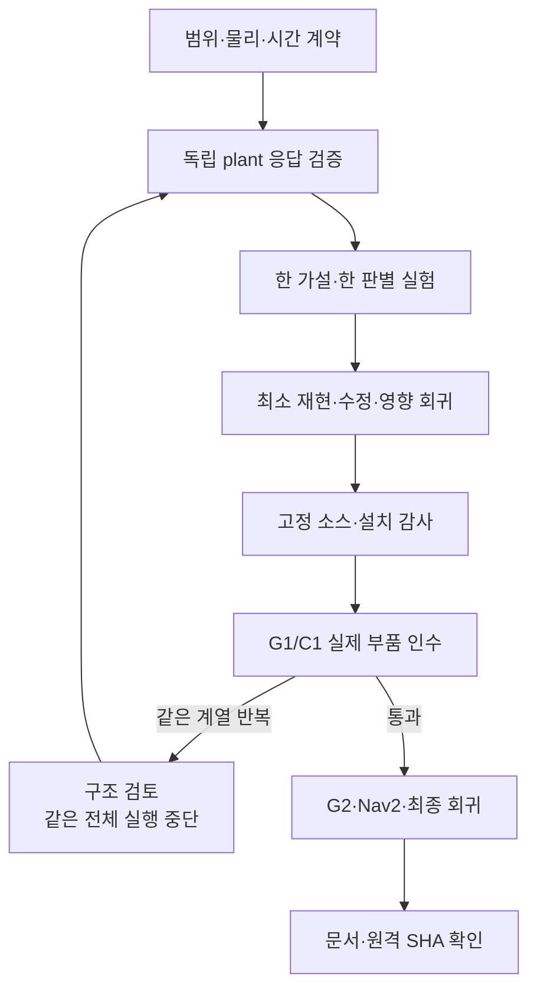

# 13.5 제작 기간 분석과 다음 패키지를 위한 개선 전략

작성일: 2026-11-02, 한국 시각. 확인한 HEAD는 `8e9cca5a1fd30fb91f4f08584bd74aa7c9ab1c9f`다.
분석 대상 마지막 구현 커밋은 `297423150010d49f28599cd8306ce3445b0d6049`이며,
현재 미커밋 수정과 최신 실패 요약도 함께 확인했다. 이 문서 작성 중에는 엔진을 실행하거나 런타임을 수정하지 않았다.

## 1. 결론과 시간의 의미

초기 Task1–7은 약 **8시간 53분의 경과 구간**에서 구현·패키지 검사를 마쳤다.
이후 **Task8 실제 엔진 검증에 10일 16시간 22분의 경과 구간**이 발생했다.
기록상 계획 커밋부터 마지막 구현 커밋까지 **11일 1시간 15분 1초**, 그중 Task8은 **96.65%**다.
주요 지연은 Nav2 자체보다, Nav2에 연결할 저속 crawl 이동기를 새로 만들고 두 엔진에서 물리적으로 검증하는 데서 발생했다.

이 숫자는 **커밋의 author timestamp 사이 달력상 경과시간**이다. 실제 작업 공수·CPU 실행시간·모델 추론시간이 아니다.
대기, 사용자 승인, 대화 재개, 전원 차단, WSL 장애, 야간 공백이 포함된다.
커밋 시각도 실제 착수·완료 시각과 다를 수 있다. 따라서 ‘11일 내내 계산했다’거나 ‘특정 원인에 정확히 몇 시간을 썼다’고 해석하면 안 된다.
원인별 배타적 작업시간 기록이 없어 **원인별 공수 상위 5개는 정확히 산출할 수 없다.**
아래에서는 계산 가능한 단계별 경과시간 순위와, 큰 반복 비용을 만든 원인 5개를 구분한다.
다른 절도 같은 방식으로 시간을 집계하지 않았으므로 절별 배수 비교는 하지 않는다.

근거: Git의 다음 명령으로 날짜를 읽어 인접 지점의 차이를 계산했다.

```powershell
git show -s --format="%H%n%aI%n%s" <commit>
```

## 2. 전체 흐름과 개별 소요시간

시간 범위는 모두 2026년 한국 시각이다. 각 구간은 중복 없이 이어진다.

| 단계 | 작업 내용 | 시작 → 종료 | 경과시간 | 확인된 범위 |
|---|---|---|---:|---|
| 계획 기준 | 승인 설계·시험 우선 계획 | 10/22 10:29:24 | 시간 집계의 시작점 | `a077ff2b` |
| Task1 | 패키지·샘플·액션 계약 | 10/22 10:29:24 → 10:54:57 | 25분 33초 | `01ad4986`; source389 PASS, 새 인터페이스/설치 감사 |
| Task2 | IK·지지 다각형·CoM | 10/22 10:54:57 → 11:07:48 | 12분 51초 | `ba05b489`; source405 PASS, 오프라인 native FK 대조 |
| Task3 | 수납 형상·footprint | 10/22 11:07:48 → 11:55:26 | 47분 38초 | `e1331bf5`; source423 PASS, 이동 허가는 아직 없음 |
| Task4 | 양 엔진 장면·센서·worker | 10/22 11:55:26 → 16:47:19 | 4시간 51분 53초 | `5d3c137a`; source444 PASS, package85, 설치8패키지 감사 |
| Task5 | 평면 TF·명령 만료·이동 게이트 | 10/22 16:47:19 → 17:36:27 | 49분 8초 | `25ba8531`; source467 PASS, DDS 소유자 교체 거부 |
| Task6 | crawl 상태기계·다리 명령 소유자 | 10/22 17:36:27 → 18:42:25 | 1시간 5분 58초 | `b6b976c2`; source500 PASS, 이상적 plant 시험 |
| Task7 | 실제 ROS 수납 액션·시동·배타 launch | 10/22 18:42:25 → 19:22:50 | 40분 25초 | `b26bcfb0`; package158 PASS, 물리 엔진 인수 전 |
| Task8-A | G1 기립·수납·단일 발 교정·종료 | 10/22 19:22:50 → 10/25 07:55:02 | 2일 12시간 32분 12초 | `4e87f6f6`; 당시 고정본 양 엔진 G1 각3회 PASS |
| Task8-B | G2 보행, C1 접촉 전환 분리, 수치·수신·물리 모델 재설계 | 10/25 07:55:02 → 11/02 11:44:25 | 8일 3시간 49분 23초 | `29742315`; 여전히 실제 C1/G2 미완료 |
| 최신 후속 | 새 이산 모델의 실제 실행과 접촉 age 실패 대응 | 위 커밋 이후 | 종료점 없음, 별도 공수 미집계 | G1 PASS, C1은 첫 수치 요청 전 FAIL; 미커밋 보완 존재 |
| Task9 | Nav2·지도·스무더·충돌 정지 | 본격 인수 착수 전 | 완료시간 없음 | Task8 의존 |
| Task10 | 비전 목표·작업 위치·IK/경로 후보 | 본격 인수 착수 전 | 완료시간 없음 | Task8/9 의존 |
| Task11 | ApproachObject·Nav2 terminal/취소·정착 | 본격 인수 착수 전 | 완료시간 없음 | Task9/10 의존 |
| Task12 | 실제 접근·고장 주입 G3/G4 | 미완료 | 완료시간 없음 | 이전 계층 완료 후 |
| Task13 | 동결본 전체 회귀·13.3/13.4 회귀 | 미완료 | 완료시간 없음 | 개발 중 부분 회귀와 구분 |
| Task14 | 최종 실습·리뷰·증거·commit/push | 부분 기록/체크포인트 게시 | 완료시간 없음 | 중간 push는 패키지 완성 아님 |

Task1–7 합계는 32,006초, Task8-A/B 합계는 922,895초, 전체는 954,901초다.
시험 개수에는 CTest wrapper가 포함될 수 있으며, 시점별 누적 회귀를 합산하지 않는다.
위 PASS는 해당 시점·해당 검증 범위의 결과이며 현재 수정본 전체 성공을 뜻하지 않는다.

근거: [실행 원장: G0·Tasks1–7](../evidence/section_13_5/85670137-e73c-4c72-bcb2-0c73e755088b/EXECUTION_LEDGER.md#task-1),
원장 원문 1093–1216행; [작업 계획](SECTION_13_5_IMPLEMENTATION_PLAN_KO.md) 93–269행.



## 3. 경과시간이 큰 단계 상위 5개

이 표는 위의 **중복 없는 커밋 구간**을 내림차순 정렬한 것이다. 실제 노동시간 순위는 아니다.

| 순위 | 구간 / 시간 | 오래 걸린 이유 | 해결 또는 현재 상태 | 정상 복구를 확인한 기준 |
|---:|---|---|---|---|
| 1 | Task8-B / 8일 3시간 49분 | 연속 보행에서 시간·전달·수치·접촉 모델의 여러 결함이 순차 노출. 국소 수정 후 전체 로봇을 반복 실행 | 수신/수치/소유권 결함 다수 보완. 전체 이산 힘 모델 구현. **종단 복구 미확정** | 현재 C1 네 발 전환, 실제 G2 cycle/reverse, 양 엔진·정지·terminal·정상 종료가 필요. 아직 충족 안 됨 |
| 2 | Task8-A / 2일 12시간 32분 | 양 엔진 구동 의미 차이, Gazebo 감쇠·접촉 불안정, 교정 기한·preload 복귀, 관측 비용·부모 종료 | 전용 PD/감쇠 경로·G1 lift-return·유계 복귀, 제한된 접촉 설정, 실행/종료 수명 보완 | 당시 같은114소스 해시로 Gazebo25/25×3, MuJoCo23/23×3, 강제 정리·잔여 없음, 독립 artifact 감사 |
| 3 | Task4 / 4시간 51분 | 새 센서 C++ 패키지와 두 엔진의 snapshot/힘·좌표 의미를 함께 구현. Python MuJoCo3.3.7과 C++vendor3.12.0 API 차이, 빌드/시험 경로 오류 | 실제 vendor API 사용, clone/2slot·단일 consumer·join 수명, ECM contact/CoM·장면 매핑 | plugin header/runtime3012000, source444 PASS, package85 오류0, 8패키지 byte/라이브러리/등록 감사. **전체 엔진 센서 정확도 증명과 다름** |
| 4 | Task6 / 1시간 5분 | 몸통 이동=전체 CoM 이동 가정, 정지 중 다음 swing, 지지 밖 목표, deactivate의 고장 사유 소실 | 전체 IK/질량으로 CoM 계산, 선행 지지 검사, 0명령은 착지·정지, sticky fault | 신규 반례→회귀, source500 PASS/337.63초, package141 오류0·설치 감사. **이상적 plant 성공이며 물리 보행 복구 아님** |
| 5 | Task5 / 49분 8초 | 센서/명령 나이·generation·단일 publisher를 함께 보장해야 함. 발행자 수가1이어도 소유자가 교체될 수 있음 | 최초 receipt 보존, 실제 DDS GID 고정, 교체/만료 시 fault·0출력·명시 재무장 | 실제 endpoint 파괴/재생성 RED→23 PASS/26.03초, source467 PASS/260.61초, package108·설치 감사. 물리 admission 양성 일부는 stub임을 보존 |

G1의 당시 결과·실패 경계: [G1 결과](SECTION_13_5_G1_RESULTS_KO.md) 7–75행.
Task4–6의 재현·수정·검사: 실행 원장 1154–1201행.

## 4. 가장 긴 Task8을 만든 원인 5개

아래는 시간 공수가 아니라 **다음 제작에서 먼저 차단할 우선순위**다.
기간은 문서에서 현상을 다룬 날짜 범위이며 서로 겹친다. 이를 합산하거나 인과 기여율로 사용하지 않는다.

### 4.1 힘 응답 모델을 검증하기 전에 통합 보행으로 진행

- **기록 구간:** 10/25 첫 G2 이후, 10/29 구조 검토, 11/02 이산 모델 구현까지. 정확한 원인별 공수 없음.
- **현상:** 선택 발이 들리기 전 하중 해제가 반복 실패. 10/29 검토한8개 G2 중6개가 해제 실패였다. 2N 아래 순간 표본이 있어도100ms 유지가 안 되면 FAIL이었다.
- **이유:** 기하적으로 가능한 자세와 구동 가능한 힘 분배를 동일시했다. 대체 계획 경로는 하중 목적을 잃었고, 독립 spring/연속 정역학 모델은 실제 Gazebo의 접촉·전체 관성·암시적 감쇠와 맞지 않았다. 같은 근사를 사용한 가상 plant 시험이 이 공백을 잡지 못했다.
- **대응:** SEIKO/Feasible Region 원리를 참고한 공통 계획·유계 힘 피드백, 독립 접촉 부품 시험, 전체 관성/중력/기하/감쇠 평형 미분을 도입했다. 감쇠 제거·게인 증대·고정 배율 맞춤으로 통과시키지 않았다.
- **확인:** 실패267 모델의12관절 명령 대조 최대 잔차는 연속식22.61547Nm에서 이산항 포함0.0041273Nm로 감소했다. 시각6ms 차이 등 한계가 있어 동역학 완전 증명으로 쓰지 않는다. 독립 미분 오차1.477e-8, 새 모델 영향115검사 PASS는 구현 근거다. 별도 실제 국소 기능 시험은 힘 오차0.000304719N·오차비율0.00239387·최소 지지력33.25469N·정상 종료를 통과했다.
- **미복구:** 원래 열별 상대 미분5% 시험의7.9036% FAIL은 그대로다. 별도 기능 시험 PASS와 교체해 숨기지 않았다. 최신 실제 C1은 첫 수치 요청 전 contact wall age214.065ms로 FAIL했으므로 **새 힘 모델의 실제 C1 효과는 아직 시험되지 않았다.**

근거: [구조 검토](SECTION_13_5_ROOT_CAUSE_REVIEW_KO.md) 7–116행,
[물리 판별](SECTION_13_5_FORCE_APPLICATION_DIAGNOSIS_KO.md) 3–55행,
[최신 실제 실패](../evidence/section_13_5/85670137-e73c-4c72-bcb2-0c73e755088b/task8-discrete-first-actual-20261102.json).

### 4.2 생산·수신·계산·기록을 하나의 ‘느림’으로 다룸

- **기록 구간:** 10/24~11/02. 긴 통합 시험 뒤 서로 다른 실행 경계를 다시 판별하는 비용이 누적됐다.
- **현상:** 센서는 발행했는데 callback이 늦게 실행됨, 기록 때문에 제어가 지연됨, 계산 결과는 완성됐는데 부모가 늦게 수집함.
- **이유:** 500Hz 시계 수신, Python 실행기/공유 잠금, 증가하는 live 기록, 동기 파일 쓰기, 50Hz 결과 polling이 한 프로세스의 일정에 영향을 줬다. llvmpipe 하나 또는 callback 부재로 설명할 수 없었다.
- **대응:** 원본 시각을 유지하는 선택형100Hz 중계, 역할별 수신 분리, 유계 live cache·writer, 직렬 수신 역할의 EventsExecutor, 단일 결과 RX/1slot, 같은 관측에서 계산·검증·적용하는 same_cycle을 도입했다.
- **확인:** 동일 기록 할당 재생에서 GC 최대129.31→3.924ms; 다른 DDS 비교에서1,600개 전수신 CPU345.036→196.143ms. 각각 제한된 벤치마크이며 전체 엔진 개선율이 아니다. 실패job19는 커널0.588ms여도 자식 완료24.4626ms, 완전 JSON 수신40.2632ms로40ms 계약을 위반했다. 이처럼 경계별 시각을 연결해 계산 실패와 전달 실패를 분리했다.
- **미복구:** 최신 접촉214ms 만료가 남아 있다. 수정된 수신기·유계 큐 시험 PASS를 실제 센서 흐름 전체 정상 복구라고 부르지 않는다.

근거: [G2 디버깅](SECTION_13_5_G2_DEBUGGING_KO.md) 116–151행, 600–734행;
[G1 비용·수명 결과](SECTION_13_5_G1_RESULTS_KO.md) 30–45행;
[하중 재설계](SECTION_13_5_LOAD_TRANSFER_REDESIGN_KO.md) 85–99행.

### 4.3 WSL의 복수 시간 보정 소유자와 시계 검사 자체의 오판

- **기록 구간:** 10/27~11/01, 대략5일의 문제 노출 구간. 대기·승인 포함이며5일 공수라는 뜻은 아니다.
- **현상:** 안정화 뒤 SYSTEM 시각이 다시 뛰고, MONOTONIC이 호스트보다 약8.3% 느림. 엔진 시작 전150초 검사에서 반복 차단.
- **이유:** 두 Ubuntu 배포판이 공유 커널을 사용했는데24.04 timesyncd 하나만 고려했다. 관리 영역의 PHC/chronyd도 존재했다. 이후 실제 진행률이 정상인데 tick/freq 보상 표현2ppm 검사 때문에 차단되는 별도 문제가 드러났다. Windows QPC helper의 첫 응답 초기화도 측정 구간을 오염시켰다.
- **대응:** 호스트QPC·RAW·MONOTONIC·REALTIME 교차 측정, 승인된 두 서비스 임시 중지/복원, 관리 시간원의 자연 수렴 관측. tick 수동 비교가 지속되지 않은 실패를 보존하고 반복 덮어쓰지 않았다. 승인 후150초 witness를 실제 진행률 연속 검사로 교정했다. QPC 응답 경로는 READY 전에 초기화했다.
- **확인:** 원본150초, 실제 진행률±0.1%,1ms 점프 거부, QPC±1% 교차,40초 안정화, 서비스 복원·종료·잔여 확인. 이후 원본 검사와 실제 G1 통과 사례가 나왔다. 역행·공백·불확실성 음성 회귀도 요구했다.
- **한계:** 정확한 tick 쓰기 syscall 발신자는 확정하지 않았다. 현재 환경을 영구 복구했다고 주장하지 않고 **실행 세션별 통과**를 확인한다. 시계 통과는 하중 전환 성공과 별개다.

근거: [시계 차단 요인](SECTION_13_5_CLOCK_BLOCKER_DECISION_KO.md) 29–153행.

### 4.4 수학적 해·실시간 해·현재 상태에 적용 가능한 해를 혼동

- **기록 구간:** 10/30~11/02, 약3일의 겹치는 문제 노출 구간.
- **현상:**10ms 계산 초과, QPMAD MAX32, 미소 음수 경계, 이전 관측에서 성공한 해의 현재 servo 위반, 실제 infeasible이 순차 발생.
- **이유:** 계산의 Python/native 호출 경계와 전체 기하 비용, 제약 표현의 단위·우선순위, 정확한 IK 비선형 잔차, 결과 ID/입력 연결과 관측 시점이 각각 달랐다. 반복 초과와 물리 실행 불가능을 구분해야 했다.
- **대응:** 접촉/QP/28표본 기하를 한 native 호출로 통합, 실패ID·입력 고정, 고정 좌표 제거와 Hessian metric 기반 등가 제약 표현, 엄격 경계 정규화 뒤 원래 전 제약 재검사, IK remainder 여유, same_cycle 적용. 원래32회·전체10ms를 유지했다.
- **확인:** 실패72/130은 같은 원래 목적값과 residual을 독립 비교; 두 입력 모두16회로 해결. 원래 모든 행·box/힘/토크/기하를 다시 검사했다. job264는 Farkas 증명으로 진짜 국소 제약 충돌을 확인해 반복 상한 증가를 해결책에서 제외했다.
- **미복구:** 같은 모델로 오프라인 feasible이어도 실제 전환 성공은 아니다. 기존 Python 비교 계산의 간헐10ms 실패도 분리 실행 PASS로 지우지 않는다.

근거: [하중 재설계](SECTION_13_5_LOAD_TRANSFER_REDESIGN_KO.md) 77–128행;
[반복 원인 검토](SECTION_13_5_REPEAT_ANALYSIS_RESEARCH_KO.md) 23–63행;
[인계](HANDOFF_SECTION_13_5_2026_11_02_KO.md).

### 4.5 증거·진단 도구·종료 절차가 제품 실행을 방해

- **기록 구간:** 10/24 이후 반복, 10/28 보존 정책 정리. 저장·종료·도구는 다른 결함들이지만 공통적으로 시험 기반시설의 비용이다.
- **현상:** Windows 공유 경로의 기록 정체, 큐 overflow, 증거 중복·용량 부족, recorder 오류가 cleanup RPC까지 막음, 엔진은 종료됐는데 launch 부모 또는 실측 STOP이 미확정.
- **이유:** 전체 원본을 매번 live 보존·복사·압축했고, 기록 실패와 ROS 수명 종료가 결합됐다. 프로세스 소멸·잔여 없음과 안전 정착/terminal 완료를 같은 결과로 취급할 위험도 있었다.
- **대응:** native EXT4 live 기록→종료 후 SHA 검증 복사, live cache/기록 격리, 기록 fault는 유지하되 cleanup 수신기 보존, STOP→정착→terminal→worker/RX join→ROS/engine/부모 회수의 수명 분리. 샘플링·크기/기간 제한·대표 원본 보존 정책 적용.
- **확인:** writer 제출/쓰기/복원 건수·해시 일치, overflow/손상 시 FAIL, 실제 terminal result, measured STOP, 각 worker join, exit0/정상 회수, forced=false·residual=[]·서비스 복원. 정상 종료 항목이 빠지면 전체 FAIL을 유지한다.
- **효과/한계:** evidence 논리 크기100.19→11.96GB,88.23GB(88.06%) 감소. 이는 저장량 효과이며 개발시간88% 감소가 아니다. 최신 실행도 engine process 정상 종료와 runtime acceptance FAIL을 분리한다.

근거: [G2 디버깅](SECTION_13_5_G2_DEBUGGING_KO.md) 698–734행;
[용량 정리](SECTION_13_5_STORAGE_CLEANUP_KO.md) 1–20행;
[구조 검토의 종료 의미](SECTION_13_5_ROOT_CAUSE_REVIEW_KO.md) 106–116행.

## 5. ‘정상 복구’ 판정의 공통 규칙

| 판정 층 | 필요한 증거 | 이 증거만으로 주장하면 안 되는 것 |
|---|---|---|
| 코드 결함 복구 | 같은 실패 입력의 RED→GREEN, 독립 oracle, 영향 회귀 | 실제 엔진 보행 성공 |
| 설치 복구 | 실행 대상8패키지 source/install bytes·ELF hash 일치 | 올바른 물리 응답 |
| 시간/전달 복구 | 원 촬영→최초 receipt→완전 수신→검증/반영 시각, 지연/손실 음성 시험 | 목표 과제 완료 |
| 물리 복구 | 실제 힘·변위·속도·정착·미래 기하, 현재 고정본의 사전 정의 시나리오 | 단일 정적 미분 시험으로 전체 이동 성공 |
| 수명 복구 | terminal result·measured STOP·join·정상 엔진/부모 종료·서비스 복원 | exit0 또는 잔여[] 하나로 정상 전체 종료 |
| 절 완료 | Tasks8–14의 필수 시나리오·최종 회귀·문서·remote SHA | 체크포인트 push만으로 완성 |

11/02 최신 승인 정책은 G1 새 기본20wall초, 엔진별 고정본 cycle/reverse 각1회를 필수로 하고3연속은 선택으로 바꿨다.
과거10초/3연속 검사는 당시 조건으로 보존한다. 승인된 기준 변경과 버그 수정을 구분해야 한다.
관측200ms, 수치10ms/32회, 실제 Fn<2N/100ms, 정착1초와 물리 토크 한도 등은 유지된다.
근거: [현재 책 예제 정책](SECTION_13_5_BOOK_ACCEPTANCE_POLICY_KO.md) 3–38행.

## 6. 다음 패키지에서 시간을 줄이는 제작 방식

### 착수 전에 범위·시간·물리의 실행 가능성을 검토한다

1. **재사용 가능한 이동기인지 먼저 판정:** 기존 PPO가 팔 적재 상태에서 검증되지 않았다면 이를 완성된 이동기로 전제하지 않는다. 새 crawl 제작을 별도 선행 과제로 예산화한다. Nav2 배선 작업과 이동기 연구를 같은 일정에 숨기지 않는다.
2. **명령·측정량의 의미표:** 위치/속도/토크, 포화 전 P값/실제 command/전달 wrench, ROS/RAW/wall의 단위·시각·소유자·표본 위상을 먼저 고정한다.
3. **엔진별 최소 plant 검증:** 자유1관절→접촉1관절→결합 지지점→실제 로봇 정지 자세 순으로 입력 대비 응답과 결합 미분을 독립 확인한다. 동일 수식을 구현한 가상 plant만으로 다음 단계에 들어가지 않는다.
4. **시간 예산을 미리 합산:** steady 제어주기, 실제 RTF, unload/swing/return/정착을 합쳐 과제 기한의 실행 가능성을 계산한다. 지지 계획에서 이동이 SHIFT 때만 일어나면 평균 속도는 입력 속도보다 작다. 불가능한 기한은 코드 작성 전 설계 결정으로 해결한다.

### 개발 중에는 가설 하나를 구분하는 가장 작은 시험을 쓴다

5. **실험 카드 한 장:** 원본UUID/소스SHA → 가설 → 경쟁 가설 → 판별 관측 → 한 변경 → 성공·중단 조건 → 시간/용량 상한을 실행 전에 적는다. 결과가 같을 때 판단이 달라지지 않는 실행은 하지 않는다.
6. **작은 시험 우선:** 순수 수학/실패 fixture→실제 DDS/수치 자식→작은 물리 부품→G1/C1→전체 G2→Nav2 순서. 각 단계에서 아직 검증하지 않은 층을 명시한다.
7. **구조 재검토 시점:** 같은 실패 계열이 최소 수정2회 뒤에도 남으면 추가 전체 실행을 멈추고 모델·스케줄·수명 경계를 재검토한다. 모든 조합을 순회하지 않는다. 이 횟수는 다음 프로젝트를 위한 운영 제안이며 기존 인수를 바꾸는 기준이 아니다.
8. **엔진은 검증에 사용:** 실제 입력에서 예측과 관측이 최초로 갈라지는 구간만 추출한다. 폐루프 반사실 계산을 물리 성공으로 과대 해석하지 않는다. 새 C1은 매번 현재 기립·센서·정착을 검증하되 오프라인에서 이미 기각할 후보를 G1부터 실행하지 않는다.

### 시험 기반시설을 먼저 가볍고 재현 가능하게 만든다

9. **시계와 실행 환경 사전 검사:** 버전/ABI·질량/관성·동기화 소유자·원본 시각 진행률·단일 producer를 짧은 준비 단계에서 확인한다. 실패하면 로봇을 시작하지 않는다. WSL 서비스 조작은 승인된 범위와 복원 소유권을 별도 관리한다.
10. **실시간 경로에서 기록 제거:** 핵심 callback은 유계 mailbox에 넘기고, 기록기는 별도로 둔다. 상세 원본은 대표·실패 전후 ring buffer 중심, 평소는 고유 촬영 수/지연/힘/속도/수명 메트릭만 저장한다. 원인 판별에 필요한 원본을 먼저 pin한다.
11. **변경 영향 기반 회귀:** 코드/설치 해시가 같으면 과거 검사를 재활용하되 유효 범위를 표시한다. 수식 변경이면 해당 fixture+수치 예산+물리 부품, 수신 변경이면 실제DDS+loss+join, 종료 변경이면 실제terminal/launch 검사를 우선한다. 전체 matrix는 동결 시 수행하고 이후 영향받은 실제 검사를 다시 한다.
12. **도구도 제품처럼 검증:** runner의 변수명·source binding·버전·역할 매핑·실패ID·종료 경합을 실제 작은 프로세스로 검사한다. 준비 오류를 물리 가설 실패로 계산하지 않는다. 로그가 없는 것을 callback 미실행의 증거로 삼지 않는다.

### 작업 기록과 모델 사용 비용을 관리한다

13. **활성 시간 원장:** 각 작업에 `started/paused/resumed/finished`, 사유, command 시작/종료, 승인 대기와 엔진/분석/빌드 시간을 기록한다. 실험UUID로 중복을 제거한다. 다음에는 달력시간 대신 실제 작업시간 기준 상위5개를 계산할 수 있어야 한다.
14. **한 장의 최신 상태:** 누적 문서에 여러 ‘최신’ 항목을 쌓는 대신 현재HEAD·dirty scope·설치hash·마지막 실패·복원 상태·다음 판별을 한 체크포인트에서 관리한다. 오래된 결과는 실행 원장으로만 연결한다.
15. **고난도 모델은 제한된 설계 검토에:** 구조/물리 모델·서로 모순된 증거 판별에 고추론 모델을 사용하고, 확정된 수정·시험 실행·로그 집계·문서화는 적합한 낮은 비용 설정으로 진행한다. 모델 변경이 실제 적용됐는지 명시하며 토큰 자료 없이 절감률을 주장하지 않는다. 큰 모델도 미검증 plant나 잘못된 시험 순서를 대신하지 못한다.



이 전략의 목표는 안전 기준을 낮추거나 필요한 실제 시험을 생략하는 것이 아니라,
**실패할 후보를 가장 싼 검증 단계에서 제거하고 전체 엔진 실행이 새로운 정보를 주도록 만드는 것**이다.
예상 절감 시간을 수치로 제시할 근거는 아직 없다. 다음 제작에서는 전체 실행 횟수·한 실행의 준비/시험/회수시간·원인 확정까지의 활성시간으로 개선 효과를 비교한다.
