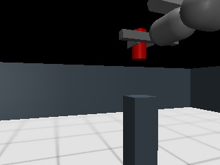

# 13.6 M4 물리 픽킹 검증 기록

2026-11-03 KST. **v4의 정상 물리 픽킹과 파지 중 취소는 PASS. 전체 손실·중복·13.5 회귀 matrix는 최종 보고서에서 구분한다.**

## 최종 v4 결과

source235/asset94 동결v4, manifest `41be725d863fa7c4fc50c6f90f698a6d8822e25e8f5ef8ba51f881d5a0539f5a`를 사용했다. renderer 직접 DDS 발행으로 부모 영상 보존을 실시간 전달에서 분리하고 원본 촬영/발행 journal을 정상 회수했다. 물리/제어 수치는 v2와 같으며 GC 정책은 변경하지 않았다.

| 실제 시나리오 | UUID | 독립 검사 |
|---|---|---|
| 정상 pick |`4068258b-eaa1-4286-9548-b203cfced440`|최소 상승100.2328mm·최대102.9414mm·HOLD2.20sim초·상대 변화0.02755mm·양 finger 접촉100%, PASS|
| 파지 중 lift 취소 |`ea0e3998-27a2-4260-9c60-d90bd9fda094`|실제 CANCELED 뒤2.20sim초·낙하0·상대 변화0.02750mm·양 finger 접촉100%, PASS|

두 경우 모두 저장 RGB-D의 중심을 재계산했고12개 자식·RX·renderer·upstream thread의 정상 회수와 잔여 없음까지 확인했다. 취소 사례는 물체9cm lift 인수로 세지 않는다. v2의 이전 정상 성공과 조기 관측 만료 실패는 아래 보존한다. 직접 발행 전 추가 취소 시도 `618613e2`, `f3064562`, 진단v3 `b432a881`은 접촉/취소 전에 만료되어 해당 안전 시나리오 성공으로 세지 않는다.

최종 v4 정상 사례의 마지막 실제 RGB 원본이다. 같은 이름의 JSON에 capture/내용 hash를 기록했다. 그림 자체가 물리 성공 판정은 아니며 표의 수치는 실제 freejoint/contact로 계산했다.

## 이전 v2 정상 픽킹 결과

UUID `48209582-6b8f-4b44-8fba-6791e95695da`, source/asset 동결v2(`3620227a258b8c8fcdef914a7af61bc6d7ea5724b7d186f49bd669415ac7491c`). 실행 exit0, 독립 `verify_pick.py` PASS. 실제 MuJoCo freejoint/contact 측정에서 아래를 확인했다.

| 항목 | 결과 | 사전 기준 |
|---|---|---|
| HOLD 최소 실제 상승 |100.346mm|≥90mm|
| HOLD 최대 실제 상승 |103.056mm|진단|
| HOLD 실제 시간 |2.20sim초|≥2sim초|
| TCP 상대 변화 |0.02755mm|≤20mm|
| HOLD 양 finger 접촉 비율 |100%|≥90%|
| 실제 RGB-D 저장 중심 재계산 |일치|원본 저장 영상/depth와 과거TF로 fit|
| 엔진·노드 회수 |12개 정상 종료, worker/RX/upstream join·잔여 없음|정상 수명|

동일 session에서 접근·실제 정착·MoveIt pre-grasp·직선 진입·실제 close/접촉·직선 lift·한 번의 제한된 시각 보정·정착·HOLD·회수가 이어졌다. 이 한 번의 대표 성공을 반복 성공률이나 일반 하중 성능으로 확장하지 않는다. 이전 실패는 아래 그대로 보존한다.

이전 v2 RGB 원본 복사본과 capture/hash도 `pick_success_rgb_v2.{png,json}`로 보존한다.

## 고정한 과제

원본 Go2+Piper와 같은 살아 있는 engine에서 Nav2 접근·정착 후 open→12cm pre-grasp(OMPL/TRAC-IK)→전체 Cartesian 직선 접근→close→양 finger 실제 접촉→10cm 직선 lift→최대 한 번3cm 이내 시각 보정→실제 정착→2.2sim초 HOLD→회수한다. 속도/가속도 scaling0.08, 다리는 계속 기존 정책으로 지지한다.

대상은 반경2cm·높이8cm·질량20g·마찰0.8·condim3의 동적 원통, 시작 중심[1.8,0,0.54]m와 기존 받침 top0.5m다. 로봇 mass/inertia/equality/native PD gain·원본 팔32/8Nm·gripper0.5N cap은 유지한다. 팔 bias 보상과 실제 양 finger 접촉 후 제한된 닫기 힘 유지는 명시적 새 제어 profile이다. 물체를 손에 weld/teleport하지 않는다. planning scene attach는 충돌 형상 표현이며 실제 부착이 아니다.

실제320×240 RGB-D와 원본 capture/최초 receipt/GID·과거TF를 사용한다. 알려진 upright 원통 치수로 표면을 fit하며 일반6D/yaw 인식이 아니다. base[0.4,0.25,0.25]m·yaw-20°의 교육용 가상 센서와 pinned MuJoCo3.13.0/skybox-off paired RGB-depth 경로를 사용한다. 대상 freejoint 정답은 증거/실행 후 독립 평가에만 쓰며 비전·계획·보정 입력으로 발행하지 않는다. 제어가 사용하는 접촉 force는 실제 촉각 관측이다.

## 판정

PRE_GRASP 실제 대상 z의 중앙값을 기준으로 HOLD 전체 최소 상승≥90mm, 최소2sim초, TCP 상대 위치 변화≤20mm, CLOSE 양 finger 접촉 및 HOLD90% 이상 양 finger normal>0.005N을 요구한다. NaN/Inf·불완전 시간/상태 증거는 거절한다. controller action 성공·gripper stall·planning scene attach만으로 성공 처리하지 않는다.

v6의 보정은 새 관측 부족량에 실측 robot TCP endpoint 지연과3mm를 더하되 한 번·30mm로 제한한다. 관측 부족27mm 초과는 거절한다. HOLD 전에는 관측 상승95mm·실제 팔 속도0.003rad/s 이내·기존 base 정착을0.5sim초 연속 확인한다. 최종 독립 물리 기준은 완화하지 않았다.

## 보존한 개발 실패와 작은 시험

| 증거 | 확인과 처리 |
|---|---|
| `c2708b43`, `0dc72e43`, `89dc14f6`, `b68d4a66` | 긴 pre-grasp에서 관측/mission 만료. 긴 동기 수치 계산 분리·일괄 증명·채널 분리 이후에도 실패를 숨기지 않았다. |
| `22870a96` | 붉은 로봇 조각과 원통의 전역 mask 병합. 연결 성분별 같은 원통 fit·잔차/높이 기준을 적용했다. |
| `25b54efe`, `f4786a31`, `3e994ef3` | 간헐 시각 지연 또는 실제 팔의 원통 상단 가림. 15cm 측면 후보도 가림이 남았다. |
| `camera_visibility_review_v1.json` | 이전 실제 경로와56개 오프라인 자세/광선으로 가림 조사.25cm 측면·yaw-20° 선택. 오프라인 IK 결과를 실제 명령 성공으로 세지 않았다. |
| `5cadca4e` | 실제 접근·양 finger 접촉·0.5N 이내 force hold까지 확인, scene attach API의 중복 world REMOVE 때문에 lift 전에 실패. |
| `e792f843`→`c8726493` | 실제 MoveIt scene API 단독 RED→GREEN. attach의 암묵적 world 제거를 중복 요청하지 않도록 수정. 물리 파지 성공 증거는 아니다. |
| `18c2d938`, `675587d6`, `bc6abc20`, `22c58cdb` | 렌더/전달 지연·수신 잠금 시각 경쟁 조건·관측 만료. 원본300ms/100ms는 유지했고, 정상 회수/잔여 검사를 보존했다. |
| `rgbd_single_pass_benchmark_v1.json` | 두 실제 정적 장면에서 RGB 동일·전체 depth 오차0, 렌더 중앙값 약9.7~9.9→6.0~6.2ms. skybox-on 초기 불일치는 기각. 모든 장면의 동등성 증명은 아니다. |
| `39d706b8` | 전체 물리 순서·회수 완료, 유지 최소 상승88.304mm로 FAIL. 접촉100%·상대 미끄러짐27μm. 실제 endpoint 지연을 보정에 포함하고 HOLD admission을 분리했다. |

원본 손가락의 분리 rig에서 position PD/20g는 lift가 없었고 force hold/20g는81.6mm 상승했다. condim4는75.5mm로 더 나빠 채택하지 않았다.10g 진단 시험도 최종 물체 선택으로 쓰지 않았다. 이 rig는 Go2 지지·전체 pick 인수가 아니다. 최종 mass/friction/condim/cap은20g/0.8/3/0.5N이다.

## 한계

이 실습의 대상·배치·가상 카메라·힘 profile에 대한 교육용 검증이다. 새 WBC/재학습·실기·가반 하중·일반 비전·놓기·다양한 물체의 강건성은 별도 과제다. 간헐 시각 지연의 실패를 모두 보존하며 한 번의 대표 PASS가 반복 성공률을 뜻하지 않는다. [변경 이유와 비용](SECTION_13_6_REUSE_ENGINEERING_DECISIONS_KO.md), [실습 명령](LAB_13_6_REUSE_GUIDE_KO.md)을 함께 읽는다.

## v13 최종 인수 추가 확인 (2026-11-04)

정상 pick20662d06-ec82-4232-8a8a-6426d347557e: 최소100.399579mm 상승·2.18sim초 유지·상대변화0.027299mm·양 finger 접촉100%, 원본 RGB-D 중심 재계산·정상 자식12개 회수 PASS. held_cancel4448d833-3500-4108-8b00-2464f67aba00: 실제 취소 뒤2.22sim초·낙하0mm·상대변화0.034446mm·접촉100%·정상 회수 PASS. v13은 불필요한2ms knot 간격만 제거하며 힘/물체/관측/물리 인수 수치는 유지했다. 전체16개 중 raw_loss 원판정 FAIL과 별도 검토 결과를 최종 보고서에 명시한다.