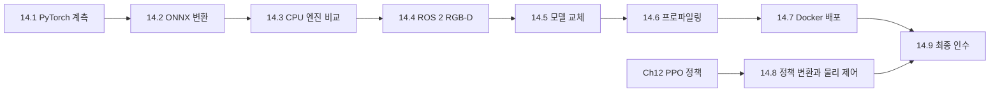

# 14장. AI 모델 최적화 및 배포

학습된 AI 모델을 ONNX로 변환하고, CPU 추론 엔진과 ROS 2 노드에 연결한 뒤 Docker와 물리 시뮬레이터에서 동작을 검증합니다. **실제 로봇이나 임베디드 보드 없이** 실습합니다.

[전체 챕터 목록](../README.md) · [실습 인수 원장](docs/CH14_ACCEPTANCE_LEDGER.md) · [WSL2 원샷 검수](docs/G09_WSL2_OWNER_ACCEPTANCE_KO.md)

> **제공 범위:** CPU 시뮬레이션 교육용 제한 MVP. WSL2 Headless Docker의 4개 검수 경로는 실제 사용자 인수 완료(OWNER_L3_SCOPED_PASS). 모든 절의 현장 검수, 원본 모델의 절대 탐지 정확도, 안정 보행, GPU/GUI 및 실제 HW 안전은 보장하지 않습니다. 외부 자산 권리와 최종 출판 승인은 별도 HOLD입니다.

## 1. 학습 목표

- PyTorch와 ONNX의 입력·출력 계약 및 변환 동등성을 검증합니다.
- ORT와 OpenVINO를 같은 입력에서 비교하고 지연시간, 처리량, 결과 나이를 구분합니다.
- 비동기 AI 노드, RGB-D 동기화·좌표 변환, 동적 파라미터, 모델 교체를 실습합니다.
- Docker로 추론 환경을 재현하고 ROS 2 DDS 연결과 안전한 종료를 관찰합니다.
- PPO 정책의 관측·행동 계약을 유지한 채 시뮬레이터에 연결하고, 실제 물리 피드백으로 확인합니다.



인지(A)와 강화학습 제어(B)는 독립 실습입니다. 두 기능을 연결한 자율조작 제품은 아닙니다.

## 2. 실행 환경 및 준비

| 구분 | 기본 환경 |
|---|---|
| 호스트 | Windows WSL2 / Ubuntu 24.04 / x86_64 |
| ROS 2 | Jazzy |
| 시뮬레이터 | Gazebo Harmonic, MuJoCo |
| Python | 3.12, 검증된 CPU 의존성 lock |
| Docker | Docker Desktop WSL 통합 또는 WSL 내부 Docker Engine 중 하나 |
| 가속기 | CPU 기본; GPU 선택(미검수) |
| 실물 HW | 사용하지 않음 |

- [CPU 환경 준비 및 검수 기록](docs/G00_CPU_ENVIRONMENT_ACCEPTANCE_KO.md)을 먼저 읽습니다. 수동 실습은 해당 절의 venv/ROS overlay 및 의존성 준비를 따릅니다.
- WSL2 사용자는 Linux 파일시스템의 홈 디렉토리에서 실행하고, `docker info`, 네트워크 및 여유 공간을 확인합니다.
- 외부 모델·영상·Gazebo 자산의 사용 조건을 확인합니다. [자산 및 권리 원장](docs/G09_ASSET_RELEASE_REGISTER_KO.md)을 참조하십시오. 권리를 확인하지 못했으면 해당 실습을 중단하고 build-only 검수만 진행합니다.
- 14.8/14.9의 정책 제어에는 기존 G07 원본 ZIP이 필요합니다. 승인된 원본과 SHA256이 확보된 경우에만 재사용하며, 미확보·만료·해시 불일치 시 BLOCKED로 처리합니다. 자동 재학습하지 않습니다.

### 검증된 환경의 빠른 시작 — build-only

아래 명령은 **고정 SHA의 CPU Docker 빌드**만 검증합니다. ROS 2 Jazzy를 호스트에 직접 설치하는 절차나 물리 시뮬레이션 실행이 아닙니다. 기존 성공 인수자는 반복 실행할 필요가 없습니다.

```bash
(
  set -euo pipefail
  cd "$HOME"
  PIN=6c458e345236b124c9aa60f65788f35cfed74e62
  BOOT="$HOME/ch14-bootstrap-$PIN.sh"
  docker info >/dev/null
  curl --proto '=https' --proto-redir '=https' -fsSL --connect-timeout 15 --max-time 90 \
    "https://raw.githubusercontent.com/silverbjin/Pysical_AI_ROS2/$PIN/Ch14/scripts/bootstrap.sh" -o "$BOOT"
  printf '%s  %s\n' '0939ce653d896fb84a381e494600d77ce1cbbafd95e4aa86618cff33b7c2e30f' "$BOOT" | sha256sum -c -
  CH14_SOURCE_SHA="$PIN" bash "$BOOT" --profile cpu --headless --check build
)
```

실제 RGB-D, MuJoCo, Gazebo 및 전체 순차 검수는 [14.9 WSL2 원샷 안내](docs/G09_WSL2_OWNER_ACCEPTANCE_KO.md)의 사전 조건과 명령을 사용합니다. `--check all`이 14.1~14.9의 모든 수동 실습을 실행하는 것은 아닙니다.

## 3. 절별 실습 가이드

| 절 | 주제 | 교재 코드 | 실습 가이드 | 검수 범위 |
|---|---|---|---|---|
| 14.1 | 로봇 시스템에서의 AI 배포 | 14-1 | [실습](docs/LAB_14_1_GUIDE_KO.md) | CPU 벤치마크 |
| 14.2 | ONNX 표준 포맷 | 14-2~4 | [실습](docs/LAB_14_2_GUIDE_KO.md) | 변환·동등성; 절대 탐지 FAIL |
| 14.3 | 추론 엔진 최적화 | 14-5~6 | [실습](docs/LAB_14_3_GUIDE_KO.md) | ORT/OV CPU; TRT 미구현 |
| 14.4 | ROS 2 AI 추론 노드 | 14-7~8 | [실습](docs/LAB_14_4_GUIDE_KO.md) | DDS·실제 Gazebo RGB-D |
| 14.5 | 동적 모델 설정 | 14-9~12 | [실습](docs/LAB_14_5_GUIDE_KO.md) | 파라미터·교체·순서 종료 |
| 14.6 | 성능 모니터링 | 14-13 | [실습](docs/LAB_14_6_GUIDE_KO.md) | A/B/C 각 60초 |
| 14.7 | Docker 및 ROS 2 배포 | 14-14~16 | [실습](docs/LAB_14_7_GUIDE_KO.md) | CPU Docker DDS Replay |
| 14.8 | 강화학습 정책 배포 | 14-17~19 | [실습](docs/LAB_14_8_GUIDE_KO.md) | SMOKE_ONLY 두 엔진 제어 |
| 14.9 | 최종 프로젝트 출격 준비 | 통합 검수 | [실습](docs/LAB_14_9_GUIDE_KO.md) | WSL2 4개 경로 L3 |

### 14.1 로봇 시스템에서의 AI 배포 — 왜 최적화가 필요한가?

**목표:** 모델 추론 비용을 측정하고 주기, 지연시간과 처리량의 관계를 설명합니다.

- 실행: CPU 환경과 권리 확인된 YOLOv8n 준비 → `python/benchmark_torch.py`로 1/2 threads를 비교합니다.
- 관찰: warmup 제외 100개 표본, CSV, 평균/P95/P99/max 및 실제 실행 장치.
- 확인: 추론 시간과 전체 ROS 2 제어 지연시간은 다릅니다.

[상세 실습](docs/LAB_14_1_GUIDE_KO.md) · [G01 개발 보고서](docs/reports/G01_YOLO_DEVELOPMENT_REPORT_KO.md)

### 14.2 모델 경량화의 첫걸음 — ONNX 표준 포맷

**목표:** 모델을 ONNX로 변환하고 동일 입력에 대한 원본과의 동등성을 검증합니다.

- 실행: `python/export_yolo.py` → `python/inference_onnx.py`; 별도로 `python/export_custom_model.py`의 미학습 MLP 예제를 확인합니다.
- 관찰: Netron 그래프, 입출력 shape·dtype, export.json, 원시 출력 오차, bbox·score 일치와 실제 GT.
- 확인: 40/40 raw, 71/71 bbox, 신규 GT 누락 0. 원본 필수 표적은 n14/16, s15/16으로 FAIL. 변환 성공을 모델 자체의 정확도 보증으로 해석하지 않습니다.

[상세 실습](docs/LAB_14_2_GUIDE_KO.md) · [검수 범위](docs/G01_ACCEPTANCE_SCOPE_KO.md) · [의미 탐지 분석](docs/reports/G01_SEMANTIC_DIAGNOSTIC_REPORT_KO.md)

### 14.3 추론 엔진 최적화 — TensorRT와 OpenVINO

**목표:** 동일 ONNX 모델에서 CPU 엔진의 속도와 결과를 비교합니다.

- 실행: `python/ov_inference.py`, `python/compare_backends.py`로 ORT CPU와 OpenVINO CPU를 비교합니다.
- 관찰: API 단독 및 메모리 내 end-to-end 시간, 평균과 tail latency, 동등성.
- 확인: 800개 실측 표본. 빠른 엔진이 모든 호스트에서 더 빠르다는 보장은 없습니다. 코드 14-5 TensorRT는 선택 이론/참고 예제이며 저장소 구현·GPU 실측이 없습니다.

[상세 실습](docs/LAB_14_3_GUIDE_KO.md) · [CPU 비교 보고서](docs/reports/G02_CPU_EXECUTION_REPORT_KO.md)

### 14.4 ROS 2 AI 추론 노드 설계 패턴

**목표:** 비동기 추론과 RGB-D 융합으로 실제 ROS 2 인지 결과를 생성합니다.

- 실행: `ch14_ai_perception`의 `perception.launch.py`, 실제 가상 센서와 모델을 준비합니다. Headless 자동 검수는 `--check perception`입니다.
- 관찰: `/perception/detections`, `/perception/image_annotated`, `/perception/target_point`, heartbeat.
- 확인: 실제 Gazebo 정상 10 + 재개 3개 평가 표본의 의미·3D 관측 13/13. 시간 동기화만으로 공간 정렬을 보증하지 않으며, 잘못된 Depth/TF에서는 3D 출력을 차단합니다.

[상세 실습](docs/LAB_14_4_GUIDE_KO.md) · [실제 Gazebo 보고서](docs/reports/G03_L2_EXECUTION_REPORT_KO.md)

### 14.5 ROS 2 파라미터를 이용한 동적 모델 설정

**목표:** 실행 중 설정 변경과 모델 교체를 안전하게 관리합니다.

- 실행: `robot_ai_system.launch.py`로 시작하고 `ros2 param get/set`, `/ch14/swap_model` 서비스를 사용합니다.
- 관찰: threshold 변경, 교체 요청의 terminal 상태·generation·model hash, 실패 시 이전 모델 유지.
- 확인: atomic parameter와 Hot Swap의 성공/거부를 비교합니다. 검증된 순서 종료(소비자→서버→launch)를 사용하며 일반 동시 Ctrl+C 안정성은 별도 HOLD입니다.

[상세 실습](docs/LAB_14_5_GUIDE_KO.md) · [실행 보고서](docs/reports/G04_EXECUTION_REPORT_KO.md) · [종료 장애 분석](docs/reports/G04_SHUTDOWN_BOUNDARY_DEBUG_KO.md)

### 14.6 성능 모니터링 및 벤치마킹

**목표:** 모델과 ROS 2 시스템의 병목을 수치로 설명합니다.

- 실행: `python/profiler.py`, `ch14_performance_monitor`, `scripts/g05_actual_compare.py`로 A(Torch sync), B(ORT sync), C(ORT async)를 비교합니다.
- 관찰: inference latency, heartbeat 누락, 발행/수신 수, CPU/RSS/RTF 및 그래프.
- 확인: 각 60초 실측, heartbeat 누락 16/7/0. ROS clock callback 지연에 따른 node-local age의 한계를 구분합니다.

[상세 실습](docs/LAB_14_6_GUIDE_KO.md) · [실측 보고서](docs/reports/G05_EXECUTION_REPORT_KO.md)

### 14.7 가상화 및 배포 자동화 — Docker와 ROS 2

**목표:** CPU 추론 환경을 이미지로 구성하고 DDS 기반 서비스를 실행합니다.

- 실행: `docker/build_cpu.sh` → `docker/run_docker.sh` → `docker/compose.yaml`의 sensor-source/ai-inference/monitor.
- 관찰: readiness, 단일 /clock, 이미지 ID, 모델 해시, 결과 수신 및 컨테이너 종료.
- 확인: standalone/compose 각각 39/39 결과; 실제 RGB와 합성 Depth/TF의 bag replay입니다. 실제 Gazebo 센서 전체 제품이나 WSL2 Compose 자체를 인수한 것은 아닙니다.

[상세 실습](docs/LAB_14_7_GUIDE_KO.md) · [Docker 검수 보고서](docs/reports/G06_EXECUTION_REPORT_KO.md)

### 14.8 프로젝트 — 4족 보행 강화학습 모델 배포

**목표:** PPO Actor를 ONNX로 변환하고 센서→관측→추론→관절 명령→물리 피드백의 연결을 확인합니다.

- 실행: 승인된 G07 원본 모델과 계약 검증 → `python/export_rl_policy.py`/ `observation_builder.py` → `rl_shadow` → `rl_controller`.
- 관찰: 관측 48, 행동 12, Shadow의 명령 0건, enabled의 50Hz 제어 및 실제 관절 응답. MuJoCo의 pause/resume 및 별도 보호 검수.
- 확인: SMOKE_ONLY 모델 사용. 실제 WSL2에서 MuJoCo 400/400/400, Gazebo 398/398/397(활성/명령/피드백). 안정 보행, 모든 Gazebo 결함 상황 및 실제 모터 안전은 입증되지 않았습니다.

[상세 실습](docs/LAB_14_8_GUIDE_KO.md) · [정책 변환 보고서](docs/reports/G07_EXECUTION_REPORT_KO.md) · [두 엔진 제어 보고서](docs/reports/G08_EXECUTION_REPORT_KO.md)

### 14.9 요약 및 최종 프로젝트 출격 준비

**목표:** 고정된 소스에서 실행 환경과 실제 동작을 검증하고 성공 범위를 증거로 설명합니다.

| 실행 옵션 | 확인 대상 |
|---|---|
| `--check build` | 6개 ROS 2 패키지 빌드 |
| `--check perception` | 실제 Gazebo RGB-D 인지 |
| `--check mujoco` | 실제 MuJoCo 정책 제어 |
| `--check gazebo` | 실제 Gazebo 정책 제어 |
| `--check all` | 위 네 경로 순차 실행 |

인지에는 자산 조건 확인 후 명시적인 `--acknowledge-assets`, 정책 제어에는 승인된 G07 원본 ZIP과 `--enable-sim-control --reuse`가 필요합니다. 명령 전문은 아래 공식 가이드에서 확인하십시오.

[상세 실습](docs/LAB_14_9_GUIDE_KO.md) · [WSL2 원샷 실행](docs/G09_WSL2_OWNER_ACCEPTANCE_KO.md) · [실제 인수 보고서](docs/reports/G09_WSL2_OWNER_ACCEPTANCE_REVIEW_20261126_KO.md)

## 4. 실행 방법 및 증거 읽기

- 저장소의 Ch14 디렉토리에서 `bash scripts/run_lab.sh 14.1 --guide`처럼 절 번호를 바꿔 가이드를 조회할 수 있습니다. 조회는 실습 실행이 아닙니다.
- 자동 실행은 14.4, 14.8의 enabled 엔진 선택, 14.9의 headless 검수에 한정됩니다. 그 밖의 절과 Shadow 수동 실행은 각각의 상세 가이드에서 명령·환경을 확인합니다.
- 수동 예제의 `ACTUAL_SHA`, `VERIFIED_..._SHA`, `/absolute/...`는 실제 승인된 해시·절대 경로로 바꿉니다. 동일 모델이라도 새로 export한 파일의 해시를 과거 결과로 대체하지 않습니다.
- 원샷 실행의 `CH14_OWNER_EVIDENCE` 경로에 생성된 `evidence.tar.gz` 및 `.sha256`을 함께 보존합니다. 종료 코드 0은 요청 범위 성공, 2는 BLOCKED, 130은 취소, 나머지는 실패입니다. 원본 검토 후 인수 판정합니다.
- 성공 SHA는 `6c458e345236b124c9aa60f65788f35cfed74e62`입니다. main의 최신 문서 SHA를 실제 성공 소스 SHA로 대체하지 않습니다. 동일 사용자가 이미 성공한 시험을 반복할 필요는 없습니다.

### 실제 WSL2 인수 결과 (2026-11-26)

| 지표 | 결과 |
|---|---:|
| Clean Build | 6/6 |
| RGB-D 의미·공간 관측 | 13/13 |
| MuJoCo 활성/명령/피드백 | 400/400/400 |
| Gazebo 활성/명령/피드백 | 398/398/397 |
| 두 엔진 시뮬레이션 제어율 | 50Hz |
| 내부 증거 해시 | 82/82 |
| 소유 컨테이너 정리 | 4/4 |
| 전체 종료 코드 | 0 |

Gazebo 마지막 피드백 1쌍은 측정 종료 경계에서 사후 관측을 확보하지 못했습니다. 기존 합격 기준 충족과 마지막 물리 응답 미확인을 구분합니다. [원시 데이터 분석 및 인수 판정](docs/reports/G09_WSL2_OWNER_ACCEPTANCE_REVIEW_20261126_KO.md).

## 5. 디렉토리 구조

```text
Ch14/
├── README.md        # 절별 실습 안내
├── python/          # 교재 코드 진입점
├── ros2_ws/src/     # ROS 2 패키지와 launch/config
├── scripts/         # 실행기, 환경 검사, 모델 준비, 검수기
├── docker/          # CPU Dockerfile 및 Compose
├── requirements/    # Python 의존성 lock
├── models/          # 모델 출처·계약
├── fixtures/        # 평가 자산 출처·해시
├── vendor/          # 재사용 코드 및 출처 기록
├── evidence/        # 정제 검수 증거
└── docs/            # 절별 실습 가이드와 개발/검수 보고서
```

## 6. 검수 범위와 참고 자료

- [인수 원장](docs/CH14_ACCEPTANCE_LEDGER.md): L0~L3 및 FAIL/HOLD의 의미와 실제 근거.
- [교재 코드 14-1~14-19 추적표](docs/MANUSCRIPT_TRACEABILITY_KO.md): 18개 구현 경로, 미구현 선택 코드 14-5, 증거 연결.
- [MVP 출고 결정 및 제한](docs/G09_MVP_RELEASE_DECISION_KO.md): 원본 탐지 기준 FAIL, 권리/최종 출판 QA, 일반 종료 및 GUI 등.
- [출판 교차 QA](docs/reports/G09_RELEASE_CLOSEOUT_QA_20261126_KO.md): 원고와 실제 코드·가이드 차이.
- [자산 및 장기 보존](docs/G09_ASSET_RELEASE_REGISTER_KO.md): 라이선스와 출처, 원본 ZIP 보관.
- [개발 이력](docs/CH14_RESUME_CHECKPOINT_KO.md): 성공과 실패를 보존한 개발 체크포인트.

이 저장소의 소스 통합은 전체 원고 출판 또는 제3자 자산 재배포 권리의 승인을 뜻하지 않습니다. 미검수 항목을 PASS로 변경하지 않습니다.
