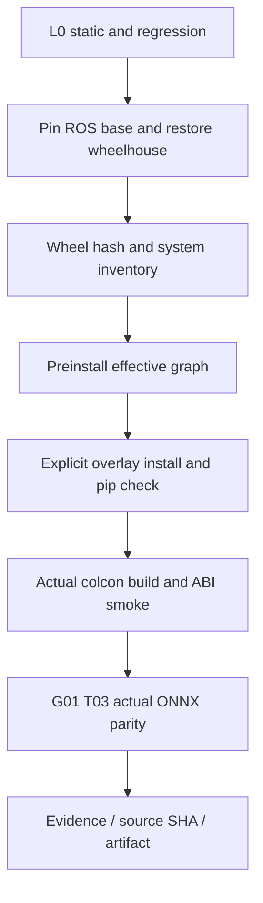

# Ch14 CI 구조

단일 target container를 해당 job의 G00와 독립 G01 T03에 재사용하며 단계별 상태/로그를 기록한다. G00 실패하면 G01 미실행. Cache는 exact lock SHA/Ubuntu/x64/CP312/Jazzy/image digest prefix, wheel hash 전체 cmp. Cache save는 검증 marker가 있어야 가능, 이후 실패해도 재사용. 문서-only push는 workflow를 실행하지 않음. L2 전체와 L3는 별도 미래 Gate; 현 단계 실제 gazebo/mujoco/DDS 통합 미실행. GPU/모델 캐시는 권리 및 해당 단계에서 별도 구현. apt base는 digest 고정이나 apt repo 업데이트는 별도 기록하여 차이 검증.
