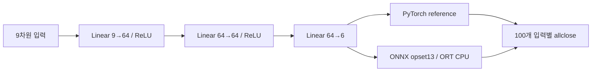

# 14.2 실습 가이드 — 개발 중인 14-3 독립 경로

목표: PyTorch의 계산 그래프를 ONNX로 변환하고 입력/출력 계약 및 수치 동등성을 이해한다. 이 예제는 미학습 MLP이므로 로봇팔 제어에 사용하지 않는다.



현재 상태: Python source-level 테스트만 완료. G00 CPU lock 확정 전 임의 pip 설치 금지. 다음 명령은 **목표 실행 경로이며 아직 ONNX 실행 검증되지 않았다**. Ch14 루트에서 검증된 CPU venv 활성화 및 Ch14 overlay 설치 후 실행한다.

```bash
python python/export_custom_model.py --output evidence/t03_run_001
```

새 출력 디렉터리에 robot_arm_controller.onnx, reference_outputs.npz, result.json이 생성되도록 구현했다. 예상 PASS 조건: input_state (1,9), joint_vel_cmd (1,6), FP32, CPUExecutionProvider, 100개 입력별 atol=1e-5/rtol=1e-4 만족. 실제 결과값을 확인해야 하며 수치는 예상으로 대체하지 않는다. 실패 result.json/로그 보존; 누락 의존성은 G00 lock 단계에서 해결. Netron에서 두 Linear/ReLU 구간을 살펴보되 그래프 확인을 parity로 간주하지 않는다. 14-2 YOLO export 및 14-4 실제 탐지 가이드는 후속 구현에서 작성한다.
