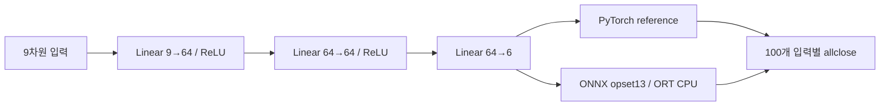

# 14.2 실습 가이드 — 개발 중인 14-3 독립 경로

목표: PyTorch의 계산 그래프를 ONNX로 변환하고 입력/출력 계약 및 수치 동등성을 이해한다. 이 예제는 미학습 MLP이므로 로봇팔 제어에 사용하지 않는다.



현재 상태: G00 CPU profile CI 검증 및 T03 실제 ONNX 변환 PASS. Ch14 루트에서 검증된 CPU venv 활성화 및 Ch14 overlay 설치 후 실행한다. WSL2 Owner 인수는 아직 미실행.

```bash
python python/export_custom_model.py --output evidence/t03_run_001
```

새 출력 디렉터리에 robot_arm_controller.onnx, reference_outputs.npz, result.json이 생성되도록 구현했다. 예상 PASS 조건: input_state (1,9), joint_vel_cmd (1,6), FP32, CPUExecutionProvider, 100개 입력별 atol=1e-5/rtol=1e-4 만족. CI 실측: 100개 allclose PASS, max abs 2.384185791015625e-07; 자신의 실행에서도 실제 결과값을 확인하며 수치를 예상으로 대체하지 않는다. 실패 result.json/로그 보존; 누락 의존성은 G00 lock 단계에서 해결. Netron에서 두 Linear/ReLU 구간을 살펴보되 그래프 확인을 parity로 간주하지 않는다. 14-2 YOLO export 및 14-4 실제 탐지 가이드는 후속 구현에서 작성한다.

## 실제 CI 증거
[Run 45742206902](https://github.com/silverbjin/Pysical_AI_ROS2/actions/runs/45742206902) · [원본 ONNX/NPZ/JSON](https://github.com/silverbjin/Pysical_AI_ROS2/actions/runs/45742206902/artifacts/15081503468). source 1228072c5679b608756bfbd578b2c56cbcfe32e8. T03 scope only; 실측 결과 참고, YOLO 코드 14-2/4 미검수. CPU+export exact lock requirements/cpu.lock.txt와 실제 환경은 G00_CPU_ENVIRONMENT_ACCEPTANCE_KO.md 참조.

## 14-2 / 14-4 — YOLO 실습 (검증 후보)
`python python/export_yolo.py --manifest models/model_manifest.json --cache /absolute/models --model yolov8n --output evidence/yolov8n` (yolov8s 동일). export.json의 실제 ONNX SHA256을 사용해 `python python/inference_onnx.py --onnx evidence/yolov8n/yolov8n.onnx --sha256 <actual_sha256> --image /absolute/authorized.jpg --output evidence/detect_1`. Netron에서 images/predictions static shape 확인. detections.json, annotated.jpg 확인. 실제 CI에서 이미지/모델 바이너리는 외부 권리 확인 전 업로드하지 않는다. Fixture manifest는 출처와 해시 보존; T04 raw atol=1e-3/rtol=1e-3, bbox IoU>=.95, score diff<=.02, GT IoU>=.5. 실제 결과 후 판정.

## 실제 T02 검증
Run 45744146299: n/s ONNX actual checker/ORT load and infer PASS, FP32 static 640 batch1, COCO 80 map, NMS 없음. Seed max abs n 0.000701904296875, s 0.0015869140625 (combined atol/rtol allclose PASS). n SHA 7a0036fa3389769f62f48fae0b26e0acec937cee0e3c8d78e0bab31a7dbcfc4e; s SHA 18fb51e7a65dbfba1c011d2d99c30d066324a1164e1c0eddf5fbcd383153f8d3. T04 fixture TLS blocked; do not call image parity PASS. External model/fixture distribution approval pending.
