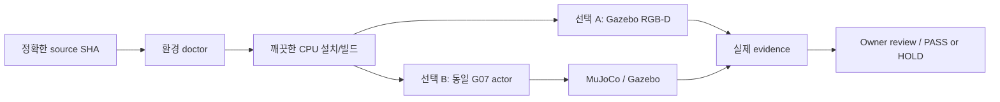

# 14.9 최종 프로젝트 출격 준비 — 증거 기반 검수
목표: 모델 변환, ROS 실행, 물리 피드백, 배포 환경의 성공 범위를 구분하고 자기 PC에서 재현한다. A(인지)와 B(강화학습 제어)는 독립 프로젝트이며 연결된 자율조작 제품이 아니다.

## 사전 조건
WSL2 Ubuntu24.04 x86_64, Python3.12, Docker Engine 또는 Docker Desktop WSL integration 한 가지, Linux 파일시스템, 충분한 공간, 네트워크/권리 확인. Docker headless 인수 후보이며 WSLg GUI·native ROS 설치 검증은 별도다. 선택 GPU/TensorRT는 미실행, 14-5 구현 없음. 실제 HW 금지. 원래 14.9 체크리스트의 비상정지 시 토크0은 실물 HW 검수이며 이 도서의 위치 hold 검수로 대체하거나 PASS 표시하지 않는다.
## 실행 방법
정확한 검수 후보 SHA는 최종 인수 안내에서 제공한다. 아래 PIN은 placeholder. 기존 Git 작업공간 수정하지 않는다.
```bash
PIN=REVIEWED_40_HEX_SOURCE_SHA
curl -fsSLo "$HOME/ch14-bootstrap.sh" "https://raw.githubusercontent.com/silverbjin/Pysical_AI_ROS2/$PIN/Ch14/scripts/bootstrap.sh"
CH14_SOURCE_SHA="$PIN" bash "$HOME/ch14-bootstrap.sh" --profile cpu --headless --check build
```
build는 6개 package clean install-space 검수이며 실제 센서 실행을 의미하지 않는다. 실제 A는 --check perception --acknowledge-assets (AGPL과 3D asset 사용 조건 확인 후); B는 --check mujoco 또는 gazebo --reuse /absolute/original-G07.zip --enable-sim-control. all은 세 실제 경로와 build를 각각 1회 순차 수행하며 두 승인 옵션과 원본 ZIP 필수. --gui는 지원하지 않으며 조용히 headless로 변경하지 않는다. --check build는 CPU install-only. 14.1~14.8의 개별 manual command는 기존 가이드의 범위를 참조한다. run_lab.sh 14.n --guide는 가이드 조회, 실행 성공이 아님. 자동 실행은 14.4, 14.8, 14.9에 한정.
## 증거·판정
G07 원본 artifact 15090667475 ZIP SHA256 c8defc1a154c3d0ec92ddd3a7fbd70f8d3b012dc21d375acde9f5c5f9be9641d. Actions 보존 기간 30일: 원본은 허용된 로컬 저장소에 보관. 만료/해시 오류 시 BLOCKED; 재학습 없음. 출력 evidence.tar.gz와 .sha256을 제출한다. 0은 요청한 경로만 성공, 2는 BLOCKED, 130 취소, 기타 실패. owner-result의 WSL2_OWNER_REVIEW_REQUIRED는 사용자 L3 자동 PASS가 아니다. 소스/스크립트 SHA, 실제 로그, 결과, 해시를 검토한 뒤 승인한다. GUI 품질은 별도 기록. 
## 학습 과제
1. G01 원본과 변환 모델이 같은 오검출을 내는 이유를 설명한다.
2. 20ms 제어 주기와 추론 P95·max를 구분하고 Gazebo의 headerless Float64 수신 비교 한계를 설명한다.
3. 모델 미확보·잘못된 SHA·비활성 제어에서 어떤 단계가 중단되는지 확인한다.
4. G05 heartbeat와 ROS age, G06 replay와 실제 가상 센서, G08 smoke policy와 보행 품질을 비교한다.
## 인수 범위
현재 G09 OWNER_READY_HEADLESS_SCOPED (Linux 실제 원샷 4개 선택 경로 성공, WSL2 L3 NOT_RUN). 전체 권리/의미 탐지/일반 종료/legacy PR/WSL2 L3 조건은 원장에 따르며 승인 전 main 병합 금지.

## 7. 검수된 사용자 출고 PIN
6c458e345236b124c9aa60f65788f35cfed74e62. [WSL2 사용자 인수 안내](G09_WSL2_OWNER_ACCEPTANCE_KO.md)에서 정확한 SHA256 및 단일 명령을 사용한다. Build45815645513 and physical45816276822 actual SUCCESS, same source. Four selected paths separately tested; no redundant combined all CI. Headless Docker only; user WSL2 L3 not run. 
