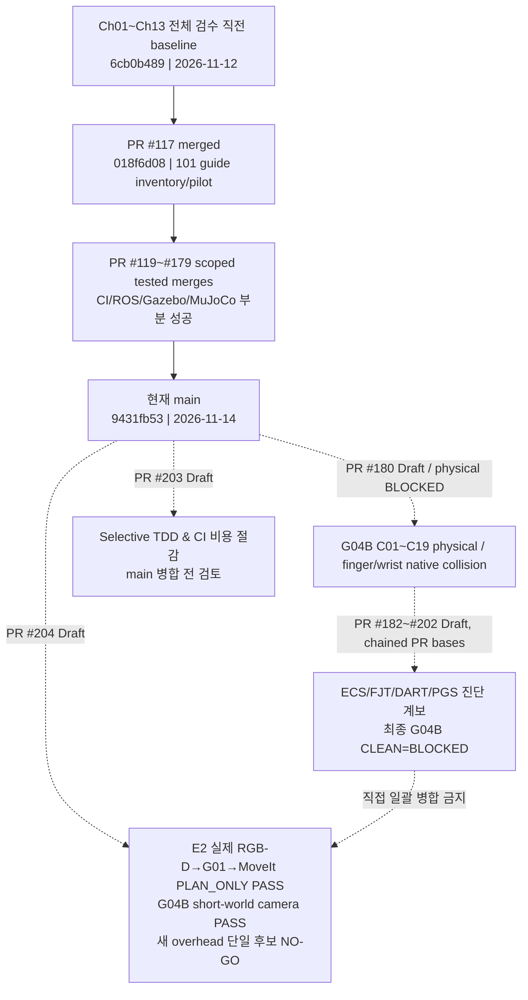

# Physical AI ROS2 — 검수 이전 Baseline→현재 HEAD 전수 브랜치 계보·정리·의사결정 보고 (2026-11-17)

> **원격 소스**: `silverbjin/Pysical_AI_ROS2`. 기준 main `9431fb535ce7a51416c19c4395fb2ba3fabdad40`. GitHub REST `git/refs/heads` 197개와 PR 1~204 중 실제 190개(166 merged / 24 open) 전수 대조. **이 보고서는 새 기능 인수나 ROS/Gazebo 실행 보고가 아님**.
>
> **기계판독 전수표**: [BOOK_BRANCH_LINEAGE_INVENTORY_20261117.json](BOOK_BRANCH_LINEAGE_INVENTORY_20261117.json). *모든* 당시 원격 브랜치의 HEAD SHA, 연결 merged/open PR, 남은 PR base 의존성, 88개 이력 모호 브랜치의 현재 main 앞·뒤 커밋/변경 파일 예시, 삭제 후보 또는 보존 판정을 기록한다.

## 1. 검수 전 Baseline 구분 (혼동 금지)

- **원격 저장소 최초 도입 이력**: 2026-10-16 당시 최초 `92fa2fea6b61`. **로컬 별도 first commit `51c4c0e1`과 ancestor 관계가 확인되지 않았으므로 단일 계보로 그리지 않음**. 이 과거 값은 초기 도서 코드 집계 이력이지 2026-11 Ch01~Ch13 검수 시작 지점이 아님.
- **Ch13 통합 선행 단계**: [PR #112](https://github.com/silverbjin/Pysical_AI_ROS2/pull/112) `feat/ch13-section-13-4-completion` 병합, 13.5~13.8의 복합 작업들이 이후 main에 각기 들어왔다.
- **이번 전체 검수 시작 직전의 정확한 원격 baseline**: `6cb0b489c1142f23868be9184e6bb63cc9c58f52`. 이는 2026-11-12 UTC 04:00:08의 [PR #117](https://github.com/silverbjin/Pysical_AI_ROS2/pull/117) 병합 commit `018f6d0868cc6240173bda6fcc028ef3b088c2b6`의 **첫째/유일 부모**로 GitHub 직접 검증. 동일 SHA에 지금도 **`feat/ch13-section-13-8` 원격 브랜치**가 있어 historical baseline 참조로 **보존**한다.
- **전체 검수 인수 이력**: #117 최초 101 실습 가이드 Inventory 및 Ch02/Ch12 파일럿 → #118 총괄 OPEN → #119~#179 등 특정 새 경계의 GREEN만 범위 한정 main으로 병합 → 2026-11-14 `main=9431fb535ce7a51416c19c4395fb2ba3fabdad40`.
- **미병합 이후 개발**: Draft [PR #180](https://github.com/silverbjin/Pysical_AI_ROS2/pull/180) 기점의 G04B native 물리 집기 실험 분기, #182~#202 진단 계열, [PR #203](https://github.com/silverbjin/Pysical_AI_ROS2/pull/203) 경량 CI 개발방법론, [PR #204](https://github.com/silverbjin/Pysical_AI_ROS2/pull/204) 실제 RGBD→MoveIt plan_only, 모든 PR 지금 **미병합**.

## 2. 모든 원격 브랜치 구조 — 197개 스냅샷

| 분류 | 수 | 정확한 GitHub 검증 | 조치 |
|---|---:|---|---|
| 본류 | 1 | `main=9431fb...` | 절대 삭제 금지 |
| 미병합/열린 PR의 HEAD | 24 | #180, #182~#204(실제 열린 번호 24개) | 보존, 향후 개발 의사결정 |
| HOLD 및 이전 코드 백업 | 31 | Ch09 hold 8, Ch10 backup 8, Ch11 backup 7, Ch12 hold 8 | **원칙적으로 보존**, 특히 Ch10 #123 HOLD |
| merged PR 당시 SHA와 현재 동일 | 53 | 각 PR `merged_at != null`, merged `base=main`, `PR.head.sha == branch HEAD`, open PR의 head/base 아님 | **엄격 확인 후 삭제 가능** |
| merged PR 당시 SHA는 달라도 현재 main의 엄격 조상 | 1 | `feat/ch13-section-13-5`, merged [PR #113](https://github.com/silverbjin/Pysical_AI_ROS2/pull/113), `main...branch ahead=0` | **엄격 확인 후 삭제 가능** |
| merged PR 이후 별도 source 커밋이 존재 | 73 | PR merged지만 현재 SHA 다르고 `main...branch ahead>0`, **실제 후속 커밋의 독립 가치 미확정** | **절대 자동 삭제 금지**; 후속 source diff 검토 대상 |
| merged PR이 연결되지 않은 별도 브랜치 | 14 | old source + baseline + 13.5 reuse branch 등 | 보존, 선별 검토 |

**안전 삭제 후보 정확히 54개**. 나머지 143개는 당시 브랜치가 여전히 갖는 정보/보류 사유가 있어 자동 삭제 금지. 이번 감사 자체용 브랜치 `audit/book-branch-lineage-prune-20261117`은 최초 197개 스냅샷 *이후* 생성되므로 이후 총계는 +1이 될 수 있다.

**삭제 정책**: GitHub REST의 `merged_at`만으로 끝내지 않고, PR base=main·branch HEAD가 스냅샷 SHA와 불변·현재 열린 PR head/base 참조 없음·원격 DELETE 후 GET 404를 모두 검사한다. 단, GitHub에서 PR을 **Squash Merge**하면 source commit은 main의 조상이 아니어도 정상 병합이다. 반대로 헤드가 나중에 움직인 73개는 중복 병합됐다고 단정하지 않는다. 자동화가 권한/보호 정책으로 실행 불가라면 **삭제 성공 주장 금지**.

## 3. 남을 개발 계열의 실제 역할 (24 열린 PR)

### A. 목표 기능·설계 기준 (두 개의 독립 개발계열)

| PR / branch | 현재까지 입증된 일 | 중단 이유 / 진짜 검수 경계 | 다음 의사결정 |
|---|---|---|---|
| [#203](https://github.com/silverbjin/Pysical_AI_ROS2/pull/203) `process/book-review-selective-tdd-ci-20261115` | 반복 ROS/Gazebo 인수 절감, 아키텍처 우선 선택적 TDD 지침과 CI 구조 | Draft/미병합, main 최신 교육 정책 적용 미승인 | **우선 채택 검토**: 공통 개발·검증 문서/필요한 workflow만 독립 병합 |
| [#204](https://github.com/silverbjin/Pysical_AI_ROS2/pull/204) `plan/ch07-77-rgbd-moveit-physical-e2e-20261117` | 실제 G04A 240mm RGB-D→G01→MoveIt 3 계획 [#43914056590](https://github.com/silverbjin/Pysical_AI_ROS2/actions/runs/43914056590) SCOPED PASS; G04B 80mm 물리 fixture 실제 RGBD/G01 [#43984345894](https://github.com/silverbjin/Pysical_AI_ROS2/actions/runs/43984345894) SCOPED PASS; Overhead 단일 기구 후보 [#43993232265](https://github.com/silverbjin/Pysical_AI_ROS2/actions/runs/43993232265) pre-FCL hard REJECT | 물리 구동/forbidden native contact=0 미인수, 전체 §7.7 E2E BLOCKED. E2 motor Goals 0 | **선별 병합 후보**: 교육용 E2 plan-only·정확한 가이드·L0; G04B 실제 물리 PASS로 승격·진단 코드를 main으로 일괄 이동 금지 |

### B. Ch07 G04B 장기 실패 진단 체인 (22개 열린 PR)

| PR 범위 / 대표 브랜치 | 진단/기능 역할 | 현재 왜 중단됐나 | 다음 개발 |
|---|---|---|---|
| [#180](https://github.com/silverbjin/Pysical_AI_ROS2/pull/180) `test/ch07-173-g04b-physical-rod-20261114` | 실제 원통/그리퍼 물리 집기의 최초 기준 실험 | finger2 실제 관절 피드백 오류, 로봇·지지대 간섭; 전체 실패 | 실패 원본 보존, 병합 금지 |
| [#182](https://github.com/silverbjin/Pysical_AI_ROS2/pull/182), [#184](https://github.com/silverbjin/Pysical_AI_ROS2/pull/184), [#186~#188](https://github.com/silverbjin/Pysical_AI_ROS2/pulls?q=is%3Apr+is%3Aopen+ch07-181) | 자유공간 손가락 냉간시작, hardware→controller→Gazebo ECS command/feedback 계측 | isolated 성공 ≠ 같은 월드 물리 집기/놓기 성공 | **고장사례 보고서 재사용만**, 새 반복 시험 없음 |
| [#183](https://github.com/silverbjin/Pysical_AI_ROS2/pull/183), [#185](https://github.com/silverbjin/Pysical_AI_ROS2/pull/185), [#189~#193](https://github.com/silverbjin/Pysical_AI_ROS2/pulls?q=is%3Apr+is%3Aopen+ch07-181) | 물리 지지대·direct FJT·2mm finger release·FK·운반·Bin 배치 | 일부 native lift/hold/place 기록이 있어도 wrist↔rod **금지 접촉 C17 648건**, C18 620건, C19 535건. 최종 CLEAN=FAIL | 속도 sweep·추가 파지 후보 확장하지 않음 |
| [#194~#202](https://github.com/silverbjin/Pysical_AI_ROS2/pull/202) | native ECS Contact/WorldPose/rods/PGS/FCL 원인계측; #202 test-only anchored base | 다양한 solver/후퇴 조건에도 **zero forbidden native contact**를 입증 못함. #202 진단 변경 파일이 많고 PR base 자체가 이전 미병합 진단 브랜치 | #202 등은 **교육용 포렌식 원본**으로 Freeze; 필요 함수만 범위 분리 후 재사용 |

**중요:** 22개 PR들은 base가 서로 다른 진단 브랜치에 걸쳐 있다. 예를 들어 `#180 main→#183→#189→#190→#191→#192→#193→#194→#195→#200→#201→#202`라는 의존 체인과 `#195→#197→#199/#198` 분기가 있다. **#202 하나를 main에 병합하면 이 미병합 전단계를 전부 합치는 위험**이 있다. Ch07 안전 게이트를 감소시키지 않고 **Read-only 기록으로 보존**한다.

### C. 73개의 old merged-but-modified 브랜치 / 추가 14개의 no-PR

- **73개**는 Ch01/03/04/06/07의 과거 feat 브랜치(총 36개), Ch05/08/10/11/12의 과거 docs 브랜치(37개). 일반적인 기능 개발 main과 변경 파일의 diff가 이미 덮였을 가능성도 있지만 **커밋 그래프만으로 content 동일성을 증명할 수 없으므로 현재는 모두 보존**. 이후 요구가 있을 때 **한 장/한 파일씩** raw diff를 review한 뒤 cherry-pick 또는 포기; 전량 자동 병합 금지.
- **14개 PR 미연결**: `fix/ch01-static-review-validated`, `fix/ch02-section-2-{1..8}-static`, `fix/ch09-post-review-code-20261021`, `docs/ch12-review-context`, `feat/ch12-section-12-6`, `feat/ch13-section-13-5-reuse-r2-20261102`, `feat/ch13-section-13-8`. 그중 후자의 두 Ch13 HEAD는 현재 main의 조상이지만, 역사적 stage/Baseline 용도로 보존. 나머지는 별도 source 커밋이 있어 임의 삭제 금지.
- **31 HOLD/backup**: Ch09 8개, Ch10 8개, Ch11 7개, Ch12 8개. Ch10 #123 원래 IK/URDF 0.20m vs 0.25m 결함 및 사용자 HOLD. 이 브랜치를 main으로 자동 병합하거나 코드 변경하지 않음.

## 4. 출판/개발 결정을 위한 남은 작업 우선순위

1. **P0 — 브랜치 위생**: verified 54개만 실제 원격 삭제→404 재조회→원본 197개·삭제 54개·남은 143개(+감사 브랜치 1개) 숫자/이름/PR 보존. 삭제에 실패하면 그 목록/사유를 RAW 기록.
2. **P1 — 전체 도서 101 가이드/98절**: 현재 [Issue #118](https://github.com/silverbjin/Pysical_AI_ROS2/issues/118) **OPEN**; [main 증거 등록기](book_acceptance_evidence.json) 53 SCOPED_PASS, 35 EVIDENCE_REVIEW_REQUIRED, Ch07 1 BLOCKED, Ch08 1 FAIL, Ch10 8 HOLD. 과거 성공시험 재실행 없이 35개 source/Artifact 링크부터 대조, 7개 CI 링크 없는 scoped entries는 historical/native 증거로만 명시.
3. **P1 — Ch07 §7.7**: #204의 E2 `plan_only` 성공을 학습 실습으로 선별 병합할지 결정. **G04B native physical CLEAN=BLOCKED**를 반드시 별도 명시. main LAB_7_7_GUIDE_KO에는 이미 수정된 G01 `mission_controller` 실행기와 `target_3d_base` 구독을 여전히 '미구현'이라 안내하는 **현행 문서 오류**; PR #204 교육 정정을 우선 선별 병합.
4. **P2 — Ch08 §8.7**: 실제 원본 PPO 성공률 0/10 PERFORMANCE_FAIL을 평가·디버깅 실습으로 출판 또는 별도 재학습 프로젝트로 구분. Ch09 #171 실제 동적 미끄럼은 현 교재 범위 확대 여부에 따라 명시적 NOT_RUN; Ch11 #130 원본 SaveMap 서비스 FAIL vs Nav2 공식 map_saver_cli PASS; Ch12 장기 보행 성능/Ch13 최신 main+94 assets Owner WSL2 인수는 각각 별도 범위.
5. **P0 보호 정책**: Ch10 #123 HOLD는 그대로. 사용자 허가 없이 Ch10 보행 수정/정식 인수, 실패한 G04B 물리 기능의 일괄 병합, 원본 금지 충돌 임계치 완화, 5DOF 새 범용 grasp solver 도입 금지.

## 5. 삭제 및 검증 도구

- `ci/book_branch_prune_verified_once.py`: 표준 Python, `--mode plan`은 네트워크/삭제 없음. `--mode apply`는 GitHub Actions **same-repo** `pull_request.labeled`의 특정 label/감사 브랜치 조건에서만, 현재 main 및 각 PR merged 상태 재검증 뒤 삭제; 로컬 개발자가 실수로 호출해도 GitHub 이벤트 없이 apply 불가.
- `.github/workflows/book-branch-prune-merged-once.yml`: `contents: write` 작업 격리, 원본 branch HEAD re-check, 열린 PR base/head 보호, 삭제 이후 GET HTTP 404, 결과 Artifact 90일 보존.
- 검사 결과를 얻기 전에는 `DELETED`라고 쓰지 않는다. 임시 감사 workflow는 main에 포함하지 않으며, 다음 단계에서 감사 PR 기록을 어떻게 보존할지 결정한다.
